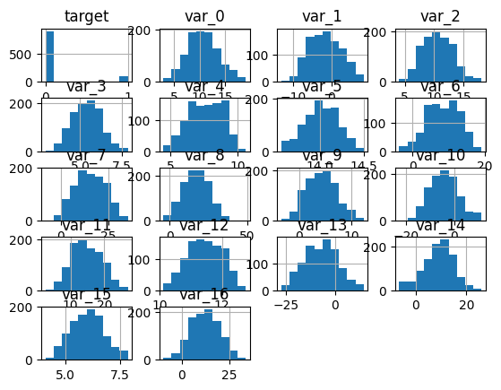
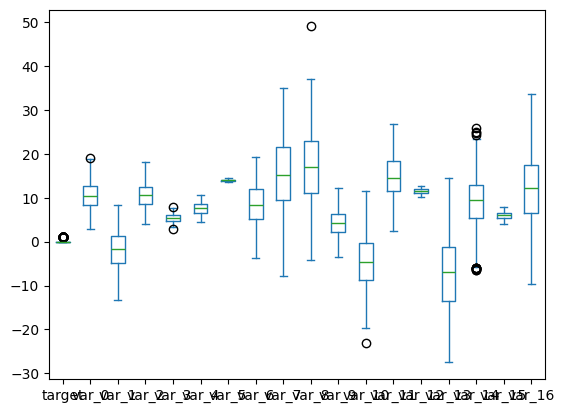
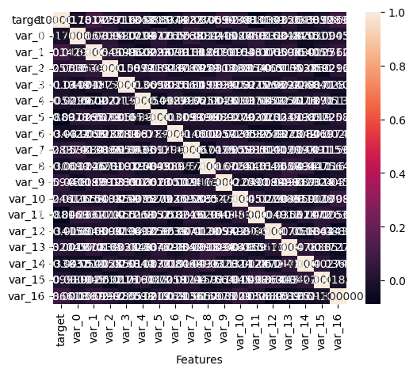
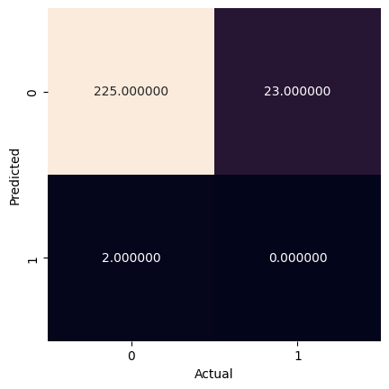
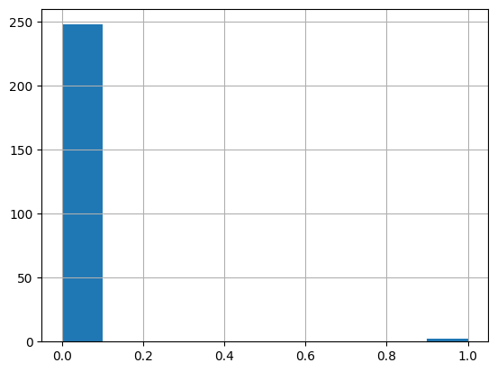

<a href="https://colab.research.google.com/github/efitznm/Data-Science-Portfolio-C22/blob/main/Modules/Module_1_Intro_to_DS_and_Naive_Bayes/Projects/Instructions/Project.1-Transactions/Project.1-Pass-02.ipynb" target="_parent"></a>

# Project.1_Pass-02, Transaction Data


## Problem Definition


State the business problem. Translate the business problem into a Data Science problem by stating what kind of problem it is ( supervised vs unsupervised ) and whether it is a classification, regression, or clustering problem.

### Business Problem
We want to predict whether or not a future customer will make a transaction based on their transaction data. The goal might be to increase customer transactions by sending targeted ads/deals to customers who are not likely to make a transaction on a given day.

### Data Science Problem
Supervised binary classification problem.

## Data Collection/Sources


### Load Pandas, Numpy, and Matplotlib modules


```python
# Load Pandas, Numpy, and Matplotlib modules
import pandas as pd
import numpy as np
import matplotlib.pyplot as plt
import seaborn as sns

from sklearn import datasets, metrics, model_selection
from sklearn import model_selection
from sklearn.naive_bayes import GaussianNB
from sklearn.model_selection import train_test_split
```

### Load data Train.csv from AWS S3[link text](https://)


```python
# Load data Train.csv from AWS S3
url = 'https://ddc-datascience.s3.amazonaws.com/Projects/Project.1-Transactions/Data/Transaction.train.csv'
url

df = pd.read_csv(
    url,
    usecols=range(20),
    nrows=1_000,
)

df
```


  <div id="df-4b5e1549-3548-403c-a232-0f94f7eef797" class="colab-df-container">
    <div>
<style scoped>
    .dataframe tbody tr th:only-of-type {
        vertical-align: middle;
    }

    .dataframe tbody tr th {
        vertical-align: top;
    }

    .dataframe thead th {
        text-align: right;
    }
</style>
<table border="1" class="dataframe">
  <thead>
    <tr style="text-align: right;">
      <th></th>
      <th>Unnamed: 0</th>
      <th>ID_code</th>
      <th>target</th>
      <th>var_0</th>
      <th>var_1</th>
      <th>var_2</th>
      <th>var_3</th>
      <th>var_4</th>
      <th>var_5</th>
      <th>var_6</th>
      <th>var_7</th>
      <th>var_8</th>
      <th>var_9</th>
      <th>var_10</th>
      <th>var_11</th>
      <th>var_12</th>
      <th>var_13</th>
      <th>var_14</th>
      <th>var_15</th>
      <th>var_16</th>
    </tr>
  </thead>
  <tbody>
    <tr>
      <th>0</th>
      <td>0</td>
      <td>train_0</td>
      <td>0</td>
      <td>8.9255</td>
      <td>-6.7863</td>
      <td>11.9081</td>
      <td>5.1187</td>
      <td>5.7470</td>
      <td>14.0137</td>
      <td>0.5745</td>
      <td>4.2840</td>
      <td>16.2191</td>
      <td>2.5791</td>
      <td>-5.1488</td>
      <td>16.8911</td>
      <td>11.1920</td>
      <td>-5.2387</td>
      <td>11.6418</td>
      <td>5.1736</td>
      <td>22.4321</td>
    </tr>
    <tr>
      <th>1</th>
      <td>1</td>
      <td>train_1</td>
      <td>0</td>
      <td>11.5006</td>
      <td>-4.1473</td>
      <td>13.8588</td>
      <td>5.6208</td>
      <td>8.0851</td>
      <td>14.0239</td>
      <td>8.4135</td>
      <td>7.8000</td>
      <td>2.7407</td>
      <td>8.5524</td>
      <td>-11.7684</td>
      <td>19.3710</td>
      <td>11.3702</td>
      <td>-11.1147</td>
      <td>1.2444</td>
      <td>6.6885</td>
      <td>7.9344</td>
    </tr>
    <tr>
      <th>2</th>
      <td>2</td>
      <td>train_2</td>
      <td>0</td>
      <td>8.6093</td>
      <td>-2.7457</td>
      <td>12.0805</td>
      <td>6.9427</td>
      <td>5.9525</td>
      <td>14.1929</td>
      <td>7.3124</td>
      <td>4.7011</td>
      <td>18.1377</td>
      <td>1.2145</td>
      <td>-7.9940</td>
      <td>19.0422</td>
      <td>11.0449</td>
      <td>-13.5174</td>
      <td>4.1006</td>
      <td>6.4059</td>
      <td>9.8565</td>
    </tr>
    <tr>
      <th>3</th>
      <td>3</td>
      <td>train_3</td>
      <td>0</td>
      <td>11.0604</td>
      <td>-2.1518</td>
      <td>8.9522</td>
      <td>5.8428</td>
      <td>8.2450</td>
      <td>13.8463</td>
      <td>11.9704</td>
      <td>15.9426</td>
      <td>12.5579</td>
      <td>6.8202</td>
      <td>0.8135</td>
      <td>6.1796</td>
      <td>10.6093</td>
      <td>-3.8294</td>
      <td>8.0485</td>
      <td>5.2091</td>
      <td>23.6143</td>
    </tr>
    <tr>
      <th>4</th>
      <td>4</td>
      <td>train_4</td>
      <td>0</td>
      <td>9.8369</td>
      <td>-1.4834</td>
      <td>12.8746</td>
      <td>5.9405</td>
      <td>7.6784</td>
      <td>13.8481</td>
      <td>7.8895</td>
      <td>6.5263</td>
      <td>18.9608</td>
      <td>10.1102</td>
      <td>3.1736</td>
      <td>19.3239</td>
      <td>12.4057</td>
      <td>-5.5963</td>
      <td>6.9087</td>
      <td>5.7555</td>
      <td>1.6184</td>
    </tr>
    <tr>
      <th>...</th>
      <td>...</td>
      <td>...</td>
      <td>...</td>
      <td>...</td>
      <td>...</td>
      <td>...</td>
      <td>...</td>
      <td>...</td>
      <td>...</td>
      <td>...</td>
      <td>...</td>
      <td>...</td>
      <td>...</td>
      <td>...</td>
      <td>...</td>
      <td>...</td>
      <td>...</td>
      <td>...</td>
      <td>...</td>
      <td>...</td>
    </tr>
    <tr>
      <th>995</th>
      <td>995</td>
      <td>train_995</td>
      <td>0</td>
      <td>10.5429</td>
      <td>-3.1313</td>
      <td>10.3739</td>
      <td>4.3798</td>
      <td>9.0138</td>
      <td>14.2108</td>
      <td>5.6618</td>
      <td>7.6517</td>
      <td>19.3311</td>
      <td>6.2302</td>
      <td>-12.5961</td>
      <td>21.2310</td>
      <td>10.9861</td>
      <td>-23.1897</td>
      <td>1.5943</td>
      <td>5.1007</td>
      <td>-2.5036</td>
    </tr>
    <tr>
      <th>996</th>
      <td>996</td>
      <td>train_996</td>
      <td>0</td>
      <td>12.9541</td>
      <td>-3.5607</td>
      <td>9.7151</td>
      <td>5.3609</td>
      <td>5.4369</td>
      <td>13.7852</td>
      <td>10.7173</td>
      <td>21.3798</td>
      <td>21.1709</td>
      <td>9.5601</td>
      <td>-10.3499</td>
      <td>19.2482</td>
      <td>11.7017</td>
      <td>-13.8955</td>
      <td>9.6203</td>
      <td>5.2604</td>
      <td>11.5526</td>
    </tr>
    <tr>
      <th>997</th>
      <td>997</td>
      <td>train_997</td>
      <td>0</td>
      <td>4.2341</td>
      <td>-8.5367</td>
      <td>12.5934</td>
      <td>5.4229</td>
      <td>7.1058</td>
      <td>14.4427</td>
      <td>2.3831</td>
      <td>17.1287</td>
      <td>13.0236</td>
      <td>7.6927</td>
      <td>-9.0699</td>
      <td>15.5518</td>
      <td>11.9697</td>
      <td>-13.3420</td>
      <td>11.4566</td>
      <td>5.5599</td>
      <td>0.7550</td>
    </tr>
    <tr>
      <th>998</th>
      <td>998</td>
      <td>train_998</td>
      <td>0</td>
      <td>18.5600</td>
      <td>2.3607</td>
      <td>9.7861</td>
      <td>7.4188</td>
      <td>6.3675</td>
      <td>14.3499</td>
      <td>13.4479</td>
      <td>24.5266</td>
      <td>18.8782</td>
      <td>3.8359</td>
      <td>-13.2004</td>
      <td>15.8111</td>
      <td>10.7356</td>
      <td>-12.2080</td>
      <td>13.5891</td>
      <td>6.1986</td>
      <td>10.8496</td>
    </tr>
    <tr>
      <th>999</th>
      <td>999</td>
      <td>train_999</td>
      <td>0</td>
      <td>10.5495</td>
      <td>2.3825</td>
      <td>8.0625</td>
      <td>5.4776</td>
      <td>9.2568</td>
      <td>13.7043</td>
      <td>8.1997</td>
      <td>28.6449</td>
      <td>32.1460</td>
      <td>5.7252</td>
      <td>-10.5380</td>
      <td>16.8766</td>
      <td>11.9905</td>
      <td>-25.7403</td>
      <td>13.1973</td>
      <td>5.7198</td>
      <td>2.8214</td>
    </tr>
  </tbody>
</table>
<p>1000 rows × 20 columns</p>
</div>
    <div class="colab-df-buttons">

  <div class="colab-df-container">
    <button class="colab-df-convert" onclick="convertToInteractive('df-4b5e1549-3548-403c-a232-0f94f7eef797')"
            title="Convert this dataframe to an interactive table."
            style="display:none;">

  <svg xmlns="http://www.w3.org/2000/svg" height="24px" viewBox="0 -960 960 960">
    <path d="M120-120v-720h720v720H120Zm60-500h600v-160H180v160Zm220 220h160v-160H400v160Zm0 220h160v-160H400v160ZM180-400h160v-160H180v160Zm440 0h160v-160H620v160ZM180-180h160v-160H180v160Zm440 0h160v-160H620v160Z"/>
  </svg>
    </button>

  <style>
    .colab-df-container {
      display:flex;
      gap: 12px;
    }

    .colab-df-convert {
      background-color: #E8F0FE;
      border: none;
      border-radius: 50%;
      cursor: pointer;
      display: none;
      fill: #1967D2;
      height: 32px;
      padding: 0 0 0 0;
      width: 32px;
    }

    .colab-df-convert:hover {
      background-color: #E2EBFA;
      box-shadow: 0px 1px 2px rgba(60, 64, 67, 0.3), 0px 1px 3px 1px rgba(60, 64, 67, 0.15);
      fill: #174EA6;
    }

    .colab-df-buttons div {
      margin-bottom: 4px;
    }

    [theme=dark] .colab-df-convert {
      background-color: #3B4455;
      fill: #D2E3FC;
    }

    [theme=dark] .colab-df-convert:hover {
      background-color: #434B5C;
      box-shadow: 0px 1px 3px 1px rgba(0, 0, 0, 0.15);
      filter: drop-shadow(0px 1px 2px rgba(0, 0, 0, 0.3));
      fill: #FFFFFF;
    }
  </style>

    <script>
      const buttonEl =
        document.querySelector('#df-4b5e1549-3548-403c-a232-0f94f7eef797 button.colab-df-convert');
      buttonEl.style.display =
        google.colab.kernel.accessAllowed ? 'block' : 'none';

      async function convertToInteractive(key) {
        const element = document.querySelector('#df-4b5e1549-3548-403c-a232-0f94f7eef797');
        const dataTable =
          await google.colab.kernel.invokeFunction('convertToInteractive',
                                                    [key], {});
        if (!dataTable) return;

        const docLinkHtml = 'Like what you see? Visit the ' +
          '<a target="_blank" href=https://colab.research.google.com/notebooks/data_table.ipynb>data table notebook</a>'
          + ' to learn more about interactive tables.';
        element.innerHTML = '';
        dataTable['output_type'] = 'display_data';
        await google.colab.output.renderOutput(dataTable, element);
        const docLink = document.createElement('div');
        docLink.innerHTML = docLinkHtml;
        element.appendChild(docLink);
      }
    </script>
  </div>


  <div id="id_6cef59f6-4250-4a8f-b789-b5682c26b9be">
    <style>
      .colab-df-generate {
        background-color: #E8F0FE;
        border: none;
        border-radius: 50%;
        cursor: pointer;
        display: none;
        fill: #1967D2;
        height: 32px;
        padding: 0 0 0 0;
        width: 32px;
      }

      .colab-df-generate:hover {
        background-color: #E2EBFA;
        box-shadow: 0px 1px 2px rgba(60, 64, 67, 0.3), 0px 1px 3px 1px rgba(60, 64, 67, 0.15);
        fill: #174EA6;
      }

      [theme=dark] .colab-df-generate {
        background-color: #3B4455;
        fill: #D2E3FC;
      }

      [theme=dark] .colab-df-generate:hover {
        background-color: #434B5C;
        box-shadow: 0px 1px 3px 1px rgba(0, 0, 0, 0.15);
        filter: drop-shadow(0px 1px 2px rgba(0, 0, 0, 0.3));
        fill: #FFFFFF;
      }
    </style>
    <button class="colab-df-generate" onclick="generateWithVariable('df')"
            title="Generate code using this dataframe."
            style="display:none;">

  <svg xmlns="http://www.w3.org/2000/svg" height="24px"viewBox="0 0 24 24"
       width="24px">
    <path d="M7,19H8.4L18.45,9,17,7.55,7,17.6ZM5,21V16.75L18.45,3.32a2,2,0,0,1,2.83,0l1.4,1.43a1.91,1.91,0,0,1,.58,1.4,1.91,1.91,0,0,1-.58,1.4L9.25,21ZM18.45,9,17,7.55Zm-12,3A5.31,5.31,0,0,0,4.9,8.1,5.31,5.31,0,0,0,1,6.5,5.31,5.31,0,0,0,4.9,4.9,5.31,5.31,0,0,0,6.5,1,5.31,5.31,0,0,0,8.1,4.9,5.31,5.31,0,0,0,12,6.5,5.46,5.46,0,0,0,6.5,12Z"/>
  </svg>
    </button>
    <script>
      (() => {
      const buttonEl =
        document.querySelector('#id_6cef59f6-4250-4a8f-b789-b5682c26b9be button.colab-df-generate');
      buttonEl.style.display =
        google.colab.kernel.accessAllowed ? 'block' : 'none';

      buttonEl.onclick = () => {
        google.colab.notebook.generateWithVariable('df');
      }
      })();
    </script>
  </div>

    </div>
  </div>


```python
# Look at the first few rows
df.head()
```


  <div id="df-7bba185b-2036-4aac-baef-d0aea568441f" class="colab-df-container">
    <div>
<style scoped>
    .dataframe tbody tr th:only-of-type {
        vertical-align: middle;
    }

    .dataframe tbody tr th {
        vertical-align: top;
    }

    .dataframe thead th {
        text-align: right;
    }
</style>
<table border="1" class="dataframe">
  <thead>
    <tr style="text-align: right;">
      <th></th>
      <th>Unnamed: 0</th>
      <th>ID_code</th>
      <th>target</th>
      <th>var_0</th>
      <th>var_1</th>
      <th>var_2</th>
      <th>var_3</th>
      <th>var_4</th>
      <th>var_5</th>
      <th>var_6</th>
      <th>var_7</th>
      <th>var_8</th>
      <th>var_9</th>
      <th>var_10</th>
      <th>var_11</th>
      <th>var_12</th>
      <th>var_13</th>
      <th>var_14</th>
      <th>var_15</th>
      <th>var_16</th>
    </tr>
  </thead>
  <tbody>
    <tr>
      <th>0</th>
      <td>0</td>
      <td>train_0</td>
      <td>0</td>
      <td>8.9255</td>
      <td>-6.7863</td>
      <td>11.9081</td>
      <td>5.1187</td>
      <td>5.7470</td>
      <td>14.0137</td>
      <td>0.5745</td>
      <td>4.2840</td>
      <td>16.2191</td>
      <td>2.5791</td>
      <td>-5.1488</td>
      <td>16.8911</td>
      <td>11.1920</td>
      <td>-5.2387</td>
      <td>11.6418</td>
      <td>5.1736</td>
      <td>22.4321</td>
    </tr>
    <tr>
      <th>1</th>
      <td>1</td>
      <td>train_1</td>
      <td>0</td>
      <td>11.5006</td>
      <td>-4.1473</td>
      <td>13.8588</td>
      <td>5.6208</td>
      <td>8.0851</td>
      <td>14.0239</td>
      <td>8.4135</td>
      <td>7.8000</td>
      <td>2.7407</td>
      <td>8.5524</td>
      <td>-11.7684</td>
      <td>19.3710</td>
      <td>11.3702</td>
      <td>-11.1147</td>
      <td>1.2444</td>
      <td>6.6885</td>
      <td>7.9344</td>
    </tr>
    <tr>
      <th>2</th>
      <td>2</td>
      <td>train_2</td>
      <td>0</td>
      <td>8.6093</td>
      <td>-2.7457</td>
      <td>12.0805</td>
      <td>6.9427</td>
      <td>5.9525</td>
      <td>14.1929</td>
      <td>7.3124</td>
      <td>4.7011</td>
      <td>18.1377</td>
      <td>1.2145</td>
      <td>-7.9940</td>
      <td>19.0422</td>
      <td>11.0449</td>
      <td>-13.5174</td>
      <td>4.1006</td>
      <td>6.4059</td>
      <td>9.8565</td>
    </tr>
    <tr>
      <th>3</th>
      <td>3</td>
      <td>train_3</td>
      <td>0</td>
      <td>11.0604</td>
      <td>-2.1518</td>
      <td>8.9522</td>
      <td>5.8428</td>
      <td>8.2450</td>
      <td>13.8463</td>
      <td>11.9704</td>
      <td>15.9426</td>
      <td>12.5579</td>
      <td>6.8202</td>
      <td>0.8135</td>
      <td>6.1796</td>
      <td>10.6093</td>
      <td>-3.8294</td>
      <td>8.0485</td>
      <td>5.2091</td>
      <td>23.6143</td>
    </tr>
    <tr>
      <th>4</th>
      <td>4</td>
      <td>train_4</td>
      <td>0</td>
      <td>9.8369</td>
      <td>-1.4834</td>
      <td>12.8746</td>
      <td>5.9405</td>
      <td>7.6784</td>
      <td>13.8481</td>
      <td>7.8895</td>
      <td>6.5263</td>
      <td>18.9608</td>
      <td>10.1102</td>
      <td>3.1736</td>
      <td>19.3239</td>
      <td>12.4057</td>
      <td>-5.5963</td>
      <td>6.9087</td>
      <td>5.7555</td>
      <td>1.6184</td>
    </tr>
  </tbody>
</table>
</div>
    <div class="colab-df-buttons">

  <div class="colab-df-container">
    <button class="colab-df-convert" onclick="convertToInteractive('df-7bba185b-2036-4aac-baef-d0aea568441f')"
            title="Convert this dataframe to an interactive table."
            style="display:none;">

  <svg xmlns="http://www.w3.org/2000/svg" height="24px" viewBox="0 -960 960 960">
    <path d="M120-120v-720h720v720H120Zm60-500h600v-160H180v160Zm220 220h160v-160H400v160Zm0 220h160v-160H400v160ZM180-400h160v-160H180v160Zm440 0h160v-160H620v160ZM180-180h160v-160H180v160Zm440 0h160v-160H620v160Z"/>
  </svg>
    </button>

  <style>
    .colab-df-container {
      display:flex;
      gap: 12px;
    }

    .colab-df-convert {
      background-color: #E8F0FE;
      border: none;
      border-radius: 50%;
      cursor: pointer;
      display: none;
      fill: #1967D2;
      height: 32px;
      padding: 0 0 0 0;
      width: 32px;
    }

    .colab-df-convert:hover {
      background-color: #E2EBFA;
      box-shadow: 0px 1px 2px rgba(60, 64, 67, 0.3), 0px 1px 3px 1px rgba(60, 64, 67, 0.15);
      fill: #174EA6;
    }

    .colab-df-buttons div {
      margin-bottom: 4px;
    }

    [theme=dark] .colab-df-convert {
      background-color: #3B4455;
      fill: #D2E3FC;
    }

    [theme=dark] .colab-df-convert:hover {
      background-color: #434B5C;
      box-shadow: 0px 1px 3px 1px rgba(0, 0, 0, 0.15);
      filter: drop-shadow(0px 1px 2px rgba(0, 0, 0, 0.3));
      fill: #FFFFFF;
    }
  </style>

    <script>
      const buttonEl =
        document.querySelector('#df-7bba185b-2036-4aac-baef-d0aea568441f button.colab-df-convert');
      buttonEl.style.display =
        google.colab.kernel.accessAllowed ? 'block' : 'none';

      async function convertToInteractive(key) {
        const element = document.querySelector('#df-7bba185b-2036-4aac-baef-d0aea568441f');
        const dataTable =
          await google.colab.kernel.invokeFunction('convertToInteractive',
                                                    [key], {});
        if (!dataTable) return;

        const docLinkHtml = 'Like what you see? Visit the ' +
          '<a target="_blank" href=https://colab.research.google.com/notebooks/data_table.ipynb>data table notebook</a>'
          + ' to learn more about interactive tables.';
        element.innerHTML = '';
        dataTable['output_type'] = 'display_data';
        await google.colab.output.renderOutput(dataTable, element);
        const docLink = document.createElement('div');
        docLink.innerHTML = docLinkHtml;
        element.appendChild(docLink);
      }
    </script>
  </div>


    </div>
  </div>


```python
# Look at the last few rows
df.tail()
```


  <div id="df-d5f9ffdc-0ac8-4dcf-ac7a-4ca1aa99f3ae" class="colab-df-container">
    <div>
<style scoped>
    .dataframe tbody tr th:only-of-type {
        vertical-align: middle;
    }

    .dataframe tbody tr th {
        vertical-align: top;
    }

    .dataframe thead th {
        text-align: right;
    }
</style>
<table border="1" class="dataframe">
  <thead>
    <tr style="text-align: right;">
      <th></th>
      <th>Unnamed: 0</th>
      <th>ID_code</th>
      <th>target</th>
      <th>var_0</th>
      <th>var_1</th>
      <th>var_2</th>
      <th>var_3</th>
      <th>var_4</th>
      <th>var_5</th>
      <th>var_6</th>
      <th>var_7</th>
      <th>var_8</th>
      <th>var_9</th>
      <th>var_10</th>
      <th>var_11</th>
      <th>var_12</th>
      <th>var_13</th>
      <th>var_14</th>
      <th>var_15</th>
      <th>var_16</th>
    </tr>
  </thead>
  <tbody>
    <tr>
      <th>995</th>
      <td>995</td>
      <td>train_995</td>
      <td>0</td>
      <td>10.5429</td>
      <td>-3.1313</td>
      <td>10.3739</td>
      <td>4.3798</td>
      <td>9.0138</td>
      <td>14.2108</td>
      <td>5.6618</td>
      <td>7.6517</td>
      <td>19.3311</td>
      <td>6.2302</td>
      <td>-12.5961</td>
      <td>21.2310</td>
      <td>10.9861</td>
      <td>-23.1897</td>
      <td>1.5943</td>
      <td>5.1007</td>
      <td>-2.5036</td>
    </tr>
    <tr>
      <th>996</th>
      <td>996</td>
      <td>train_996</td>
      <td>0</td>
      <td>12.9541</td>
      <td>-3.5607</td>
      <td>9.7151</td>
      <td>5.3609</td>
      <td>5.4369</td>
      <td>13.7852</td>
      <td>10.7173</td>
      <td>21.3798</td>
      <td>21.1709</td>
      <td>9.5601</td>
      <td>-10.3499</td>
      <td>19.2482</td>
      <td>11.7017</td>
      <td>-13.8955</td>
      <td>9.6203</td>
      <td>5.2604</td>
      <td>11.5526</td>
    </tr>
    <tr>
      <th>997</th>
      <td>997</td>
      <td>train_997</td>
      <td>0</td>
      <td>4.2341</td>
      <td>-8.5367</td>
      <td>12.5934</td>
      <td>5.4229</td>
      <td>7.1058</td>
      <td>14.4427</td>
      <td>2.3831</td>
      <td>17.1287</td>
      <td>13.0236</td>
      <td>7.6927</td>
      <td>-9.0699</td>
      <td>15.5518</td>
      <td>11.9697</td>
      <td>-13.3420</td>
      <td>11.4566</td>
      <td>5.5599</td>
      <td>0.7550</td>
    </tr>
    <tr>
      <th>998</th>
      <td>998</td>
      <td>train_998</td>
      <td>0</td>
      <td>18.5600</td>
      <td>2.3607</td>
      <td>9.7861</td>
      <td>7.4188</td>
      <td>6.3675</td>
      <td>14.3499</td>
      <td>13.4479</td>
      <td>24.5266</td>
      <td>18.8782</td>
      <td>3.8359</td>
      <td>-13.2004</td>
      <td>15.8111</td>
      <td>10.7356</td>
      <td>-12.2080</td>
      <td>13.5891</td>
      <td>6.1986</td>
      <td>10.8496</td>
    </tr>
    <tr>
      <th>999</th>
      <td>999</td>
      <td>train_999</td>
      <td>0</td>
      <td>10.5495</td>
      <td>2.3825</td>
      <td>8.0625</td>
      <td>5.4776</td>
      <td>9.2568</td>
      <td>13.7043</td>
      <td>8.1997</td>
      <td>28.6449</td>
      <td>32.1460</td>
      <td>5.7252</td>
      <td>-10.5380</td>
      <td>16.8766</td>
      <td>11.9905</td>
      <td>-25.7403</td>
      <td>13.1973</td>
      <td>5.7198</td>
      <td>2.8214</td>
    </tr>
  </tbody>
</table>
</div>
    <div class="colab-df-buttons">

  <div class="colab-df-container">
    <button class="colab-df-convert" onclick="convertToInteractive('df-d5f9ffdc-0ac8-4dcf-ac7a-4ca1aa99f3ae')"
            title="Convert this dataframe to an interactive table."
            style="display:none;">

  <svg xmlns="http://www.w3.org/2000/svg" height="24px" viewBox="0 -960 960 960">
    <path d="M120-120v-720h720v720H120Zm60-500h600v-160H180v160Zm220 220h160v-160H400v160Zm0 220h160v-160H400v160ZM180-400h160v-160H180v160Zm440 0h160v-160H620v160ZM180-180h160v-160H180v160Zm440 0h160v-160H620v160Z"/>
  </svg>
    </button>

  <style>
    .colab-df-container {
      display:flex;
      gap: 12px;
    }

    .colab-df-convert {
      background-color: #E8F0FE;
      border: none;
      border-radius: 50%;
      cursor: pointer;
      display: none;
      fill: #1967D2;
      height: 32px;
      padding: 0 0 0 0;
      width: 32px;
    }

    .colab-df-convert:hover {
      background-color: #E2EBFA;
      box-shadow: 0px 1px 2px rgba(60, 64, 67, 0.3), 0px 1px 3px 1px rgba(60, 64, 67, 0.15);
      fill: #174EA6;
    }

    .colab-df-buttons div {
      margin-bottom: 4px;
    }

    [theme=dark] .colab-df-convert {
      background-color: #3B4455;
      fill: #D2E3FC;
    }

    [theme=dark] .colab-df-convert:hover {
      background-color: #434B5C;
      box-shadow: 0px 1px 3px 1px rgba(0, 0, 0, 0.15);
      filter: drop-shadow(0px 1px 2px rgba(0, 0, 0, 0.3));
      fill: #FFFFFF;
    }
  </style>

    <script>
      const buttonEl =
        document.querySelector('#df-d5f9ffdc-0ac8-4dcf-ac7a-4ca1aa99f3ae button.colab-df-convert');
      buttonEl.style.display =
        google.colab.kernel.accessAllowed ? 'block' : 'none';

      async function convertToInteractive(key) {
        const element = document.querySelector('#df-d5f9ffdc-0ac8-4dcf-ac7a-4ca1aa99f3ae');
        const dataTable =
          await google.colab.kernel.invokeFunction('convertToInteractive',
                                                    [key], {});
        if (!dataTable) return;

        const docLinkHtml = 'Like what you see? Visit the ' +
          '<a target="_blank" href=https://colab.research.google.com/notebooks/data_table.ipynb>data table notebook</a>'
          + ' to learn more about interactive tables.';
        element.innerHTML = '';
        dataTable['output_type'] = 'display_data';
        await google.colab.output.renderOutput(dataTable, element);
        const docLink = document.createElement('div');
        docLink.innerHTML = docLinkHtml;
        element.appendChild(docLink);
      }
    </script>
  </div>


    </div>
  </div>


```python
# Shape of the dataframe
df.shape
```


    (1000, 20)


```python
# Size of the dataframe
df.size
```


    20000


### Summary Meta-Data


```python
# Display meta-data
df.info()
```

    <class 'pandas.core.frame.DataFrame'>
    RangeIndex: 1000 entries, 0 to 999
    Data columns (total 20 columns):
     #   Column      Non-Null Count  Dtype  
    ---  ------      --------------  -----  
     0   Unnamed: 0  1000 non-null   int64  
     1   ID_code     1000 non-null   object 
     2   target      1000 non-null   int64  
     3   var_0       1000 non-null   float64
     4   var_1       1000 non-null   float64
     5   var_2       1000 non-null   float64
     6   var_3       1000 non-null   float64
     7   var_4       1000 non-null   float64
     8   var_5       1000 non-null   float64
     9   var_6       1000 non-null   float64
     10  var_7       1000 non-null   float64
     11  var_8       1000 non-null   float64
     12  var_9       1000 non-null   float64
     13  var_10      1000 non-null   float64
     14  var_11      1000 non-null   float64
     15  var_12      1000 non-null   float64
     16  var_13      1000 non-null   float64
     17  var_14      1000 non-null   float64
     18  var_15      1000 non-null   float64
     19  var_16      1000 non-null   float64
    dtypes: float64(17), int64(2), object(1)
    memory usage: 156.4+ KB


### Summary Statistics


```python
# Display summary statistics
df.describe()
```


  <div id="df-1636c722-a293-4e60-ab10-54c14d1b9646" class="colab-df-container">
    <div>
<style scoped>
    .dataframe tbody tr th:only-of-type {
        vertical-align: middle;
    }

    .dataframe tbody tr th {
        vertical-align: top;
    }

    .dataframe thead th {
        text-align: right;
    }
</style>
<table border="1" class="dataframe">
  <thead>
    <tr style="text-align: right;">
      <th></th>
      <th>Unnamed: 0</th>
      <th>target</th>
      <th>var_0</th>
      <th>var_1</th>
      <th>var_2</th>
      <th>var_3</th>
      <th>var_4</th>
      <th>var_5</th>
      <th>var_6</th>
      <th>var_7</th>
      <th>var_8</th>
      <th>var_9</th>
      <th>var_10</th>
      <th>var_11</th>
      <th>var_12</th>
      <th>var_13</th>
      <th>var_14</th>
      <th>var_15</th>
      <th>var_16</th>
    </tr>
  </thead>
  <tbody>
    <tr>
      <th>count</th>
      <td>1000.000000</td>
      <td>1000.000000</td>
      <td>1000.000000</td>
      <td>1000.000000</td>
      <td>1000.000000</td>
      <td>1000.000000</td>
      <td>1000.000000</td>
      <td>1000.000000</td>
      <td>1000.000000</td>
      <td>1000.000000</td>
      <td>1000.000000</td>
      <td>1000.000000</td>
      <td>1000.000000</td>
      <td>1000.000000</td>
      <td>1000.000000</td>
      <td>1000.000000</td>
      <td>1000.000000</td>
      <td>1000.000000</td>
      <td>1000.000000</td>
    </tr>
    <tr>
      <th>mean</th>
      <td>499.500000</td>
      <td>0.097000</td>
      <td>10.647679</td>
      <td>-1.648351</td>
      <td>10.614775</td>
      <td>5.403146</td>
      <td>7.594834</td>
      <td>14.016787</td>
      <td>8.452692</td>
      <td>15.401296</td>
      <td>16.980541</td>
      <td>4.309364</td>
      <td>-4.277935</td>
      <td>14.884472</td>
      <td>11.447819</td>
      <td>-7.126485</td>
      <td>9.040722</td>
      <td>6.002673</td>
      <td>12.228451</td>
    </tr>
    <tr>
      <th>std</th>
      <td>288.819436</td>
      <td>0.296106</td>
      <td>3.046156</td>
      <td>4.133810</td>
      <td>2.548399</td>
      <td>0.852977</td>
      <td>1.239705</td>
      <td>0.193809</td>
      <td>4.511940</td>
      <td>7.927170</td>
      <td>8.176076</td>
      <td>2.856678</td>
      <td>6.049009</td>
      <td>4.423330</td>
      <td>0.549439</td>
      <td>8.493894</td>
      <td>5.845390</td>
      <td>0.757023</td>
      <td>7.561044</td>
    </tr>
    <tr>
      <th>min</th>
      <td>0.000000</td>
      <td>0.000000</td>
      <td>2.825300</td>
      <td>-13.202600</td>
      <td>4.027300</td>
      <td>2.897800</td>
      <td>4.469300</td>
      <td>13.553700</td>
      <td>-3.681900</td>
      <td>-7.903300</td>
      <td>-4.086700</td>
      <td>-3.420500</td>
      <td>-23.001300</td>
      <td>2.535400</td>
      <td>10.118600</td>
      <td>-27.533500</td>
      <td>-6.409200</td>
      <td>4.074600</td>
      <td>-9.602000</td>
    </tr>
    <tr>
      <th>25%</th>
      <td>249.750000</td>
      <td>0.000000</td>
      <td>8.418225</td>
      <td>-4.858000</td>
      <td>8.619500</td>
      <td>4.787975</td>
      <td>6.632325</td>
      <td>13.882175</td>
      <td>5.154925</td>
      <td>9.544700</td>
      <td>11.173075</td>
      <td>2.199350</td>
      <td>-8.666150</td>
      <td>11.585500</td>
      <td>11.031225</td>
      <td>-13.518725</td>
      <td>5.429900</td>
      <td>5.412125</td>
      <td>6.542725</td>
    </tr>
    <tr>
      <th>50%</th>
      <td>499.500000</td>
      <td>0.000000</td>
      <td>10.460250</td>
      <td>-1.760000</td>
      <td>10.560900</td>
      <td>5.412450</td>
      <td>7.648150</td>
      <td>14.020850</td>
      <td>8.449650</td>
      <td>15.089200</td>
      <td>17.064400</td>
      <td>4.242050</td>
      <td>-4.546300</td>
      <td>14.536600</td>
      <td>11.444350</td>
      <td>-6.848250</td>
      <td>9.515450</td>
      <td>6.034850</td>
      <td>12.285650</td>
    </tr>
    <tr>
      <th>75%</th>
      <td>749.250000</td>
      <td>0.000000</td>
      <td>12.656275</td>
      <td>1.394700</td>
      <td>12.455325</td>
      <td>5.987425</td>
      <td>8.641275</td>
      <td>14.154650</td>
      <td>11.983350</td>
      <td>21.644800</td>
      <td>23.001475</td>
      <td>6.270100</td>
      <td>-0.250150</td>
      <td>18.375850</td>
      <td>11.902675</td>
      <td>-1.114775</td>
      <td>12.996675</td>
      <td>6.513875</td>
      <td>17.510250</td>
    </tr>
    <tr>
      <th>max</th>
      <td>999.000000</td>
      <td>1.000000</td>
      <td>19.122300</td>
      <td>8.416000</td>
      <td>18.108400</td>
      <td>7.875500</td>
      <td>10.598200</td>
      <td>14.501000</td>
      <td>19.183400</td>
      <td>35.052600</td>
      <td>49.044300</td>
      <td>12.285300</td>
      <td>11.465400</td>
      <td>26.928200</td>
      <td>12.762200</td>
      <td>14.544700</td>
      <td>25.969800</td>
      <td>7.846700</td>
      <td>33.624800</td>
    </tr>
  </tbody>
</table>
</div>
    <div class="colab-df-buttons">

  <div class="colab-df-container">
    <button class="colab-df-convert" onclick="convertToInteractive('df-1636c722-a293-4e60-ab10-54c14d1b9646')"
            title="Convert this dataframe to an interactive table."
            style="display:none;">

  <svg xmlns="http://www.w3.org/2000/svg" height="24px" viewBox="0 -960 960 960">
    <path d="M120-120v-720h720v720H120Zm60-500h600v-160H180v160Zm220 220h160v-160H400v160Zm0 220h160v-160H400v160ZM180-400h160v-160H180v160Zm440 0h160v-160H620v160ZM180-180h160v-160H180v160Zm440 0h160v-160H620v160Z"/>
  </svg>
    </button>

  <style>
    .colab-df-container {
      display:flex;
      gap: 12px;
    }

    .colab-df-convert {
      background-color: #E8F0FE;
      border: none;
      border-radius: 50%;
      cursor: pointer;
      display: none;
      fill: #1967D2;
      height: 32px;
      padding: 0 0 0 0;
      width: 32px;
    }

    .colab-df-convert:hover {
      background-color: #E2EBFA;
      box-shadow: 0px 1px 2px rgba(60, 64, 67, 0.3), 0px 1px 3px 1px rgba(60, 64, 67, 0.15);
      fill: #174EA6;
    }

    .colab-df-buttons div {
      margin-bottom: 4px;
    }

    [theme=dark] .colab-df-convert {
      background-color: #3B4455;
      fill: #D2E3FC;
    }

    [theme=dark] .colab-df-convert:hover {
      background-color: #434B5C;
      box-shadow: 0px 1px 3px 1px rgba(0, 0, 0, 0.15);
      filter: drop-shadow(0px 1px 2px rgba(0, 0, 0, 0.3));
      fill: #FFFFFF;
    }
  </style>

    <script>
      const buttonEl =
        document.querySelector('#df-1636c722-a293-4e60-ab10-54c14d1b9646 button.colab-df-convert');
      buttonEl.style.display =
        google.colab.kernel.accessAllowed ? 'block' : 'none';

      async function convertToInteractive(key) {
        const element = document.querySelector('#df-1636c722-a293-4e60-ab10-54c14d1b9646');
        const dataTable =
          await google.colab.kernel.invokeFunction('convertToInteractive',
                                                    [key], {});
        if (!dataTable) return;

        const docLinkHtml = 'Like what you see? Visit the ' +
          '<a target="_blank" href=https://colab.research.google.com/notebooks/data_table.ipynb>data table notebook</a>'
          + ' to learn more about interactive tables.';
        element.innerHTML = '';
        dataTable['output_type'] = 'display_data';
        await google.colab.output.renderOutput(dataTable, element);
        const docLink = document.createElement('div');
        docLink.innerHTML = docLinkHtml;
        element.appendChild(docLink);
      }
    </script>
  </div>


    </div>
  </div>


### NOTE: the ‘target’ column indicates a successful transaction (‘1’) or a no-transaction (‘0’). Verify these are the only values in that column, and that there are no nulls.

### Target Value Counts

Binary numerical classification and no nulls.


```python
# Value_counts on target ; include nulls
df['target'].value_counts(dropna=False)
```


<div>
<style scoped>
    .dataframe tbody tr th:only-of-type {
        vertical-align: middle;
    }

    .dataframe tbody tr th {
        vertical-align: top;
    }

    .dataframe thead th {
        text-align: right;
    }
</style>
<table border="1" class="dataframe">
  <thead>
    <tr style="text-align: right;">
      <th></th>
      <th>count</th>
    </tr>
    <tr>
      <th>target</th>
      <th></th>
    </tr>
  </thead>
  <tbody>
    <tr>
      <th>0</th>
      <td>903</td>
    </tr>
    <tr>
      <th>1</th>
      <td>97</td>
    </tr>
  </tbody>
</table>
</div><br><label><b>dtype:</b> int64</label>


### Normalize The Data


```python
# Normalized value_counts on target ; include nulls
df['target'].value_counts(dropna=False, normalize=True)
```


<div>
<style scoped>
    .dataframe tbody tr th:only-of-type {
        vertical-align: middle;
    }

    .dataframe tbody tr th {
        vertical-align: top;
    }

    .dataframe thead th {
        text-align: right;
    }
</style>
<table border="1" class="dataframe">
  <thead>
    <tr style="text-align: right;">
      <th></th>
      <th>proportion</th>
    </tr>
    <tr>
      <th>target</th>
      <th></th>
    </tr>
  </thead>
  <tbody>
    <tr>
      <th>0</th>
      <td>0.903</td>
    </tr>
    <tr>
      <th>1</th>
      <td>0.097</td>
    </tr>
  </tbody>
</table>
</div><br><label><b>dtype:</b> float64</label>


### Nulls
No imputation because no nulls.


```python
# Look for nulls
df.isnull().sum().sort_values(ascending=False)
```


<div>
<style scoped>
    .dataframe tbody tr th:only-of-type {
        vertical-align: middle;
    }

    .dataframe tbody tr th {
        vertical-align: top;
    }

    .dataframe thead th {
        text-align: right;
    }
</style>
<table border="1" class="dataframe">
  <thead>
    <tr style="text-align: right;">
      <th></th>
      <th>0</th>
    </tr>
  </thead>
  <tbody>
    <tr>
      <th>Unnamed: 0</th>
      <td>0</td>
    </tr>
    <tr>
      <th>ID_code</th>
      <td>0</td>
    </tr>
    <tr>
      <th>target</th>
      <td>0</td>
    </tr>
    <tr>
      <th>var_0</th>
      <td>0</td>
    </tr>
    <tr>
      <th>var_1</th>
      <td>0</td>
    </tr>
    <tr>
      <th>var_2</th>
      <td>0</td>
    </tr>
    <tr>
      <th>var_3</th>
      <td>0</td>
    </tr>
    <tr>
      <th>var_4</th>
      <td>0</td>
    </tr>
    <tr>
      <th>var_5</th>
      <td>0</td>
    </tr>
    <tr>
      <th>var_6</th>
      <td>0</td>
    </tr>
    <tr>
      <th>var_7</th>
      <td>0</td>
    </tr>
    <tr>
      <th>var_8</th>
      <td>0</td>
    </tr>
    <tr>
      <th>var_9</th>
      <td>0</td>
    </tr>
    <tr>
      <th>var_10</th>
      <td>0</td>
    </tr>
    <tr>
      <th>var_11</th>
      <td>0</td>
    </tr>
    <tr>
      <th>var_12</th>
      <td>0</td>
    </tr>
    <tr>
      <th>var_13</th>
      <td>0</td>
    </tr>
    <tr>
      <th>var_14</th>
      <td>0</td>
    </tr>
    <tr>
      <th>var_15</th>
      <td>0</td>
    </tr>
    <tr>
      <th>var_16</th>
      <td>0</td>
    </tr>
  </tbody>
</table>
</div><br><label><b>dtype:</b> int64</label>


Column Data Types


```python
# Display data types
df.dtypes
```


<div>
<style scoped>
    .dataframe tbody tr th:only-of-type {
        vertical-align: middle;
    }

    .dataframe tbody tr th {
        vertical-align: top;
    }

    .dataframe thead th {
        text-align: right;
    }
</style>
<table border="1" class="dataframe">
  <thead>
    <tr style="text-align: right;">
      <th></th>
      <th>0</th>
    </tr>
  </thead>
  <tbody>
    <tr>
      <th>Unnamed: 0</th>
      <td>int64</td>
    </tr>
    <tr>
      <th>ID_code</th>
      <td>object</td>
    </tr>
    <tr>
      <th>target</th>
      <td>int64</td>
    </tr>
    <tr>
      <th>var_0</th>
      <td>float64</td>
    </tr>
    <tr>
      <th>var_1</th>
      <td>float64</td>
    </tr>
    <tr>
      <th>var_2</th>
      <td>float64</td>
    </tr>
    <tr>
      <th>var_3</th>
      <td>float64</td>
    </tr>
    <tr>
      <th>var_4</th>
      <td>float64</td>
    </tr>
    <tr>
      <th>var_5</th>
      <td>float64</td>
    </tr>
    <tr>
      <th>var_6</th>
      <td>float64</td>
    </tr>
    <tr>
      <th>var_7</th>
      <td>float64</td>
    </tr>
    <tr>
      <th>var_8</th>
      <td>float64</td>
    </tr>
    <tr>
      <th>var_9</th>
      <td>float64</td>
    </tr>
    <tr>
      <th>var_10</th>
      <td>float64</td>
    </tr>
    <tr>
      <th>var_11</th>
      <td>float64</td>
    </tr>
    <tr>
      <th>var_12</th>
      <td>float64</td>
    </tr>
    <tr>
      <th>var_13</th>
      <td>float64</td>
    </tr>
    <tr>
      <th>var_14</th>
      <td>float64</td>
    </tr>
    <tr>
      <th>var_15</th>
      <td>float64</td>
    </tr>
    <tr>
      <th>var_16</th>
      <td>float64</td>
    </tr>
  </tbody>
</table>
</div><br><label><b>dtype:</b> object</label>


```python
# Number of unique elements in a column
df.nunique().sort_values(ascending=False)
```


<div>
<style scoped>
    .dataframe tbody tr th:only-of-type {
        vertical-align: middle;
    }

    .dataframe tbody tr th {
        vertical-align: top;
    }

    .dataframe thead th {
        text-align: right;
    }
</style>
<table border="1" class="dataframe">
  <thead>
    <tr style="text-align: right;">
      <th></th>
      <th>0</th>
    </tr>
  </thead>
  <tbody>
    <tr>
      <th>Unnamed: 0</th>
      <td>1000</td>
    </tr>
    <tr>
      <th>ID_code</th>
      <td>1000</td>
    </tr>
    <tr>
      <th>var_13</th>
      <td>1000</td>
    </tr>
    <tr>
      <th>var_14</th>
      <td>999</td>
    </tr>
    <tr>
      <th>var_6</th>
      <td>998</td>
    </tr>
    <tr>
      <th>var_8</th>
      <td>998</td>
    </tr>
    <tr>
      <th>var_7</th>
      <td>998</td>
    </tr>
    <tr>
      <th>var_10</th>
      <td>997</td>
    </tr>
    <tr>
      <th>var_16</th>
      <td>997</td>
    </tr>
    <tr>
      <th>var_9</th>
      <td>996</td>
    </tr>
    <tr>
      <th>var_1</th>
      <td>995</td>
    </tr>
    <tr>
      <th>var_2</th>
      <td>995</td>
    </tr>
    <tr>
      <th>var_11</th>
      <td>994</td>
    </tr>
    <tr>
      <th>var_0</th>
      <td>994</td>
    </tr>
    <tr>
      <th>var_15</th>
      <td>989</td>
    </tr>
    <tr>
      <th>var_4</th>
      <td>988</td>
    </tr>
    <tr>
      <th>var_12</th>
      <td>983</td>
    </tr>
    <tr>
      <th>var_3</th>
      <td>983</td>
    </tr>
    <tr>
      <th>var_5</th>
      <td>934</td>
    </tr>
    <tr>
      <th>target</th>
      <td>2</td>
    </tr>
  </tbody>
</table>
</div><br><label><b>dtype:</b> int64</label>


## Data Cleaning


### Backup #1


```python
# Make backup
df_bak = df.copy()
```


```python
# Restore from backup
df = df_bak.copy()
```

### Keep Only the Target and Features


```python
# Select the target and features
df = df[['target'] + [f'var_{i}' for i in range(17)]]
df
```


  <div id="df-c4cb6f6f-ac1b-4739-ba91-c1475dd75e10" class="colab-df-container">
    <div>
<style scoped>
    .dataframe tbody tr th:only-of-type {
        vertical-align: middle;
    }

    .dataframe tbody tr th {
        vertical-align: top;
    }

    .dataframe thead th {
        text-align: right;
    }
</style>
<table border="1" class="dataframe">
  <thead>
    <tr style="text-align: right;">
      <th></th>
      <th>target</th>
      <th>var_0</th>
      <th>var_1</th>
      <th>var_2</th>
      <th>var_3</th>
      <th>var_4</th>
      <th>var_5</th>
      <th>var_6</th>
      <th>var_7</th>
      <th>var_8</th>
      <th>var_9</th>
      <th>var_10</th>
      <th>var_11</th>
      <th>var_12</th>
      <th>var_13</th>
      <th>var_14</th>
      <th>var_15</th>
      <th>var_16</th>
    </tr>
  </thead>
  <tbody>
    <tr>
      <th>0</th>
      <td>0</td>
      <td>8.9255</td>
      <td>-6.7863</td>
      <td>11.9081</td>
      <td>5.1187</td>
      <td>5.7470</td>
      <td>14.0137</td>
      <td>0.5745</td>
      <td>4.2840</td>
      <td>16.2191</td>
      <td>2.5791</td>
      <td>-5.1488</td>
      <td>16.8911</td>
      <td>11.1920</td>
      <td>-5.2387</td>
      <td>11.6418</td>
      <td>5.1736</td>
      <td>22.4321</td>
    </tr>
    <tr>
      <th>1</th>
      <td>0</td>
      <td>11.5006</td>
      <td>-4.1473</td>
      <td>13.8588</td>
      <td>5.6208</td>
      <td>8.0851</td>
      <td>14.0239</td>
      <td>8.4135</td>
      <td>7.8000</td>
      <td>2.7407</td>
      <td>8.5524</td>
      <td>-11.7684</td>
      <td>19.3710</td>
      <td>11.3702</td>
      <td>-11.1147</td>
      <td>1.2444</td>
      <td>6.6885</td>
      <td>7.9344</td>
    </tr>
    <tr>
      <th>2</th>
      <td>0</td>
      <td>8.6093</td>
      <td>-2.7457</td>
      <td>12.0805</td>
      <td>6.9427</td>
      <td>5.9525</td>
      <td>14.1929</td>
      <td>7.3124</td>
      <td>4.7011</td>
      <td>18.1377</td>
      <td>1.2145</td>
      <td>-7.9940</td>
      <td>19.0422</td>
      <td>11.0449</td>
      <td>-13.5174</td>
      <td>4.1006</td>
      <td>6.4059</td>
      <td>9.8565</td>
    </tr>
    <tr>
      <th>3</th>
      <td>0</td>
      <td>11.0604</td>
      <td>-2.1518</td>
      <td>8.9522</td>
      <td>5.8428</td>
      <td>8.2450</td>
      <td>13.8463</td>
      <td>11.9704</td>
      <td>15.9426</td>
      <td>12.5579</td>
      <td>6.8202</td>
      <td>0.8135</td>
      <td>6.1796</td>
      <td>10.6093</td>
      <td>-3.8294</td>
      <td>8.0485</td>
      <td>5.2091</td>
      <td>23.6143</td>
    </tr>
    <tr>
      <th>4</th>
      <td>0</td>
      <td>9.8369</td>
      <td>-1.4834</td>
      <td>12.8746</td>
      <td>5.9405</td>
      <td>7.6784</td>
      <td>13.8481</td>
      <td>7.8895</td>
      <td>6.5263</td>
      <td>18.9608</td>
      <td>10.1102</td>
      <td>3.1736</td>
      <td>19.3239</td>
      <td>12.4057</td>
      <td>-5.5963</td>
      <td>6.9087</td>
      <td>5.7555</td>
      <td>1.6184</td>
    </tr>
    <tr>
      <th>...</th>
      <td>...</td>
      <td>...</td>
      <td>...</td>
      <td>...</td>
      <td>...</td>
      <td>...</td>
      <td>...</td>
      <td>...</td>
      <td>...</td>
      <td>...</td>
      <td>...</td>
      <td>...</td>
      <td>...</td>
      <td>...</td>
      <td>...</td>
      <td>...</td>
      <td>...</td>
      <td>...</td>
    </tr>
    <tr>
      <th>995</th>
      <td>0</td>
      <td>10.5429</td>
      <td>-3.1313</td>
      <td>10.3739</td>
      <td>4.3798</td>
      <td>9.0138</td>
      <td>14.2108</td>
      <td>5.6618</td>
      <td>7.6517</td>
      <td>19.3311</td>
      <td>6.2302</td>
      <td>-12.5961</td>
      <td>21.2310</td>
      <td>10.9861</td>
      <td>-23.1897</td>
      <td>1.5943</td>
      <td>5.1007</td>
      <td>-2.5036</td>
    </tr>
    <tr>
      <th>996</th>
      <td>0</td>
      <td>12.9541</td>
      <td>-3.5607</td>
      <td>9.7151</td>
      <td>5.3609</td>
      <td>5.4369</td>
      <td>13.7852</td>
      <td>10.7173</td>
      <td>21.3798</td>
      <td>21.1709</td>
      <td>9.5601</td>
      <td>-10.3499</td>
      <td>19.2482</td>
      <td>11.7017</td>
      <td>-13.8955</td>
      <td>9.6203</td>
      <td>5.2604</td>
      <td>11.5526</td>
    </tr>
    <tr>
      <th>997</th>
      <td>0</td>
      <td>4.2341</td>
      <td>-8.5367</td>
      <td>12.5934</td>
      <td>5.4229</td>
      <td>7.1058</td>
      <td>14.4427</td>
      <td>2.3831</td>
      <td>17.1287</td>
      <td>13.0236</td>
      <td>7.6927</td>
      <td>-9.0699</td>
      <td>15.5518</td>
      <td>11.9697</td>
      <td>-13.3420</td>
      <td>11.4566</td>
      <td>5.5599</td>
      <td>0.7550</td>
    </tr>
    <tr>
      <th>998</th>
      <td>0</td>
      <td>18.5600</td>
      <td>2.3607</td>
      <td>9.7861</td>
      <td>7.4188</td>
      <td>6.3675</td>
      <td>14.3499</td>
      <td>13.4479</td>
      <td>24.5266</td>
      <td>18.8782</td>
      <td>3.8359</td>
      <td>-13.2004</td>
      <td>15.8111</td>
      <td>10.7356</td>
      <td>-12.2080</td>
      <td>13.5891</td>
      <td>6.1986</td>
      <td>10.8496</td>
    </tr>
    <tr>
      <th>999</th>
      <td>0</td>
      <td>10.5495</td>
      <td>2.3825</td>
      <td>8.0625</td>
      <td>5.4776</td>
      <td>9.2568</td>
      <td>13.7043</td>
      <td>8.1997</td>
      <td>28.6449</td>
      <td>32.1460</td>
      <td>5.7252</td>
      <td>-10.5380</td>
      <td>16.8766</td>
      <td>11.9905</td>
      <td>-25.7403</td>
      <td>13.1973</td>
      <td>5.7198</td>
      <td>2.8214</td>
    </tr>
  </tbody>
</table>
<p>1000 rows × 18 columns</p>
</div>
    <div class="colab-df-buttons">

  <div class="colab-df-container">
    <button class="colab-df-convert" onclick="convertToInteractive('df-c4cb6f6f-ac1b-4739-ba91-c1475dd75e10')"
            title="Convert this dataframe to an interactive table."
            style="display:none;">

  <svg xmlns="http://www.w3.org/2000/svg" height="24px" viewBox="0 -960 960 960">
    <path d="M120-120v-720h720v720H120Zm60-500h600v-160H180v160Zm220 220h160v-160H400v160Zm0 220h160v-160H400v160ZM180-400h160v-160H180v160Zm440 0h160v-160H620v160ZM180-180h160v-160H180v160Zm440 0h160v-160H620v160Z"/>
  </svg>
    </button>

  <style>
    .colab-df-container {
      display:flex;
      gap: 12px;
    }

    .colab-df-convert {
      background-color: #E8F0FE;
      border: none;
      border-radius: 50%;
      cursor: pointer;
      display: none;
      fill: #1967D2;
      height: 32px;
      padding: 0 0 0 0;
      width: 32px;
    }

    .colab-df-convert:hover {
      background-color: #E2EBFA;
      box-shadow: 0px 1px 2px rgba(60, 64, 67, 0.3), 0px 1px 3px 1px rgba(60, 64, 67, 0.15);
      fill: #174EA6;
    }

    .colab-df-buttons div {
      margin-bottom: 4px;
    }

    [theme=dark] .colab-df-convert {
      background-color: #3B4455;
      fill: #D2E3FC;
    }

    [theme=dark] .colab-df-convert:hover {
      background-color: #434B5C;
      box-shadow: 0px 1px 3px 1px rgba(0, 0, 0, 0.15);
      filter: drop-shadow(0px 1px 2px rgba(0, 0, 0, 0.3));
      fill: #FFFFFF;
    }
  </style>

    <script>
      const buttonEl =
        document.querySelector('#df-c4cb6f6f-ac1b-4739-ba91-c1475dd75e10 button.colab-df-convert');
      buttonEl.style.display =
        google.colab.kernel.accessAllowed ? 'block' : 'none';

      async function convertToInteractive(key) {
        const element = document.querySelector('#df-c4cb6f6f-ac1b-4739-ba91-c1475dd75e10');
        const dataTable =
          await google.colab.kernel.invokeFunction('convertToInteractive',
                                                    [key], {});
        if (!dataTable) return;

        const docLinkHtml = 'Like what you see? Visit the ' +
          '<a target="_blank" href=https://colab.research.google.com/notebooks/data_table.ipynb>data table notebook</a>'
          + ' to learn more about interactive tables.';
        element.innerHTML = '';
        dataTable['output_type'] = 'display_data';
        await google.colab.output.renderOutput(dataTable, element);
        const docLink = document.createElement('div');
        docLink.innerHTML = docLinkHtml;
        element.appendChild(docLink);
      }
    </script>
  </div>


  <div id="id_2c7c8488-0046-4fba-9002-072fd3d1929f">
    <style>
      .colab-df-generate {
        background-color: #E8F0FE;
        border: none;
        border-radius: 50%;
        cursor: pointer;
        display: none;
        fill: #1967D2;
        height: 32px;
        padding: 0 0 0 0;
        width: 32px;
      }

      .colab-df-generate:hover {
        background-color: #E2EBFA;
        box-shadow: 0px 1px 2px rgba(60, 64, 67, 0.3), 0px 1px 3px 1px rgba(60, 64, 67, 0.15);
        fill: #174EA6;
      }

      [theme=dark] .colab-df-generate {
        background-color: #3B4455;
        fill: #D2E3FC;
      }

      [theme=dark] .colab-df-generate:hover {
        background-color: #434B5C;
        box-shadow: 0px 1px 3px 1px rgba(0, 0, 0, 0.15);
        filter: drop-shadow(0px 1px 2px rgba(0, 0, 0, 0.3));
        fill: #FFFFFF;
      }
    </style>
    <button class="colab-df-generate" onclick="generateWithVariable('df')"
            title="Generate code using this dataframe."
            style="display:none;">

  <svg xmlns="http://www.w3.org/2000/svg" height="24px"viewBox="0 0 24 24"
       width="24px">
    <path d="M7,19H8.4L18.45,9,17,7.55,7,17.6ZM5,21V16.75L18.45,3.32a2,2,0,0,1,2.83,0l1.4,1.43a1.91,1.91,0,0,1,.58,1.4,1.91,1.91,0,0,1-.58,1.4L9.25,21ZM18.45,9,17,7.55Zm-12,3A5.31,5.31,0,0,0,4.9,8.1,5.31,5.31,0,0,0,1,6.5,5.31,5.31,0,0,0,4.9,4.9,5.31,5.31,0,0,0,6.5,1,5.31,5.31,0,0,0,8.1,4.9,5.31,5.31,0,0,0,12,6.5,5.46,5.46,0,0,0,6.5,12Z"/>
  </svg>
    </button>
    <script>
      (() => {
      const buttonEl =
        document.querySelector('#id_2c7c8488-0046-4fba-9002-072fd3d1929f button.colab-df-generate');
      buttonEl.style.display =
        google.colab.kernel.accessAllowed ? 'block' : 'none';

      buttonEl.onclick = () => {
        google.colab.notebook.generateWithVariable('df');
      }
      })();
    </script>
  </div>

    </div>
  </div>


### Backup #2


```python
# Make 2nd backup
df_bak_2 = df.copy()
```


```python
# Restore from 2nd backup
df = df_bak_2.copy()
```

## Exploratory Data Analysis


### Normal Distribution of Features: Histogram & Box Plot


```python
# Display a histogram
df.hist() ;
```


    

    


```python
# Display a box and whisker plot
df.plot(kind='box') ;
```


    

    


### Correlation: Independence of Features


```python
# Calculate a correlation matrix
iso_features = df[['target'] + [f'var_{i}' for i in range(17)]]

corr_mat = iso_features.corr()

corr_mat
```


  <div id="df-2fed9975-45de-4aad-a27c-c4f3e642db36" class="colab-df-container">
    <div>
<style scoped>
    .dataframe tbody tr th:only-of-type {
        vertical-align: middle;
    }

    .dataframe tbody tr th {
        vertical-align: top;
    }

    .dataframe thead th {
        text-align: right;
    }
</style>
<table border="1" class="dataframe">
  <thead>
    <tr style="text-align: right;">
      <th></th>
      <th>target</th>
      <th>var_0</th>
      <th>var_1</th>
      <th>var_2</th>
      <th>var_3</th>
      <th>var_4</th>
      <th>var_5</th>
      <th>var_6</th>
      <th>var_7</th>
      <th>var_8</th>
      <th>var_9</th>
      <th>var_10</th>
      <th>var_11</th>
      <th>var_12</th>
      <th>var_13</th>
      <th>var_14</th>
      <th>var_15</th>
      <th>var_16</th>
    </tr>
  </thead>
  <tbody>
    <tr>
      <th>target</th>
      <td>1.000000</td>
      <td>-0.017817</td>
      <td>0.101429</td>
      <td>0.025716</td>
      <td>-0.011348</td>
      <td>-0.005215</td>
      <td>-0.088978</td>
      <td>-0.034422</td>
      <td>0.028374</td>
      <td>-0.030690</td>
      <td>0.059438</td>
      <td>0.024611</td>
      <td>-0.088169</td>
      <td>-0.034156</td>
      <td>0.032045</td>
      <td>-0.033832</td>
      <td>0.009989</td>
      <td>0.086618</td>
    </tr>
    <tr>
      <th>var_0</th>
      <td>-0.017817</td>
      <td>1.000000</td>
      <td>0.016709</td>
      <td>0.033530</td>
      <td>-0.041718</td>
      <td>-0.029472</td>
      <td>0.031765</td>
      <td>-0.031768</td>
      <td>0.053884</td>
      <td>-0.001246</td>
      <td>-0.041087</td>
      <td>0.012658</td>
      <td>0.040331</td>
      <td>-0.016348</td>
      <td>0.001870</td>
      <td>-0.045511</td>
      <td>-0.030945</td>
      <td>0.000387</td>
    </tr>
    <tr>
      <th>var_1</th>
      <td>0.101429</td>
      <td>0.016709</td>
      <td>1.000000</td>
      <td>0.054599</td>
      <td>0.004523</td>
      <td>-0.060222</td>
      <td>0.029673</td>
      <td>-0.009913</td>
      <td>-0.013886</td>
      <td>0.012571</td>
      <td>0.019991</td>
      <td>-0.015433</td>
      <td>0.036771</td>
      <td>-0.006590</td>
      <td>0.050830</td>
      <td>-0.054055</td>
      <td>-0.002712</td>
      <td>0.056096</td>
    </tr>
    <tr>
      <th>var_2</th>
      <td>0.025716</td>
      <td>0.033530</td>
      <td>0.054599</td>
      <td>1.000000</td>
      <td>-0.015892</td>
      <td>0.007115</td>
      <td>0.018316</td>
      <td>-0.028780</td>
      <td>-0.016959</td>
      <td>-0.028103</td>
      <td>0.031280</td>
      <td>0.010854</td>
      <td>0.011465</td>
      <td>0.000913</td>
      <td>-0.013533</td>
      <td>0.012850</td>
      <td>-0.059216</td>
      <td>0.029235</td>
    </tr>
    <tr>
      <th>var_3</th>
      <td>-0.011348</td>
      <td>-0.041718</td>
      <td>0.004523</td>
      <td>-0.015892</td>
      <td>1.000000</td>
      <td>-0.013690</td>
      <td>0.005885</td>
      <td>-0.001661</td>
      <td>-0.018431</td>
      <td>0.019194</td>
      <td>0.033903</td>
      <td>-0.025975</td>
      <td>-0.021268</td>
      <td>-0.029692</td>
      <td>0.022048</td>
      <td>-0.026840</td>
      <td>-0.017160</td>
      <td>-0.028598</td>
    </tr>
    <tr>
      <th>var_4</th>
      <td>-0.005215</td>
      <td>-0.029472</td>
      <td>-0.060222</td>
      <td>0.007115</td>
      <td>-0.013690</td>
      <td>1.000000</td>
      <td>-0.054929</td>
      <td>0.018787</td>
      <td>-0.048617</td>
      <td>-0.025843</td>
      <td>-0.002610</td>
      <td>-0.009370</td>
      <td>-0.015352</td>
      <td>-0.040256</td>
      <td>-0.023076</td>
      <td>-0.011870</td>
      <td>0.019113</td>
      <td>-0.051219</td>
    </tr>
    <tr>
      <th>var_5</th>
      <td>-0.088978</td>
      <td>0.031765</td>
      <td>0.029673</td>
      <td>0.018316</td>
      <td>0.005885</td>
      <td>-0.054929</td>
      <td>1.000000</td>
      <td>-0.003199</td>
      <td>0.009396</td>
      <td>0.009989</td>
      <td>0.002301</td>
      <td>-0.027920</td>
      <td>0.003701</td>
      <td>-0.023235</td>
      <td>0.034798</td>
      <td>0.013219</td>
      <td>-0.037258</td>
      <td>0.020763</td>
    </tr>
    <tr>
      <th>var_6</th>
      <td>-0.034422</td>
      <td>-0.031768</td>
      <td>-0.009913</td>
      <td>-0.028780</td>
      <td>-0.001661</td>
      <td>0.018787</td>
      <td>-0.003199</td>
      <td>1.000000</td>
      <td>-0.014602</td>
      <td>-0.000257</td>
      <td>0.005024</td>
      <td>0.013592</td>
      <td>-0.058749</td>
      <td>-0.053371</td>
      <td>-0.022342</td>
      <td>-0.008460</td>
      <td>0.001974</td>
      <td>-0.002136</td>
    </tr>
    <tr>
      <th>var_7</th>
      <td>0.028374</td>
      <td>0.053884</td>
      <td>-0.013886</td>
      <td>-0.016959</td>
      <td>-0.018431</td>
      <td>-0.048617</td>
      <td>0.009396</td>
      <td>-0.014602</td>
      <td>1.000000</td>
      <td>-0.067479</td>
      <td>0.019505</td>
      <td>0.025885</td>
      <td>0.031629</td>
      <td>-0.004120</td>
      <td>0.009993</td>
      <td>0.014491</td>
      <td>0.011159</td>
      <td>0.015657</td>
    </tr>
    <tr>
      <th>var_8</th>
      <td>-0.030690</td>
      <td>-0.001246</td>
      <td>0.012571</td>
      <td>-0.028103</td>
      <td>0.019194</td>
      <td>-0.025843</td>
      <td>0.009989</td>
      <td>-0.000257</td>
      <td>-0.067479</td>
      <td>1.000000</td>
      <td>0.016724</td>
      <td>0.005545</td>
      <td>-0.013643</td>
      <td>-0.013057</td>
      <td>0.060894</td>
      <td>0.043611</td>
      <td>-0.047564</td>
      <td>-0.016875</td>
    </tr>
    <tr>
      <th>var_9</th>
      <td>0.059438</td>
      <td>-0.041087</td>
      <td>0.019991</td>
      <td>0.031280</td>
      <td>0.033903</td>
      <td>-0.002610</td>
      <td>0.002301</td>
      <td>0.005024</td>
      <td>0.019505</td>
      <td>0.016724</td>
      <td>1.000000</td>
      <td>-0.022590</td>
      <td>-0.040189</td>
      <td>0.009498</td>
      <td>0.049887</td>
      <td>-0.032324</td>
      <td>-0.031945</td>
      <td>-0.003121</td>
    </tr>
    <tr>
      <th>var_10</th>
      <td>0.024611</td>
      <td>0.012658</td>
      <td>-0.015433</td>
      <td>0.010854</td>
      <td>-0.025975</td>
      <td>-0.009370</td>
      <td>-0.027920</td>
      <td>0.013592</td>
      <td>0.025885</td>
      <td>0.005545</td>
      <td>-0.022590</td>
      <td>1.000000</td>
      <td>0.045179</td>
      <td>-0.022986</td>
      <td>0.004959</td>
      <td>-0.031128</td>
      <td>-0.001098</td>
      <td>0.070932</td>
    </tr>
    <tr>
      <th>var_11</th>
      <td>-0.088169</td>
      <td>0.040331</td>
      <td>0.036771</td>
      <td>0.011465</td>
      <td>-0.021268</td>
      <td>-0.015352</td>
      <td>0.003701</td>
      <td>-0.058749</td>
      <td>0.031629</td>
      <td>-0.013643</td>
      <td>-0.040189</td>
      <td>0.045179</td>
      <td>1.000000</td>
      <td>-0.004912</td>
      <td>-0.035613</td>
      <td>0.012472</td>
      <td>0.040263</td>
      <td>0.005680</td>
    </tr>
    <tr>
      <th>var_12</th>
      <td>-0.034156</td>
      <td>-0.016348</td>
      <td>-0.006590</td>
      <td>0.000913</td>
      <td>-0.029692</td>
      <td>-0.040256</td>
      <td>-0.023235</td>
      <td>-0.053371</td>
      <td>-0.004120</td>
      <td>-0.013057</td>
      <td>0.009498</td>
      <td>-0.022986</td>
      <td>-0.004912</td>
      <td>1.000000</td>
      <td>0.017036</td>
      <td>-0.051841</td>
      <td>0.036443</td>
      <td>-0.088589</td>
    </tr>
    <tr>
      <th>var_13</th>
      <td>0.032045</td>
      <td>0.001870</td>
      <td>0.050830</td>
      <td>-0.013533</td>
      <td>0.022048</td>
      <td>-0.023076</td>
      <td>0.034798</td>
      <td>-0.022342</td>
      <td>0.009993</td>
      <td>0.060894</td>
      <td>0.049887</td>
      <td>0.004959</td>
      <td>-0.035613</td>
      <td>0.017036</td>
      <td>1.000000</td>
      <td>0.047833</td>
      <td>-0.003727</td>
      <td>-0.051751</td>
    </tr>
    <tr>
      <th>var_14</th>
      <td>-0.033832</td>
      <td>-0.045511</td>
      <td>-0.054055</td>
      <td>0.012850</td>
      <td>-0.026840</td>
      <td>-0.011870</td>
      <td>0.013219</td>
      <td>-0.008460</td>
      <td>0.014491</td>
      <td>0.043611</td>
      <td>-0.032324</td>
      <td>-0.031128</td>
      <td>0.012472</td>
      <td>-0.051841</td>
      <td>0.047833</td>
      <td>1.000000</td>
      <td>0.040274</td>
      <td>-0.036910</td>
    </tr>
    <tr>
      <th>var_15</th>
      <td>0.009989</td>
      <td>-0.030945</td>
      <td>-0.002712</td>
      <td>-0.059216</td>
      <td>-0.017160</td>
      <td>0.019113</td>
      <td>-0.037258</td>
      <td>0.001974</td>
      <td>0.011159</td>
      <td>-0.047564</td>
      <td>-0.031945</td>
      <td>-0.001098</td>
      <td>0.040263</td>
      <td>0.036443</td>
      <td>-0.003727</td>
      <td>0.040274</td>
      <td>1.000000</td>
      <td>-0.018326</td>
    </tr>
    <tr>
      <th>var_16</th>
      <td>0.086618</td>
      <td>0.000387</td>
      <td>0.056096</td>
      <td>0.029235</td>
      <td>-0.028598</td>
      <td>-0.051219</td>
      <td>0.020763</td>
      <td>-0.002136</td>
      <td>0.015657</td>
      <td>-0.016875</td>
      <td>-0.003121</td>
      <td>0.070932</td>
      <td>0.005680</td>
      <td>-0.088589</td>
      <td>-0.051751</td>
      <td>-0.036910</td>
      <td>-0.018326</td>
      <td>1.000000</td>
    </tr>
  </tbody>
</table>
</div>
    <div class="colab-df-buttons">

  <div class="colab-df-container">
    <button class="colab-df-convert" onclick="convertToInteractive('df-2fed9975-45de-4aad-a27c-c4f3e642db36')"
            title="Convert this dataframe to an interactive table."
            style="display:none;">

  <svg xmlns="http://www.w3.org/2000/svg" height="24px" viewBox="0 -960 960 960">
    <path d="M120-120v-720h720v720H120Zm60-500h600v-160H180v160Zm220 220h160v-160H400v160Zm0 220h160v-160H400v160ZM180-400h160v-160H180v160Zm440 0h160v-160H620v160ZM180-180h160v-160H180v160Zm440 0h160v-160H620v160Z"/>
  </svg>
    </button>

  <style>
    .colab-df-container {
      display:flex;
      gap: 12px;
    }

    .colab-df-convert {
      background-color: #E8F0FE;
      border: none;
      border-radius: 50%;
      cursor: pointer;
      display: none;
      fill: #1967D2;
      height: 32px;
      padding: 0 0 0 0;
      width: 32px;
    }

    .colab-df-convert:hover {
      background-color: #E2EBFA;
      box-shadow: 0px 1px 2px rgba(60, 64, 67, 0.3), 0px 1px 3px 1px rgba(60, 64, 67, 0.15);
      fill: #174EA6;
    }

    .colab-df-buttons div {
      margin-bottom: 4px;
    }

    [theme=dark] .colab-df-convert {
      background-color: #3B4455;
      fill: #D2E3FC;
    }

    [theme=dark] .colab-df-convert:hover {
      background-color: #434B5C;
      box-shadow: 0px 1px 3px 1px rgba(0, 0, 0, 0.15);
      filter: drop-shadow(0px 1px 2px rgba(0, 0, 0, 0.3));
      fill: #FFFFFF;
    }
  </style>

    <script>
      const buttonEl =
        document.querySelector('#df-2fed9975-45de-4aad-a27c-c4f3e642db36 button.colab-df-convert');
      buttonEl.style.display =
        google.colab.kernel.accessAllowed ? 'block' : 'none';

      async function convertToInteractive(key) {
        const element = document.querySelector('#df-2fed9975-45de-4aad-a27c-c4f3e642db36');
        const dataTable =
          await google.colab.kernel.invokeFunction('convertToInteractive',
                                                    [key], {});
        if (!dataTable) return;

        const docLinkHtml = 'Like what you see? Visit the ' +
          '<a target="_blank" href=https://colab.research.google.com/notebooks/data_table.ipynb>data table notebook</a>'
          + ' to learn more about interactive tables.';
        element.innerHTML = '';
        dataTable['output_type'] = 'display_data';
        await google.colab.output.renderOutput(dataTable, element);
        const docLink = document.createElement('div');
        docLink.innerHTML = docLinkHtml;
        element.appendChild(docLink);
      }
    </script>
  </div>


  <div id="id_b2996b1f-daa2-4315-a257-3dfb7979425c">
    <style>
      .colab-df-generate {
        background-color: #E8F0FE;
        border: none;
        border-radius: 50%;
        cursor: pointer;
        display: none;
        fill: #1967D2;
        height: 32px;
        padding: 0 0 0 0;
        width: 32px;
      }

      .colab-df-generate:hover {
        background-color: #E2EBFA;
        box-shadow: 0px 1px 2px rgba(60, 64, 67, 0.3), 0px 1px 3px 1px rgba(60, 64, 67, 0.15);
        fill: #174EA6;
      }

      [theme=dark] .colab-df-generate {
        background-color: #3B4455;
        fill: #D2E3FC;
      }

      [theme=dark] .colab-df-generate:hover {
        background-color: #434B5C;
        box-shadow: 0px 1px 3px 1px rgba(0, 0, 0, 0.15);
        filter: drop-shadow(0px 1px 2px rgba(0, 0, 0, 0.3));
        fill: #FFFFFF;
      }
    </style>
    <button class="colab-df-generate" onclick="generateWithVariable('corr_mat')"
            title="Generate code using this dataframe."
            style="display:none;">

  <svg xmlns="http://www.w3.org/2000/svg" height="24px"viewBox="0 0 24 24"
       width="24px">
    <path d="M7,19H8.4L18.45,9,17,7.55,7,17.6ZM5,21V16.75L18.45,3.32a2,2,0,0,1,2.83,0l1.4,1.43a1.91,1.91,0,0,1,.58,1.4,1.91,1.91,0,0,1-.58,1.4L9.25,21ZM18.45,9,17,7.55Zm-12,3A5.31,5.31,0,0,0,4.9,8.1,5.31,5.31,0,0,0,1,6.5,5.31,5.31,0,0,0,4.9,4.9,5.31,5.31,0,0,0,6.5,1,5.31,5.31,0,0,0,8.1,4.9,5.31,5.31,0,0,0,12,6.5,5.46,5.46,0,0,0,6.5,12Z"/>
  </svg>
    </button>
    <script>
      (() => {
      const buttonEl =
        document.querySelector('#id_b2996b1f-daa2-4315-a257-3dfb7979425c button.colab-df-generate');
      buttonEl.style.display =
        google.colab.kernel.accessAllowed ? 'block' : 'none';

      buttonEl.onclick = () => {
        google.colab.notebook.generateWithVariable('corr_mat');
      }
      })();
    </script>
  </div>

    </div>
  </div>


```python
# Heatmap of the correlation matrix
sns.heatmap(
    corr_mat,
    square=True,
    annot=True,
    fmt='2f',
    cbar=True,
)

plt.xlabel('Features')
plt.xlabel('Features')
```


    Text(0.5, 23.52222222222222, 'Features')


    

    


### Create Two Dataframes (Copies, Not Slices)
1. Successful Transactions
1. Unsuccessful Transactions


```python
# Create a dataframe of successful transactions
successful_df = df[df['target'] == 1].copy()

# Create a dataframe of unsuccessful transactions
unsuccessful_df = df[df['target'] == 0].copy()
```

## Processing


### Single Cross Validation ( CV )

#### Two data sets with target and features


```python
# Split data frame into target and features
target_col = 'target'
target = df[ target_col]
features = df.drop(columns=[target_col])
```


```python
# Verify the target
target
```


<div>
<style scoped>
    .dataframe tbody tr th:only-of-type {
        vertical-align: middle;
    }

    .dataframe tbody tr th {
        vertical-align: top;
    }

    .dataframe thead th {
        text-align: right;
    }
</style>
<table border="1" class="dataframe">
  <thead>
    <tr style="text-align: right;">
      <th></th>
      <th>target</th>
    </tr>
  </thead>
  <tbody>
    <tr>
      <th>0</th>
      <td>0</td>
    </tr>
    <tr>
      <th>1</th>
      <td>0</td>
    </tr>
    <tr>
      <th>2</th>
      <td>0</td>
    </tr>
    <tr>
      <th>3</th>
      <td>0</td>
    </tr>
    <tr>
      <th>4</th>
      <td>0</td>
    </tr>
    <tr>
      <th>...</th>
      <td>...</td>
    </tr>
    <tr>
      <th>995</th>
      <td>0</td>
    </tr>
    <tr>
      <th>996</th>
      <td>0</td>
    </tr>
    <tr>
      <th>997</th>
      <td>0</td>
    </tr>
    <tr>
      <th>998</th>
      <td>0</td>
    </tr>
    <tr>
      <th>999</th>
      <td>0</td>
    </tr>
  </tbody>
</table>
<p>1000 rows × 1 columns</p>
</div><br><label><b>dtype:</b> int64</label>


```python
# Verify the features
features
```


  <div id="df-dcea3147-c607-4c1b-a520-8ee727be40b7" class="colab-df-container">
    <div>
<style scoped>
    .dataframe tbody tr th:only-of-type {
        vertical-align: middle;
    }

    .dataframe tbody tr th {
        vertical-align: top;
    }

    .dataframe thead th {
        text-align: right;
    }
</style>
<table border="1" class="dataframe">
  <thead>
    <tr style="text-align: right;">
      <th></th>
      <th>var_0</th>
      <th>var_1</th>
      <th>var_2</th>
      <th>var_3</th>
      <th>var_4</th>
      <th>var_5</th>
      <th>var_6</th>
      <th>var_7</th>
      <th>var_8</th>
      <th>var_9</th>
      <th>var_10</th>
      <th>var_11</th>
      <th>var_12</th>
      <th>var_13</th>
      <th>var_14</th>
      <th>var_15</th>
      <th>var_16</th>
    </tr>
  </thead>
  <tbody>
    <tr>
      <th>0</th>
      <td>8.9255</td>
      <td>-6.7863</td>
      <td>11.9081</td>
      <td>5.1187</td>
      <td>5.7470</td>
      <td>14.0137</td>
      <td>0.5745</td>
      <td>4.2840</td>
      <td>16.2191</td>
      <td>2.5791</td>
      <td>-5.1488</td>
      <td>16.8911</td>
      <td>11.1920</td>
      <td>-5.2387</td>
      <td>11.6418</td>
      <td>5.1736</td>
      <td>22.4321</td>
    </tr>
    <tr>
      <th>1</th>
      <td>11.5006</td>
      <td>-4.1473</td>
      <td>13.8588</td>
      <td>5.6208</td>
      <td>8.0851</td>
      <td>14.0239</td>
      <td>8.4135</td>
      <td>7.8000</td>
      <td>2.7407</td>
      <td>8.5524</td>
      <td>-11.7684</td>
      <td>19.3710</td>
      <td>11.3702</td>
      <td>-11.1147</td>
      <td>1.2444</td>
      <td>6.6885</td>
      <td>7.9344</td>
    </tr>
    <tr>
      <th>2</th>
      <td>8.6093</td>
      <td>-2.7457</td>
      <td>12.0805</td>
      <td>6.9427</td>
      <td>5.9525</td>
      <td>14.1929</td>
      <td>7.3124</td>
      <td>4.7011</td>
      <td>18.1377</td>
      <td>1.2145</td>
      <td>-7.9940</td>
      <td>19.0422</td>
      <td>11.0449</td>
      <td>-13.5174</td>
      <td>4.1006</td>
      <td>6.4059</td>
      <td>9.8565</td>
    </tr>
    <tr>
      <th>3</th>
      <td>11.0604</td>
      <td>-2.1518</td>
      <td>8.9522</td>
      <td>5.8428</td>
      <td>8.2450</td>
      <td>13.8463</td>
      <td>11.9704</td>
      <td>15.9426</td>
      <td>12.5579</td>
      <td>6.8202</td>
      <td>0.8135</td>
      <td>6.1796</td>
      <td>10.6093</td>
      <td>-3.8294</td>
      <td>8.0485</td>
      <td>5.2091</td>
      <td>23.6143</td>
    </tr>
    <tr>
      <th>4</th>
      <td>9.8369</td>
      <td>-1.4834</td>
      <td>12.8746</td>
      <td>5.9405</td>
      <td>7.6784</td>
      <td>13.8481</td>
      <td>7.8895</td>
      <td>6.5263</td>
      <td>18.9608</td>
      <td>10.1102</td>
      <td>3.1736</td>
      <td>19.3239</td>
      <td>12.4057</td>
      <td>-5.5963</td>
      <td>6.9087</td>
      <td>5.7555</td>
      <td>1.6184</td>
    </tr>
    <tr>
      <th>...</th>
      <td>...</td>
      <td>...</td>
      <td>...</td>
      <td>...</td>
      <td>...</td>
      <td>...</td>
      <td>...</td>
      <td>...</td>
      <td>...</td>
      <td>...</td>
      <td>...</td>
      <td>...</td>
      <td>...</td>
      <td>...</td>
      <td>...</td>
      <td>...</td>
      <td>...</td>
    </tr>
    <tr>
      <th>995</th>
      <td>10.5429</td>
      <td>-3.1313</td>
      <td>10.3739</td>
      <td>4.3798</td>
      <td>9.0138</td>
      <td>14.2108</td>
      <td>5.6618</td>
      <td>7.6517</td>
      <td>19.3311</td>
      <td>6.2302</td>
      <td>-12.5961</td>
      <td>21.2310</td>
      <td>10.9861</td>
      <td>-23.1897</td>
      <td>1.5943</td>
      <td>5.1007</td>
      <td>-2.5036</td>
    </tr>
    <tr>
      <th>996</th>
      <td>12.9541</td>
      <td>-3.5607</td>
      <td>9.7151</td>
      <td>5.3609</td>
      <td>5.4369</td>
      <td>13.7852</td>
      <td>10.7173</td>
      <td>21.3798</td>
      <td>21.1709</td>
      <td>9.5601</td>
      <td>-10.3499</td>
      <td>19.2482</td>
      <td>11.7017</td>
      <td>-13.8955</td>
      <td>9.6203</td>
      <td>5.2604</td>
      <td>11.5526</td>
    </tr>
    <tr>
      <th>997</th>
      <td>4.2341</td>
      <td>-8.5367</td>
      <td>12.5934</td>
      <td>5.4229</td>
      <td>7.1058</td>
      <td>14.4427</td>
      <td>2.3831</td>
      <td>17.1287</td>
      <td>13.0236</td>
      <td>7.6927</td>
      <td>-9.0699</td>
      <td>15.5518</td>
      <td>11.9697</td>
      <td>-13.3420</td>
      <td>11.4566</td>
      <td>5.5599</td>
      <td>0.7550</td>
    </tr>
    <tr>
      <th>998</th>
      <td>18.5600</td>
      <td>2.3607</td>
      <td>9.7861</td>
      <td>7.4188</td>
      <td>6.3675</td>
      <td>14.3499</td>
      <td>13.4479</td>
      <td>24.5266</td>
      <td>18.8782</td>
      <td>3.8359</td>
      <td>-13.2004</td>
      <td>15.8111</td>
      <td>10.7356</td>
      <td>-12.2080</td>
      <td>13.5891</td>
      <td>6.1986</td>
      <td>10.8496</td>
    </tr>
    <tr>
      <th>999</th>
      <td>10.5495</td>
      <td>2.3825</td>
      <td>8.0625</td>
      <td>5.4776</td>
      <td>9.2568</td>
      <td>13.7043</td>
      <td>8.1997</td>
      <td>28.6449</td>
      <td>32.1460</td>
      <td>5.7252</td>
      <td>-10.5380</td>
      <td>16.8766</td>
      <td>11.9905</td>
      <td>-25.7403</td>
      <td>13.1973</td>
      <td>5.7198</td>
      <td>2.8214</td>
    </tr>
  </tbody>
</table>
<p>1000 rows × 17 columns</p>
</div>
    <div class="colab-df-buttons">

  <div class="colab-df-container">
    <button class="colab-df-convert" onclick="convertToInteractive('df-dcea3147-c607-4c1b-a520-8ee727be40b7')"
            title="Convert this dataframe to an interactive table."
            style="display:none;">

  <svg xmlns="http://www.w3.org/2000/svg" height="24px" viewBox="0 -960 960 960">
    <path d="M120-120v-720h720v720H120Zm60-500h600v-160H180v160Zm220 220h160v-160H400v160Zm0 220h160v-160H400v160ZM180-400h160v-160H180v160Zm440 0h160v-160H620v160ZM180-180h160v-160H180v160Zm440 0h160v-160H620v160Z"/>
  </svg>
    </button>

  <style>
    .colab-df-container {
      display:flex;
      gap: 12px;
    }

    .colab-df-convert {
      background-color: #E8F0FE;
      border: none;
      border-radius: 50%;
      cursor: pointer;
      display: none;
      fill: #1967D2;
      height: 32px;
      padding: 0 0 0 0;
      width: 32px;
    }

    .colab-df-convert:hover {
      background-color: #E2EBFA;
      box-shadow: 0px 1px 2px rgba(60, 64, 67, 0.3), 0px 1px 3px 1px rgba(60, 64, 67, 0.15);
      fill: #174EA6;
    }

    .colab-df-buttons div {
      margin-bottom: 4px;
    }

    [theme=dark] .colab-df-convert {
      background-color: #3B4455;
      fill: #D2E3FC;
    }

    [theme=dark] .colab-df-convert:hover {
      background-color: #434B5C;
      box-shadow: 0px 1px 3px 1px rgba(0, 0, 0, 0.15);
      filter: drop-shadow(0px 1px 2px rgba(0, 0, 0, 0.3));
      fill: #FFFFFF;
    }
  </style>

    <script>
      const buttonEl =
        document.querySelector('#df-dcea3147-c607-4c1b-a520-8ee727be40b7 button.colab-df-convert');
      buttonEl.style.display =
        google.colab.kernel.accessAllowed ? 'block' : 'none';

      async function convertToInteractive(key) {
        const element = document.querySelector('#df-dcea3147-c607-4c1b-a520-8ee727be40b7');
        const dataTable =
          await google.colab.kernel.invokeFunction('convertToInteractive',
                                                    [key], {});
        if (!dataTable) return;

        const docLinkHtml = 'Like what you see? Visit the ' +
          '<a target="_blank" href=https://colab.research.google.com/notebooks/data_table.ipynb>data table notebook</a>'
          + ' to learn more about interactive tables.';
        element.innerHTML = '';
        dataTable['output_type'] = 'display_data';
        await google.colab.output.renderOutput(dataTable, element);
        const docLink = document.createElement('div');
        docLink.innerHTML = docLinkHtml;
        element.appendChild(docLink);
      }
    </script>
  </div>


  <div id="id_ab8908e8-5ef4-4412-915a-614a827558b4">
    <style>
      .colab-df-generate {
        background-color: #E8F0FE;
        border: none;
        border-radius: 50%;
        cursor: pointer;
        display: none;
        fill: #1967D2;
        height: 32px;
        padding: 0 0 0 0;
        width: 32px;
      }

      .colab-df-generate:hover {
        background-color: #E2EBFA;
        box-shadow: 0px 1px 2px rgba(60, 64, 67, 0.3), 0px 1px 3px 1px rgba(60, 64, 67, 0.15);
        fill: #174EA6;
      }

      [theme=dark] .colab-df-generate {
        background-color: #3B4455;
        fill: #D2E3FC;
      }

      [theme=dark] .colab-df-generate:hover {
        background-color: #434B5C;
        box-shadow: 0px 1px 3px 1px rgba(0, 0, 0, 0.15);
        filter: drop-shadow(0px 1px 2px rgba(0, 0, 0, 0.3));
        fill: #FFFFFF;
      }
    </style>
    <button class="colab-df-generate" onclick="generateWithVariable('features')"
            title="Generate code using this dataframe."
            style="display:none;">

  <svg xmlns="http://www.w3.org/2000/svg" height="24px"viewBox="0 0 24 24"
       width="24px">
    <path d="M7,19H8.4L18.45,9,17,7.55,7,17.6ZM5,21V16.75L18.45,3.32a2,2,0,0,1,2.83,0l1.4,1.43a1.91,1.91,0,0,1,.58,1.4,1.91,1.91,0,0,1-.58,1.4L9.25,21ZM18.45,9,17,7.55Zm-12,3A5.31,5.31,0,0,0,4.9,8.1,5.31,5.31,0,0,0,1,6.5,5.31,5.31,0,0,0,4.9,4.9,5.31,5.31,0,0,0,6.5,1,5.31,5.31,0,0,0,8.1,4.9,5.31,5.31,0,0,0,12,6.5,5.46,5.46,0,0,0,6.5,12Z"/>
  </svg>
    </button>
    <script>
      (() => {
      const buttonEl =
        document.querySelector('#id_ab8908e8-5ef4-4412-915a-614a827558b4 button.colab-df-generate');
      buttonEl.style.display =
        google.colab.kernel.accessAllowed ? 'block' : 'none';

      buttonEl.onclick = () => {
        google.colab.notebook.generateWithVariable('features');
      }
      })();
    </script>
  </div>

    </div>
  </div>


#### Define an empty Gaussian Naïve Bayes model using Sklearn


```python
# Create an empty GNB model
modelGNB = GaussianNB()
```

#### Divide the two data sets you created in step 10 into training and testing subsets, i.e. train-test split.


```python
# Train Test Split
X_train, X_test, y_train, y_test = train_test_split(
     features,
     target,
     test_size=0.25
)
```


```python
# Verify shape of each data set from Train Test Split
for i in [ X_train, X_test, y_train, y_test ]:
  print(i.shape)
  print(type(i))
```

    (750, 17)
    <class 'pandas.core.frame.DataFrame'>
    (250, 17)
    <class 'pandas.core.frame.DataFrame'>
    (750,)
    <class 'pandas.core.series.Series'>
    (250,)
    <class 'pandas.core.series.Series'>


#### Train ( fit ) the model using the training subset of the dataset.


```python
# Train ( fit ) the model
modelGNB.fit( (X_train), y_train)
```


<style>#sk-container-id-1 {
  /* Definition of color scheme common for light and dark mode */
  --sklearn-color-text: #000;
  --sklearn-color-text-muted: #666;
  --sklearn-color-line: gray;
  /* Definition of color scheme for unfitted estimators */
  --sklearn-color-unfitted-level-0: #fff5e6;
  --sklearn-color-unfitted-level-1: #f6e4d2;
  --sklearn-color-unfitted-level-2: #ffe0b3;
  --sklearn-color-unfitted-level-3: chocolate;
  /* Definition of color scheme for fitted estimators */
  --sklearn-color-fitted-level-0: #f0f8ff;
  --sklearn-color-fitted-level-1: #d4ebff;
  --sklearn-color-fitted-level-2: #b3dbfd;
  --sklearn-color-fitted-level-3: cornflowerblue;

  /* Specific color for light theme */
  --sklearn-color-text-on-default-background: var(--sg-text-color, var(--theme-code-foreground, var(--jp-content-font-color1, black)));
  --sklearn-color-background: var(--sg-background-color, var(--theme-background, var(--jp-layout-color0, white)));
  --sklearn-color-border-box: var(--sg-text-color, var(--theme-code-foreground, var(--jp-content-font-color1, black)));
  --sklearn-color-icon: #696969;

  @media (prefers-color-scheme: dark) {
    /* Redefinition of color scheme for dark theme */
    --sklearn-color-text-on-default-background: var(--sg-text-color, var(--theme-code-foreground, var(--jp-content-font-color1, white)));
    --sklearn-color-background: var(--sg-background-color, var(--theme-background, var(--jp-layout-color0, #111)));
    --sklearn-color-border-box: var(--sg-text-color, var(--theme-code-foreground, var(--jp-content-font-color1, white)));
    --sklearn-color-icon: #878787;
  }
}

#sk-container-id-1 {
  color: var(--sklearn-color-text);
}

#sk-container-id-1 pre {
  padding: 0;
}

#sk-container-id-1 input.sk-hidden--visually {
  border: 0;
  clip: rect(1px 1px 1px 1px);
  clip: rect(1px, 1px, 1px, 1px);
  height: 1px;
  margin: -1px;
  overflow: hidden;
  padding: 0;
  position: absolute;
  width: 1px;
}

#sk-container-id-1 div.sk-dashed-wrapped {
  border: 1px dashed var(--sklearn-color-line);
  margin: 0 0.4em 0.5em 0.4em;
  box-sizing: border-box;
  padding-bottom: 0.4em;
  background-color: var(--sklearn-color-background);
}

#sk-container-id-1 div.sk-container {
  /* jupyter's `normalize.less` sets `[hidden] { display: none; }`
     but bootstrap.min.css set `[hidden] { display: none !important; }`
     so we also need the `!important` here to be able to override the
     default hidden behavior on the sphinx rendered scikit-learn.org.
     See: https://github.com/scikit-learn/scikit-learn/issues/21755 */
  display: inline-block !important;
  position: relative;
}

#sk-container-id-1 div.sk-text-repr-fallback {
  display: none;
}

div.sk-parallel-item,
div.sk-serial,
div.sk-item {
  /* draw centered vertical line to link estimators */
  background-image: linear-gradient(var(--sklearn-color-text-on-default-background), var(--sklearn-color-text-on-default-background));
  background-size: 2px 100%;
  background-repeat: no-repeat;
  background-position: center center;
}

/* Parallel-specific style estimator block */

#sk-container-id-1 div.sk-parallel-item::after {
  content: "";
  width: 100%;
  border-bottom: 2px solid var(--sklearn-color-text-on-default-background);
  flex-grow: 1;
}

#sk-container-id-1 div.sk-parallel {
  display: flex;
  align-items: stretch;
  justify-content: center;
  background-color: var(--sklearn-color-background);
  position: relative;
}

#sk-container-id-1 div.sk-parallel-item {
  display: flex;
  flex-direction: column;
}

#sk-container-id-1 div.sk-parallel-item:first-child::after {
  align-self: flex-end;
  width: 50%;
}

#sk-container-id-1 div.sk-parallel-item:last-child::after {
  align-self: flex-start;
  width: 50%;
}

#sk-container-id-1 div.sk-parallel-item:only-child::after {
  width: 0;
}

/* Serial-specific style estimator block */

#sk-container-id-1 div.sk-serial {
  display: flex;
  flex-direction: column;
  align-items: center;
  background-color: var(--sklearn-color-background);
  padding-right: 1em;
  padding-left: 1em;
}


/* Toggleable style: style used for estimator/Pipeline/ColumnTransformer box that is
clickable and can be expanded/collapsed.
- Pipeline and ColumnTransformer use this feature and define the default style
- Estimators will overwrite some part of the style using the `sk-estimator` class
*/

/* Pipeline and ColumnTransformer style (default) */

#sk-container-id-1 div.sk-toggleable {
  /* Default theme specific background. It is overwritten whether we have a
  specific estimator or a Pipeline/ColumnTransformer */
  background-color: var(--sklearn-color-background);
}

/* Toggleable label */
#sk-container-id-1 label.sk-toggleable__label {
  cursor: pointer;
  display: flex;
  width: 100%;
  margin-bottom: 0;
  padding: 0.5em;
  box-sizing: border-box;
  text-align: center;
  align-items: start;
  justify-content: space-between;
  gap: 0.5em;
}

#sk-container-id-1 label.sk-toggleable__label .caption {
  font-size: 0.6rem;
  font-weight: lighter;
  color: var(--sklearn-color-text-muted);
}

#sk-container-id-1 label.sk-toggleable__label-arrow:before {
  /* Arrow on the left of the label */
  content: "▸";
  float: left;
  margin-right: 0.25em;
  color: var(--sklearn-color-icon);
}

#sk-container-id-1 label.sk-toggleable__label-arrow:hover:before {
  color: var(--sklearn-color-text);
}

/* Toggleable content - dropdown */

#sk-container-id-1 div.sk-toggleable__content {
  max-height: 0;
  max-width: 0;
  overflow: hidden;
  text-align: left;
  /* unfitted */
  background-color: var(--sklearn-color-unfitted-level-0);
}

#sk-container-id-1 div.sk-toggleable__content.fitted {
  /* fitted */
  background-color: var(--sklearn-color-fitted-level-0);
}

#sk-container-id-1 div.sk-toggleable__content pre {
  margin: 0.2em;
  border-radius: 0.25em;
  color: var(--sklearn-color-text);
  /* unfitted */
  background-color: var(--sklearn-color-unfitted-level-0);
}

#sk-container-id-1 div.sk-toggleable__content.fitted pre {
  /* unfitted */
  background-color: var(--sklearn-color-fitted-level-0);
}

#sk-container-id-1 input.sk-toggleable__control:checked~div.sk-toggleable__content {
  /* Expand drop-down */
  max-height: 200px;
  max-width: 100%;
  overflow: auto;
}

#sk-container-id-1 input.sk-toggleable__control:checked~label.sk-toggleable__label-arrow:before {
  content: "▾";
}

/* Pipeline/ColumnTransformer-specific style */

#sk-container-id-1 div.sk-label input.sk-toggleable__control:checked~label.sk-toggleable__label {
  color: var(--sklearn-color-text);
  background-color: var(--sklearn-color-unfitted-level-2);
}

#sk-container-id-1 div.sk-label.fitted input.sk-toggleable__control:checked~label.sk-toggleable__label {
  background-color: var(--sklearn-color-fitted-level-2);
}

/* Estimator-specific style */

/* Colorize estimator box */
#sk-container-id-1 div.sk-estimator input.sk-toggleable__control:checked~label.sk-toggleable__label {
  /* unfitted */
  background-color: var(--sklearn-color-unfitted-level-2);
}

#sk-container-id-1 div.sk-estimator.fitted input.sk-toggleable__control:checked~label.sk-toggleable__label {
  /* fitted */
  background-color: var(--sklearn-color-fitted-level-2);
}

#sk-container-id-1 div.sk-label label.sk-toggleable__label,
#sk-container-id-1 div.sk-label label {
  /* The background is the default theme color */
  color: var(--sklearn-color-text-on-default-background);
}

/* On hover, darken the color of the background */
#sk-container-id-1 div.sk-label:hover label.sk-toggleable__label {
  color: var(--sklearn-color-text);
  background-color: var(--sklearn-color-unfitted-level-2);
}

/* Label box, darken color on hover, fitted */
#sk-container-id-1 div.sk-label.fitted:hover label.sk-toggleable__label.fitted {
  color: var(--sklearn-color-text);
  background-color: var(--sklearn-color-fitted-level-2);
}

/* Estimator label */

#sk-container-id-1 div.sk-label label {
  font-family: monospace;
  font-weight: bold;
  display: inline-block;
  line-height: 1.2em;
}

#sk-container-id-1 div.sk-label-container {
  text-align: center;
}

/* Estimator-specific */
#sk-container-id-1 div.sk-estimator {
  font-family: monospace;
  border: 1px dotted var(--sklearn-color-border-box);
  border-radius: 0.25em;
  box-sizing: border-box;
  margin-bottom: 0.5em;
  /* unfitted */
  background-color: var(--sklearn-color-unfitted-level-0);
}

#sk-container-id-1 div.sk-estimator.fitted {
  /* fitted */
  background-color: var(--sklearn-color-fitted-level-0);
}

/* on hover */
#sk-container-id-1 div.sk-estimator:hover {
  /* unfitted */
  background-color: var(--sklearn-color-unfitted-level-2);
}

#sk-container-id-1 div.sk-estimator.fitted:hover {
  /* fitted */
  background-color: var(--sklearn-color-fitted-level-2);
}

/* Specification for estimator info (e.g. "i" and "?") */

/* Common style for "i" and "?" */

.sk-estimator-doc-link,
a:link.sk-estimator-doc-link,
a:visited.sk-estimator-doc-link {
  float: right;
  font-size: smaller;
  line-height: 1em;
  font-family: monospace;
  background-color: var(--sklearn-color-background);
  border-radius: 1em;
  height: 1em;
  width: 1em;
  text-decoration: none !important;
  margin-left: 0.5em;
  text-align: center;
  /* unfitted */
  border: var(--sklearn-color-unfitted-level-1) 1pt solid;
  color: var(--sklearn-color-unfitted-level-1);
}

.sk-estimator-doc-link.fitted,
a:link.sk-estimator-doc-link.fitted,
a:visited.sk-estimator-doc-link.fitted {
  /* fitted */
  border: var(--sklearn-color-fitted-level-1) 1pt solid;
  color: var(--sklearn-color-fitted-level-1);
}

/* On hover */
div.sk-estimator:hover .sk-estimator-doc-link:hover,
.sk-estimator-doc-link:hover,
div.sk-label-container:hover .sk-estimator-doc-link:hover,
.sk-estimator-doc-link:hover {
  /* unfitted */
  background-color: var(--sklearn-color-unfitted-level-3);
  color: var(--sklearn-color-background);
  text-decoration: none;
}

div.sk-estimator.fitted:hover .sk-estimator-doc-link.fitted:hover,
.sk-estimator-doc-link.fitted:hover,
div.sk-label-container:hover .sk-estimator-doc-link.fitted:hover,
.sk-estimator-doc-link.fitted:hover {
  /* fitted */
  background-color: var(--sklearn-color-fitted-level-3);
  color: var(--sklearn-color-background);
  text-decoration: none;
}

/* Span, style for the box shown on hovering the info icon */
.sk-estimator-doc-link span {
  display: none;
  z-index: 9999;
  position: relative;
  font-weight: normal;
  right: .2ex;
  padding: .5ex;
  margin: .5ex;
  width: min-content;
  min-width: 20ex;
  max-width: 50ex;
  color: var(--sklearn-color-text);
  box-shadow: 2pt 2pt 4pt #999;
  /* unfitted */
  background: var(--sklearn-color-unfitted-level-0);
  border: .5pt solid var(--sklearn-color-unfitted-level-3);
}

.sk-estimator-doc-link.fitted span {
  /* fitted */
  background: var(--sklearn-color-fitted-level-0);
  border: var(--sklearn-color-fitted-level-3);
}

.sk-estimator-doc-link:hover span {
  display: block;
}

/* "?"-specific style due to the `<a>` HTML tag */

#sk-container-id-1 a.estimator_doc_link {
  float: right;
  font-size: 1rem;
  line-height: 1em;
  font-family: monospace;
  background-color: var(--sklearn-color-background);
  border-radius: 1rem;
  height: 1rem;
  width: 1rem;
  text-decoration: none;
  /* unfitted */
  color: var(--sklearn-color-unfitted-level-1);
  border: var(--sklearn-color-unfitted-level-1) 1pt solid;
}

#sk-container-id-1 a.estimator_doc_link.fitted {
  /* fitted */
  border: var(--sklearn-color-fitted-level-1) 1pt solid;
  color: var(--sklearn-color-fitted-level-1);
}

/* On hover */
#sk-container-id-1 a.estimator_doc_link:hover {
  /* unfitted */
  background-color: var(--sklearn-color-unfitted-level-3);
  color: var(--sklearn-color-background);
  text-decoration: none;
}

#sk-container-id-1 a.estimator_doc_link.fitted:hover {
  /* fitted */
  background-color: var(--sklearn-color-fitted-level-3);
}
</style><div id="sk-container-id-1" class="sk-top-container"><div class="sk-text-repr-fallback"><pre>GaussianNB()</pre><b>In a Jupyter environment, please rerun this cell to show the HTML representation or trust the notebook. <br />On GitHub, the HTML representation is unable to render, please try loading this page with nbviewer.org.</b></div><div class="sk-container" hidden><div class="sk-item"><div class="sk-estimator fitted sk-toggleable"><input class="sk-toggleable__control sk-hidden--visually" id="sk-estimator-id-1" type="checkbox" checked><label for="sk-estimator-id-1" class="sk-toggleable__label fitted sk-toggleable__label-arrow"><div><div>GaussianNB</div></div><div><a class="sk-estimator-doc-link fitted" rel="noreferrer" target="_blank" href="https://scikit-learn.org/1.6/modules/generated/sklearn.naive_bayes.GaussianNB.html">?<span>Documentation for GaussianNB</span></a><span class="sk-estimator-doc-link fitted">i<span>Fitted</span></span></div></label><div class="sk-toggleable__content fitted"><pre>GaussianNB()</pre></div> </div></div></div></div>


#### Test the model ( predict ) using the testing subset of the dataset.


```python
# Make predicitons using the model
pred_results = modelGNB.predict(X_test)
pred_results * 1000
```


    array([   0,    0,    0,    0,    0,    0,    0,    0,    0,    0,    0,
              0,    0,    0,    0,    0,    0,    0,    0,    0,    0,    0,
              0, 1000,    0,    0,    0,    0,    0,    0,    0,    0,    0,
              0,    0,    0,    0,    0,    0,    0,    0,    0,    0,    0,
              0,    0,    0,    0,    0,    0,    0,    0,    0,    0,    0,
              0,    0,    0,    0,    0,    0,    0,    0,    0,    0,    0,
              0,    0,    0,    0,    0,    0,    0,    0,    0,    0,    0,
              0,    0,    0,    0,    0,    0,    0,    0,    0,    0,    0,
              0,    0,    0,    0,    0,    0,    0,    0,    0,    0,    0,
              0,    0,    0,    0,    0,    0,    0,    0,    0,    0,    0,
              0,    0,    0,    0,    0,    0,    0,    0,    0,    0,    0,
              0,    0,    0,    0,    0,    0,    0,    0,    0,    0,    0,
              0,    0,    0,    0,    0,    0,    0,    0,    0,    0,    0,
              0,    0,    0,    0,    0,    0, 1000,    0,    0,    0,    0,
              0,    0,    0,    0,    0,    0,    0,    0,    0,    0,    0,
              0,    0,    0,    0,    0,    0,    0,    0,    0,    0,    0,
              0,    0,    0,    0,    0,    0,    0,    0,    0,    0,    0,
              0,    0,    0,    0,    0,    0,    0,    0,    0,    0,    0,
              0,    0,    0,    0,    0,    0,    0,    0,    0,    0,    0,
              0,    0,    0,    0,    0,    0,    0,    0,    0,    0,    0,
              0,    0,    0,    0,    0,    0,    0,    0,    0,    0,    0,
              0,    0,    0,    0,    0,    0,    0,    0,    0,    0,    0,
              0,    0,    0,    0,    0,    0,    0,    0])


#### Calculate and report the accuracy.


```python
# Display accuracy
acc = metrics.accuracy_score( y_test,pred_results )
acc * 100
```


    90.0


#### Present a confusion matrix and heatmap


```python
# Display a confusion matrix and heatmap
mat =  metrics.confusion_matrix(
    y_test,
    pred_results
)

sns.heatmap( mat.T,
    square=True,
    annot=True,
    fmt = "2f",
    cbar = False,
)
plt.xlabel('Actual')
plt.ylabel('Predicted');
```


    

    


#### Present the results of a Classification Report (sklearn.metrics.classification_report).


```python
# Display a classification report
print(metrics.classification_report(y_test, pred_results))
```

                  precision    recall  f1-score   support
    
               0       0.91      0.99      0.95       227
               1       0.00      0.00      0.00        23
    
        accuracy                           0.90       250
       macro avg       0.45      0.50      0.47       250
    weighted avg       0.82      0.90      0.86       250
    


## Data Visualization/Communication of Results


### Data Visualization


```python
# Display a histogram of the results
pd.Series(pred_results).hist() ;
```


    

    


## Conclusion

### Communication of Results

- var_0 thru var_16 gave us 90% accuracy
- Bad at predicting no-transactions
- Excellent at predicting a successful transaction

### Future work


- For Pass-03, use all columns and rows
- Balance the dataset (way more unsuccessful transactions vs. successful transactions)
