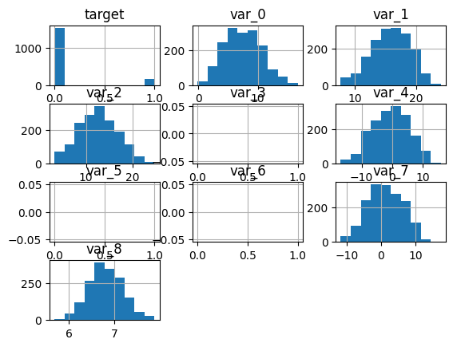
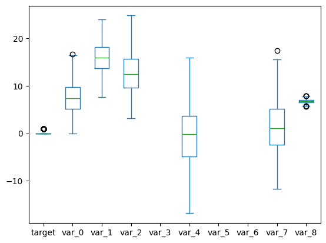
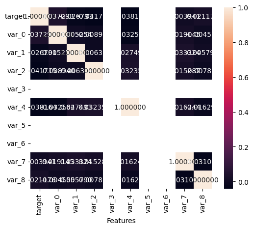
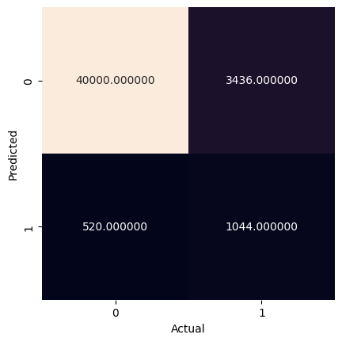
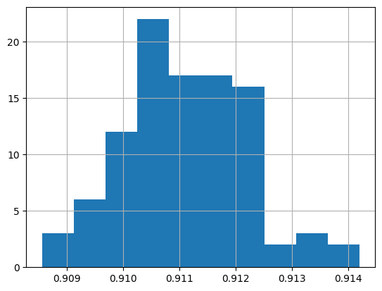
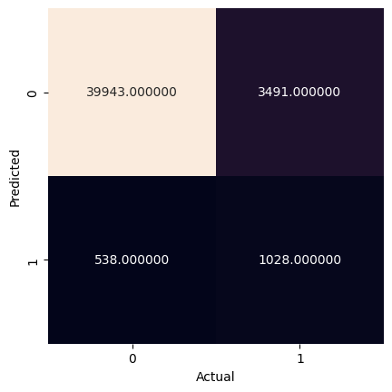

<a href="https://colab.research.google.com/github/efitznm/Data-Science-Portfolio-C22/blob/main/Modules/Module_1_Intro_to_DS_and_Naive_Bayes/Projects/Instructions/Project.1-Transactions/Project.1-Pass-07.ipynb" target="_parent"></a>

# Project.1_Pass-07, Transaction Data


## Problem Definition


State the business problem. Translate the business problem into a Data Science problem by stating what kind of problem it is ( supervised vs unsupervised ) and whether it is a classification, regression, or clustering problem.

### Business Problem
We want to predict whether or not a future customer will make a transaction based on their transaction data. The goal might be to increase customer transactions by sending targeted ads/deals to customers who are not likely to make a transaction on a given day.

### Data Science Problem
Supervised binary classification problem.

## Data Collection/Sources


### Load Pandas, Numpy, and Matplotlib modules


```python
# Load Pandas, Numpy, and Matplotlib modules
import pandas as pd
import numpy as np
import matplotlib.pyplot as plt
import seaborn as sns

from sklearn import datasets, metrics, model_selection
from sklearn import model_selection
from sklearn.naive_bayes import GaussianNB
from sklearn.model_selection import train_test_split
```

### Load data Train.csv from AWS S3[link text](https://)


```python
# Load the big dataset Train.big.csv from AWS S3
url = 'https://ddc-datascience.s3.amazonaws.com/Projects/Project.1-Transactions/Data/Transaction.train.big.csv'
url

df = pd.read_csv(
    url,
    usecols=range(15),
    nrows=10_000,
)

df
```


  <div id="df-e0cef6a5-d71e-4a77-adb3-6d6cd24f29b2" class="colab-df-container">
    <div>
<style scoped>
    .dataframe tbody tr th:only-of-type {
        vertical-align: middle;
    }

    .dataframe tbody tr th {
        vertical-align: top;
    }

    .dataframe thead th {
        text-align: right;
    }
</style>
<table border="1" class="dataframe">
  <thead>
    <tr style="text-align: right;">
      <th></th>
      <th>Unnamed: 0</th>
      <th>ID_code</th>
      <th>target</th>
      <th>var_0</th>
      <th>var_1</th>
      <th>var_2</th>
      <th>var_3</th>
      <th>var_4</th>
      <th>var_5</th>
      <th>var_6</th>
      <th>var_7</th>
      <th>var_8</th>
      <th>var_9</th>
      <th>var_10</th>
      <th>var_11</th>
    </tr>
  </thead>
  <tbody>
    <tr>
      <th>0</th>
      <td>0</td>
      <td>train_0</td>
      <td>NaN</td>
      <td>NaN</td>
      <td>NaN</td>
      <td>NaN</td>
      <td>NaN</td>
      <td>NaN</td>
      <td>NaN</td>
      <td>NaN</td>
      <td>NaN</td>
      <td>NaN</td>
      <td>NaN</td>
      <td>NaN</td>
      <td>NaN</td>
    </tr>
    <tr>
      <th>1</th>
      <td>1</td>
      <td>train_1</td>
      <td>NaN</td>
      <td>NaN</td>
      <td>NaN</td>
      <td>NaN</td>
      <td>NaN</td>
      <td>NaN</td>
      <td>NaN</td>
      <td>NaN</td>
      <td>NaN</td>
      <td>NaN</td>
      <td>NaN</td>
      <td>NaN</td>
      <td>NaN</td>
    </tr>
    <tr>
      <th>2</th>
      <td>2</td>
      <td>train_2</td>
      <td>NaN</td>
      <td>NaN</td>
      <td>NaN</td>
      <td>NaN</td>
      <td>NaN</td>
      <td>NaN</td>
      <td>NaN</td>
      <td>NaN</td>
      <td>NaN</td>
      <td>NaN</td>
      <td>NaN</td>
      <td>NaN</td>
      <td>NaN</td>
    </tr>
    <tr>
      <th>3</th>
      <td>3</td>
      <td>train_3</td>
      <td>0.0</td>
      <td>4.6739</td>
      <td>22.3915</td>
      <td>15.6015</td>
      <td>NaN</td>
      <td>0.0464</td>
      <td>NaN</td>
      <td>NaN</td>
      <td>-1.9254</td>
      <td>6.4760</td>
      <td>NaN</td>
      <td>NaN</td>
      <td>NaN</td>
    </tr>
    <tr>
      <th>4</th>
      <td>4</td>
      <td>train_4</td>
      <td>NaN</td>
      <td>NaN</td>
      <td>NaN</td>
      <td>NaN</td>
      <td>NaN</td>
      <td>NaN</td>
      <td>NaN</td>
      <td>NaN</td>
      <td>NaN</td>
      <td>NaN</td>
      <td>NaN</td>
      <td>NaN</td>
      <td>NaN</td>
    </tr>
    <tr>
      <th>...</th>
      <td>...</td>
      <td>...</td>
      <td>...</td>
      <td>...</td>
      <td>...</td>
      <td>...</td>
      <td>...</td>
      <td>...</td>
      <td>...</td>
      <td>...</td>
      <td>...</td>
      <td>...</td>
      <td>...</td>
      <td>...</td>
      <td>...</td>
    </tr>
    <tr>
      <th>9995</th>
      <td>9995</td>
      <td>train_9995</td>
      <td>NaN</td>
      <td>NaN</td>
      <td>NaN</td>
      <td>NaN</td>
      <td>NaN</td>
      <td>NaN</td>
      <td>NaN</td>
      <td>NaN</td>
      <td>NaN</td>
      <td>NaN</td>
      <td>NaN</td>
      <td>NaN</td>
      <td>NaN</td>
    </tr>
    <tr>
      <th>9996</th>
      <td>9996</td>
      <td>train_9996</td>
      <td>NaN</td>
      <td>NaN</td>
      <td>NaN</td>
      <td>NaN</td>
      <td>NaN</td>
      <td>NaN</td>
      <td>NaN</td>
      <td>NaN</td>
      <td>NaN</td>
      <td>NaN</td>
      <td>NaN</td>
      <td>NaN</td>
      <td>NaN</td>
    </tr>
    <tr>
      <th>9997</th>
      <td>9997</td>
      <td>train_9997</td>
      <td>0.0</td>
      <td>4.1463</td>
      <td>20.3755</td>
      <td>14.8105</td>
      <td>NaN</td>
      <td>6.0432</td>
      <td>NaN</td>
      <td>NaN</td>
      <td>1.2462</td>
      <td>6.5467</td>
      <td>NaN</td>
      <td>NaN</td>
      <td>NaN</td>
    </tr>
    <tr>
      <th>9998</th>
      <td>9998</td>
      <td>train_9998</td>
      <td>NaN</td>
      <td>NaN</td>
      <td>NaN</td>
      <td>NaN</td>
      <td>NaN</td>
      <td>NaN</td>
      <td>NaN</td>
      <td>NaN</td>
      <td>NaN</td>
      <td>NaN</td>
      <td>NaN</td>
      <td>NaN</td>
      <td>NaN</td>
    </tr>
    <tr>
      <th>9999</th>
      <td>9999</td>
      <td>train_9999</td>
      <td>NaN</td>
      <td>NaN</td>
      <td>NaN</td>
      <td>NaN</td>
      <td>NaN</td>
      <td>NaN</td>
      <td>NaN</td>
      <td>NaN</td>
      <td>NaN</td>
      <td>NaN</td>
      <td>NaN</td>
      <td>NaN</td>
      <td>NaN</td>
    </tr>
  </tbody>
</table>
<p>10000 rows × 15 columns</p>
</div>
    <div class="colab-df-buttons">

  <div class="colab-df-container">
    <button class="colab-df-convert" onclick="convertToInteractive('df-e0cef6a5-d71e-4a77-adb3-6d6cd24f29b2')"
            title="Convert this dataframe to an interactive table."
            style="display:none;">

  <svg xmlns="http://www.w3.org/2000/svg" height="24px" viewBox="0 -960 960 960">
    <path d="M120-120v-720h720v720H120Zm60-500h600v-160H180v160Zm220 220h160v-160H400v160Zm0 220h160v-160H400v160ZM180-400h160v-160H180v160Zm440 0h160v-160H620v160ZM180-180h160v-160H180v160Zm440 0h160v-160H620v160Z"/>
  </svg>
    </button>

  <style>
    .colab-df-container {
      display:flex;
      gap: 12px;
    }

    .colab-df-convert {
      background-color: #E8F0FE;
      border: none;
      border-radius: 50%;
      cursor: pointer;
      display: none;
      fill: #1967D2;
      height: 32px;
      padding: 0 0 0 0;
      width: 32px;
    }

    .colab-df-convert:hover {
      background-color: #E2EBFA;
      box-shadow: 0px 1px 2px rgba(60, 64, 67, 0.3), 0px 1px 3px 1px rgba(60, 64, 67, 0.15);
      fill: #174EA6;
    }

    .colab-df-buttons div {
      margin-bottom: 4px;
    }

    [theme=dark] .colab-df-convert {
      background-color: #3B4455;
      fill: #D2E3FC;
    }

    [theme=dark] .colab-df-convert:hover {
      background-color: #434B5C;
      box-shadow: 0px 1px 3px 1px rgba(0, 0, 0, 0.15);
      filter: drop-shadow(0px 1px 2px rgba(0, 0, 0, 0.3));
      fill: #FFFFFF;
    }
  </style>

    <script>
      const buttonEl =
        document.querySelector('#df-e0cef6a5-d71e-4a77-adb3-6d6cd24f29b2 button.colab-df-convert');
      buttonEl.style.display =
        google.colab.kernel.accessAllowed ? 'block' : 'none';

      async function convertToInteractive(key) {
        const element = document.querySelector('#df-e0cef6a5-d71e-4a77-adb3-6d6cd24f29b2');
        const dataTable =
          await google.colab.kernel.invokeFunction('convertToInteractive',
                                                    [key], {});
        if (!dataTable) return;

        const docLinkHtml = 'Like what you see? Visit the ' +
          '<a target="_blank" href=https://colab.research.google.com/notebooks/data_table.ipynb>data table notebook</a>'
          + ' to learn more about interactive tables.';
        element.innerHTML = '';
        dataTable['output_type'] = 'display_data';
        await google.colab.output.renderOutput(dataTable, element);
        const docLink = document.createElement('div');
        docLink.innerHTML = docLinkHtml;
        element.appendChild(docLink);
      }
    </script>
  </div>


  <div id="id_83a0451c-cba2-47db-8f59-6388cfae6c35">
    <style>
      .colab-df-generate {
        background-color: #E8F0FE;
        border: none;
        border-radius: 50%;
        cursor: pointer;
        display: none;
        fill: #1967D2;
        height: 32px;
        padding: 0 0 0 0;
        width: 32px;
      }

      .colab-df-generate:hover {
        background-color: #E2EBFA;
        box-shadow: 0px 1px 2px rgba(60, 64, 67, 0.3), 0px 1px 3px 1px rgba(60, 64, 67, 0.15);
        fill: #174EA6;
      }

      [theme=dark] .colab-df-generate {
        background-color: #3B4455;
        fill: #D2E3FC;
      }

      [theme=dark] .colab-df-generate:hover {
        background-color: #434B5C;
        box-shadow: 0px 1px 3px 1px rgba(0, 0, 0, 0.15);
        filter: drop-shadow(0px 1px 2px rgba(0, 0, 0, 0.3));
        fill: #FFFFFF;
      }
    </style>
    <button class="colab-df-generate" onclick="generateWithVariable('df')"
            title="Generate code using this dataframe."
            style="display:none;">

  <svg xmlns="http://www.w3.org/2000/svg" height="24px"viewBox="0 0 24 24"
       width="24px">
    <path d="M7,19H8.4L18.45,9,17,7.55,7,17.6ZM5,21V16.75L18.45,3.32a2,2,0,0,1,2.83,0l1.4,1.43a1.91,1.91,0,0,1,.58,1.4,1.91,1.91,0,0,1-.58,1.4L9.25,21ZM18.45,9,17,7.55Zm-12,3A5.31,5.31,0,0,0,4.9,8.1,5.31,5.31,0,0,0,1,6.5,5.31,5.31,0,0,0,4.9,4.9,5.31,5.31,0,0,0,6.5,1,5.31,5.31,0,0,0,8.1,4.9,5.31,5.31,0,0,0,12,6.5,5.46,5.46,0,0,0,6.5,12Z"/>
  </svg>
    </button>
    <script>
      (() => {
      const buttonEl =
        document.querySelector('#id_83a0451c-cba2-47db-8f59-6388cfae6c35 button.colab-df-generate');
      buttonEl.style.display =
        google.colab.kernel.accessAllowed ? 'block' : 'none';

      buttonEl.onclick = () => {
        google.colab.notebook.generateWithVariable('df');
      }
      })();
    </script>
  </div>

    </div>
  </div>


```python
# Look at the first few rows
df.head()
```


  <div id="df-17add697-07a2-4379-a4c6-c727f0c546dc" class="colab-df-container">
    <div>
<style scoped>
    .dataframe tbody tr th:only-of-type {
        vertical-align: middle;
    }

    .dataframe tbody tr th {
        vertical-align: top;
    }

    .dataframe thead th {
        text-align: right;
    }
</style>
<table border="1" class="dataframe">
  <thead>
    <tr style="text-align: right;">
      <th></th>
      <th>Unnamed: 0</th>
      <th>ID_code</th>
      <th>target</th>
      <th>var_0</th>
      <th>var_1</th>
      <th>var_2</th>
      <th>var_3</th>
      <th>var_4</th>
      <th>var_5</th>
      <th>var_6</th>
      <th>var_7</th>
      <th>var_8</th>
      <th>var_9</th>
      <th>var_10</th>
      <th>var_11</th>
    </tr>
  </thead>
  <tbody>
    <tr>
      <th>0</th>
      <td>0</td>
      <td>train_0</td>
      <td>NaN</td>
      <td>NaN</td>
      <td>NaN</td>
      <td>NaN</td>
      <td>NaN</td>
      <td>NaN</td>
      <td>NaN</td>
      <td>NaN</td>
      <td>NaN</td>
      <td>NaN</td>
      <td>NaN</td>
      <td>NaN</td>
      <td>NaN</td>
    </tr>
    <tr>
      <th>1</th>
      <td>1</td>
      <td>train_1</td>
      <td>NaN</td>
      <td>NaN</td>
      <td>NaN</td>
      <td>NaN</td>
      <td>NaN</td>
      <td>NaN</td>
      <td>NaN</td>
      <td>NaN</td>
      <td>NaN</td>
      <td>NaN</td>
      <td>NaN</td>
      <td>NaN</td>
      <td>NaN</td>
    </tr>
    <tr>
      <th>2</th>
      <td>2</td>
      <td>train_2</td>
      <td>NaN</td>
      <td>NaN</td>
      <td>NaN</td>
      <td>NaN</td>
      <td>NaN</td>
      <td>NaN</td>
      <td>NaN</td>
      <td>NaN</td>
      <td>NaN</td>
      <td>NaN</td>
      <td>NaN</td>
      <td>NaN</td>
      <td>NaN</td>
    </tr>
    <tr>
      <th>3</th>
      <td>3</td>
      <td>train_3</td>
      <td>0.0</td>
      <td>4.6739</td>
      <td>22.3915</td>
      <td>15.6015</td>
      <td>NaN</td>
      <td>0.0464</td>
      <td>NaN</td>
      <td>NaN</td>
      <td>-1.9254</td>
      <td>6.476</td>
      <td>NaN</td>
      <td>NaN</td>
      <td>NaN</td>
    </tr>
    <tr>
      <th>4</th>
      <td>4</td>
      <td>train_4</td>
      <td>NaN</td>
      <td>NaN</td>
      <td>NaN</td>
      <td>NaN</td>
      <td>NaN</td>
      <td>NaN</td>
      <td>NaN</td>
      <td>NaN</td>
      <td>NaN</td>
      <td>NaN</td>
      <td>NaN</td>
      <td>NaN</td>
      <td>NaN</td>
    </tr>
  </tbody>
</table>
</div>
    <div class="colab-df-buttons">

  <div class="colab-df-container">
    <button class="colab-df-convert" onclick="convertToInteractive('df-17add697-07a2-4379-a4c6-c727f0c546dc')"
            title="Convert this dataframe to an interactive table."
            style="display:none;">

  <svg xmlns="http://www.w3.org/2000/svg" height="24px" viewBox="0 -960 960 960">
    <path d="M120-120v-720h720v720H120Zm60-500h600v-160H180v160Zm220 220h160v-160H400v160Zm0 220h160v-160H400v160ZM180-400h160v-160H180v160Zm440 0h160v-160H620v160ZM180-180h160v-160H180v160Zm440 0h160v-160H620v160Z"/>
  </svg>
    </button>

  <style>
    .colab-df-container {
      display:flex;
      gap: 12px;
    }

    .colab-df-convert {
      background-color: #E8F0FE;
      border: none;
      border-radius: 50%;
      cursor: pointer;
      display: none;
      fill: #1967D2;
      height: 32px;
      padding: 0 0 0 0;
      width: 32px;
    }

    .colab-df-convert:hover {
      background-color: #E2EBFA;
      box-shadow: 0px 1px 2px rgba(60, 64, 67, 0.3), 0px 1px 3px 1px rgba(60, 64, 67, 0.15);
      fill: #174EA6;
    }

    .colab-df-buttons div {
      margin-bottom: 4px;
    }

    [theme=dark] .colab-df-convert {
      background-color: #3B4455;
      fill: #D2E3FC;
    }

    [theme=dark] .colab-df-convert:hover {
      background-color: #434B5C;
      box-shadow: 0px 1px 3px 1px rgba(0, 0, 0, 0.15);
      filter: drop-shadow(0px 1px 2px rgba(0, 0, 0, 0.3));
      fill: #FFFFFF;
    }
  </style>

    <script>
      const buttonEl =
        document.querySelector('#df-17add697-07a2-4379-a4c6-c727f0c546dc button.colab-df-convert');
      buttonEl.style.display =
        google.colab.kernel.accessAllowed ? 'block' : 'none';

      async function convertToInteractive(key) {
        const element = document.querySelector('#df-17add697-07a2-4379-a4c6-c727f0c546dc');
        const dataTable =
          await google.colab.kernel.invokeFunction('convertToInteractive',
                                                    [key], {});
        if (!dataTable) return;

        const docLinkHtml = 'Like what you see? Visit the ' +
          '<a target="_blank" href=https://colab.research.google.com/notebooks/data_table.ipynb>data table notebook</a>'
          + ' to learn more about interactive tables.';
        element.innerHTML = '';
        dataTable['output_type'] = 'display_data';
        await google.colab.output.renderOutput(dataTable, element);
        const docLink = document.createElement('div');
        docLink.innerHTML = docLinkHtml;
        element.appendChild(docLink);
      }
    </script>
  </div>


    </div>
  </div>


```python
# Look at the last few rows
df.tail()
```


  <div id="df-ec048b8a-5bc4-415b-916f-351644742dc7" class="colab-df-container">
    <div>
<style scoped>
    .dataframe tbody tr th:only-of-type {
        vertical-align: middle;
    }

    .dataframe tbody tr th {
        vertical-align: top;
    }

    .dataframe thead th {
        text-align: right;
    }
</style>
<table border="1" class="dataframe">
  <thead>
    <tr style="text-align: right;">
      <th></th>
      <th>Unnamed: 0</th>
      <th>ID_code</th>
      <th>target</th>
      <th>var_0</th>
      <th>var_1</th>
      <th>var_2</th>
      <th>var_3</th>
      <th>var_4</th>
      <th>var_5</th>
      <th>var_6</th>
      <th>var_7</th>
      <th>var_8</th>
      <th>var_9</th>
      <th>var_10</th>
      <th>var_11</th>
    </tr>
  </thead>
  <tbody>
    <tr>
      <th>9995</th>
      <td>9995</td>
      <td>train_9995</td>
      <td>NaN</td>
      <td>NaN</td>
      <td>NaN</td>
      <td>NaN</td>
      <td>NaN</td>
      <td>NaN</td>
      <td>NaN</td>
      <td>NaN</td>
      <td>NaN</td>
      <td>NaN</td>
      <td>NaN</td>
      <td>NaN</td>
      <td>NaN</td>
    </tr>
    <tr>
      <th>9996</th>
      <td>9996</td>
      <td>train_9996</td>
      <td>NaN</td>
      <td>NaN</td>
      <td>NaN</td>
      <td>NaN</td>
      <td>NaN</td>
      <td>NaN</td>
      <td>NaN</td>
      <td>NaN</td>
      <td>NaN</td>
      <td>NaN</td>
      <td>NaN</td>
      <td>NaN</td>
      <td>NaN</td>
    </tr>
    <tr>
      <th>9997</th>
      <td>9997</td>
      <td>train_9997</td>
      <td>0.0</td>
      <td>4.1463</td>
      <td>20.3755</td>
      <td>14.8105</td>
      <td>NaN</td>
      <td>6.0432</td>
      <td>NaN</td>
      <td>NaN</td>
      <td>1.2462</td>
      <td>6.5467</td>
      <td>NaN</td>
      <td>NaN</td>
      <td>NaN</td>
    </tr>
    <tr>
      <th>9998</th>
      <td>9998</td>
      <td>train_9998</td>
      <td>NaN</td>
      <td>NaN</td>
      <td>NaN</td>
      <td>NaN</td>
      <td>NaN</td>
      <td>NaN</td>
      <td>NaN</td>
      <td>NaN</td>
      <td>NaN</td>
      <td>NaN</td>
      <td>NaN</td>
      <td>NaN</td>
      <td>NaN</td>
    </tr>
    <tr>
      <th>9999</th>
      <td>9999</td>
      <td>train_9999</td>
      <td>NaN</td>
      <td>NaN</td>
      <td>NaN</td>
      <td>NaN</td>
      <td>NaN</td>
      <td>NaN</td>
      <td>NaN</td>
      <td>NaN</td>
      <td>NaN</td>
      <td>NaN</td>
      <td>NaN</td>
      <td>NaN</td>
      <td>NaN</td>
    </tr>
  </tbody>
</table>
</div>
    <div class="colab-df-buttons">

  <div class="colab-df-container">
    <button class="colab-df-convert" onclick="convertToInteractive('df-ec048b8a-5bc4-415b-916f-351644742dc7')"
            title="Convert this dataframe to an interactive table."
            style="display:none;">

  <svg xmlns="http://www.w3.org/2000/svg" height="24px" viewBox="0 -960 960 960">
    <path d="M120-120v-720h720v720H120Zm60-500h600v-160H180v160Zm220 220h160v-160H400v160Zm0 220h160v-160H400v160ZM180-400h160v-160H180v160Zm440 0h160v-160H620v160ZM180-180h160v-160H180v160Zm440 0h160v-160H620v160Z"/>
  </svg>
    </button>

  <style>
    .colab-df-container {
      display:flex;
      gap: 12px;
    }

    .colab-df-convert {
      background-color: #E8F0FE;
      border: none;
      border-radius: 50%;
      cursor: pointer;
      display: none;
      fill: #1967D2;
      height: 32px;
      padding: 0 0 0 0;
      width: 32px;
    }

    .colab-df-convert:hover {
      background-color: #E2EBFA;
      box-shadow: 0px 1px 2px rgba(60, 64, 67, 0.3), 0px 1px 3px 1px rgba(60, 64, 67, 0.15);
      fill: #174EA6;
    }

    .colab-df-buttons div {
      margin-bottom: 4px;
    }

    [theme=dark] .colab-df-convert {
      background-color: #3B4455;
      fill: #D2E3FC;
    }

    [theme=dark] .colab-df-convert:hover {
      background-color: #434B5C;
      box-shadow: 0px 1px 3px 1px rgba(0, 0, 0, 0.15);
      filter: drop-shadow(0px 1px 2px rgba(0, 0, 0, 0.3));
      fill: #FFFFFF;
    }
  </style>

    <script>
      const buttonEl =
        document.querySelector('#df-ec048b8a-5bc4-415b-916f-351644742dc7 button.colab-df-convert');
      buttonEl.style.display =
        google.colab.kernel.accessAllowed ? 'block' : 'none';

      async function convertToInteractive(key) {
        const element = document.querySelector('#df-ec048b8a-5bc4-415b-916f-351644742dc7');
        const dataTable =
          await google.colab.kernel.invokeFunction('convertToInteractive',
                                                    [key], {});
        if (!dataTable) return;

        const docLinkHtml = 'Like what you see? Visit the ' +
          '<a target="_blank" href=https://colab.research.google.com/notebooks/data_table.ipynb>data table notebook</a>'
          + ' to learn more about interactive tables.';
        element.innerHTML = '';
        dataTable['output_type'] = 'display_data';
        await google.colab.output.renderOutput(dataTable, element);
        const docLink = document.createElement('div');
        docLink.innerHTML = docLinkHtml;
        element.appendChild(docLink);
      }
    </script>
  </div>


    </div>
  </div>


## Data Cleaning


### Summary Meta-Data


```python
# Shape of the dataframe
df.shape
```


    (10000, 15)


```python
# Size of the dataframe
df.size
```


    150000


```python
# Display meta-data
df.info()
```

    <class 'pandas.core.frame.DataFrame'>
    RangeIndex: 10000 entries, 0 to 9999
    Data columns (total 15 columns):
     #   Column      Non-Null Count  Dtype  
    ---  ------      --------------  -----  
     0   Unnamed: 0  10000 non-null  int64  
     1   ID_code     10000 non-null  object 
     2   target      1686 non-null   float64
     3   var_0       1686 non-null   float64
     4   var_1       1686 non-null   float64
     5   var_2       1686 non-null   float64
     6   var_3       0 non-null      float64
     7   var_4       1686 non-null   float64
     8   var_5       0 non-null      float64
     9   var_6       0 non-null      float64
     10  var_7       1686 non-null   float64
     11  var_8       1686 non-null   float64
     12  var_9       0 non-null      float64
     13  var_10      0 non-null      float64
     14  var_11      0 non-null      float64
    dtypes: float64(13), int64(1), object(1)
    memory usage: 1.1+ MB


### Summary Statistics


```python
# Display summary statistics
df.describe()
```


  <div id="df-811e6512-c02b-4799-89c0-4b68eaf24efc" class="colab-df-container">
    <div>
<style scoped>
    .dataframe tbody tr th:only-of-type {
        vertical-align: middle;
    }

    .dataframe tbody tr th {
        vertical-align: top;
    }

    .dataframe thead th {
        text-align: right;
    }
</style>
<table border="1" class="dataframe">
  <thead>
    <tr style="text-align: right;">
      <th></th>
      <th>Unnamed: 0</th>
      <th>target</th>
      <th>var_0</th>
      <th>var_1</th>
      <th>var_2</th>
      <th>var_3</th>
      <th>var_4</th>
      <th>var_5</th>
      <th>var_6</th>
      <th>var_7</th>
      <th>var_8</th>
      <th>var_9</th>
      <th>var_10</th>
      <th>var_11</th>
    </tr>
  </thead>
  <tbody>
    <tr>
      <th>count</th>
      <td>10000.00000</td>
      <td>1686.000000</td>
      <td>1686.000000</td>
      <td>1686.000000</td>
      <td>1686.000000</td>
      <td>0.0</td>
      <td>1686.000000</td>
      <td>0.0</td>
      <td>0.0</td>
      <td>1686.000000</td>
      <td>1686.000000</td>
      <td>0.0</td>
      <td>0.0</td>
      <td>0.0</td>
    </tr>
    <tr>
      <th>mean</th>
      <td>4999.50000</td>
      <td>0.098458</td>
      <td>7.493109</td>
      <td>15.840630</td>
      <td>12.667966</td>
      <td>NaN</td>
      <td>-0.461214</td>
      <td>NaN</td>
      <td>NaN</td>
      <td>1.276329</td>
      <td>6.812313</td>
      <td>NaN</td>
      <td>NaN</td>
      <td>NaN</td>
    </tr>
    <tr>
      <th>std</th>
      <td>2886.89568</td>
      <td>0.298021</td>
      <td>3.090435</td>
      <td>3.086651</td>
      <td>4.187706</td>
      <td>NaN</td>
      <td>6.014515</td>
      <td>NaN</td>
      <td>NaN</td>
      <td>5.103567</td>
      <td>0.374905</td>
      <td>NaN</td>
      <td>NaN</td>
      <td>NaN</td>
    </tr>
    <tr>
      <th>min</th>
      <td>0.00000</td>
      <td>0.000000</td>
      <td>-0.101600</td>
      <td>7.700200</td>
      <td>3.218700</td>
      <td>NaN</td>
      <td>-16.855000</td>
      <td>NaN</td>
      <td>NaN</td>
      <td>-11.731000</td>
      <td>5.688300</td>
      <td>NaN</td>
      <td>NaN</td>
      <td>NaN</td>
    </tr>
    <tr>
      <th>25%</th>
      <td>2499.75000</td>
      <td>0.000000</td>
      <td>5.174825</td>
      <td>13.739200</td>
      <td>9.601600</td>
      <td>NaN</td>
      <td>-4.893675</td>
      <td>NaN</td>
      <td>NaN</td>
      <td>-2.458950</td>
      <td>6.559500</td>
      <td>NaN</td>
      <td>NaN</td>
      <td>NaN</td>
    </tr>
    <tr>
      <th>50%</th>
      <td>4999.50000</td>
      <td>0.000000</td>
      <td>7.379350</td>
      <td>15.992700</td>
      <td>12.478250</td>
      <td>NaN</td>
      <td>-0.190200</td>
      <td>NaN</td>
      <td>NaN</td>
      <td>1.080350</td>
      <td>6.795350</td>
      <td>NaN</td>
      <td>NaN</td>
      <td>NaN</td>
    </tr>
    <tr>
      <th>75%</th>
      <td>7499.25000</td>
      <td>0.000000</td>
      <td>9.708875</td>
      <td>18.155675</td>
      <td>15.725050</td>
      <td>NaN</td>
      <td>3.730575</td>
      <td>NaN</td>
      <td>NaN</td>
      <td>5.107175</td>
      <td>7.071325</td>
      <td>NaN</td>
      <td>NaN</td>
      <td>NaN</td>
    </tr>
    <tr>
      <th>max</th>
      <td>9999.00000</td>
      <td>1.000000</td>
      <td>16.716500</td>
      <td>23.971700</td>
      <td>24.828500</td>
      <td>NaN</td>
      <td>15.973100</td>
      <td>NaN</td>
      <td>NaN</td>
      <td>17.441800</td>
      <td>7.877900</td>
      <td>NaN</td>
      <td>NaN</td>
      <td>NaN</td>
    </tr>
  </tbody>
</table>
</div>
    <div class="colab-df-buttons">

  <div class="colab-df-container">
    <button class="colab-df-convert" onclick="convertToInteractive('df-811e6512-c02b-4799-89c0-4b68eaf24efc')"
            title="Convert this dataframe to an interactive table."
            style="display:none;">

  <svg xmlns="http://www.w3.org/2000/svg" height="24px" viewBox="0 -960 960 960">
    <path d="M120-120v-720h720v720H120Zm60-500h600v-160H180v160Zm220 220h160v-160H400v160Zm0 220h160v-160H400v160ZM180-400h160v-160H180v160Zm440 0h160v-160H620v160ZM180-180h160v-160H180v160Zm440 0h160v-160H620v160Z"/>
  </svg>
    </button>

  <style>
    .colab-df-container {
      display:flex;
      gap: 12px;
    }

    .colab-df-convert {
      background-color: #E8F0FE;
      border: none;
      border-radius: 50%;
      cursor: pointer;
      display: none;
      fill: #1967D2;
      height: 32px;
      padding: 0 0 0 0;
      width: 32px;
    }

    .colab-df-convert:hover {
      background-color: #E2EBFA;
      box-shadow: 0px 1px 2px rgba(60, 64, 67, 0.3), 0px 1px 3px 1px rgba(60, 64, 67, 0.15);
      fill: #174EA6;
    }

    .colab-df-buttons div {
      margin-bottom: 4px;
    }

    [theme=dark] .colab-df-convert {
      background-color: #3B4455;
      fill: #D2E3FC;
    }

    [theme=dark] .colab-df-convert:hover {
      background-color: #434B5C;
      box-shadow: 0px 1px 3px 1px rgba(0, 0, 0, 0.15);
      filter: drop-shadow(0px 1px 2px rgba(0, 0, 0, 0.3));
      fill: #FFFFFF;
    }
  </style>

    <script>
      const buttonEl =
        document.querySelector('#df-811e6512-c02b-4799-89c0-4b68eaf24efc button.colab-df-convert');
      buttonEl.style.display =
        google.colab.kernel.accessAllowed ? 'block' : 'none';

      async function convertToInteractive(key) {
        const element = document.querySelector('#df-811e6512-c02b-4799-89c0-4b68eaf24efc');
        const dataTable =
          await google.colab.kernel.invokeFunction('convertToInteractive',
                                                    [key], {});
        if (!dataTable) return;

        const docLinkHtml = 'Like what you see? Visit the ' +
          '<a target="_blank" href=https://colab.research.google.com/notebooks/data_table.ipynb>data table notebook</a>'
          + ' to learn more about interactive tables.';
        element.innerHTML = '';
        dataTable['output_type'] = 'display_data';
        await google.colab.output.renderOutput(dataTable, element);
        const docLink = document.createElement('div');
        docLink.innerHTML = docLinkHtml;
        element.appendChild(docLink);
      }
    </script>
  </div>


    </div>
  </div>


### Data Types


```python
# Display data types of columns
df.dtypes
```


<div>
<style scoped>
    .dataframe tbody tr th:only-of-type {
        vertical-align: middle;
    }

    .dataframe tbody tr th {
        vertical-align: top;
    }

    .dataframe thead th {
        text-align: right;
    }
</style>
<table border="1" class="dataframe">
  <thead>
    <tr style="text-align: right;">
      <th></th>
      <th>0</th>
    </tr>
  </thead>
  <tbody>
    <tr>
      <th>Unnamed: 0</th>
      <td>int64</td>
    </tr>
    <tr>
      <th>ID_code</th>
      <td>object</td>
    </tr>
    <tr>
      <th>target</th>
      <td>float64</td>
    </tr>
    <tr>
      <th>var_0</th>
      <td>float64</td>
    </tr>
    <tr>
      <th>var_1</th>
      <td>float64</td>
    </tr>
    <tr>
      <th>var_2</th>
      <td>float64</td>
    </tr>
    <tr>
      <th>var_3</th>
      <td>float64</td>
    </tr>
    <tr>
      <th>var_4</th>
      <td>float64</td>
    </tr>
    <tr>
      <th>var_5</th>
      <td>float64</td>
    </tr>
    <tr>
      <th>var_6</th>
      <td>float64</td>
    </tr>
    <tr>
      <th>var_7</th>
      <td>float64</td>
    </tr>
    <tr>
      <th>var_8</th>
      <td>float64</td>
    </tr>
    <tr>
      <th>var_9</th>
      <td>float64</td>
    </tr>
    <tr>
      <th>var_10</th>
      <td>float64</td>
    </tr>
    <tr>
      <th>var_11</th>
      <td>float64</td>
    </tr>
  </tbody>
</table>
</div><br><label><b>dtype:</b> object</label>


### Nulls and Identifier Columns
Imputation required on account of the nulls.

#### NOTE: the ‘target’ column indicates a successful transaction (‘1’) or a no-transaction (‘0’). Verify these are the only values in that column, and that there are no nulls.

#### Target Value Counts

Binary numerical classification and nulls are present.


```python
# Value_counts on target ; include nulls
df['target'].value_counts(dropna=False)
```


<div>
<style scoped>
    .dataframe tbody tr th:only-of-type {
        vertical-align: middle;
    }

    .dataframe tbody tr th {
        vertical-align: top;
    }

    .dataframe thead th {
        text-align: right;
    }
</style>
<table border="1" class="dataframe">
  <thead>
    <tr style="text-align: right;">
      <th></th>
      <th>count</th>
    </tr>
    <tr>
      <th>target</th>
      <th></th>
    </tr>
  </thead>
  <tbody>
    <tr>
      <th>NaN</th>
      <td>8314</td>
    </tr>
    <tr>
      <th>0.0</th>
      <td>1520</td>
    </tr>
    <tr>
      <th>1.0</th>
      <td>166</td>
    </tr>
  </tbody>
</table>
</div><br><label><b>dtype:</b> int64</label>


#### Normalize The Data


```python
# Normalized value_counts on target ; include nulls
df['target'].value_counts(dropna=False, normalize=True)
```


<div>
<style scoped>
    .dataframe tbody tr th:only-of-type {
        vertical-align: middle;
    }

    .dataframe tbody tr th {
        vertical-align: top;
    }

    .dataframe thead th {
        text-align: right;
    }
</style>
<table border="1" class="dataframe">
  <thead>
    <tr style="text-align: right;">
      <th></th>
      <th>proportion</th>
    </tr>
    <tr>
      <th>target</th>
      <th></th>
    </tr>
  </thead>
  <tbody>
    <tr>
      <th>NaN</th>
      <td>0.8314</td>
    </tr>
    <tr>
      <th>0.0</th>
      <td>0.1520</td>
    </tr>
    <tr>
      <th>1.0</th>
      <td>0.0166</td>
    </tr>
  </tbody>
</table>
</div><br><label><b>dtype:</b> float64</label>


#### Nulls


```python
# Look for nulls
df.isnull().sum().sort_values(ascending=False)
```


<div>
<style scoped>
    .dataframe tbody tr th:only-of-type {
        vertical-align: middle;
    }

    .dataframe tbody tr th {
        vertical-align: top;
    }

    .dataframe thead th {
        text-align: right;
    }
</style>
<table border="1" class="dataframe">
  <thead>
    <tr style="text-align: right;">
      <th></th>
      <th>0</th>
    </tr>
  </thead>
  <tbody>
    <tr>
      <th>var_3</th>
      <td>10000</td>
    </tr>
    <tr>
      <th>var_6</th>
      <td>10000</td>
    </tr>
    <tr>
      <th>var_11</th>
      <td>10000</td>
    </tr>
    <tr>
      <th>var_9</th>
      <td>10000</td>
    </tr>
    <tr>
      <th>var_10</th>
      <td>10000</td>
    </tr>
    <tr>
      <th>var_5</th>
      <td>10000</td>
    </tr>
    <tr>
      <th>var_0</th>
      <td>8314</td>
    </tr>
    <tr>
      <th>target</th>
      <td>8314</td>
    </tr>
    <tr>
      <th>var_4</th>
      <td>8314</td>
    </tr>
    <tr>
      <th>var_2</th>
      <td>8314</td>
    </tr>
    <tr>
      <th>var_1</th>
      <td>8314</td>
    </tr>
    <tr>
      <th>var_7</th>
      <td>8314</td>
    </tr>
    <tr>
      <th>var_8</th>
      <td>8314</td>
    </tr>
    <tr>
      <th>Unnamed: 0</th>
      <td>0</td>
    </tr>
    <tr>
      <th>ID_code</th>
      <td>0</td>
    </tr>
  </tbody>
</table>
</div><br><label><b>dtype:</b> int64</label>


#### Feature Columns


```python
# Normalize the data to see proportion of nulls on features
df.drop(columns=['target']).isnull().mean().sort_values(ascending=False)
```


<div>
<style scoped>
    .dataframe tbody tr th:only-of-type {
        vertical-align: middle;
    }

    .dataframe tbody tr th {
        vertical-align: top;
    }

    .dataframe thead th {
        text-align: right;
    }
</style>
<table border="1" class="dataframe">
  <thead>
    <tr style="text-align: right;">
      <th></th>
      <th>0</th>
    </tr>
  </thead>
  <tbody>
    <tr>
      <th>var_3</th>
      <td>1.0000</td>
    </tr>
    <tr>
      <th>var_11</th>
      <td>1.0000</td>
    </tr>
    <tr>
      <th>var_9</th>
      <td>1.0000</td>
    </tr>
    <tr>
      <th>var_10</th>
      <td>1.0000</td>
    </tr>
    <tr>
      <th>var_6</th>
      <td>1.0000</td>
    </tr>
    <tr>
      <th>var_5</th>
      <td>1.0000</td>
    </tr>
    <tr>
      <th>var_0</th>
      <td>0.8314</td>
    </tr>
    <tr>
      <th>var_4</th>
      <td>0.8314</td>
    </tr>
    <tr>
      <th>var_2</th>
      <td>0.8314</td>
    </tr>
    <tr>
      <th>var_1</th>
      <td>0.8314</td>
    </tr>
    <tr>
      <th>var_7</th>
      <td>0.8314</td>
    </tr>
    <tr>
      <th>var_8</th>
      <td>0.8314</td>
    </tr>
    <tr>
      <th>Unnamed: 0</th>
      <td>0.0000</td>
    </tr>
    <tr>
      <th>ID_code</th>
      <td>0.0000</td>
    </tr>
  </tbody>
</table>
</div><br><label><b>dtype:</b> float64</label>


#### Identifier Columns


```python
# Number of unique elements in a column
df.nunique().sort_values(ascending=False)
```


<div>
<style scoped>
    .dataframe tbody tr th:only-of-type {
        vertical-align: middle;
    }

    .dataframe tbody tr th {
        vertical-align: top;
    }

    .dataframe thead th {
        text-align: right;
    }
</style>
<table border="1" class="dataframe">
  <thead>
    <tr style="text-align: right;">
      <th></th>
      <th>0</th>
    </tr>
  </thead>
  <tbody>
    <tr>
      <th>Unnamed: 0</th>
      <td>10000</td>
    </tr>
    <tr>
      <th>ID_code</th>
      <td>10000</td>
    </tr>
    <tr>
      <th>var_4</th>
      <td>1678</td>
    </tr>
    <tr>
      <th>var_7</th>
      <td>1677</td>
    </tr>
    <tr>
      <th>var_0</th>
      <td>1677</td>
    </tr>
    <tr>
      <th>var_2</th>
      <td>1672</td>
    </tr>
    <tr>
      <th>var_1</th>
      <td>1663</td>
    </tr>
    <tr>
      <th>var_8</th>
      <td>1596</td>
    </tr>
    <tr>
      <th>target</th>
      <td>2</td>
    </tr>
    <tr>
      <th>var_3</th>
      <td>0</td>
    </tr>
    <tr>
      <th>var_5</th>
      <td>0</td>
    </tr>
    <tr>
      <th>var_6</th>
      <td>0</td>
    </tr>
    <tr>
      <th>var_9</th>
      <td>0</td>
    </tr>
    <tr>
      <th>var_10</th>
      <td>0</td>
    </tr>
    <tr>
      <th>var_11</th>
      <td>0</td>
    </tr>
  </tbody>
</table>
</div><br><label><b>dtype:</b> int64</label>


### Backup #1


```python
# Make backup
df_bak = df.copy()
```


```python
# Restore from backup
df = df_bak.copy()
```

### Recommendations

#### Identifier Columns

Exclude columns 'Unnamed: 0' and 'ID_code'


```python
# Drop the 'Unnamed: 0' and 'ID_code' columns
df = df.drop(columns=['Unnamed: 0','ID_code'])
```


```python
# Verify
df
```


  <div id="df-9c0076ca-bcc9-45bf-a34c-c38ba595b3e4" class="colab-df-container">
    <div>
<style scoped>
    .dataframe tbody tr th:only-of-type {
        vertical-align: middle;
    }

    .dataframe tbody tr th {
        vertical-align: top;
    }

    .dataframe thead th {
        text-align: right;
    }
</style>
<table border="1" class="dataframe">
  <thead>
    <tr style="text-align: right;">
      <th></th>
      <th>target</th>
      <th>var_0</th>
      <th>var_1</th>
      <th>var_2</th>
      <th>var_3</th>
      <th>var_4</th>
      <th>var_5</th>
      <th>var_6</th>
      <th>var_7</th>
      <th>var_8</th>
      <th>var_9</th>
      <th>var_10</th>
      <th>var_11</th>
    </tr>
  </thead>
  <tbody>
    <tr>
      <th>0</th>
      <td>NaN</td>
      <td>NaN</td>
      <td>NaN</td>
      <td>NaN</td>
      <td>NaN</td>
      <td>NaN</td>
      <td>NaN</td>
      <td>NaN</td>
      <td>NaN</td>
      <td>NaN</td>
      <td>NaN</td>
      <td>NaN</td>
      <td>NaN</td>
    </tr>
    <tr>
      <th>1</th>
      <td>NaN</td>
      <td>NaN</td>
      <td>NaN</td>
      <td>NaN</td>
      <td>NaN</td>
      <td>NaN</td>
      <td>NaN</td>
      <td>NaN</td>
      <td>NaN</td>
      <td>NaN</td>
      <td>NaN</td>
      <td>NaN</td>
      <td>NaN</td>
    </tr>
    <tr>
      <th>2</th>
      <td>NaN</td>
      <td>NaN</td>
      <td>NaN</td>
      <td>NaN</td>
      <td>NaN</td>
      <td>NaN</td>
      <td>NaN</td>
      <td>NaN</td>
      <td>NaN</td>
      <td>NaN</td>
      <td>NaN</td>
      <td>NaN</td>
      <td>NaN</td>
    </tr>
    <tr>
      <th>3</th>
      <td>0.0</td>
      <td>4.6739</td>
      <td>22.3915</td>
      <td>15.6015</td>
      <td>NaN</td>
      <td>0.0464</td>
      <td>NaN</td>
      <td>NaN</td>
      <td>-1.9254</td>
      <td>6.4760</td>
      <td>NaN</td>
      <td>NaN</td>
      <td>NaN</td>
    </tr>
    <tr>
      <th>4</th>
      <td>NaN</td>
      <td>NaN</td>
      <td>NaN</td>
      <td>NaN</td>
      <td>NaN</td>
      <td>NaN</td>
      <td>NaN</td>
      <td>NaN</td>
      <td>NaN</td>
      <td>NaN</td>
      <td>NaN</td>
      <td>NaN</td>
      <td>NaN</td>
    </tr>
    <tr>
      <th>...</th>
      <td>...</td>
      <td>...</td>
      <td>...</td>
      <td>...</td>
      <td>...</td>
      <td>...</td>
      <td>...</td>
      <td>...</td>
      <td>...</td>
      <td>...</td>
      <td>...</td>
      <td>...</td>
      <td>...</td>
    </tr>
    <tr>
      <th>9995</th>
      <td>NaN</td>
      <td>NaN</td>
      <td>NaN</td>
      <td>NaN</td>
      <td>NaN</td>
      <td>NaN</td>
      <td>NaN</td>
      <td>NaN</td>
      <td>NaN</td>
      <td>NaN</td>
      <td>NaN</td>
      <td>NaN</td>
      <td>NaN</td>
    </tr>
    <tr>
      <th>9996</th>
      <td>NaN</td>
      <td>NaN</td>
      <td>NaN</td>
      <td>NaN</td>
      <td>NaN</td>
      <td>NaN</td>
      <td>NaN</td>
      <td>NaN</td>
      <td>NaN</td>
      <td>NaN</td>
      <td>NaN</td>
      <td>NaN</td>
      <td>NaN</td>
    </tr>
    <tr>
      <th>9997</th>
      <td>0.0</td>
      <td>4.1463</td>
      <td>20.3755</td>
      <td>14.8105</td>
      <td>NaN</td>
      <td>6.0432</td>
      <td>NaN</td>
      <td>NaN</td>
      <td>1.2462</td>
      <td>6.5467</td>
      <td>NaN</td>
      <td>NaN</td>
      <td>NaN</td>
    </tr>
    <tr>
      <th>9998</th>
      <td>NaN</td>
      <td>NaN</td>
      <td>NaN</td>
      <td>NaN</td>
      <td>NaN</td>
      <td>NaN</td>
      <td>NaN</td>
      <td>NaN</td>
      <td>NaN</td>
      <td>NaN</td>
      <td>NaN</td>
      <td>NaN</td>
      <td>NaN</td>
    </tr>
    <tr>
      <th>9999</th>
      <td>NaN</td>
      <td>NaN</td>
      <td>NaN</td>
      <td>NaN</td>
      <td>NaN</td>
      <td>NaN</td>
      <td>NaN</td>
      <td>NaN</td>
      <td>NaN</td>
      <td>NaN</td>
      <td>NaN</td>
      <td>NaN</td>
      <td>NaN</td>
    </tr>
  </tbody>
</table>
<p>10000 rows × 13 columns</p>
</div>
    <div class="colab-df-buttons">

  <div class="colab-df-container">
    <button class="colab-df-convert" onclick="convertToInteractive('df-9c0076ca-bcc9-45bf-a34c-c38ba595b3e4')"
            title="Convert this dataframe to an interactive table."
            style="display:none;">

  <svg xmlns="http://www.w3.org/2000/svg" height="24px" viewBox="0 -960 960 960">
    <path d="M120-120v-720h720v720H120Zm60-500h600v-160H180v160Zm220 220h160v-160H400v160Zm0 220h160v-160H400v160ZM180-400h160v-160H180v160Zm440 0h160v-160H620v160ZM180-180h160v-160H180v160Zm440 0h160v-160H620v160Z"/>
  </svg>
    </button>

  <style>
    .colab-df-container {
      display:flex;
      gap: 12px;
    }

    .colab-df-convert {
      background-color: #E8F0FE;
      border: none;
      border-radius: 50%;
      cursor: pointer;
      display: none;
      fill: #1967D2;
      height: 32px;
      padding: 0 0 0 0;
      width: 32px;
    }

    .colab-df-convert:hover {
      background-color: #E2EBFA;
      box-shadow: 0px 1px 2px rgba(60, 64, 67, 0.3), 0px 1px 3px 1px rgba(60, 64, 67, 0.15);
      fill: #174EA6;
    }

    .colab-df-buttons div {
      margin-bottom: 4px;
    }

    [theme=dark] .colab-df-convert {
      background-color: #3B4455;
      fill: #D2E3FC;
    }

    [theme=dark] .colab-df-convert:hover {
      background-color: #434B5C;
      box-shadow: 0px 1px 3px 1px rgba(0, 0, 0, 0.15);
      filter: drop-shadow(0px 1px 2px rgba(0, 0, 0, 0.3));
      fill: #FFFFFF;
    }
  </style>

    <script>
      const buttonEl =
        document.querySelector('#df-9c0076ca-bcc9-45bf-a34c-c38ba595b3e4 button.colab-df-convert');
      buttonEl.style.display =
        google.colab.kernel.accessAllowed ? 'block' : 'none';

      async function convertToInteractive(key) {
        const element = document.querySelector('#df-9c0076ca-bcc9-45bf-a34c-c38ba595b3e4');
        const dataTable =
          await google.colab.kernel.invokeFunction('convertToInteractive',
                                                    [key], {});
        if (!dataTable) return;

        const docLinkHtml = 'Like what you see? Visit the ' +
          '<a target="_blank" href=https://colab.research.google.com/notebooks/data_table.ipynb>data table notebook</a>'
          + ' to learn more about interactive tables.';
        element.innerHTML = '';
        dataTable['output_type'] = 'display_data';
        await google.colab.output.renderOutput(dataTable, element);
        const docLink = document.createElement('div');
        docLink.innerHTML = docLinkHtml;
        element.appendChild(docLink);
      }
    </script>
  </div>


  <div id="id_d8f27b86-cf71-460d-b5bd-b5d1d63b79b5">
    <style>
      .colab-df-generate {
        background-color: #E8F0FE;
        border: none;
        border-radius: 50%;
        cursor: pointer;
        display: none;
        fill: #1967D2;
        height: 32px;
        padding: 0 0 0 0;
        width: 32px;
      }

      .colab-df-generate:hover {
        background-color: #E2EBFA;
        box-shadow: 0px 1px 2px rgba(60, 64, 67, 0.3), 0px 1px 3px 1px rgba(60, 64, 67, 0.15);
        fill: #174EA6;
      }

      [theme=dark] .colab-df-generate {
        background-color: #3B4455;
        fill: #D2E3FC;
      }

      [theme=dark] .colab-df-generate:hover {
        background-color: #434B5C;
        box-shadow: 0px 1px 3px 1px rgba(0, 0, 0, 0.15);
        filter: drop-shadow(0px 1px 2px rgba(0, 0, 0, 0.3));
        fill: #FFFFFF;
      }
    </style>
    <button class="colab-df-generate" onclick="generateWithVariable('df')"
            title="Generate code using this dataframe."
            style="display:none;">

  <svg xmlns="http://www.w3.org/2000/svg" height="24px"viewBox="0 0 24 24"
       width="24px">
    <path d="M7,19H8.4L18.45,9,17,7.55,7,17.6ZM5,21V16.75L18.45,3.32a2,2,0,0,1,2.83,0l1.4,1.43a1.91,1.91,0,0,1,.58,1.4,1.91,1.91,0,0,1-.58,1.4L9.25,21ZM18.45,9,17,7.55Zm-12,3A5.31,5.31,0,0,0,4.9,8.1,5.31,5.31,0,0,0,1,6.5,5.31,5.31,0,0,0,4.9,4.9,5.31,5.31,0,0,0,6.5,1,5.31,5.31,0,0,0,8.1,4.9,5.31,5.31,0,0,0,12,6.5,5.46,5.46,0,0,0,6.5,12Z"/>
  </svg>
    </button>
    <script>
      (() => {
      const buttonEl =
        document.querySelector('#id_d8f27b86-cf71-460d-b5bd-b5d1d63b79b5 button.colab-df-generate');
      buttonEl.style.display =
        google.colab.kernel.accessAllowed ? 'block' : 'none';

      buttonEl.onclick = () => {
        google.colab.notebook.generateWithVariable('df');
      }
      })();
    </script>
  </div>

    </div>
  </div>


#### Target Column with Null Counts

Remove rows with unknown target values


```python
df = df.dropna(subset=['target'])
```


```python
# Verify
df
```


  <div id="df-355f0e3b-be14-41b9-97a6-f358d4b84317" class="colab-df-container">
    <div>
<style scoped>
    .dataframe tbody tr th:only-of-type {
        vertical-align: middle;
    }

    .dataframe tbody tr th {
        vertical-align: top;
    }

    .dataframe thead th {
        text-align: right;
    }
</style>
<table border="1" class="dataframe">
  <thead>
    <tr style="text-align: right;">
      <th></th>
      <th>target</th>
      <th>var_0</th>
      <th>var_1</th>
      <th>var_2</th>
      <th>var_3</th>
      <th>var_4</th>
      <th>var_5</th>
      <th>var_6</th>
      <th>var_7</th>
      <th>var_8</th>
      <th>var_9</th>
      <th>var_10</th>
      <th>var_11</th>
    </tr>
  </thead>
  <tbody>
    <tr>
      <th>3</th>
      <td>0.0</td>
      <td>4.6739</td>
      <td>22.3915</td>
      <td>15.6015</td>
      <td>NaN</td>
      <td>0.0464</td>
      <td>NaN</td>
      <td>NaN</td>
      <td>-1.9254</td>
      <td>6.4760</td>
      <td>NaN</td>
      <td>NaN</td>
      <td>NaN</td>
    </tr>
    <tr>
      <th>5</th>
      <td>0.0</td>
      <td>14.6962</td>
      <td>18.3383</td>
      <td>17.4788</td>
      <td>NaN</td>
      <td>-9.1355</td>
      <td>NaN</td>
      <td>NaN</td>
      <td>-6.4882</td>
      <td>6.0821</td>
      <td>NaN</td>
      <td>NaN</td>
      <td>NaN</td>
    </tr>
    <tr>
      <th>11</th>
      <td>0.0</td>
      <td>4.4949</td>
      <td>14.4142</td>
      <td>13.2219</td>
      <td>NaN</td>
      <td>4.9140</td>
      <td>NaN</td>
      <td>NaN</td>
      <td>4.0501</td>
      <td>5.8144</td>
      <td>NaN</td>
      <td>NaN</td>
      <td>NaN</td>
    </tr>
    <tr>
      <th>15</th>
      <td>0.0</td>
      <td>4.9657</td>
      <td>16.2867</td>
      <td>17.9579</td>
      <td>NaN</td>
      <td>0.6017</td>
      <td>NaN</td>
      <td>NaN</td>
      <td>-5.4904</td>
      <td>6.6670</td>
      <td>NaN</td>
      <td>NaN</td>
      <td>NaN</td>
    </tr>
    <tr>
      <th>19</th>
      <td>0.0</td>
      <td>9.4287</td>
      <td>18.7822</td>
      <td>10.7630</td>
      <td>NaN</td>
      <td>-0.7532</td>
      <td>NaN</td>
      <td>NaN</td>
      <td>8.8477</td>
      <td>6.8045</td>
      <td>NaN</td>
      <td>NaN</td>
      <td>NaN</td>
    </tr>
    <tr>
      <th>...</th>
      <td>...</td>
      <td>...</td>
      <td>...</td>
      <td>...</td>
      <td>...</td>
      <td>...</td>
      <td>...</td>
      <td>...</td>
      <td>...</td>
      <td>...</td>
      <td>...</td>
      <td>...</td>
      <td>...</td>
    </tr>
    <tr>
      <th>9978</th>
      <td>0.0</td>
      <td>3.7065</td>
      <td>12.2215</td>
      <td>12.0781</td>
      <td>NaN</td>
      <td>-4.5570</td>
      <td>NaN</td>
      <td>NaN</td>
      <td>-2.0199</td>
      <td>6.4613</td>
      <td>NaN</td>
      <td>NaN</td>
      <td>NaN</td>
    </tr>
    <tr>
      <th>9982</th>
      <td>0.0</td>
      <td>7.4992</td>
      <td>12.3931</td>
      <td>15.6143</td>
      <td>NaN</td>
      <td>3.9159</td>
      <td>NaN</td>
      <td>NaN</td>
      <td>-6.4257</td>
      <td>6.4960</td>
      <td>NaN</td>
      <td>NaN</td>
      <td>NaN</td>
    </tr>
    <tr>
      <th>9983</th>
      <td>0.0</td>
      <td>3.6195</td>
      <td>11.1681</td>
      <td>6.0020</td>
      <td>NaN</td>
      <td>2.7570</td>
      <td>NaN</td>
      <td>NaN</td>
      <td>-1.3041</td>
      <td>7.3073</td>
      <td>NaN</td>
      <td>NaN</td>
      <td>NaN</td>
    </tr>
    <tr>
      <th>9993</th>
      <td>0.0</td>
      <td>6.6722</td>
      <td>17.1154</td>
      <td>9.2696</td>
      <td>NaN</td>
      <td>8.2625</td>
      <td>NaN</td>
      <td>NaN</td>
      <td>4.0066</td>
      <td>6.6464</td>
      <td>NaN</td>
      <td>NaN</td>
      <td>NaN</td>
    </tr>
    <tr>
      <th>9997</th>
      <td>0.0</td>
      <td>4.1463</td>
      <td>20.3755</td>
      <td>14.8105</td>
      <td>NaN</td>
      <td>6.0432</td>
      <td>NaN</td>
      <td>NaN</td>
      <td>1.2462</td>
      <td>6.5467</td>
      <td>NaN</td>
      <td>NaN</td>
      <td>NaN</td>
    </tr>
  </tbody>
</table>
<p>1686 rows × 13 columns</p>
</div>
    <div class="colab-df-buttons">

  <div class="colab-df-container">
    <button class="colab-df-convert" onclick="convertToInteractive('df-355f0e3b-be14-41b9-97a6-f358d4b84317')"
            title="Convert this dataframe to an interactive table."
            style="display:none;">

  <svg xmlns="http://www.w3.org/2000/svg" height="24px" viewBox="0 -960 960 960">
    <path d="M120-120v-720h720v720H120Zm60-500h600v-160H180v160Zm220 220h160v-160H400v160Zm0 220h160v-160H400v160ZM180-400h160v-160H180v160Zm440 0h160v-160H620v160ZM180-180h160v-160H180v160Zm440 0h160v-160H620v160Z"/>
  </svg>
    </button>

  <style>
    .colab-df-container {
      display:flex;
      gap: 12px;
    }

    .colab-df-convert {
      background-color: #E8F0FE;
      border: none;
      border-radius: 50%;
      cursor: pointer;
      display: none;
      fill: #1967D2;
      height: 32px;
      padding: 0 0 0 0;
      width: 32px;
    }

    .colab-df-convert:hover {
      background-color: #E2EBFA;
      box-shadow: 0px 1px 2px rgba(60, 64, 67, 0.3), 0px 1px 3px 1px rgba(60, 64, 67, 0.15);
      fill: #174EA6;
    }

    .colab-df-buttons div {
      margin-bottom: 4px;
    }

    [theme=dark] .colab-df-convert {
      background-color: #3B4455;
      fill: #D2E3FC;
    }

    [theme=dark] .colab-df-convert:hover {
      background-color: #434B5C;
      box-shadow: 0px 1px 3px 1px rgba(0, 0, 0, 0.15);
      filter: drop-shadow(0px 1px 2px rgba(0, 0, 0, 0.3));
      fill: #FFFFFF;
    }
  </style>

    <script>
      const buttonEl =
        document.querySelector('#df-355f0e3b-be14-41b9-97a6-f358d4b84317 button.colab-df-convert');
      buttonEl.style.display =
        google.colab.kernel.accessAllowed ? 'block' : 'none';

      async function convertToInteractive(key) {
        const element = document.querySelector('#df-355f0e3b-be14-41b9-97a6-f358d4b84317');
        const dataTable =
          await google.colab.kernel.invokeFunction('convertToInteractive',
                                                    [key], {});
        if (!dataTable) return;

        const docLinkHtml = 'Like what you see? Visit the ' +
          '<a target="_blank" href=https://colab.research.google.com/notebooks/data_table.ipynb>data table notebook</a>'
          + ' to learn more about interactive tables.';
        element.innerHTML = '';
        dataTable['output_type'] = 'display_data';
        await google.colab.output.renderOutput(dataTable, element);
        const docLink = document.createElement('div');
        docLink.innerHTML = docLinkHtml;
        element.appendChild(docLink);
      }
    </script>
  </div>


  <div id="id_7d32cf9b-54eb-4171-8d05-b302800ca4cc">
    <style>
      .colab-df-generate {
        background-color: #E8F0FE;
        border: none;
        border-radius: 50%;
        cursor: pointer;
        display: none;
        fill: #1967D2;
        height: 32px;
        padding: 0 0 0 0;
        width: 32px;
      }

      .colab-df-generate:hover {
        background-color: #E2EBFA;
        box-shadow: 0px 1px 2px rgba(60, 64, 67, 0.3), 0px 1px 3px 1px rgba(60, 64, 67, 0.15);
        fill: #174EA6;
      }

      [theme=dark] .colab-df-generate {
        background-color: #3B4455;
        fill: #D2E3FC;
      }

      [theme=dark] .colab-df-generate:hover {
        background-color: #434B5C;
        box-shadow: 0px 1px 3px 1px rgba(0, 0, 0, 0.15);
        filter: drop-shadow(0px 1px 2px rgba(0, 0, 0, 0.3));
        fill: #FFFFFF;
      }
    </style>
    <button class="colab-df-generate" onclick="generateWithVariable('df')"
            title="Generate code using this dataframe."
            style="display:none;">

  <svg xmlns="http://www.w3.org/2000/svg" height="24px"viewBox="0 0 24 24"
       width="24px">
    <path d="M7,19H8.4L18.45,9,17,7.55,7,17.6ZM5,21V16.75L18.45,3.32a2,2,0,0,1,2.83,0l1.4,1.43a1.91,1.91,0,0,1,.58,1.4,1.91,1.91,0,0,1-.58,1.4L9.25,21ZM18.45,9,17,7.55Zm-12,3A5.31,5.31,0,0,0,4.9,8.1,5.31,5.31,0,0,0,1,6.5,5.31,5.31,0,0,0,4.9,4.9,5.31,5.31,0,0,0,6.5,1,5.31,5.31,0,0,0,8.1,4.9,5.31,5.31,0,0,0,12,6.5,5.46,5.46,0,0,0,6.5,12Z"/>
  </svg>
    </button>
    <script>
      (() => {
      const buttonEl =
        document.querySelector('#id_7d32cf9b-54eb-4171-8d05-b302800ca4cc button.colab-df-generate');
      buttonEl.style.display =
        google.colab.kernel.accessAllowed ? 'block' : 'none';

      buttonEl.onclick = () => {
        google.colab.notebook.generateWithVariable('df');
      }
      })();
    </script>
  </div>

    </div>
  </div>


#### Feature Columns with High Null Counts

Investigate usefullness and consider dropping or imputing


```python
#See null counts in each of the var columns (exlude the identifier and target columns)
df.isnull().sum().sort_values(ascending=False)
```


<div>
<style scoped>
    .dataframe tbody tr th:only-of-type {
        vertical-align: middle;
    }

    .dataframe tbody tr th {
        vertical-align: top;
    }

    .dataframe thead th {
        text-align: right;
    }
</style>
<table border="1" class="dataframe">
  <thead>
    <tr style="text-align: right;">
      <th></th>
      <th>0</th>
    </tr>
  </thead>
  <tbody>
    <tr>
      <th>var_3</th>
      <td>1686</td>
    </tr>
    <tr>
      <th>var_9</th>
      <td>1686</td>
    </tr>
    <tr>
      <th>var_10</th>
      <td>1686</td>
    </tr>
    <tr>
      <th>var_6</th>
      <td>1686</td>
    </tr>
    <tr>
      <th>var_5</th>
      <td>1686</td>
    </tr>
    <tr>
      <th>var_11</th>
      <td>1686</td>
    </tr>
    <tr>
      <th>var_1</th>
      <td>0</td>
    </tr>
    <tr>
      <th>var_0</th>
      <td>0</td>
    </tr>
    <tr>
      <th>target</th>
      <td>0</td>
    </tr>
    <tr>
      <th>var_2</th>
      <td>0</td>
    </tr>
    <tr>
      <th>var_4</th>
      <td>0</td>
    </tr>
    <tr>
      <th>var_7</th>
      <td>0</td>
    </tr>
    <tr>
      <th>var_8</th>
      <td>0</td>
    </tr>
  </tbody>
</table>
</div><br><label><b>dtype:</b> int64</label>


```python
# Drop columns that contain exactly all null values (1686 nulls)
df = df.dropna(axis=1, thresh=1)
```


```python
# Verify
df.isnull().sum().sort_values(ascending=False)
```


<div>
<style scoped>
    .dataframe tbody tr th:only-of-type {
        vertical-align: middle;
    }

    .dataframe tbody tr th {
        vertical-align: top;
    }

    .dataframe thead th {
        text-align: right;
    }
</style>
<table border="1" class="dataframe">
  <thead>
    <tr style="text-align: right;">
      <th></th>
      <th>0</th>
    </tr>
  </thead>
  <tbody>
    <tr>
      <th>target</th>
      <td>0</td>
    </tr>
    <tr>
      <th>var_0</th>
      <td>0</td>
    </tr>
    <tr>
      <th>var_1</th>
      <td>0</td>
    </tr>
    <tr>
      <th>var_2</th>
      <td>0</td>
    </tr>
    <tr>
      <th>var_4</th>
      <td>0</td>
    </tr>
    <tr>
      <th>var_7</th>
      <td>0</td>
    </tr>
    <tr>
      <th>var_8</th>
      <td>0</td>
    </tr>
  </tbody>
</table>
</div><br><label><b>dtype:</b> int64</label>


#### Feature Columns with Low Null Counts

Consider some row removal or imputation


```python
df.isnull().sum()
```


<div>
<style scoped>
    .dataframe tbody tr th:only-of-type {
        vertical-align: middle;
    }

    .dataframe tbody tr th {
        vertical-align: top;
    }

    .dataframe thead th {
        text-align: right;
    }
</style>
<table border="1" class="dataframe">
  <thead>
    <tr style="text-align: right;">
      <th></th>
      <th>0</th>
    </tr>
  </thead>
  <tbody>
    <tr>
      <th>target</th>
      <td>0</td>
    </tr>
    <tr>
      <th>var_0</th>
      <td>0</td>
    </tr>
    <tr>
      <th>var_1</th>
      <td>0</td>
    </tr>
    <tr>
      <th>var_2</th>
      <td>0</td>
    </tr>
    <tr>
      <th>var_4</th>
      <td>0</td>
    </tr>
    <tr>
      <th>var_7</th>
      <td>0</td>
    </tr>
    <tr>
      <th>var_8</th>
      <td>0</td>
    </tr>
  </tbody>
</table>
</div><br><label><b>dtype:</b> int64</label>


#### Feature Columns with Medium Null Counts

Investigate before removing rows


```python
# No imputation needed
```

### Backup #2


```python
# Make 2nd backup
df_bak_2 = df.copy()
```


```python
# Restore from 2nd backup
df = df_bak_2.copy()
```

### Keep Only the Target and Features


```python
# Select the target and features
df = df[['target'] + [f'var_{i}' for i in range(9)]]
df
```


  <div id="df-522dfaff-543c-45be-a3c6-cefc5d9d7aa9" class="colab-df-container">
    <div>
<style scoped>
    .dataframe tbody tr th:only-of-type {
        vertical-align: middle;
    }

    .dataframe tbody tr th {
        vertical-align: top;
    }

    .dataframe thead th {
        text-align: right;
    }
</style>
<table border="1" class="dataframe">
  <thead>
    <tr style="text-align: right;">
      <th></th>
      <th>target</th>
      <th>var_0</th>
      <th>var_1</th>
      <th>var_2</th>
      <th>var_3</th>
      <th>var_4</th>
      <th>var_5</th>
      <th>var_6</th>
      <th>var_7</th>
      <th>var_8</th>
    </tr>
  </thead>
  <tbody>
    <tr>
      <th>3</th>
      <td>0.0</td>
      <td>4.6739</td>
      <td>22.3915</td>
      <td>15.6015</td>
      <td>NaN</td>
      <td>0.0464</td>
      <td>NaN</td>
      <td>NaN</td>
      <td>-1.9254</td>
      <td>6.4760</td>
    </tr>
    <tr>
      <th>5</th>
      <td>0.0</td>
      <td>14.6962</td>
      <td>18.3383</td>
      <td>17.4788</td>
      <td>NaN</td>
      <td>-9.1355</td>
      <td>NaN</td>
      <td>NaN</td>
      <td>-6.4882</td>
      <td>6.0821</td>
    </tr>
    <tr>
      <th>11</th>
      <td>0.0</td>
      <td>4.4949</td>
      <td>14.4142</td>
      <td>13.2219</td>
      <td>NaN</td>
      <td>4.9140</td>
      <td>NaN</td>
      <td>NaN</td>
      <td>4.0501</td>
      <td>5.8144</td>
    </tr>
    <tr>
      <th>15</th>
      <td>0.0</td>
      <td>4.9657</td>
      <td>16.2867</td>
      <td>17.9579</td>
      <td>NaN</td>
      <td>0.6017</td>
      <td>NaN</td>
      <td>NaN</td>
      <td>-5.4904</td>
      <td>6.6670</td>
    </tr>
    <tr>
      <th>19</th>
      <td>0.0</td>
      <td>9.4287</td>
      <td>18.7822</td>
      <td>10.7630</td>
      <td>NaN</td>
      <td>-0.7532</td>
      <td>NaN</td>
      <td>NaN</td>
      <td>8.8477</td>
      <td>6.8045</td>
    </tr>
    <tr>
      <th>...</th>
      <td>...</td>
      <td>...</td>
      <td>...</td>
      <td>...</td>
      <td>...</td>
      <td>...</td>
      <td>...</td>
      <td>...</td>
      <td>...</td>
      <td>...</td>
    </tr>
    <tr>
      <th>9978</th>
      <td>0.0</td>
      <td>3.7065</td>
      <td>12.2215</td>
      <td>12.0781</td>
      <td>NaN</td>
      <td>-4.5570</td>
      <td>NaN</td>
      <td>NaN</td>
      <td>-2.0199</td>
      <td>6.4613</td>
    </tr>
    <tr>
      <th>9982</th>
      <td>0.0</td>
      <td>7.4992</td>
      <td>12.3931</td>
      <td>15.6143</td>
      <td>NaN</td>
      <td>3.9159</td>
      <td>NaN</td>
      <td>NaN</td>
      <td>-6.4257</td>
      <td>6.4960</td>
    </tr>
    <tr>
      <th>9983</th>
      <td>0.0</td>
      <td>3.6195</td>
      <td>11.1681</td>
      <td>6.0020</td>
      <td>NaN</td>
      <td>2.7570</td>
      <td>NaN</td>
      <td>NaN</td>
      <td>-1.3041</td>
      <td>7.3073</td>
    </tr>
    <tr>
      <th>9993</th>
      <td>0.0</td>
      <td>6.6722</td>
      <td>17.1154</td>
      <td>9.2696</td>
      <td>NaN</td>
      <td>8.2625</td>
      <td>NaN</td>
      <td>NaN</td>
      <td>4.0066</td>
      <td>6.6464</td>
    </tr>
    <tr>
      <th>9997</th>
      <td>0.0</td>
      <td>4.1463</td>
      <td>20.3755</td>
      <td>14.8105</td>
      <td>NaN</td>
      <td>6.0432</td>
      <td>NaN</td>
      <td>NaN</td>
      <td>1.2462</td>
      <td>6.5467</td>
    </tr>
  </tbody>
</table>
<p>1686 rows × 10 columns</p>
</div>
    <div class="colab-df-buttons">

  <div class="colab-df-container">
    <button class="colab-df-convert" onclick="convertToInteractive('df-522dfaff-543c-45be-a3c6-cefc5d9d7aa9')"
            title="Convert this dataframe to an interactive table."
            style="display:none;">

  <svg xmlns="http://www.w3.org/2000/svg" height="24px" viewBox="0 -960 960 960">
    <path d="M120-120v-720h720v720H120Zm60-500h600v-160H180v160Zm220 220h160v-160H400v160Zm0 220h160v-160H400v160ZM180-400h160v-160H180v160Zm440 0h160v-160H620v160ZM180-180h160v-160H180v160Zm440 0h160v-160H620v160Z"/>
  </svg>
    </button>

  <style>
    .colab-df-container {
      display:flex;
      gap: 12px;
    }

    .colab-df-convert {
      background-color: #E8F0FE;
      border: none;
      border-radius: 50%;
      cursor: pointer;
      display: none;
      fill: #1967D2;
      height: 32px;
      padding: 0 0 0 0;
      width: 32px;
    }

    .colab-df-convert:hover {
      background-color: #E2EBFA;
      box-shadow: 0px 1px 2px rgba(60, 64, 67, 0.3), 0px 1px 3px 1px rgba(60, 64, 67, 0.15);
      fill: #174EA6;
    }

    .colab-df-buttons div {
      margin-bottom: 4px;
    }

    [theme=dark] .colab-df-convert {
      background-color: #3B4455;
      fill: #D2E3FC;
    }

    [theme=dark] .colab-df-convert:hover {
      background-color: #434B5C;
      box-shadow: 0px 1px 3px 1px rgba(0, 0, 0, 0.15);
      filter: drop-shadow(0px 1px 2px rgba(0, 0, 0, 0.3));
      fill: #FFFFFF;
    }
  </style>

    <script>
      const buttonEl =
        document.querySelector('#df-522dfaff-543c-45be-a3c6-cefc5d9d7aa9 button.colab-df-convert');
      buttonEl.style.display =
        google.colab.kernel.accessAllowed ? 'block' : 'none';

      async function convertToInteractive(key) {
        const element = document.querySelector('#df-522dfaff-543c-45be-a3c6-cefc5d9d7aa9');
        const dataTable =
          await google.colab.kernel.invokeFunction('convertToInteractive',
                                                    [key], {});
        if (!dataTable) return;

        const docLinkHtml = 'Like what you see? Visit the ' +
          '<a target="_blank" href=https://colab.research.google.com/notebooks/data_table.ipynb>data table notebook</a>'
          + ' to learn more about interactive tables.';
        element.innerHTML = '';
        dataTable['output_type'] = 'display_data';
        await google.colab.output.renderOutput(dataTable, element);
        const docLink = document.createElement('div');
        docLink.innerHTML = docLinkHtml;
        element.appendChild(docLink);
      }
    </script>
  </div>


  <div id="id_9fef307a-13b3-49b5-a9e1-487f68d67ad9">
    <style>
      .colab-df-generate {
        background-color: #E8F0FE;
        border: none;
        border-radius: 50%;
        cursor: pointer;
        display: none;
        fill: #1967D2;
        height: 32px;
        padding: 0 0 0 0;
        width: 32px;
      }

      .colab-df-generate:hover {
        background-color: #E2EBFA;
        box-shadow: 0px 1px 2px rgba(60, 64, 67, 0.3), 0px 1px 3px 1px rgba(60, 64, 67, 0.15);
        fill: #174EA6;
      }

      [theme=dark] .colab-df-generate {
        background-color: #3B4455;
        fill: #D2E3FC;
      }

      [theme=dark] .colab-df-generate:hover {
        background-color: #434B5C;
        box-shadow: 0px 1px 3px 1px rgba(0, 0, 0, 0.15);
        filter: drop-shadow(0px 1px 2px rgba(0, 0, 0, 0.3));
        fill: #FFFFFF;
      }
    </style>
    <button class="colab-df-generate" onclick="generateWithVariable('df')"
            title="Generate code using this dataframe."
            style="display:none;">

  <svg xmlns="http://www.w3.org/2000/svg" height="24px"viewBox="0 0 24 24"
       width="24px">
    <path d="M7,19H8.4L18.45,9,17,7.55,7,17.6ZM5,21V16.75L18.45,3.32a2,2,0,0,1,2.83,0l1.4,1.43a1.91,1.91,0,0,1,.58,1.4,1.91,1.91,0,0,1-.58,1.4L9.25,21ZM18.45,9,17,7.55Zm-12,3A5.31,5.31,0,0,0,4.9,8.1,5.31,5.31,0,0,0,1,6.5,5.31,5.31,0,0,0,4.9,4.9,5.31,5.31,0,0,0,6.5,1,5.31,5.31,0,0,0,8.1,4.9,5.31,5.31,0,0,0,12,6.5,5.46,5.46,0,0,0,6.5,12Z"/>
  </svg>
    </button>
    <script>
      (() => {
      const buttonEl =
        document.querySelector('#id_9fef307a-13b3-49b5-a9e1-487f68d67ad9 button.colab-df-generate');
      buttonEl.style.display =
        google.colab.kernel.accessAllowed ? 'block' : 'none';

      buttonEl.onclick = () => {
        google.colab.notebook.generateWithVariable('df');
      }
      })();
    </script>
  </div>

    </div>
  </div>


Backup #3


```python
# Make a backup
df_bak_3 = df.copy()
```


```python
# Restore from backup
df = df_bak_3.copy()
```

## Exploratory Data Analysis


### Normal Distribution of Features: Histogram & Box Plot


```python
# Display a histogram
df.hist() ;
```


    

    


```python
# Display a box and whisker plot
df.plot(kind='box') ;
```


    

    


### Correlation: Independence of Features


```python
# Calculate a correlation matrix
iso_features = df[['target'] + [f'var_{i}' for i in range(9)]]

corr_mat = iso_features.corr()

corr_mat
```


  <div id="df-cc560a92-16ba-4af2-b67b-34e4af1d5fda" class="colab-df-container">
    <div>
<style scoped>
    .dataframe tbody tr th:only-of-type {
        vertical-align: middle;
    }

    .dataframe tbody tr th {
        vertical-align: top;
    }

    .dataframe thead th {
        text-align: right;
    }
</style>
<table border="1" class="dataframe">
  <thead>
    <tr style="text-align: right;">
      <th></th>
      <th>target</th>
      <th>var_0</th>
      <th>var_1</th>
      <th>var_2</th>
      <th>var_3</th>
      <th>var_4</th>
      <th>var_5</th>
      <th>var_6</th>
      <th>var_7</th>
      <th>var_8</th>
    </tr>
  </thead>
  <tbody>
    <tr>
      <th>target</th>
      <td>1.000000</td>
      <td>0.037293</td>
      <td>-0.026791</td>
      <td>-0.041715</td>
      <td>NaN</td>
      <td>-0.038164</td>
      <td>NaN</td>
      <td>NaN</td>
      <td>0.003941</td>
      <td>0.021176</td>
    </tr>
    <tr>
      <th>var_0</th>
      <td>0.037293</td>
      <td>1.000000</td>
      <td>0.005254</td>
      <td>-0.008940</td>
      <td>NaN</td>
      <td>-0.032564</td>
      <td>NaN</td>
      <td>NaN</td>
      <td>0.019145</td>
      <td>-0.004555</td>
    </tr>
    <tr>
      <th>var_1</th>
      <td>-0.026791</td>
      <td>0.005254</td>
      <td>1.000000</td>
      <td>-0.006304</td>
      <td>NaN</td>
      <td>0.027493</td>
      <td>NaN</td>
      <td>NaN</td>
      <td>0.033324</td>
      <td>0.005790</td>
    </tr>
    <tr>
      <th>var_2</th>
      <td>-0.041715</td>
      <td>-0.008940</td>
      <td>-0.006304</td>
      <td>1.000000</td>
      <td>NaN</td>
      <td>0.032350</td>
      <td>NaN</td>
      <td>NaN</td>
      <td>0.015287</td>
      <td>-0.007869</td>
    </tr>
    <tr>
      <th>var_3</th>
      <td>NaN</td>
      <td>NaN</td>
      <td>NaN</td>
      <td>NaN</td>
      <td>NaN</td>
      <td>NaN</td>
      <td>NaN</td>
      <td>NaN</td>
      <td>NaN</td>
      <td>NaN</td>
    </tr>
    <tr>
      <th>var_4</th>
      <td>-0.038164</td>
      <td>-0.032564</td>
      <td>0.027493</td>
      <td>0.032350</td>
      <td>NaN</td>
      <td>1.000000</td>
      <td>NaN</td>
      <td>NaN</td>
      <td>0.016244</td>
      <td>-0.016298</td>
    </tr>
    <tr>
      <th>var_5</th>
      <td>NaN</td>
      <td>NaN</td>
      <td>NaN</td>
      <td>NaN</td>
      <td>NaN</td>
      <td>NaN</td>
      <td>NaN</td>
      <td>NaN</td>
      <td>NaN</td>
      <td>NaN</td>
    </tr>
    <tr>
      <th>var_6</th>
      <td>NaN</td>
      <td>NaN</td>
      <td>NaN</td>
      <td>NaN</td>
      <td>NaN</td>
      <td>NaN</td>
      <td>NaN</td>
      <td>NaN</td>
      <td>NaN</td>
      <td>NaN</td>
    </tr>
    <tr>
      <th>var_7</th>
      <td>0.003941</td>
      <td>0.019145</td>
      <td>0.033324</td>
      <td>0.015287</td>
      <td>NaN</td>
      <td>0.016244</td>
      <td>NaN</td>
      <td>NaN</td>
      <td>1.000000</td>
      <td>-0.031002</td>
    </tr>
    <tr>
      <th>var_8</th>
      <td>0.021176</td>
      <td>-0.004555</td>
      <td>0.005790</td>
      <td>-0.007869</td>
      <td>NaN</td>
      <td>-0.016298</td>
      <td>NaN</td>
      <td>NaN</td>
      <td>-0.031002</td>
      <td>1.000000</td>
    </tr>
  </tbody>
</table>
</div>
    <div class="colab-df-buttons">

  <div class="colab-df-container">
    <button class="colab-df-convert" onclick="convertToInteractive('df-cc560a92-16ba-4af2-b67b-34e4af1d5fda')"
            title="Convert this dataframe to an interactive table."
            style="display:none;">

  <svg xmlns="http://www.w3.org/2000/svg" height="24px" viewBox="0 -960 960 960">
    <path d="M120-120v-720h720v720H120Zm60-500h600v-160H180v160Zm220 220h160v-160H400v160Zm0 220h160v-160H400v160ZM180-400h160v-160H180v160Zm440 0h160v-160H620v160ZM180-180h160v-160H180v160Zm440 0h160v-160H620v160Z"/>
  </svg>
    </button>

  <style>
    .colab-df-container {
      display:flex;
      gap: 12px;
    }

    .colab-df-convert {
      background-color: #E8F0FE;
      border: none;
      border-radius: 50%;
      cursor: pointer;
      display: none;
      fill: #1967D2;
      height: 32px;
      padding: 0 0 0 0;
      width: 32px;
    }

    .colab-df-convert:hover {
      background-color: #E2EBFA;
      box-shadow: 0px 1px 2px rgba(60, 64, 67, 0.3), 0px 1px 3px 1px rgba(60, 64, 67, 0.15);
      fill: #174EA6;
    }

    .colab-df-buttons div {
      margin-bottom: 4px;
    }

    [theme=dark] .colab-df-convert {
      background-color: #3B4455;
      fill: #D2E3FC;
    }

    [theme=dark] .colab-df-convert:hover {
      background-color: #434B5C;
      box-shadow: 0px 1px 3px 1px rgba(0, 0, 0, 0.15);
      filter: drop-shadow(0px 1px 2px rgba(0, 0, 0, 0.3));
      fill: #FFFFFF;
    }
  </style>

    <script>
      const buttonEl =
        document.querySelector('#df-cc560a92-16ba-4af2-b67b-34e4af1d5fda button.colab-df-convert');
      buttonEl.style.display =
        google.colab.kernel.accessAllowed ? 'block' : 'none';

      async function convertToInteractive(key) {
        const element = document.querySelector('#df-cc560a92-16ba-4af2-b67b-34e4af1d5fda');
        const dataTable =
          await google.colab.kernel.invokeFunction('convertToInteractive',
                                                    [key], {});
        if (!dataTable) return;

        const docLinkHtml = 'Like what you see? Visit the ' +
          '<a target="_blank" href=https://colab.research.google.com/notebooks/data_table.ipynb>data table notebook</a>'
          + ' to learn more about interactive tables.';
        element.innerHTML = '';
        dataTable['output_type'] = 'display_data';
        await google.colab.output.renderOutput(dataTable, element);
        const docLink = document.createElement('div');
        docLink.innerHTML = docLinkHtml;
        element.appendChild(docLink);
      }
    </script>
  </div>


  <div id="id_60acbcd8-968f-429f-8f16-0ca88092f123">
    <style>
      .colab-df-generate {
        background-color: #E8F0FE;
        border: none;
        border-radius: 50%;
        cursor: pointer;
        display: none;
        fill: #1967D2;
        height: 32px;
        padding: 0 0 0 0;
        width: 32px;
      }

      .colab-df-generate:hover {
        background-color: #E2EBFA;
        box-shadow: 0px 1px 2px rgba(60, 64, 67, 0.3), 0px 1px 3px 1px rgba(60, 64, 67, 0.15);
        fill: #174EA6;
      }

      [theme=dark] .colab-df-generate {
        background-color: #3B4455;
        fill: #D2E3FC;
      }

      [theme=dark] .colab-df-generate:hover {
        background-color: #434B5C;
        box-shadow: 0px 1px 3px 1px rgba(0, 0, 0, 0.15);
        filter: drop-shadow(0px 1px 2px rgba(0, 0, 0, 0.3));
        fill: #FFFFFF;
      }
    </style>
    <button class="colab-df-generate" onclick="generateWithVariable('corr_mat')"
            title="Generate code using this dataframe."
            style="display:none;">

  <svg xmlns="http://www.w3.org/2000/svg" height="24px"viewBox="0 0 24 24"
       width="24px">
    <path d="M7,19H8.4L18.45,9,17,7.55,7,17.6ZM5,21V16.75L18.45,3.32a2,2,0,0,1,2.83,0l1.4,1.43a1.91,1.91,0,0,1,.58,1.4,1.91,1.91,0,0,1-.58,1.4L9.25,21ZM18.45,9,17,7.55Zm-12,3A5.31,5.31,0,0,0,4.9,8.1,5.31,5.31,0,0,0,1,6.5,5.31,5.31,0,0,0,4.9,4.9,5.31,5.31,0,0,0,6.5,1,5.31,5.31,0,0,0,8.1,4.9,5.31,5.31,0,0,0,12,6.5,5.46,5.46,0,0,0,6.5,12Z"/>
  </svg>
    </button>
    <script>
      (() => {
      const buttonEl =
        document.querySelector('#id_60acbcd8-968f-429f-8f16-0ca88092f123 button.colab-df-generate');
      buttonEl.style.display =
        google.colab.kernel.accessAllowed ? 'block' : 'none';

      buttonEl.onclick = () => {
        google.colab.notebook.generateWithVariable('corr_mat');
      }
      })();
    </script>
  </div>

    </div>
  </div>


```python
# Heatmap of the correlation matrix
sns.heatmap(
    corr_mat,
    square=True,
    annot=True,
    fmt='2f',
    cbar=True,
)

plt.xlabel('Features')
plt.xlabel('Features')
```


    Text(0.5, 23.52222222222222, 'Features')


    

    


### Create Two Dataframes (Copies, Not Slices)
1. Successful Transactions
1. Unsuccessful Transactions


```python
# Create a dataframe of successful transactions
successful_df = df[df['target'] == 1].copy()

# Create a dataframe of unsuccessful transactions
unsuccessful_df = df[df['target'] == 0].copy()
```

## Processing


### Single Cross Validation ( CV )

#### Two data sets with target and features


```python
# Split data frame into target and features
target_col = 'target'
target = df[ target_col]
features = df.drop(columns=[target_col])
```


```python
# Display the target
target
```


<div>
<style scoped>
    .dataframe tbody tr th:only-of-type {
        vertical-align: middle;
    }

    .dataframe tbody tr th {
        vertical-align: top;
    }

    .dataframe thead th {
        text-align: right;
    }
</style>
<table border="1" class="dataframe">
  <thead>
    <tr style="text-align: right;">
      <th></th>
      <th>target</th>
    </tr>
  </thead>
  <tbody>
    <tr>
      <th>3</th>
      <td>0.0</td>
    </tr>
    <tr>
      <th>5</th>
      <td>0.0</td>
    </tr>
    <tr>
      <th>11</th>
      <td>0.0</td>
    </tr>
    <tr>
      <th>15</th>
      <td>0.0</td>
    </tr>
    <tr>
      <th>19</th>
      <td>0.0</td>
    </tr>
    <tr>
      <th>...</th>
      <td>...</td>
    </tr>
    <tr>
      <th>9978</th>
      <td>0.0</td>
    </tr>
    <tr>
      <th>9982</th>
      <td>0.0</td>
    </tr>
    <tr>
      <th>9983</th>
      <td>0.0</td>
    </tr>
    <tr>
      <th>9993</th>
      <td>0.0</td>
    </tr>
    <tr>
      <th>9997</th>
      <td>0.0</td>
    </tr>
  </tbody>
</table>
<p>1686 rows × 1 columns</p>
</div><br><label><b>dtype:</b> float64</label>


```python
# Display the features
features
```


  <div id="df-a2673d2f-2def-420a-bdd1-99ce6d07e2ed" class="colab-df-container">
    <div>
<style scoped>
    .dataframe tbody tr th:only-of-type {
        vertical-align: middle;
    }

    .dataframe tbody tr th {
        vertical-align: top;
    }

    .dataframe thead th {
        text-align: right;
    }
</style>
<table border="1" class="dataframe">
  <thead>
    <tr style="text-align: right;">
      <th></th>
      <th>var_0</th>
      <th>var_1</th>
      <th>var_2</th>
      <th>var_3</th>
      <th>var_4</th>
      <th>var_5</th>
      <th>var_6</th>
      <th>var_7</th>
      <th>var_8</th>
    </tr>
  </thead>
  <tbody>
    <tr>
      <th>3</th>
      <td>4.6739</td>
      <td>22.3915</td>
      <td>15.6015</td>
      <td>NaN</td>
      <td>0.0464</td>
      <td>NaN</td>
      <td>NaN</td>
      <td>-1.9254</td>
      <td>6.4760</td>
    </tr>
    <tr>
      <th>5</th>
      <td>14.6962</td>
      <td>18.3383</td>
      <td>17.4788</td>
      <td>NaN</td>
      <td>-9.1355</td>
      <td>NaN</td>
      <td>NaN</td>
      <td>-6.4882</td>
      <td>6.0821</td>
    </tr>
    <tr>
      <th>11</th>
      <td>4.4949</td>
      <td>14.4142</td>
      <td>13.2219</td>
      <td>NaN</td>
      <td>4.9140</td>
      <td>NaN</td>
      <td>NaN</td>
      <td>4.0501</td>
      <td>5.8144</td>
    </tr>
    <tr>
      <th>15</th>
      <td>4.9657</td>
      <td>16.2867</td>
      <td>17.9579</td>
      <td>NaN</td>
      <td>0.6017</td>
      <td>NaN</td>
      <td>NaN</td>
      <td>-5.4904</td>
      <td>6.6670</td>
    </tr>
    <tr>
      <th>19</th>
      <td>9.4287</td>
      <td>18.7822</td>
      <td>10.7630</td>
      <td>NaN</td>
      <td>-0.7532</td>
      <td>NaN</td>
      <td>NaN</td>
      <td>8.8477</td>
      <td>6.8045</td>
    </tr>
    <tr>
      <th>...</th>
      <td>...</td>
      <td>...</td>
      <td>...</td>
      <td>...</td>
      <td>...</td>
      <td>...</td>
      <td>...</td>
      <td>...</td>
      <td>...</td>
    </tr>
    <tr>
      <th>9978</th>
      <td>3.7065</td>
      <td>12.2215</td>
      <td>12.0781</td>
      <td>NaN</td>
      <td>-4.5570</td>
      <td>NaN</td>
      <td>NaN</td>
      <td>-2.0199</td>
      <td>6.4613</td>
    </tr>
    <tr>
      <th>9982</th>
      <td>7.4992</td>
      <td>12.3931</td>
      <td>15.6143</td>
      <td>NaN</td>
      <td>3.9159</td>
      <td>NaN</td>
      <td>NaN</td>
      <td>-6.4257</td>
      <td>6.4960</td>
    </tr>
    <tr>
      <th>9983</th>
      <td>3.6195</td>
      <td>11.1681</td>
      <td>6.0020</td>
      <td>NaN</td>
      <td>2.7570</td>
      <td>NaN</td>
      <td>NaN</td>
      <td>-1.3041</td>
      <td>7.3073</td>
    </tr>
    <tr>
      <th>9993</th>
      <td>6.6722</td>
      <td>17.1154</td>
      <td>9.2696</td>
      <td>NaN</td>
      <td>8.2625</td>
      <td>NaN</td>
      <td>NaN</td>
      <td>4.0066</td>
      <td>6.6464</td>
    </tr>
    <tr>
      <th>9997</th>
      <td>4.1463</td>
      <td>20.3755</td>
      <td>14.8105</td>
      <td>NaN</td>
      <td>6.0432</td>
      <td>NaN</td>
      <td>NaN</td>
      <td>1.2462</td>
      <td>6.5467</td>
    </tr>
  </tbody>
</table>
<p>1686 rows × 9 columns</p>
</div>
    <div class="colab-df-buttons">

  <div class="colab-df-container">
    <button class="colab-df-convert" onclick="convertToInteractive('df-a2673d2f-2def-420a-bdd1-99ce6d07e2ed')"
            title="Convert this dataframe to an interactive table."
            style="display:none;">

  <svg xmlns="http://www.w3.org/2000/svg" height="24px" viewBox="0 -960 960 960">
    <path d="M120-120v-720h720v720H120Zm60-500h600v-160H180v160Zm220 220h160v-160H400v160Zm0 220h160v-160H400v160ZM180-400h160v-160H180v160Zm440 0h160v-160H620v160ZM180-180h160v-160H180v160Zm440 0h160v-160H620v160Z"/>
  </svg>
    </button>

  <style>
    .colab-df-container {
      display:flex;
      gap: 12px;
    }

    .colab-df-convert {
      background-color: #E8F0FE;
      border: none;
      border-radius: 50%;
      cursor: pointer;
      display: none;
      fill: #1967D2;
      height: 32px;
      padding: 0 0 0 0;
      width: 32px;
    }

    .colab-df-convert:hover {
      background-color: #E2EBFA;
      box-shadow: 0px 1px 2px rgba(60, 64, 67, 0.3), 0px 1px 3px 1px rgba(60, 64, 67, 0.15);
      fill: #174EA6;
    }

    .colab-df-buttons div {
      margin-bottom: 4px;
    }

    [theme=dark] .colab-df-convert {
      background-color: #3B4455;
      fill: #D2E3FC;
    }

    [theme=dark] .colab-df-convert:hover {
      background-color: #434B5C;
      box-shadow: 0px 1px 3px 1px rgba(0, 0, 0, 0.15);
      filter: drop-shadow(0px 1px 2px rgba(0, 0, 0, 0.3));
      fill: #FFFFFF;
    }
  </style>

    <script>
      const buttonEl =
        document.querySelector('#df-a2673d2f-2def-420a-bdd1-99ce6d07e2ed button.colab-df-convert');
      buttonEl.style.display =
        google.colab.kernel.accessAllowed ? 'block' : 'none';

      async function convertToInteractive(key) {
        const element = document.querySelector('#df-a2673d2f-2def-420a-bdd1-99ce6d07e2ed');
        const dataTable =
          await google.colab.kernel.invokeFunction('convertToInteractive',
                                                    [key], {});
        if (!dataTable) return;

        const docLinkHtml = 'Like what you see? Visit the ' +
          '<a target="_blank" href=https://colab.research.google.com/notebooks/data_table.ipynb>data table notebook</a>'
          + ' to learn more about interactive tables.';
        element.innerHTML = '';
        dataTable['output_type'] = 'display_data';
        await google.colab.output.renderOutput(dataTable, element);
        const docLink = document.createElement('div');
        docLink.innerHTML = docLinkHtml;
        element.appendChild(docLink);
      }
    </script>
  </div>


  <div id="id_33285dec-5135-416f-b57c-149ddd6203b0">
    <style>
      .colab-df-generate {
        background-color: #E8F0FE;
        border: none;
        border-radius: 50%;
        cursor: pointer;
        display: none;
        fill: #1967D2;
        height: 32px;
        padding: 0 0 0 0;
        width: 32px;
      }

      .colab-df-generate:hover {
        background-color: #E2EBFA;
        box-shadow: 0px 1px 2px rgba(60, 64, 67, 0.3), 0px 1px 3px 1px rgba(60, 64, 67, 0.15);
        fill: #174EA6;
      }

      [theme=dark] .colab-df-generate {
        background-color: #3B4455;
        fill: #D2E3FC;
      }

      [theme=dark] .colab-df-generate:hover {
        background-color: #434B5C;
        box-shadow: 0px 1px 3px 1px rgba(0, 0, 0, 0.15);
        filter: drop-shadow(0px 1px 2px rgba(0, 0, 0, 0.3));
        fill: #FFFFFF;
      }
    </style>
    <button class="colab-df-generate" onclick="generateWithVariable('features')"
            title="Generate code using this dataframe."
            style="display:none;">

  <svg xmlns="http://www.w3.org/2000/svg" height="24px"viewBox="0 0 24 24"
       width="24px">
    <path d="M7,19H8.4L18.45,9,17,7.55,7,17.6ZM5,21V16.75L18.45,3.32a2,2,0,0,1,2.83,0l1.4,1.43a1.91,1.91,0,0,1,.58,1.4,1.91,1.91,0,0,1-.58,1.4L9.25,21ZM18.45,9,17,7.55Zm-12,3A5.31,5.31,0,0,0,4.9,8.1,5.31,5.31,0,0,0,1,6.5,5.31,5.31,0,0,0,4.9,4.9,5.31,5.31,0,0,0,6.5,1,5.31,5.31,0,0,0,8.1,4.9,5.31,5.31,0,0,0,12,6.5,5.46,5.46,0,0,0,6.5,12Z"/>
  </svg>
    </button>
    <script>
      (() => {
      const buttonEl =
        document.querySelector('#id_33285dec-5135-416f-b57c-149ddd6203b0 button.colab-df-generate');
      buttonEl.style.display =
        google.colab.kernel.accessAllowed ? 'block' : 'none';

      buttonEl.onclick = () => {
        google.colab.notebook.generateWithVariable('features');
      }
      })();
    </script>
  </div>

    </div>
  </div>


#### Define an empty Gaussian Naïve Bayes model using Sklearn


```python
# Create an empty GNB model
modelGNB = GaussianNB()
```

#### Divide the two data sets you created in step 10 into training and testing subsets, i.e. train-test split.


```python
# Train Test Split
X_train, X_test, y_train, y_test = train_test_split(
     features,
     target,
     test_size=0.25
)
```


```python
# Verify shape of each data set from Train Test Split
for i in [ X_train, X_test, y_train, y_test ]:
  print(i.shape)
  print(type(i))
```

    (1264, 9)
    <class 'pandas.core.frame.DataFrame'>
    (422, 9)
    <class 'pandas.core.frame.DataFrame'>
    (1264,)
    <class 'pandas.core.series.Series'>
    (422,)
    <class 'pandas.core.series.Series'>


#### Train ( fit ) the model using the training subset of the dataset.


```python
# Train ( fit ) the model
modelGNB.fit( (X_train), y_train)
```


    ---------------------------------------------------------------------------

    ValueError                                Traceback (most recent call last)

    /tmp/ipykernel_23569/1392212584.py in <cell line: 0>()
          1 # Train ( fit ) the model
    ----> 2 modelGNB.fit( (X_train), y_train)
    

    /usr/local/lib/python3.13/dist-packages/sklearn/base.py in wrapper(estimator, *args, **kwargs)
       1387                 )
       1388             ):
    -> 1389                 return fit_method(estimator, *args, **kwargs)
       1390 
       1391         return wrapper


    /usr/local/lib/python3.13/dist-packages/sklearn/naive_bayes.py in fit(self, X, y, sample_weight)
        264         """
        265         y = validate_data(self, y=y)
    --> 266         return self._partial_fit(
        267             X, y, np.unique(y), _refit=True, sample_weight=sample_weight
        268         )


    /usr/local/lib/python3.13/dist-packages/sklearn/naive_bayes.py in _partial_fit(self, X, y, classes, _refit, sample_weight)
        424 
        425         first_call = _check_partial_fit_first_call(self, classes)
    --> 426         X, y = validate_data(self, X, y, reset=first_call)
        427         if sample_weight is not None:
        428             sample_weight = _check_sample_weight(sample_weight, X)


    /usr/local/lib/python3.13/dist-packages/sklearn/utils/validation.py in validate_data(_estimator, X, y, reset, validate_separately, skip_check_array, **check_params)
       2959             y = check_array(y, input_name="y", **check_y_params)
       2960         else:
    -> 2961             X, y = check_X_y(X, y, **check_params)
       2962         out = X, y
       2963 


    /usr/local/lib/python3.13/dist-packages/sklearn/utils/validation.py in check_X_y(X, y, accept_sparse, accept_large_sparse, dtype, order, copy, force_writeable, force_all_finite, ensure_all_finite, ensure_2d, allow_nd, multi_output, ensure_min_samples, ensure_min_features, y_numeric, estimator)
       1368     ensure_all_finite = _deprecate_force_all_finite(force_all_finite, ensure_all_finite)
       1369 
    -> 1370     X = check_array(
       1371         X,
       1372         accept_sparse=accept_sparse,


    /usr/local/lib/python3.13/dist-packages/sklearn/utils/validation.py in check_array(array, accept_sparse, accept_large_sparse, dtype, order, copy, force_writeable, force_all_finite, ensure_all_finite, ensure_non_negative, ensure_2d, allow_nd, ensure_min_samples, ensure_min_features, estimator, input_name)
       1105 
       1106         if ensure_all_finite:
    -> 1107             _assert_all_finite(
       1108                 array,
       1109                 input_name=input_name,


    /usr/local/lib/python3.13/dist-packages/sklearn/utils/validation.py in _assert_all_finite(X, allow_nan, msg_dtype, estimator_name, input_name)
        118         return
        119 
    --> 120     _assert_all_finite_element_wise(
        121         X,
        122         xp=xp,


    /usr/local/lib/python3.13/dist-packages/sklearn/utils/validation.py in _assert_all_finite_element_wise(X, xp, allow_nan, msg_dtype, estimator_name, input_name)
        167                 "#estimators-that-handle-nan-values"
        168             )
    --> 169         raise ValueError(msg_err)
        170 
        171 


    ValueError: Input X contains NaN.
    GaussianNB does not accept missing values encoded as NaN natively. For supervised learning, you might want to consider sklearn.ensemble.HistGradientBoostingClassifier and Regressor which accept missing values encoded as NaNs natively. Alternatively, it is possible to preprocess the data, for instance by using an imputer transformer in a pipeline or drop samples with missing values. See https://scikit-learn.org/stable/modules/impute.html You can find a list of all estimators that handle NaN values at the following page: https://scikit-learn.org/stable/modules/impute.html#estimators-that-handle-nan-values


#### Test the model ( predict ) using the testing subset of the dataset.


```python
# Make predicitons using the model
pred_results = modelGNB.predict(X_test)
pred_results * 1000
```


    array([0, 0, 0, ..., 0, 0, 0])


#### Calculate and report the accuracy.


```python
# Display accuracy
acc = metrics.accuracy_score( y_test,pred_results )
acc * 100
```


    91.20888888888888


#### Present a confusion matrix and heatmap


```python
# Display a confusion matrix and heatmap
mat =  metrics.confusion_matrix(
    y_test,
    pred_results
)

sns.heatmap( mat.T,
    square=True,
    annot=True,
    fmt = "2f",
    cbar = False,
)
plt.xlabel('Actual')
plt.ylabel('Predicted');
```


    

    


#### Present the results of a Classification Report (sklearn.metrics.classification_report).


```python
# Display a classification report
print(metrics.classification_report(y_test, pred_results))
```

                  precision    recall  f1-score   support
    
               0       0.92      0.99      0.95     40520
               1       0.67      0.23      0.35      4480
    
        accuracy                           0.91     45000
       macro avg       0.79      0.61      0.65     45000
    weighted avg       0.90      0.91      0.89     45000
    


### Multiple Cross-Validation (CV)


```python
# Multiple CV loop
n = 100
results = np.zeros(n)

for i in range(n):
   X_train, X_test, y_train, y_test = train_test_split(
        features, target, test_size=0.25, random_state=None
)

# Create an empty GNB model
modelGNB = GaussianNB()

# Train ( fit ) the model
modelGNB.fit( (X_train), y_train)

# Make predicitons using the model
pred_results = modelGNB.predict(X_test)

# calculate the accuracy
results[i] = metrics.accuracy_score(y_test, pred_results)

results
```


    array([0.        , 0.        , 0.        , 0.        , 0.        ,
           0.        , 0.        , 0.        , 0.        , 0.        ,
           0.        , 0.        , 0.        , 0.        , 0.        ,
           0.        , 0.        , 0.        , 0.        , 0.        ,
           0.        , 0.        , 0.        , 0.        , 0.        ,
           0.        , 0.        , 0.        , 0.        , 0.        ,
           0.        , 0.        , 0.        , 0.        , 0.        ,
           0.        , 0.        , 0.        , 0.        , 0.        ,
           0.        , 0.        , 0.        , 0.        , 0.        ,
           0.        , 0.        , 0.        , 0.        , 0.        ,
           0.        , 0.        , 0.        , 0.        , 0.        ,
           0.        , 0.        , 0.        , 0.        , 0.        ,
           0.        , 0.        , 0.        , 0.        , 0.        ,
           0.        , 0.        , 0.        , 0.        , 0.        ,
           0.        , 0.        , 0.        , 0.        , 0.        ,
           0.        , 0.        , 0.        , 0.        , 0.        ,
           0.        , 0.        , 0.        , 0.        , 0.        ,
           0.        , 0.        , 0.        , 0.        , 0.        ,
           0.        , 0.        , 0.        , 0.        , 0.        ,
           0.        , 0.        , 0.        , 0.        , 0.91217778])


### Accuracy Comparison
Accuracies are both 91% for single and multi CVs


```python
# Compare the accuracies by creating variables for each
acc_single_cv = acc
acc_multi_cv = results[i]

display('Single CV:', acc_single_cv)
display('Multi CV:', acc_multi_cv)
```


    'Single CV:'


    0.9120888888888888


    'Multi CV:'


    np.float64(0.9121777777777778)


### Balance Dataset

The training data is very skewed towards non-successful transactions (about 90% of the training data has ‘target’==0).

#### Remove enough non-successful transaction rows so that your remaining training data is 50%/50% split between successful and non-successful transactions.


```python
# Display value counts of the target
df['target'].value_counts()
```


<div>
<style scoped>
    .dataframe tbody tr th:only-of-type {
        vertical-align: middle;
    }

    .dataframe tbody tr th {
        vertical-align: top;
    }

    .dataframe thead th {
        text-align: right;
    }
</style>
<table border="1" class="dataframe">
  <thead>
    <tr style="text-align: right;">
      <th></th>
      <th>count</th>
    </tr>
    <tr>
      <th>target</th>
      <th></th>
    </tr>
  </thead>
  <tbody>
    <tr>
      <th>0</th>
      <td>161960</td>
    </tr>
    <tr>
      <th>1</th>
      <td>18040</td>
    </tr>
  </tbody>
</table>
</div><br><label><b>dtype:</b> int64</label>


```python
# Place minority class in one dataframe
successful_df
```


  <div id="df-cddd382e-3d53-4e6b-958f-525a4e91c259" class="colab-df-container">
    <div>
<style scoped>
    .dataframe tbody tr th:only-of-type {
        vertical-align: middle;
    }

    .dataframe tbody tr th {
        vertical-align: top;
    }

    .dataframe thead th {
        text-align: right;
    }
</style>
<table border="1" class="dataframe">
  <thead>
    <tr style="text-align: right;">
      <th></th>
      <th>target</th>
      <th>var_0</th>
      <th>var_1</th>
      <th>var_2</th>
      <th>var_3</th>
      <th>var_4</th>
      <th>var_5</th>
      <th>var_6</th>
      <th>var_7</th>
      <th>var_8</th>
      <th>...</th>
      <th>var_40</th>
      <th>var_41</th>
      <th>var_42</th>
      <th>var_43</th>
      <th>var_44</th>
      <th>var_45</th>
      <th>var_46</th>
      <th>var_47</th>
      <th>var_48</th>
      <th>var_49</th>
    </tr>
  </thead>
  <tbody>
    <tr>
      <th>13</th>
      <td>1</td>
      <td>16.3699</td>
      <td>1.5934</td>
      <td>16.7395</td>
      <td>4.8222</td>
      <td>8.6978</td>
      <td>13.7999</td>
      <td>2.7925</td>
      <td>14.3984</td>
      <td>19.4258</td>
      <td>...</td>
      <td>5.6656</td>
      <td>3.5750</td>
      <td>-2.2723</td>
      <td>15.7383</td>
      <td>8.5618</td>
      <td>11.8982</td>
      <td>7.4002</td>
      <td>7.4031</td>
      <td>4.3989</td>
      <td>15.6064</td>
    </tr>
    <tr>
      <th>29</th>
      <td>1</td>
      <td>5.3301</td>
      <td>-2.6064</td>
      <td>13.1913</td>
      <td>5.9064</td>
      <td>9.1168</td>
      <td>14.0957</td>
      <td>12.3335</td>
      <td>1.6610</td>
      <td>13.0446</td>
      <td>...</td>
      <td>5.4183</td>
      <td>8.6643</td>
      <td>4.1428</td>
      <td>4.7056</td>
      <td>4.3694</td>
      <td>16.4554</td>
      <td>5.9215</td>
      <td>7.9676</td>
      <td>2.3405</td>
      <td>17.4105</td>
    </tr>
    <tr>
      <th>63</th>
      <td>1</td>
      <td>7.7072</td>
      <td>0.0183</td>
      <td>9.9974</td>
      <td>6.0425</td>
      <td>6.6710</td>
      <td>14.0503</td>
      <td>9.0144</td>
      <td>-2.3445</td>
      <td>23.5101</td>
      <td>...</td>
      <td>6.0669</td>
      <td>2.5841</td>
      <td>2.2445</td>
      <td>23.1283</td>
      <td>2.9384</td>
      <td>27.6213</td>
      <td>1.5832</td>
      <td>5.0039</td>
      <td>3.8814</td>
      <td>15.7685</td>
    </tr>
    <tr>
      <th>65</th>
      <td>1</td>
      <td>10.5358</td>
      <td>-2.5439</td>
      <td>8.7394</td>
      <td>5.1584</td>
      <td>9.0358</td>
      <td>13.6021</td>
      <td>4.2864</td>
      <td>13.8723</td>
      <td>2.2106</td>
      <td>...</td>
      <td>6.1149</td>
      <td>2.2550</td>
      <td>-7.2104</td>
      <td>19.7545</td>
      <td>6.3190</td>
      <td>11.9410</td>
      <td>4.6648</td>
      <td>6.4227</td>
      <td>3.4025</td>
      <td>15.1340</td>
    </tr>
    <tr>
      <th>71</th>
      <td>1</td>
      <td>6.7547</td>
      <td>2.5973</td>
      <td>14.2141</td>
      <td>4.2336</td>
      <td>9.1282</td>
      <td>13.9394</td>
      <td>3.6480</td>
      <td>24.2658</td>
      <td>33.3687</td>
      <td>...</td>
      <td>5.0565</td>
      <td>11.9429</td>
      <td>0.3140</td>
      <td>20.4828</td>
      <td>7.9488</td>
      <td>11.2587</td>
      <td>1.4677</td>
      <td>3.5935</td>
      <td>2.0013</td>
      <td>18.9013</td>
    </tr>
    <tr>
      <th>...</th>
      <td>...</td>
      <td>...</td>
      <td>...</td>
      <td>...</td>
      <td>...</td>
      <td>...</td>
      <td>...</td>
      <td>...</td>
      <td>...</td>
      <td>...</td>
      <td>...</td>
      <td>...</td>
      <td>...</td>
      <td>...</td>
      <td>...</td>
      <td>...</td>
      <td>...</td>
      <td>...</td>
      <td>...</td>
      <td>...</td>
      <td>...</td>
    </tr>
    <tr>
      <th>179949</th>
      <td>1</td>
      <td>8.0020</td>
      <td>-0.6347</td>
      <td>10.4115</td>
      <td>6.6628</td>
      <td>7.4319</td>
      <td>14.1266</td>
      <td>3.2978</td>
      <td>23.4884</td>
      <td>18.9512</td>
      <td>...</td>
      <td>5.0568</td>
      <td>1.4224</td>
      <td>-6.1050</td>
      <td>32.4652</td>
      <td>6.0889</td>
      <td>16.3210</td>
      <td>7.9024</td>
      <td>10.2831</td>
      <td>2.3823</td>
      <td>13.7123</td>
    </tr>
    <tr>
      <th>179956</th>
      <td>1</td>
      <td>12.8143</td>
      <td>1.7022</td>
      <td>12.5143</td>
      <td>5.1252</td>
      <td>5.9459</td>
      <td>14.0384</td>
      <td>1.9840</td>
      <td>16.6534</td>
      <td>21.4191</td>
      <td>...</td>
      <td>5.5592</td>
      <td>6.6583</td>
      <td>-3.3179</td>
      <td>18.3914</td>
      <td>5.4363</td>
      <td>12.9044</td>
      <td>1.3307</td>
      <td>9.1192</td>
      <td>0.8223</td>
      <td>16.8015</td>
    </tr>
    <tr>
      <th>179964</th>
      <td>1</td>
      <td>10.7885</td>
      <td>-2.7318</td>
      <td>9.9486</td>
      <td>5.4815</td>
      <td>5.8853</td>
      <td>13.6646</td>
      <td>0.6277</td>
      <td>12.3875</td>
      <td>-0.1087</td>
      <td>...</td>
      <td>5.0744</td>
      <td>0.9305</td>
      <td>4.2118</td>
      <td>10.3895</td>
      <td>6.5844</td>
      <td>33.9682</td>
      <td>0.9674</td>
      <td>8.2839</td>
      <td>1.4019</td>
      <td>15.1976</td>
    </tr>
    <tr>
      <th>179968</th>
      <td>1</td>
      <td>7.1795</td>
      <td>-1.8935</td>
      <td>13.6706</td>
      <td>4.5245</td>
      <td>5.2765</td>
      <td>13.9576</td>
      <td>8.4353</td>
      <td>26.0088</td>
      <td>25.4347</td>
      <td>...</td>
      <td>4.9769</td>
      <td>-6.4637</td>
      <td>1.2472</td>
      <td>27.3877</td>
      <td>2.7317</td>
      <td>-7.4564</td>
      <td>2.5978</td>
      <td>9.9902</td>
      <td>0.9539</td>
      <td>17.1436</td>
    </tr>
    <tr>
      <th>179970</th>
      <td>1</td>
      <td>17.5818</td>
      <td>-1.3393</td>
      <td>15.3123</td>
      <td>6.6506</td>
      <td>6.6792</td>
      <td>13.8550</td>
      <td>4.5367</td>
      <td>11.6246</td>
      <td>21.1560</td>
      <td>...</td>
      <td>6.0796</td>
      <td>-0.3480</td>
      <td>11.5689</td>
      <td>3.8518</td>
      <td>2.8814</td>
      <td>3.9331</td>
      <td>-0.0082</td>
      <td>6.4707</td>
      <td>1.8034</td>
      <td>16.9780</td>
    </tr>
  </tbody>
</table>
<p>18040 rows × 51 columns</p>
</div>
    <div class="colab-df-buttons">

  <div class="colab-df-container">
    <button class="colab-df-convert" onclick="convertToInteractive('df-cddd382e-3d53-4e6b-958f-525a4e91c259')"
            title="Convert this dataframe to an interactive table."
            style="display:none;">

  <svg xmlns="http://www.w3.org/2000/svg" height="24px" viewBox="0 -960 960 960">
    <path d="M120-120v-720h720v720H120Zm60-500h600v-160H180v160Zm220 220h160v-160H400v160Zm0 220h160v-160H400v160ZM180-400h160v-160H180v160Zm440 0h160v-160H620v160ZM180-180h160v-160H180v160Zm440 0h160v-160H620v160Z"/>
  </svg>
    </button>

  <style>
    .colab-df-container {
      display:flex;
      gap: 12px;
    }

    .colab-df-convert {
      background-color: #E8F0FE;
      border: none;
      border-radius: 50%;
      cursor: pointer;
      display: none;
      fill: #1967D2;
      height: 32px;
      padding: 0 0 0 0;
      width: 32px;
    }

    .colab-df-convert:hover {
      background-color: #E2EBFA;
      box-shadow: 0px 1px 2px rgba(60, 64, 67, 0.3), 0px 1px 3px 1px rgba(60, 64, 67, 0.15);
      fill: #174EA6;
    }

    .colab-df-buttons div {
      margin-bottom: 4px;
    }

    [theme=dark] .colab-df-convert {
      background-color: #3B4455;
      fill: #D2E3FC;
    }

    [theme=dark] .colab-df-convert:hover {
      background-color: #434B5C;
      box-shadow: 0px 1px 3px 1px rgba(0, 0, 0, 0.15);
      filter: drop-shadow(0px 1px 2px rgba(0, 0, 0, 0.3));
      fill: #FFFFFF;
    }
  </style>

    <script>
      const buttonEl =
        document.querySelector('#df-cddd382e-3d53-4e6b-958f-525a4e91c259 button.colab-df-convert');
      buttonEl.style.display =
        google.colab.kernel.accessAllowed ? 'block' : 'none';

      async function convertToInteractive(key) {
        const element = document.querySelector('#df-cddd382e-3d53-4e6b-958f-525a4e91c259');
        const dataTable =
          await google.colab.kernel.invokeFunction('convertToInteractive',
                                                    [key], {});
        if (!dataTable) return;

        const docLinkHtml = 'Like what you see? Visit the ' +
          '<a target="_blank" href=https://colab.research.google.com/notebooks/data_table.ipynb>data table notebook</a>'
          + ' to learn more about interactive tables.';
        element.innerHTML = '';
        dataTable['output_type'] = 'display_data';
        await google.colab.output.renderOutput(dataTable, element);
        const docLink = document.createElement('div');
        docLink.innerHTML = docLinkHtml;
        element.appendChild(docLink);
      }
    </script>
  </div>


  <div id="id_be905b99-e723-46d7-a6db-e88a2d8fffa5">
    <style>
      .colab-df-generate {
        background-color: #E8F0FE;
        border: none;
        border-radius: 50%;
        cursor: pointer;
        display: none;
        fill: #1967D2;
        height: 32px;
        padding: 0 0 0 0;
        width: 32px;
      }

      .colab-df-generate:hover {
        background-color: #E2EBFA;
        box-shadow: 0px 1px 2px rgba(60, 64, 67, 0.3), 0px 1px 3px 1px rgba(60, 64, 67, 0.15);
        fill: #174EA6;
      }

      [theme=dark] .colab-df-generate {
        background-color: #3B4455;
        fill: #D2E3FC;
      }

      [theme=dark] .colab-df-generate:hover {
        background-color: #434B5C;
        box-shadow: 0px 1px 3px 1px rgba(0, 0, 0, 0.15);
        filter: drop-shadow(0px 1px 2px rgba(0, 0, 0, 0.3));
        fill: #FFFFFF;
      }
    </style>
    <button class="colab-df-generate" onclick="generateWithVariable('successful_df')"
            title="Generate code using this dataframe."
            style="display:none;">

  <svg xmlns="http://www.w3.org/2000/svg" height="24px"viewBox="0 0 24 24"
       width="24px">
    <path d="M7,19H8.4L18.45,9,17,7.55,7,17.6ZM5,21V16.75L18.45,3.32a2,2,0,0,1,2.83,0l1.4,1.43a1.91,1.91,0,0,1,.58,1.4,1.91,1.91,0,0,1-.58,1.4L9.25,21ZM18.45,9,17,7.55Zm-12,3A5.31,5.31,0,0,0,4.9,8.1,5.31,5.31,0,0,0,1,6.5,5.31,5.31,0,0,0,4.9,4.9,5.31,5.31,0,0,0,6.5,1,5.31,5.31,0,0,0,8.1,4.9,5.31,5.31,0,0,0,12,6.5,5.46,5.46,0,0,0,6.5,12Z"/>
  </svg>
    </button>
    <script>
      (() => {
      const buttonEl =
        document.querySelector('#id_be905b99-e723-46d7-a6db-e88a2d8fffa5 button.colab-df-generate');
      buttonEl.style.display =
        google.colab.kernel.accessAllowed ? 'block' : 'none';

      buttonEl.onclick = () => {
        google.colab.notebook.generateWithVariable('successful_df');
      }
      })();
    </script>
  </div>

    </div>
  </div>


```python
# Put majority class into its own dataframe
unsuccessful_df
```


  <div id="df-ec374b42-9c5a-4858-84dd-40808bd8bf38" class="colab-df-container">
    <div>
<style scoped>
    .dataframe tbody tr th:only-of-type {
        vertical-align: middle;
    }

    .dataframe tbody tr th {
        vertical-align: top;
    }

    .dataframe thead th {
        text-align: right;
    }
</style>
<table border="1" class="dataframe">
  <thead>
    <tr style="text-align: right;">
      <th></th>
      <th>target</th>
      <th>var_0</th>
      <th>var_1</th>
      <th>var_2</th>
      <th>var_3</th>
      <th>var_4</th>
      <th>var_5</th>
      <th>var_6</th>
      <th>var_7</th>
      <th>var_8</th>
      <th>...</th>
      <th>var_40</th>
      <th>var_41</th>
      <th>var_42</th>
      <th>var_43</th>
      <th>var_44</th>
      <th>var_45</th>
      <th>var_46</th>
      <th>var_47</th>
      <th>var_48</th>
      <th>var_49</th>
    </tr>
  </thead>
  <tbody>
    <tr>
      <th>0</th>
      <td>0</td>
      <td>8.9255</td>
      <td>-6.7863</td>
      <td>11.9081</td>
      <td>5.1187</td>
      <td>5.7470</td>
      <td>14.0137</td>
      <td>0.5745</td>
      <td>4.2840</td>
      <td>16.2191</td>
      <td>...</td>
      <td>5.4879</td>
      <td>-4.7645</td>
      <td>3.1531</td>
      <td>18.5618</td>
      <td>1.7202</td>
      <td>25.8398</td>
      <td>4.4354</td>
      <td>3.9642</td>
      <td>3.1364</td>
      <td>12.7803</td>
    </tr>
    <tr>
      <th>1</th>
      <td>0</td>
      <td>11.5006</td>
      <td>-4.1473</td>
      <td>13.8588</td>
      <td>5.6208</td>
      <td>8.0851</td>
      <td>14.0239</td>
      <td>8.4135</td>
      <td>7.8000</td>
      <td>2.7407</td>
      <td>...</td>
      <td>5.7999</td>
      <td>5.5378</td>
      <td>5.5134</td>
      <td>30.2645</td>
      <td>11.0752</td>
      <td>22.5441</td>
      <td>7.6421</td>
      <td>7.7214</td>
      <td>2.5837</td>
      <td>18.3560</td>
    </tr>
    <tr>
      <th>2</th>
      <td>0</td>
      <td>8.6093</td>
      <td>-2.7457</td>
      <td>12.0805</td>
      <td>6.9427</td>
      <td>5.9525</td>
      <td>14.1929</td>
      <td>7.3124</td>
      <td>4.7011</td>
      <td>18.1377</td>
      <td>...</td>
      <td>5.7690</td>
      <td>-7.0927</td>
      <td>-5.8234</td>
      <td>25.6820</td>
      <td>2.4013</td>
      <td>23.0866</td>
      <td>2.9057</td>
      <td>9.7905</td>
      <td>1.6704</td>
      <td>14.7222</td>
    </tr>
    <tr>
      <th>3</th>
      <td>0</td>
      <td>11.0604</td>
      <td>-2.1518</td>
      <td>8.9522</td>
      <td>5.8428</td>
      <td>8.2450</td>
      <td>13.8463</td>
      <td>11.9704</td>
      <td>15.9426</td>
      <td>12.5579</td>
      <td>...</td>
      <td>5.3430</td>
      <td>-7.1541</td>
      <td>11.7134</td>
      <td>14.7483</td>
      <td>5.6961</td>
      <td>-0.4639</td>
      <td>4.4666</td>
      <td>4.7433</td>
      <td>0.7178</td>
      <td>17.9697</td>
    </tr>
    <tr>
      <th>4</th>
      <td>0</td>
      <td>9.8369</td>
      <td>-1.4834</td>
      <td>12.8746</td>
      <td>5.9405</td>
      <td>7.6784</td>
      <td>13.8481</td>
      <td>7.8895</td>
      <td>6.5263</td>
      <td>18.9608</td>
      <td>...</td>
      <td>5.5518</td>
      <td>1.4493</td>
      <td>2.3705</td>
      <td>18.4685</td>
      <td>5.1743</td>
      <td>11.8503</td>
      <td>-1.4905</td>
      <td>9.5214</td>
      <td>-0.1508</td>
      <td>17.9974</td>
    </tr>
    <tr>
      <th>...</th>
      <td>...</td>
      <td>...</td>
      <td>...</td>
      <td>...</td>
      <td>...</td>
      <td>...</td>
      <td>...</td>
      <td>...</td>
      <td>...</td>
      <td>...</td>
      <td>...</td>
      <td>...</td>
      <td>...</td>
      <td>...</td>
      <td>...</td>
      <td>...</td>
      <td>...</td>
      <td>...</td>
      <td>...</td>
      <td>...</td>
      <td>...</td>
    </tr>
    <tr>
      <th>179995</th>
      <td>0</td>
      <td>8.9112</td>
      <td>-4.4900</td>
      <td>11.3795</td>
      <td>5.4164</td>
      <td>8.3309</td>
      <td>14.1869</td>
      <td>12.8219</td>
      <td>22.3368</td>
      <td>11.4176</td>
      <td>...</td>
      <td>5.9355</td>
      <td>5.1764</td>
      <td>-5.4817</td>
      <td>20.7390</td>
      <td>-0.8043</td>
      <td>31.3663</td>
      <td>8.7194</td>
      <td>4.7839</td>
      <td>0.9673</td>
      <td>14.9529</td>
    </tr>
    <tr>
      <th>179996</th>
      <td>0</td>
      <td>8.2722</td>
      <td>7.1923</td>
      <td>16.7300</td>
      <td>4.9698</td>
      <td>5.4907</td>
      <td>14.0238</td>
      <td>11.9933</td>
      <td>16.0279</td>
      <td>15.7685</td>
      <td>...</td>
      <td>5.3550</td>
      <td>-1.5556</td>
      <td>7.3839</td>
      <td>9.9193</td>
      <td>5.0860</td>
      <td>28.0185</td>
      <td>7.4145</td>
      <td>4.2814</td>
      <td>2.5575</td>
      <td>15.3969</td>
    </tr>
    <tr>
      <th>179997</th>
      <td>0</td>
      <td>12.4902</td>
      <td>-2.9379</td>
      <td>6.5901</td>
      <td>4.7242</td>
      <td>9.1423</td>
      <td>13.9133</td>
      <td>12.2314</td>
      <td>15.2717</td>
      <td>7.7995</td>
      <td>...</td>
      <td>6.0708</td>
      <td>-0.3463</td>
      <td>-5.0098</td>
      <td>20.4807</td>
      <td>5.9814</td>
      <td>20.2668</td>
      <td>3.1006</td>
      <td>3.7701</td>
      <td>0.1299</td>
      <td>16.1256</td>
    </tr>
    <tr>
      <th>179998</th>
      <td>0</td>
      <td>8.4894</td>
      <td>0.7048</td>
      <td>11.1518</td>
      <td>4.6370</td>
      <td>8.1321</td>
      <td>14.2921</td>
      <td>6.9582</td>
      <td>20.4504</td>
      <td>29.9869</td>
      <td>...</td>
      <td>5.5161</td>
      <td>3.1774</td>
      <td>-4.9374</td>
      <td>23.6365</td>
      <td>1.0432</td>
      <td>29.9365</td>
      <td>9.6381</td>
      <td>6.9649</td>
      <td>2.5546</td>
      <td>15.6760</td>
    </tr>
    <tr>
      <th>179999</th>
      <td>0</td>
      <td>11.6252</td>
      <td>3.3959</td>
      <td>11.5558</td>
      <td>4.2003</td>
      <td>7.4666</td>
      <td>13.7381</td>
      <td>12.9590</td>
      <td>3.8168</td>
      <td>8.5698</td>
      <td>...</td>
      <td>5.0415</td>
      <td>-2.4210</td>
      <td>-3.6829</td>
      <td>14.2422</td>
      <td>1.0741</td>
      <td>26.3943</td>
      <td>4.1482</td>
      <td>11.9539</td>
      <td>2.9846</td>
      <td>15.6002</td>
    </tr>
  </tbody>
</table>
<p>161960 rows × 51 columns</p>
</div>
    <div class="colab-df-buttons">

  <div class="colab-df-container">
    <button class="colab-df-convert" onclick="convertToInteractive('df-ec374b42-9c5a-4858-84dd-40808bd8bf38')"
            title="Convert this dataframe to an interactive table."
            style="display:none;">

  <svg xmlns="http://www.w3.org/2000/svg" height="24px" viewBox="0 -960 960 960">
    <path d="M120-120v-720h720v720H120Zm60-500h600v-160H180v160Zm220 220h160v-160H400v160Zm0 220h160v-160H400v160ZM180-400h160v-160H180v160Zm440 0h160v-160H620v160ZM180-180h160v-160H180v160Zm440 0h160v-160H620v160Z"/>
  </svg>
    </button>

  <style>
    .colab-df-container {
      display:flex;
      gap: 12px;
    }

    .colab-df-convert {
      background-color: #E8F0FE;
      border: none;
      border-radius: 50%;
      cursor: pointer;
      display: none;
      fill: #1967D2;
      height: 32px;
      padding: 0 0 0 0;
      width: 32px;
    }

    .colab-df-convert:hover {
      background-color: #E2EBFA;
      box-shadow: 0px 1px 2px rgba(60, 64, 67, 0.3), 0px 1px 3px 1px rgba(60, 64, 67, 0.15);
      fill: #174EA6;
    }

    .colab-df-buttons div {
      margin-bottom: 4px;
    }

    [theme=dark] .colab-df-convert {
      background-color: #3B4455;
      fill: #D2E3FC;
    }

    [theme=dark] .colab-df-convert:hover {
      background-color: #434B5C;
      box-shadow: 0px 1px 3px 1px rgba(0, 0, 0, 0.15);
      filter: drop-shadow(0px 1px 2px rgba(0, 0, 0, 0.3));
      fill: #FFFFFF;
    }
  </style>

    <script>
      const buttonEl =
        document.querySelector('#df-ec374b42-9c5a-4858-84dd-40808bd8bf38 button.colab-df-convert');
      buttonEl.style.display =
        google.colab.kernel.accessAllowed ? 'block' : 'none';

      async function convertToInteractive(key) {
        const element = document.querySelector('#df-ec374b42-9c5a-4858-84dd-40808bd8bf38');
        const dataTable =
          await google.colab.kernel.invokeFunction('convertToInteractive',
                                                    [key], {});
        if (!dataTable) return;

        const docLinkHtml = 'Like what you see? Visit the ' +
          '<a target="_blank" href=https://colab.research.google.com/notebooks/data_table.ipynb>data table notebook</a>'
          + ' to learn more about interactive tables.';
        element.innerHTML = '';
        dataTable['output_type'] = 'display_data';
        await google.colab.output.renderOutput(dataTable, element);
        const docLink = document.createElement('div');
        docLink.innerHTML = docLinkHtml;
        element.appendChild(docLink);
      }
    </script>
  </div>


  <div id="id_c9af452b-548b-4556-b400-4fb615374b99">
    <style>
      .colab-df-generate {
        background-color: #E8F0FE;
        border: none;
        border-radius: 50%;
        cursor: pointer;
        display: none;
        fill: #1967D2;
        height: 32px;
        padding: 0 0 0 0;
        width: 32px;
      }

      .colab-df-generate:hover {
        background-color: #E2EBFA;
        box-shadow: 0px 1px 2px rgba(60, 64, 67, 0.3), 0px 1px 3px 1px rgba(60, 64, 67, 0.15);
        fill: #174EA6;
      }

      [theme=dark] .colab-df-generate {
        background-color: #3B4455;
        fill: #D2E3FC;
      }

      [theme=dark] .colab-df-generate:hover {
        background-color: #434B5C;
        box-shadow: 0px 1px 3px 1px rgba(0, 0, 0, 0.15);
        filter: drop-shadow(0px 1px 2px rgba(0, 0, 0, 0.3));
        fill: #FFFFFF;
      }
    </style>
    <button class="colab-df-generate" onclick="generateWithVariable('unsuccessful_df')"
            title="Generate code using this dataframe."
            style="display:none;">

  <svg xmlns="http://www.w3.org/2000/svg" height="24px"viewBox="0 0 24 24"
       width="24px">
    <path d="M7,19H8.4L18.45,9,17,7.55,7,17.6ZM5,21V16.75L18.45,3.32a2,2,0,0,1,2.83,0l1.4,1.43a1.91,1.91,0,0,1,.58,1.4,1.91,1.91,0,0,1-.58,1.4L9.25,21ZM18.45,9,17,7.55Zm-12,3A5.31,5.31,0,0,0,4.9,8.1,5.31,5.31,0,0,0,1,6.5,5.31,5.31,0,0,0,4.9,4.9,5.31,5.31,0,0,0,6.5,1,5.31,5.31,0,0,0,8.1,4.9,5.31,5.31,0,0,0,12,6.5,5.46,5.46,0,0,0,6.5,12Z"/>
  </svg>
    </button>
    <script>
      (() => {
      const buttonEl =
        document.querySelector('#id_c9af452b-548b-4556-b400-4fb615374b99 button.colab-df-generate');
      buttonEl.style.display =
        google.colab.kernel.accessAllowed ? 'block' : 'none';

      buttonEl.onclick = () => {
        google.colab.notebook.generateWithVariable('unsuccessful_df');
      }
      })();
    </script>
  </div>

    </div>
  </div>


```python
# Create downsample of majority class in another data frame
majority_downsampled = unsuccessful_df.sample(
    n=len(successful_df),
    random_state=42
)

# Display the downsample to verify
print("Minority class:")
print(successful_df['target'].value_counts())

print("Downsampled majority class:")
print(majority_downsampled['target'].value_counts())
```

    Minority class:
    target
    1    18040
    Name: count, dtype: int64
    Downsampled majority class:
    target
    0    18040
    Name: count, dtype: int64


```python
# Combine the dataframes
balanced_df = pd.concat([successful_df, majority_downsampled])

# Reset the index
balanced_df = balanced_df.reset_index(drop=True)
```


```python
# Verify target counts
balanced_df['target'].value_counts()
```


<div>
<style scoped>
    .dataframe tbody tr th:only-of-type {
        vertical-align: middle;
    }

    .dataframe tbody tr th {
        vertical-align: top;
    }

    .dataframe thead th {
        text-align: right;
    }
</style>
<table border="1" class="dataframe">
  <thead>
    <tr style="text-align: right;">
      <th></th>
      <th>count</th>
    </tr>
    <tr>
      <th>target</th>
      <th></th>
    </tr>
  </thead>
  <tbody>
    <tr>
      <th>1</th>
      <td>18040</td>
    </tr>
    <tr>
      <th>0</th>
      <td>18040</td>
    </tr>
  </tbody>
</table>
</div><br><label><b>dtype:</b> int64</label>


#### Backup #3


```python
# Create 3rd backup
df_bak_3 = df.copy()
```


```python
# Restore from backup
df = df_bak_3.copy()
```

#### Repeat Multi Cross-Validation


```python
# Split data frame into target and features
target_col = 'target'
target = balanced_df[ target_col]
features = balanced_df.drop(columns=[target_col])
```


```python
# Display the target
target
```


<div>
<style scoped>
    .dataframe tbody tr th:only-of-type {
        vertical-align: middle;
    }

    .dataframe tbody tr th {
        vertical-align: top;
    }

    .dataframe thead th {
        text-align: right;
    }
</style>
<table border="1" class="dataframe">
  <thead>
    <tr style="text-align: right;">
      <th></th>
      <th>target</th>
    </tr>
  </thead>
  <tbody>
    <tr>
      <th>0</th>
      <td>1</td>
    </tr>
    <tr>
      <th>1</th>
      <td>1</td>
    </tr>
    <tr>
      <th>2</th>
      <td>1</td>
    </tr>
    <tr>
      <th>3</th>
      <td>1</td>
    </tr>
    <tr>
      <th>4</th>
      <td>1</td>
    </tr>
    <tr>
      <th>...</th>
      <td>...</td>
    </tr>
    <tr>
      <th>36075</th>
      <td>0</td>
    </tr>
    <tr>
      <th>36076</th>
      <td>0</td>
    </tr>
    <tr>
      <th>36077</th>
      <td>0</td>
    </tr>
    <tr>
      <th>36078</th>
      <td>0</td>
    </tr>
    <tr>
      <th>36079</th>
      <td>0</td>
    </tr>
  </tbody>
</table>
<p>36080 rows × 1 columns</p>
</div><br><label><b>dtype:</b> int64</label>


```python
# Display the features
features
```


  <div id="df-6c876f5f-4c49-471d-bd22-9cdab9ba69bc" class="colab-df-container">
    <div>
<style scoped>
    .dataframe tbody tr th:only-of-type {
        vertical-align: middle;
    }

    .dataframe tbody tr th {
        vertical-align: top;
    }

    .dataframe thead th {
        text-align: right;
    }
</style>
<table border="1" class="dataframe">
  <thead>
    <tr style="text-align: right;">
      <th></th>
      <th>var_0</th>
      <th>var_1</th>
      <th>var_2</th>
      <th>var_3</th>
      <th>var_4</th>
      <th>var_5</th>
      <th>var_6</th>
      <th>var_7</th>
      <th>var_8</th>
      <th>var_9</th>
      <th>...</th>
      <th>var_40</th>
      <th>var_41</th>
      <th>var_42</th>
      <th>var_43</th>
      <th>var_44</th>
      <th>var_45</th>
      <th>var_46</th>
      <th>var_47</th>
      <th>var_48</th>
      <th>var_49</th>
    </tr>
  </thead>
  <tbody>
    <tr>
      <th>0</th>
      <td>16.3699</td>
      <td>1.5934</td>
      <td>16.7395</td>
      <td>4.8222</td>
      <td>8.6978</td>
      <td>13.7999</td>
      <td>2.7925</td>
      <td>14.3984</td>
      <td>19.4258</td>
      <td>1.6565</td>
      <td>...</td>
      <td>5.6656</td>
      <td>3.5750</td>
      <td>-2.2723</td>
      <td>15.7383</td>
      <td>8.5618</td>
      <td>11.8982</td>
      <td>7.4002</td>
      <td>7.4031</td>
      <td>4.3989</td>
      <td>15.6064</td>
    </tr>
    <tr>
      <th>1</th>
      <td>5.3301</td>
      <td>-2.6064</td>
      <td>13.1913</td>
      <td>5.9064</td>
      <td>9.1168</td>
      <td>14.0957</td>
      <td>12.3335</td>
      <td>1.6610</td>
      <td>13.0446</td>
      <td>4.3067</td>
      <td>...</td>
      <td>5.4183</td>
      <td>8.6643</td>
      <td>4.1428</td>
      <td>4.7056</td>
      <td>4.3694</td>
      <td>16.4554</td>
      <td>5.9215</td>
      <td>7.9676</td>
      <td>2.3405</td>
      <td>17.4105</td>
    </tr>
    <tr>
      <th>2</th>
      <td>7.7072</td>
      <td>0.0183</td>
      <td>9.9974</td>
      <td>6.0425</td>
      <td>6.6710</td>
      <td>14.0503</td>
      <td>9.0144</td>
      <td>-2.3445</td>
      <td>23.5101</td>
      <td>9.3373</td>
      <td>...</td>
      <td>6.0669</td>
      <td>2.5841</td>
      <td>2.2445</td>
      <td>23.1283</td>
      <td>2.9384</td>
      <td>27.6213</td>
      <td>1.5832</td>
      <td>5.0039</td>
      <td>3.8814</td>
      <td>15.7685</td>
    </tr>
    <tr>
      <th>3</th>
      <td>10.5358</td>
      <td>-2.5439</td>
      <td>8.7394</td>
      <td>5.1584</td>
      <td>9.0358</td>
      <td>13.6021</td>
      <td>4.2864</td>
      <td>13.8723</td>
      <td>2.2106</td>
      <td>3.9192</td>
      <td>...</td>
      <td>6.1149</td>
      <td>2.2550</td>
      <td>-7.2104</td>
      <td>19.7545</td>
      <td>6.3190</td>
      <td>11.9410</td>
      <td>4.6648</td>
      <td>6.4227</td>
      <td>3.4025</td>
      <td>15.1340</td>
    </tr>
    <tr>
      <th>4</th>
      <td>6.7547</td>
      <td>2.5973</td>
      <td>14.2141</td>
      <td>4.2336</td>
      <td>9.1282</td>
      <td>13.9394</td>
      <td>3.6480</td>
      <td>24.2658</td>
      <td>33.3687</td>
      <td>9.6420</td>
      <td>...</td>
      <td>5.0565</td>
      <td>11.9429</td>
      <td>0.3140</td>
      <td>20.4828</td>
      <td>7.9488</td>
      <td>11.2587</td>
      <td>1.4677</td>
      <td>3.5935</td>
      <td>2.0013</td>
      <td>18.9013</td>
    </tr>
    <tr>
      <th>...</th>
      <td>...</td>
      <td>...</td>
      <td>...</td>
      <td>...</td>
      <td>...</td>
      <td>...</td>
      <td>...</td>
      <td>...</td>
      <td>...</td>
      <td>...</td>
      <td>...</td>
      <td>...</td>
      <td>...</td>
      <td>...</td>
      <td>...</td>
      <td>...</td>
      <td>...</td>
      <td>...</td>
      <td>...</td>
      <td>...</td>
      <td>...</td>
    </tr>
    <tr>
      <th>36075</th>
      <td>12.1422</td>
      <td>-2.8988</td>
      <td>13.1033</td>
      <td>5.3490</td>
      <td>6.3190</td>
      <td>14.0253</td>
      <td>8.7461</td>
      <td>6.9149</td>
      <td>13.7323</td>
      <td>9.6710</td>
      <td>...</td>
      <td>5.4888</td>
      <td>1.9239</td>
      <td>-8.6241</td>
      <td>31.4515</td>
      <td>-0.1695</td>
      <td>5.2332</td>
      <td>2.8835</td>
      <td>11.8437</td>
      <td>2.8760</td>
      <td>13.9019</td>
    </tr>
    <tr>
      <th>36076</th>
      <td>9.7524</td>
      <td>3.8086</td>
      <td>13.1269</td>
      <td>4.6394</td>
      <td>7.3419</td>
      <td>13.8947</td>
      <td>4.7452</td>
      <td>2.4847</td>
      <td>19.7541</td>
      <td>8.9868</td>
      <td>...</td>
      <td>5.5012</td>
      <td>2.0163</td>
      <td>-5.6715</td>
      <td>13.7175</td>
      <td>3.0626</td>
      <td>8.2874</td>
      <td>5.2872</td>
      <td>10.1429</td>
      <td>3.1365</td>
      <td>9.3139</td>
    </tr>
    <tr>
      <th>36077</th>
      <td>9.9823</td>
      <td>-0.4673</td>
      <td>9.9985</td>
      <td>5.7266</td>
      <td>9.3172</td>
      <td>13.8065</td>
      <td>3.9257</td>
      <td>3.6788</td>
      <td>12.3129</td>
      <td>4.0103</td>
      <td>...</td>
      <td>6.4015</td>
      <td>-5.7487</td>
      <td>-11.0315</td>
      <td>17.5494</td>
      <td>0.2027</td>
      <td>6.9605</td>
      <td>11.4777</td>
      <td>7.8525</td>
      <td>-0.5350</td>
      <td>17.5503</td>
    </tr>
    <tr>
      <th>36078</th>
      <td>11.3612</td>
      <td>-5.9554</td>
      <td>12.0801</td>
      <td>5.2457</td>
      <td>8.7765</td>
      <td>13.8354</td>
      <td>3.0177</td>
      <td>6.8331</td>
      <td>11.9661</td>
      <td>6.8629</td>
      <td>...</td>
      <td>5.2804</td>
      <td>0.4139</td>
      <td>-9.4331</td>
      <td>26.0366</td>
      <td>-1.7131</td>
      <td>17.7673</td>
      <td>-7.2745</td>
      <td>4.2469</td>
      <td>1.7355</td>
      <td>15.0371</td>
    </tr>
    <tr>
      <th>36079</th>
      <td>5.0652</td>
      <td>1.3720</td>
      <td>12.2757</td>
      <td>5.9498</td>
      <td>5.8636</td>
      <td>14.4001</td>
      <td>8.9813</td>
      <td>21.2914</td>
      <td>24.8622</td>
      <td>9.0546</td>
      <td>...</td>
      <td>5.5873</td>
      <td>3.2963</td>
      <td>8.4229</td>
      <td>13.2944</td>
      <td>-3.6523</td>
      <td>5.3333</td>
      <td>-1.0422</td>
      <td>5.7597</td>
      <td>0.1795</td>
      <td>15.1603</td>
    </tr>
  </tbody>
</table>
<p>36080 rows × 50 columns</p>
</div>
    <div class="colab-df-buttons">

  <div class="colab-df-container">
    <button class="colab-df-convert" onclick="convertToInteractive('df-6c876f5f-4c49-471d-bd22-9cdab9ba69bc')"
            title="Convert this dataframe to an interactive table."
            style="display:none;">

  <svg xmlns="http://www.w3.org/2000/svg" height="24px" viewBox="0 -960 960 960">
    <path d="M120-120v-720h720v720H120Zm60-500h600v-160H180v160Zm220 220h160v-160H400v160Zm0 220h160v-160H400v160ZM180-400h160v-160H180v160Zm440 0h160v-160H620v160ZM180-180h160v-160H180v160Zm440 0h160v-160H620v160Z"/>
  </svg>
    </button>

  <style>
    .colab-df-container {
      display:flex;
      gap: 12px;
    }

    .colab-df-convert {
      background-color: #E8F0FE;
      border: none;
      border-radius: 50%;
      cursor: pointer;
      display: none;
      fill: #1967D2;
      height: 32px;
      padding: 0 0 0 0;
      width: 32px;
    }

    .colab-df-convert:hover {
      background-color: #E2EBFA;
      box-shadow: 0px 1px 2px rgba(60, 64, 67, 0.3), 0px 1px 3px 1px rgba(60, 64, 67, 0.15);
      fill: #174EA6;
    }

    .colab-df-buttons div {
      margin-bottom: 4px;
    }

    [theme=dark] .colab-df-convert {
      background-color: #3B4455;
      fill: #D2E3FC;
    }

    [theme=dark] .colab-df-convert:hover {
      background-color: #434B5C;
      box-shadow: 0px 1px 3px 1px rgba(0, 0, 0, 0.15);
      filter: drop-shadow(0px 1px 2px rgba(0, 0, 0, 0.3));
      fill: #FFFFFF;
    }
  </style>

    <script>
      const buttonEl =
        document.querySelector('#df-6c876f5f-4c49-471d-bd22-9cdab9ba69bc button.colab-df-convert');
      buttonEl.style.display =
        google.colab.kernel.accessAllowed ? 'block' : 'none';

      async function convertToInteractive(key) {
        const element = document.querySelector('#df-6c876f5f-4c49-471d-bd22-9cdab9ba69bc');
        const dataTable =
          await google.colab.kernel.invokeFunction('convertToInteractive',
                                                    [key], {});
        if (!dataTable) return;

        const docLinkHtml = 'Like what you see? Visit the ' +
          '<a target="_blank" href=https://colab.research.google.com/notebooks/data_table.ipynb>data table notebook</a>'
          + ' to learn more about interactive tables.';
        element.innerHTML = '';
        dataTable['output_type'] = 'display_data';
        await google.colab.output.renderOutput(dataTable, element);
        const docLink = document.createElement('div');
        docLink.innerHTML = docLinkHtml;
        element.appendChild(docLink);
      }
    </script>
  </div>


  <div id="id_5ea3ada4-40ca-4004-9a7f-c51d0f359ec7">
    <style>
      .colab-df-generate {
        background-color: #E8F0FE;
        border: none;
        border-radius: 50%;
        cursor: pointer;
        display: none;
        fill: #1967D2;
        height: 32px;
        padding: 0 0 0 0;
        width: 32px;
      }

      .colab-df-generate:hover {
        background-color: #E2EBFA;
        box-shadow: 0px 1px 2px rgba(60, 64, 67, 0.3), 0px 1px 3px 1px rgba(60, 64, 67, 0.15);
        fill: #174EA6;
      }

      [theme=dark] .colab-df-generate {
        background-color: #3B4455;
        fill: #D2E3FC;
      }

      [theme=dark] .colab-df-generate:hover {
        background-color: #434B5C;
        box-shadow: 0px 1px 3px 1px rgba(0, 0, 0, 0.15);
        filter: drop-shadow(0px 1px 2px rgba(0, 0, 0, 0.3));
        fill: #FFFFFF;
      }
    </style>
    <button class="colab-df-generate" onclick="generateWithVariable('features')"
            title="Generate code using this dataframe."
            style="display:none;">

  <svg xmlns="http://www.w3.org/2000/svg" height="24px"viewBox="0 0 24 24"
       width="24px">
    <path d="M7,19H8.4L18.45,9,17,7.55,7,17.6ZM5,21V16.75L18.45,3.32a2,2,0,0,1,2.83,0l1.4,1.43a1.91,1.91,0,0,1,.58,1.4,1.91,1.91,0,0,1-.58,1.4L9.25,21ZM18.45,9,17,7.55Zm-12,3A5.31,5.31,0,0,0,4.9,8.1,5.31,5.31,0,0,0,1,6.5,5.31,5.31,0,0,0,4.9,4.9,5.31,5.31,0,0,0,6.5,1,5.31,5.31,0,0,0,8.1,4.9,5.31,5.31,0,0,0,12,6.5,5.46,5.46,0,0,0,6.5,12Z"/>
  </svg>
    </button>
    <script>
      (() => {
      const buttonEl =
        document.querySelector('#id_5ea3ada4-40ca-4004-9a7f-c51d0f359ec7 button.colab-df-generate');
      buttonEl.style.display =
        google.colab.kernel.accessAllowed ? 'block' : 'none';

      buttonEl.onclick = () => {
        google.colab.notebook.generateWithVariable('features');
      }
      })();
    </script>
  </div>

    </div>
  </div>


```python
# Multiple CV loop
n = 100
balanced_df_results = np.zeros(n)

for i in range(n):
    X_train, X_test, y_train, y_test = train_test_split(
        features, target, test_size=0.25, random_state=None
    )

   # Create an empty GNB model
    modelGNB = GaussianNB()

    # Train ( fit ) the model
    modelGNB.fit( (X_train), y_train)

    # Make predicitons using the model
    pred_results = modelGNB.predict(X_test)

    # calculate the accuracy
    balanced_df_results[i] = metrics.accuracy_score(y_test, pred_results)

balanced_df_results
```


    array([0.91204444, 0.90957778, 0.91068889, 0.90855556, 0.91013333,
           0.91144444, 0.91106667, 0.91011111, 0.91235556, 0.91033333,
           0.91053333, 0.91184444, 0.91153333, 0.91184444, 0.91026667,
           0.91186667, 0.9106    , 0.91057778, 0.91064444, 0.91137778,
           0.91151111, 0.9106    , 0.91015556, 0.91042222, 0.91133333,
           0.91053333, 0.90975556, 0.91184444, 0.90962222, 0.91093333,
           0.91237778, 0.91311111, 0.9108    , 0.91115556, 0.91126667,
           0.91231111, 0.91044444, 0.91168889, 0.91228889, 0.9102    ,
           0.91326667, 0.91202222, 0.90944444, 0.91033333, 0.91177778,
           0.91222222, 0.90986667, 0.9112    , 0.91046667, 0.91184444,
           0.90955556, 0.91197778, 0.91004444, 0.91286667, 0.9142    ,
           0.91051111, 0.91011111, 0.91224444, 0.90911111, 0.91051111,
           0.91248889, 0.91231111, 0.90871111, 0.91106667, 0.91237778,
           0.91362222, 0.9116    , 0.91106667, 0.90966667, 0.91006667,
           0.91222222, 0.91148889, 0.91117778, 0.91075556, 0.91155556,
           0.90968889, 0.91371111, 0.91162222, 0.9098    , 0.91111111,
           0.9112    , 0.91102222, 0.91164444, 0.91233333, 0.91033333,
           0.91231111, 0.91151111, 0.91115556, 0.91235556, 0.91177778,
           0.91111111, 0.90948889, 0.91      , 0.91128889, 0.91302222,
           0.91117778, 0.91064444, 0.91053333, 0.91042222, 0.91046667])


#### Mean accuracy for balanced dataset


```python
# Report what your mean accuracy for this balanced data set
display(balanced_df_results[i])
```


    np.float64(0.9104666666666666)


#### Histogram of the accuracy scores


```python
pd.Series(balanced_df_results).hist() ;
```


    

    


What do you notice about the distribution of accuracy scores?

There is a negative skew.

#### Confusion Matrix and Heatmap


```python
mat =  metrics.confusion_matrix(
    y_test,
    pred_results
)

sns.heatmap( mat.T,
    square=True,
    annot=True,
    fmt = "2f",
    cbar = False,
)
plt.xlabel('Actual')
plt.ylabel('Predicted');
```


    

    


#### Classification Report


```python
print(metrics.classification_report(y_test, pred_results))
```

                  precision    recall  f1-score   support
    
               0       0.92      0.99      0.95     40481
               1       0.66      0.23      0.34      4519
    
        accuracy                           0.91     45000
       macro avg       0.79      0.61      0.64     45000
    weighted avg       0.89      0.91      0.89     45000
    


What do you notice? That is, how do the different metrics compare to each other?

## Data Visualization/Communication of Results


### Data Visualization


```python
# Display a histagram of the results
pd.Series(balanced_df_results).hist() ;
```


    

    


### Conclusion

- Using all var columns and balancing the dataset gave us 91% accuracy, same as with previous Pass-05
- Bad at predicting no-transactions
- OK at predicting a successful transaction
- Low false positive (we predict customer will make a transaction but customer does not)
- High false negative (we predict customer will not make a transaction but customer does)

### Future work


- For Pass-07,
  - Use big dataset
  - Use only the first 15 columns
  - Use ony the first 10,000 rows
