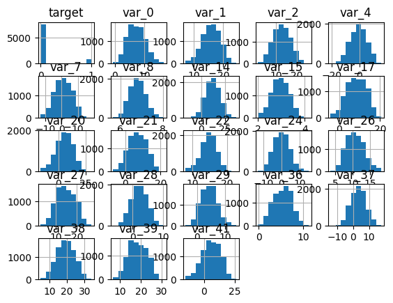
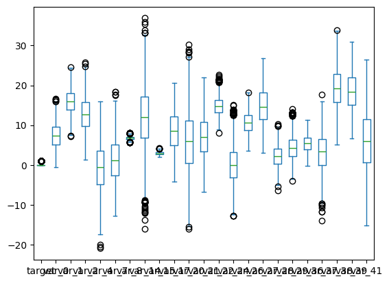
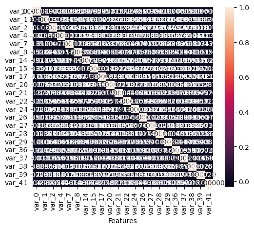
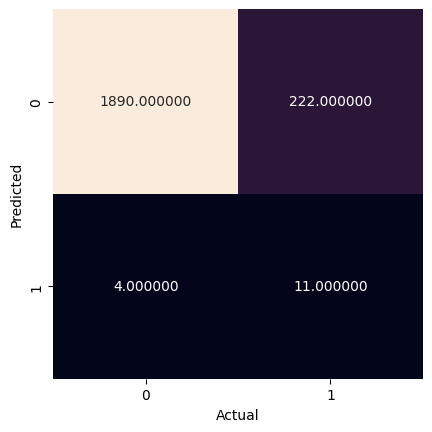

<a href="https://colab.research.google.com/github/efitznm/Data-Science-Portfolio-C22/blob/main/Modules/Module_1_Intro_to_DS_and_Naive_Bayes/Projects/Instructions/Project.1-Transactions/Project.1-Pass-08.ipynb" target="_parent"></a>

# Project.1_Pass-08, Transaction Data


## Problem Definition


State the business problem. Translate the business problem into a Data Science problem by stating what kind of problem it is ( supervised vs unsupervised ) and whether it is a classification, regression, or clustering problem.

### Business Problem
We want to predict whether or not a future customer will make a transaction based on their transaction data. The goal might be to increase customer transactions by sending targeted ads/deals to customers who are not likely to make a transaction on a given day.

### Data Science Problem
Supervised binary classification problem.

## Data Collection/Sources


### Load Pandas, Numpy, and Matplotlib modules


```python
# Load Pandas, Numpy, and Matplotlib modules
import pandas as pd
import numpy as np
import matplotlib.pyplot as plt
import seaborn as sns

from sklearn import datasets, metrics, model_selection
from sklearn import model_selection
from sklearn.naive_bayes import GaussianNB
from sklearn.model_selection import train_test_split
```

### Load data Train.csv from AWS S3[link text](https://)


```python
# Load the big dataset Train.big.csv from AWS S3
url = 'https://ddc-datascience.s3.amazonaws.com/Projects/Project.1-Transactions/Data/Transaction.train.big.csv'
url

df = pd.read_csv(
    url,
    usecols=range(50),
    nrows=50_000,
)

df
```


  <div id="df-f070c1ed-bf9d-4ee7-b6ba-8b9868dfe011" class="colab-df-container">
    <div>
<style scoped>
    .dataframe tbody tr th:only-of-type {
        vertical-align: middle;
    }

    .dataframe tbody tr th {
        vertical-align: top;
    }

    .dataframe thead th {
        text-align: right;
    }
</style>
<table border="1" class="dataframe">
  <thead>
    <tr style="text-align: right;">
      <th></th>
      <th>Unnamed: 0</th>
      <th>ID_code</th>
      <th>target</th>
      <th>var_0</th>
      <th>var_1</th>
      <th>var_2</th>
      <th>var_3</th>
      <th>var_4</th>
      <th>var_5</th>
      <th>var_6</th>
      <th>...</th>
      <th>var_37</th>
      <th>var_38</th>
      <th>var_39</th>
      <th>var_40</th>
      <th>var_41</th>
      <th>var_42</th>
      <th>var_43</th>
      <th>var_44</th>
      <th>var_45</th>
      <th>var_46</th>
    </tr>
  </thead>
  <tbody>
    <tr>
      <th>0</th>
      <td>0</td>
      <td>train_0</td>
      <td>NaN</td>
      <td>NaN</td>
      <td>NaN</td>
      <td>NaN</td>
      <td>NaN</td>
      <td>NaN</td>
      <td>NaN</td>
      <td>NaN</td>
      <td>...</td>
      <td>NaN</td>
      <td>NaN</td>
      <td>NaN</td>
      <td>NaN</td>
      <td>NaN</td>
      <td>NaN</td>
      <td>NaN</td>
      <td>NaN</td>
      <td>NaN</td>
      <td>NaN</td>
    </tr>
    <tr>
      <th>1</th>
      <td>1</td>
      <td>train_1</td>
      <td>NaN</td>
      <td>NaN</td>
      <td>NaN</td>
      <td>NaN</td>
      <td>NaN</td>
      <td>NaN</td>
      <td>NaN</td>
      <td>NaN</td>
      <td>...</td>
      <td>NaN</td>
      <td>NaN</td>
      <td>NaN</td>
      <td>NaN</td>
      <td>NaN</td>
      <td>NaN</td>
      <td>NaN</td>
      <td>NaN</td>
      <td>NaN</td>
      <td>NaN</td>
    </tr>
    <tr>
      <th>2</th>
      <td>2</td>
      <td>train_2</td>
      <td>NaN</td>
      <td>NaN</td>
      <td>NaN</td>
      <td>NaN</td>
      <td>NaN</td>
      <td>NaN</td>
      <td>NaN</td>
      <td>NaN</td>
      <td>...</td>
      <td>NaN</td>
      <td>NaN</td>
      <td>NaN</td>
      <td>NaN</td>
      <td>NaN</td>
      <td>NaN</td>
      <td>NaN</td>
      <td>NaN</td>
      <td>NaN</td>
      <td>NaN</td>
    </tr>
    <tr>
      <th>3</th>
      <td>3</td>
      <td>train_3</td>
      <td>0.0</td>
      <td>4.6739</td>
      <td>22.3915</td>
      <td>15.6015</td>
      <td>NaN</td>
      <td>0.0464</td>
      <td>NaN</td>
      <td>NaN</td>
      <td>...</td>
      <td>3.4635</td>
      <td>17.2850</td>
      <td>16.5520</td>
      <td>NaN</td>
      <td>-6.8709</td>
      <td>NaN</td>
      <td>NaN</td>
      <td>NaN</td>
      <td>NaN</td>
      <td>NaN</td>
    </tr>
    <tr>
      <th>4</th>
      <td>4</td>
      <td>train_4</td>
      <td>NaN</td>
      <td>NaN</td>
      <td>NaN</td>
      <td>NaN</td>
      <td>NaN</td>
      <td>NaN</td>
      <td>NaN</td>
      <td>NaN</td>
      <td>...</td>
      <td>NaN</td>
      <td>NaN</td>
      <td>NaN</td>
      <td>NaN</td>
      <td>NaN</td>
      <td>NaN</td>
      <td>NaN</td>
      <td>NaN</td>
      <td>NaN</td>
      <td>NaN</td>
    </tr>
    <tr>
      <th>...</th>
      <td>...</td>
      <td>...</td>
      <td>...</td>
      <td>...</td>
      <td>...</td>
      <td>...</td>
      <td>...</td>
      <td>...</td>
      <td>...</td>
      <td>...</td>
      <td>...</td>
      <td>...</td>
      <td>...</td>
      <td>...</td>
      <td>...</td>
      <td>...</td>
      <td>...</td>
      <td>...</td>
      <td>...</td>
      <td>...</td>
      <td>...</td>
    </tr>
    <tr>
      <th>49995</th>
      <td>49995</td>
      <td>train_49995</td>
      <td>NaN</td>
      <td>NaN</td>
      <td>NaN</td>
      <td>NaN</td>
      <td>NaN</td>
      <td>NaN</td>
      <td>NaN</td>
      <td>NaN</td>
      <td>...</td>
      <td>NaN</td>
      <td>NaN</td>
      <td>NaN</td>
      <td>NaN</td>
      <td>NaN</td>
      <td>NaN</td>
      <td>NaN</td>
      <td>NaN</td>
      <td>NaN</td>
      <td>NaN</td>
    </tr>
    <tr>
      <th>49996</th>
      <td>49996</td>
      <td>train_49996</td>
      <td>NaN</td>
      <td>NaN</td>
      <td>NaN</td>
      <td>NaN</td>
      <td>NaN</td>
      <td>NaN</td>
      <td>NaN</td>
      <td>NaN</td>
      <td>...</td>
      <td>NaN</td>
      <td>NaN</td>
      <td>NaN</td>
      <td>NaN</td>
      <td>NaN</td>
      <td>NaN</td>
      <td>NaN</td>
      <td>NaN</td>
      <td>NaN</td>
      <td>NaN</td>
    </tr>
    <tr>
      <th>49997</th>
      <td>49997</td>
      <td>train_49997</td>
      <td>NaN</td>
      <td>NaN</td>
      <td>NaN</td>
      <td>NaN</td>
      <td>NaN</td>
      <td>NaN</td>
      <td>NaN</td>
      <td>NaN</td>
      <td>...</td>
      <td>NaN</td>
      <td>NaN</td>
      <td>NaN</td>
      <td>NaN</td>
      <td>NaN</td>
      <td>NaN</td>
      <td>NaN</td>
      <td>NaN</td>
      <td>NaN</td>
      <td>NaN</td>
    </tr>
    <tr>
      <th>49998</th>
      <td>49998</td>
      <td>train_49998</td>
      <td>0.0</td>
      <td>7.7807</td>
      <td>11.4038</td>
      <td>11.2746</td>
      <td>NaN</td>
      <td>7.6426</td>
      <td>NaN</td>
      <td>NaN</td>
      <td>...</td>
      <td>5.0832</td>
      <td>18.0498</td>
      <td>19.0913</td>
      <td>NaN</td>
      <td>-0.0056</td>
      <td>NaN</td>
      <td>NaN</td>
      <td>NaN</td>
      <td>NaN</td>
      <td>NaN</td>
    </tr>
    <tr>
      <th>49999</th>
      <td>49999</td>
      <td>train_49999</td>
      <td>NaN</td>
      <td>NaN</td>
      <td>NaN</td>
      <td>NaN</td>
      <td>NaN</td>
      <td>NaN</td>
      <td>NaN</td>
      <td>NaN</td>
      <td>...</td>
      <td>NaN</td>
      <td>NaN</td>
      <td>NaN</td>
      <td>NaN</td>
      <td>NaN</td>
      <td>NaN</td>
      <td>NaN</td>
      <td>NaN</td>
      <td>NaN</td>
      <td>NaN</td>
    </tr>
  </tbody>
</table>
<p>50000 rows × 50 columns</p>
</div>
    <div class="colab-df-buttons">

  <div class="colab-df-container">
    <button class="colab-df-convert" onclick="convertToInteractive('df-f070c1ed-bf9d-4ee7-b6ba-8b9868dfe011')"
            title="Convert this dataframe to an interactive table."
            style="display:none;">

  <svg xmlns="http://www.w3.org/2000/svg" height="24px" viewBox="0 -960 960 960">
    <path d="M120-120v-720h720v720H120Zm60-500h600v-160H180v160Zm220 220h160v-160H400v160Zm0 220h160v-160H400v160ZM180-400h160v-160H180v160Zm440 0h160v-160H620v160ZM180-180h160v-160H180v160Zm440 0h160v-160H620v160Z"/>
  </svg>
    </button>

  <style>
    .colab-df-container {
      display:flex;
      gap: 12px;
    }

    .colab-df-convert {
      background-color: #E8F0FE;
      border: none;
      border-radius: 50%;
      cursor: pointer;
      display: none;
      fill: #1967D2;
      height: 32px;
      padding: 0 0 0 0;
      width: 32px;
    }

    .colab-df-convert:hover {
      background-color: #E2EBFA;
      box-shadow: 0px 1px 2px rgba(60, 64, 67, 0.3), 0px 1px 3px 1px rgba(60, 64, 67, 0.15);
      fill: #174EA6;
    }

    .colab-df-buttons div {
      margin-bottom: 4px;
    }

    [theme=dark] .colab-df-convert {
      background-color: #3B4455;
      fill: #D2E3FC;
    }

    [theme=dark] .colab-df-convert:hover {
      background-color: #434B5C;
      box-shadow: 0px 1px 3px 1px rgba(0, 0, 0, 0.15);
      filter: drop-shadow(0px 1px 2px rgba(0, 0, 0, 0.3));
      fill: #FFFFFF;
    }
  </style>

    <script>
      const buttonEl =
        document.querySelector('#df-f070c1ed-bf9d-4ee7-b6ba-8b9868dfe011 button.colab-df-convert');
      buttonEl.style.display =
        google.colab.kernel.accessAllowed ? 'block' : 'none';

      async function convertToInteractive(key) {
        const element = document.querySelector('#df-f070c1ed-bf9d-4ee7-b6ba-8b9868dfe011');
        const dataTable =
          await google.colab.kernel.invokeFunction('convertToInteractive',
                                                    [key], {});
        if (!dataTable) return;

        const docLinkHtml = 'Like what you see? Visit the ' +
          '<a target="_blank" href=https://colab.research.google.com/notebooks/data_table.ipynb>data table notebook</a>'
          + ' to learn more about interactive tables.';
        element.innerHTML = '';
        dataTable['output_type'] = 'display_data';
        await google.colab.output.renderOutput(dataTable, element);
        const docLink = document.createElement('div');
        docLink.innerHTML = docLinkHtml;
        element.appendChild(docLink);
      }
    </script>
  </div>


  <div id="id_7ed0e761-462f-4232-a9a2-f4e02e006203">
    <style>
      .colab-df-generate {
        background-color: #E8F0FE;
        border: none;
        border-radius: 50%;
        cursor: pointer;
        display: none;
        fill: #1967D2;
        height: 32px;
        padding: 0 0 0 0;
        width: 32px;
      }

      .colab-df-generate:hover {
        background-color: #E2EBFA;
        box-shadow: 0px 1px 2px rgba(60, 64, 67, 0.3), 0px 1px 3px 1px rgba(60, 64, 67, 0.15);
        fill: #174EA6;
      }

      [theme=dark] .colab-df-generate {
        background-color: #3B4455;
        fill: #D2E3FC;
      }

      [theme=dark] .colab-df-generate:hover {
        background-color: #434B5C;
        box-shadow: 0px 1px 3px 1px rgba(0, 0, 0, 0.15);
        filter: drop-shadow(0px 1px 2px rgba(0, 0, 0, 0.3));
        fill: #FFFFFF;
      }
    </style>
    <button class="colab-df-generate" onclick="generateWithVariable('df')"
            title="Generate code using this dataframe."
            style="display:none;">

  <svg xmlns="http://www.w3.org/2000/svg" height="24px"viewBox="0 0 24 24"
       width="24px">
    <path d="M7,19H8.4L18.45,9,17,7.55,7,17.6ZM5,21V16.75L18.45,3.32a2,2,0,0,1,2.83,0l1.4,1.43a1.91,1.91,0,0,1,.58,1.4,1.91,1.91,0,0,1-.58,1.4L9.25,21ZM18.45,9,17,7.55Zm-12,3A5.31,5.31,0,0,0,4.9,8.1,5.31,5.31,0,0,0,1,6.5,5.31,5.31,0,0,0,4.9,4.9,5.31,5.31,0,0,0,6.5,1,5.31,5.31,0,0,0,8.1,4.9,5.31,5.31,0,0,0,12,6.5,5.46,5.46,0,0,0,6.5,12Z"/>
  </svg>
    </button>
    <script>
      (() => {
      const buttonEl =
        document.querySelector('#id_7ed0e761-462f-4232-a9a2-f4e02e006203 button.colab-df-generate');
      buttonEl.style.display =
        google.colab.kernel.accessAllowed ? 'block' : 'none';

      buttonEl.onclick = () => {
        google.colab.notebook.generateWithVariable('df');
      }
      })();
    </script>
  </div>

    </div>
  </div>


```python
# Look at the first few rows
df.head()
```


  <div id="df-662c2e9a-a6e3-4fdd-8017-b104e5c2f050" class="colab-df-container">
    <div>
<style scoped>
    .dataframe tbody tr th:only-of-type {
        vertical-align: middle;
    }

    .dataframe tbody tr th {
        vertical-align: top;
    }

    .dataframe thead th {
        text-align: right;
    }
</style>
<table border="1" class="dataframe">
  <thead>
    <tr style="text-align: right;">
      <th></th>
      <th>Unnamed: 0</th>
      <th>ID_code</th>
      <th>target</th>
      <th>var_0</th>
      <th>var_1</th>
      <th>var_2</th>
      <th>var_3</th>
      <th>var_4</th>
      <th>var_5</th>
      <th>var_6</th>
      <th>...</th>
      <th>var_37</th>
      <th>var_38</th>
      <th>var_39</th>
      <th>var_40</th>
      <th>var_41</th>
      <th>var_42</th>
      <th>var_43</th>
      <th>var_44</th>
      <th>var_45</th>
      <th>var_46</th>
    </tr>
  </thead>
  <tbody>
    <tr>
      <th>0</th>
      <td>0</td>
      <td>train_0</td>
      <td>NaN</td>
      <td>NaN</td>
      <td>NaN</td>
      <td>NaN</td>
      <td>NaN</td>
      <td>NaN</td>
      <td>NaN</td>
      <td>NaN</td>
      <td>...</td>
      <td>NaN</td>
      <td>NaN</td>
      <td>NaN</td>
      <td>NaN</td>
      <td>NaN</td>
      <td>NaN</td>
      <td>NaN</td>
      <td>NaN</td>
      <td>NaN</td>
      <td>NaN</td>
    </tr>
    <tr>
      <th>1</th>
      <td>1</td>
      <td>train_1</td>
      <td>NaN</td>
      <td>NaN</td>
      <td>NaN</td>
      <td>NaN</td>
      <td>NaN</td>
      <td>NaN</td>
      <td>NaN</td>
      <td>NaN</td>
      <td>...</td>
      <td>NaN</td>
      <td>NaN</td>
      <td>NaN</td>
      <td>NaN</td>
      <td>NaN</td>
      <td>NaN</td>
      <td>NaN</td>
      <td>NaN</td>
      <td>NaN</td>
      <td>NaN</td>
    </tr>
    <tr>
      <th>2</th>
      <td>2</td>
      <td>train_2</td>
      <td>NaN</td>
      <td>NaN</td>
      <td>NaN</td>
      <td>NaN</td>
      <td>NaN</td>
      <td>NaN</td>
      <td>NaN</td>
      <td>NaN</td>
      <td>...</td>
      <td>NaN</td>
      <td>NaN</td>
      <td>NaN</td>
      <td>NaN</td>
      <td>NaN</td>
      <td>NaN</td>
      <td>NaN</td>
      <td>NaN</td>
      <td>NaN</td>
      <td>NaN</td>
    </tr>
    <tr>
      <th>3</th>
      <td>3</td>
      <td>train_3</td>
      <td>0.0</td>
      <td>4.6739</td>
      <td>22.3915</td>
      <td>15.6015</td>
      <td>NaN</td>
      <td>0.0464</td>
      <td>NaN</td>
      <td>NaN</td>
      <td>...</td>
      <td>3.4635</td>
      <td>17.285</td>
      <td>16.552</td>
      <td>NaN</td>
      <td>-6.8709</td>
      <td>NaN</td>
      <td>NaN</td>
      <td>NaN</td>
      <td>NaN</td>
      <td>NaN</td>
    </tr>
    <tr>
      <th>4</th>
      <td>4</td>
      <td>train_4</td>
      <td>NaN</td>
      <td>NaN</td>
      <td>NaN</td>
      <td>NaN</td>
      <td>NaN</td>
      <td>NaN</td>
      <td>NaN</td>
      <td>NaN</td>
      <td>...</td>
      <td>NaN</td>
      <td>NaN</td>
      <td>NaN</td>
      <td>NaN</td>
      <td>NaN</td>
      <td>NaN</td>
      <td>NaN</td>
      <td>NaN</td>
      <td>NaN</td>
      <td>NaN</td>
    </tr>
  </tbody>
</table>
<p>5 rows × 50 columns</p>
</div>
    <div class="colab-df-buttons">

  <div class="colab-df-container">
    <button class="colab-df-convert" onclick="convertToInteractive('df-662c2e9a-a6e3-4fdd-8017-b104e5c2f050')"
            title="Convert this dataframe to an interactive table."
            style="display:none;">

  <svg xmlns="http://www.w3.org/2000/svg" height="24px" viewBox="0 -960 960 960">
    <path d="M120-120v-720h720v720H120Zm60-500h600v-160H180v160Zm220 220h160v-160H400v160Zm0 220h160v-160H400v160ZM180-400h160v-160H180v160Zm440 0h160v-160H620v160ZM180-180h160v-160H180v160Zm440 0h160v-160H620v160Z"/>
  </svg>
    </button>

  <style>
    .colab-df-container {
      display:flex;
      gap: 12px;
    }

    .colab-df-convert {
      background-color: #E8F0FE;
      border: none;
      border-radius: 50%;
      cursor: pointer;
      display: none;
      fill: #1967D2;
      height: 32px;
      padding: 0 0 0 0;
      width: 32px;
    }

    .colab-df-convert:hover {
      background-color: #E2EBFA;
      box-shadow: 0px 1px 2px rgba(60, 64, 67, 0.3), 0px 1px 3px 1px rgba(60, 64, 67, 0.15);
      fill: #174EA6;
    }

    .colab-df-buttons div {
      margin-bottom: 4px;
    }

    [theme=dark] .colab-df-convert {
      background-color: #3B4455;
      fill: #D2E3FC;
    }

    [theme=dark] .colab-df-convert:hover {
      background-color: #434B5C;
      box-shadow: 0px 1px 3px 1px rgba(0, 0, 0, 0.15);
      filter: drop-shadow(0px 1px 2px rgba(0, 0, 0, 0.3));
      fill: #FFFFFF;
    }
  </style>

    <script>
      const buttonEl =
        document.querySelector('#df-662c2e9a-a6e3-4fdd-8017-b104e5c2f050 button.colab-df-convert');
      buttonEl.style.display =
        google.colab.kernel.accessAllowed ? 'block' : 'none';

      async function convertToInteractive(key) {
        const element = document.querySelector('#df-662c2e9a-a6e3-4fdd-8017-b104e5c2f050');
        const dataTable =
          await google.colab.kernel.invokeFunction('convertToInteractive',
                                                    [key], {});
        if (!dataTable) return;

        const docLinkHtml = 'Like what you see? Visit the ' +
          '<a target="_blank" href=https://colab.research.google.com/notebooks/data_table.ipynb>data table notebook</a>'
          + ' to learn more about interactive tables.';
        element.innerHTML = '';
        dataTable['output_type'] = 'display_data';
        await google.colab.output.renderOutput(dataTable, element);
        const docLink = document.createElement('div');
        docLink.innerHTML = docLinkHtml;
        element.appendChild(docLink);
      }
    </script>
  </div>


    </div>
  </div>


```python
# Look at the last few rows
df.tail()
```


  <div id="df-7f7e8f8b-5c36-461b-b63a-a15ba01cc114" class="colab-df-container">
    <div>
<style scoped>
    .dataframe tbody tr th:only-of-type {
        vertical-align: middle;
    }

    .dataframe tbody tr th {
        vertical-align: top;
    }

    .dataframe thead th {
        text-align: right;
    }
</style>
<table border="1" class="dataframe">
  <thead>
    <tr style="text-align: right;">
      <th></th>
      <th>Unnamed: 0</th>
      <th>ID_code</th>
      <th>target</th>
      <th>var_0</th>
      <th>var_1</th>
      <th>var_2</th>
      <th>var_3</th>
      <th>var_4</th>
      <th>var_5</th>
      <th>var_6</th>
      <th>...</th>
      <th>var_37</th>
      <th>var_38</th>
      <th>var_39</th>
      <th>var_40</th>
      <th>var_41</th>
      <th>var_42</th>
      <th>var_43</th>
      <th>var_44</th>
      <th>var_45</th>
      <th>var_46</th>
    </tr>
  </thead>
  <tbody>
    <tr>
      <th>49995</th>
      <td>49995</td>
      <td>train_49995</td>
      <td>NaN</td>
      <td>NaN</td>
      <td>NaN</td>
      <td>NaN</td>
      <td>NaN</td>
      <td>NaN</td>
      <td>NaN</td>
      <td>NaN</td>
      <td>...</td>
      <td>NaN</td>
      <td>NaN</td>
      <td>NaN</td>
      <td>NaN</td>
      <td>NaN</td>
      <td>NaN</td>
      <td>NaN</td>
      <td>NaN</td>
      <td>NaN</td>
      <td>NaN</td>
    </tr>
    <tr>
      <th>49996</th>
      <td>49996</td>
      <td>train_49996</td>
      <td>NaN</td>
      <td>NaN</td>
      <td>NaN</td>
      <td>NaN</td>
      <td>NaN</td>
      <td>NaN</td>
      <td>NaN</td>
      <td>NaN</td>
      <td>...</td>
      <td>NaN</td>
      <td>NaN</td>
      <td>NaN</td>
      <td>NaN</td>
      <td>NaN</td>
      <td>NaN</td>
      <td>NaN</td>
      <td>NaN</td>
      <td>NaN</td>
      <td>NaN</td>
    </tr>
    <tr>
      <th>49997</th>
      <td>49997</td>
      <td>train_49997</td>
      <td>NaN</td>
      <td>NaN</td>
      <td>NaN</td>
      <td>NaN</td>
      <td>NaN</td>
      <td>NaN</td>
      <td>NaN</td>
      <td>NaN</td>
      <td>...</td>
      <td>NaN</td>
      <td>NaN</td>
      <td>NaN</td>
      <td>NaN</td>
      <td>NaN</td>
      <td>NaN</td>
      <td>NaN</td>
      <td>NaN</td>
      <td>NaN</td>
      <td>NaN</td>
    </tr>
    <tr>
      <th>49998</th>
      <td>49998</td>
      <td>train_49998</td>
      <td>0.0</td>
      <td>7.7807</td>
      <td>11.4038</td>
      <td>11.2746</td>
      <td>NaN</td>
      <td>7.6426</td>
      <td>NaN</td>
      <td>NaN</td>
      <td>...</td>
      <td>5.0832</td>
      <td>18.0498</td>
      <td>19.0913</td>
      <td>NaN</td>
      <td>-0.0056</td>
      <td>NaN</td>
      <td>NaN</td>
      <td>NaN</td>
      <td>NaN</td>
      <td>NaN</td>
    </tr>
    <tr>
      <th>49999</th>
      <td>49999</td>
      <td>train_49999</td>
      <td>NaN</td>
      <td>NaN</td>
      <td>NaN</td>
      <td>NaN</td>
      <td>NaN</td>
      <td>NaN</td>
      <td>NaN</td>
      <td>NaN</td>
      <td>...</td>
      <td>NaN</td>
      <td>NaN</td>
      <td>NaN</td>
      <td>NaN</td>
      <td>NaN</td>
      <td>NaN</td>
      <td>NaN</td>
      <td>NaN</td>
      <td>NaN</td>
      <td>NaN</td>
    </tr>
  </tbody>
</table>
<p>5 rows × 50 columns</p>
</div>
    <div class="colab-df-buttons">

  <div class="colab-df-container">
    <button class="colab-df-convert" onclick="convertToInteractive('df-7f7e8f8b-5c36-461b-b63a-a15ba01cc114')"
            title="Convert this dataframe to an interactive table."
            style="display:none;">

  <svg xmlns="http://www.w3.org/2000/svg" height="24px" viewBox="0 -960 960 960">
    <path d="M120-120v-720h720v720H120Zm60-500h600v-160H180v160Zm220 220h160v-160H400v160Zm0 220h160v-160H400v160ZM180-400h160v-160H180v160Zm440 0h160v-160H620v160ZM180-180h160v-160H180v160Zm440 0h160v-160H620v160Z"/>
  </svg>
    </button>

  <style>
    .colab-df-container {
      display:flex;
      gap: 12px;
    }

    .colab-df-convert {
      background-color: #E8F0FE;
      border: none;
      border-radius: 50%;
      cursor: pointer;
      display: none;
      fill: #1967D2;
      height: 32px;
      padding: 0 0 0 0;
      width: 32px;
    }

    .colab-df-convert:hover {
      background-color: #E2EBFA;
      box-shadow: 0px 1px 2px rgba(60, 64, 67, 0.3), 0px 1px 3px 1px rgba(60, 64, 67, 0.15);
      fill: #174EA6;
    }

    .colab-df-buttons div {
      margin-bottom: 4px;
    }

    [theme=dark] .colab-df-convert {
      background-color: #3B4455;
      fill: #D2E3FC;
    }

    [theme=dark] .colab-df-convert:hover {
      background-color: #434B5C;
      box-shadow: 0px 1px 3px 1px rgba(0, 0, 0, 0.15);
      filter: drop-shadow(0px 1px 2px rgba(0, 0, 0, 0.3));
      fill: #FFFFFF;
    }
  </style>

    <script>
      const buttonEl =
        document.querySelector('#df-7f7e8f8b-5c36-461b-b63a-a15ba01cc114 button.colab-df-convert');
      buttonEl.style.display =
        google.colab.kernel.accessAllowed ? 'block' : 'none';

      async function convertToInteractive(key) {
        const element = document.querySelector('#df-7f7e8f8b-5c36-461b-b63a-a15ba01cc114');
        const dataTable =
          await google.colab.kernel.invokeFunction('convertToInteractive',
                                                    [key], {});
        if (!dataTable) return;

        const docLinkHtml = 'Like what you see? Visit the ' +
          '<a target="_blank" href=https://colab.research.google.com/notebooks/data_table.ipynb>data table notebook</a>'
          + ' to learn more about interactive tables.';
        element.innerHTML = '';
        dataTable['output_type'] = 'display_data';
        await google.colab.output.renderOutput(dataTable, element);
        const docLink = document.createElement('div');
        docLink.innerHTML = docLinkHtml;
        element.appendChild(docLink);
      }
    </script>
  </div>


    </div>
  </div>


## Data Cleaning


### Summary Meta-Data


```python
# Shape of the dataframe
df.shape
```


    (50000, 50)


```python
# Size of the dataframe
df.size
```


    2500000


```python
# Display meta-data
df.info()
```

    <class 'pandas.core.frame.DataFrame'>
    RangeIndex: 50000 entries, 0 to 49999
    Data columns (total 50 columns):
     #   Column      Non-Null Count  Dtype  
    ---  ------      --------------  -----  
     0   Unnamed: 0  50000 non-null  int64  
     1   ID_code     50000 non-null  object 
     2   target      8506 non-null   float64
     3   var_0       8506 non-null   float64
     4   var_1       8506 non-null   float64
     5   var_2       8506 non-null   float64
     6   var_3       0 non-null      float64
     7   var_4       8506 non-null   float64
     8   var_5       0 non-null      float64
     9   var_6       0 non-null      float64
     10  var_7       8506 non-null   float64
     11  var_8       8506 non-null   float64
     12  var_9       0 non-null      float64
     13  var_10      0 non-null      float64
     14  var_11      0 non-null      float64
     15  var_12      0 non-null      float64
     16  var_13      0 non-null      float64
     17  var_14      8506 non-null   float64
     18  var_15      8506 non-null   float64
     19  var_16      0 non-null      float64
     20  var_17      8506 non-null   float64
     21  var_18      0 non-null      float64
     22  var_19      0 non-null      float64
     23  var_20      8506 non-null   float64
     24  var_21      8506 non-null   float64
     25  var_22      8506 non-null   float64
     26  var_23      0 non-null      float64
     27  var_24      8506 non-null   float64
     28  var_25      0 non-null      float64
     29  var_26      8506 non-null   float64
     30  var_27      8506 non-null   float64
     31  var_28      8506 non-null   float64
     32  var_29      8506 non-null   float64
     33  var_30      0 non-null      float64
     34  var_31      0 non-null      float64
     35  var_32      0 non-null      float64
     36  var_33      0 non-null      float64
     37  var_34      0 non-null      float64
     38  var_35      0 non-null      float64
     39  var_36      8506 non-null   float64
     40  var_37      8506 non-null   float64
     41  var_38      8506 non-null   float64
     42  var_39      8506 non-null   float64
     43  var_40      0 non-null      float64
     44  var_41      8506 non-null   float64
     45  var_42      0 non-null      float64
     46  var_43      0 non-null      float64
     47  var_44      0 non-null      float64
     48  var_45      0 non-null      float64
     49  var_46      0 non-null      float64
    dtypes: float64(48), int64(1), object(1)
    memory usage: 19.1+ MB


### Summary Statistics


```python
# Display summary statistics
df.describe()
```


  <div id="df-d3b40e22-956c-405d-b058-692bf0ce0569" class="colab-df-container">
    <div>
<style scoped>
    .dataframe tbody tr th:only-of-type {
        vertical-align: middle;
    }

    .dataframe tbody tr th {
        vertical-align: top;
    }

    .dataframe thead th {
        text-align: right;
    }
</style>
<table border="1" class="dataframe">
  <thead>
    <tr style="text-align: right;">
      <th></th>
      <th>Unnamed: 0</th>
      <th>target</th>
      <th>var_0</th>
      <th>var_1</th>
      <th>var_2</th>
      <th>var_3</th>
      <th>var_4</th>
      <th>var_5</th>
      <th>var_6</th>
      <th>var_7</th>
      <th>...</th>
      <th>var_37</th>
      <th>var_38</th>
      <th>var_39</th>
      <th>var_40</th>
      <th>var_41</th>
      <th>var_42</th>
      <th>var_43</th>
      <th>var_44</th>
      <th>var_45</th>
      <th>var_46</th>
    </tr>
  </thead>
  <tbody>
    <tr>
      <th>count</th>
      <td>50000.000000</td>
      <td>8506.000000</td>
      <td>8506.000000</td>
      <td>8506.000000</td>
      <td>8506.000000</td>
      <td>0.0</td>
      <td>8506.000000</td>
      <td>0.0</td>
      <td>0.0</td>
      <td>8506.000000</td>
      <td>...</td>
      <td>8506.000000</td>
      <td>8506.000000</td>
      <td>8506.000000</td>
      <td>0.0</td>
      <td>8506.000000</td>
      <td>0.0</td>
      <td>0.0</td>
      <td>0.0</td>
      <td>0.0</td>
      <td>0.0</td>
    </tr>
    <tr>
      <th>mean</th>
      <td>24999.500000</td>
      <td>0.098754</td>
      <td>7.433406</td>
      <td>15.873152</td>
      <td>12.743673</td>
      <td>NaN</td>
      <td>-0.666477</td>
      <td>NaN</td>
      <td>NaN</td>
      <td>1.216609</td>
      <td>...</td>
      <td>3.335911</td>
      <td>19.317877</td>
      <td>18.439225</td>
      <td>NaN</td>
      <td>5.768740</td>
      <td>NaN</td>
      <td>NaN</td>
      <td>NaN</td>
      <td>NaN</td>
      <td>NaN</td>
    </tr>
    <tr>
      <th>std</th>
      <td>14433.901067</td>
      <td>0.298349</td>
      <td>2.998493</td>
      <td>3.026206</td>
      <td>4.167618</td>
      <td>NaN</td>
      <td>5.989788</td>
      <td>NaN</td>
      <td>NaN</td>
      <td>5.206295</td>
      <td>...</td>
      <td>4.541526</td>
      <td>5.013834</td>
      <td>4.398037</td>
      <td>NaN</td>
      <td>7.462482</td>
      <td>NaN</td>
      <td>NaN</td>
      <td>NaN</td>
      <td>NaN</td>
      <td>NaN</td>
    </tr>
    <tr>
      <th>min</th>
      <td>0.000000</td>
      <td>0.000000</td>
      <td>-0.482300</td>
      <td>7.193400</td>
      <td>1.263600</td>
      <td>NaN</td>
      <td>-20.962200</td>
      <td>NaN</td>
      <td>NaN</td>
      <td>-12.739600</td>
      <td>...</td>
      <td>-13.999500</td>
      <td>5.133100</td>
      <td>6.673300</td>
      <td>NaN</td>
      <td>-15.121100</td>
      <td>NaN</td>
      <td>NaN</td>
      <td>NaN</td>
      <td>NaN</td>
      <td>NaN</td>
    </tr>
    <tr>
      <th>25%</th>
      <td>12499.750000</td>
      <td>0.000000</td>
      <td>5.192575</td>
      <td>13.822750</td>
      <td>9.709300</td>
      <td>NaN</td>
      <td>-4.915275</td>
      <td>NaN</td>
      <td>NaN</td>
      <td>-2.600700</td>
      <td>...</td>
      <td>0.018500</td>
      <td>15.712475</td>
      <td>15.044250</td>
      <td>NaN</td>
      <td>0.638225</td>
      <td>NaN</td>
      <td>NaN</td>
      <td>NaN</td>
      <td>NaN</td>
      <td>NaN</td>
    </tr>
    <tr>
      <th>50%</th>
      <td>24999.500000</td>
      <td>0.000000</td>
      <td>7.286950</td>
      <td>15.971650</td>
      <td>12.660600</td>
      <td>NaN</td>
      <td>-0.585350</td>
      <td>NaN</td>
      <td>NaN</td>
      <td>1.209900</td>
      <td>...</td>
      <td>3.366600</td>
      <td>19.318800</td>
      <td>18.293700</td>
      <td>NaN</td>
      <td>5.958900</td>
      <td>NaN</td>
      <td>NaN</td>
      <td>NaN</td>
      <td>NaN</td>
      <td>NaN</td>
    </tr>
    <tr>
      <th>75%</th>
      <td>37499.250000</td>
      <td>0.000000</td>
      <td>9.523925</td>
      <td>18.092725</td>
      <td>15.755275</td>
      <td>NaN</td>
      <td>3.615725</td>
      <td>NaN</td>
      <td>NaN</td>
      <td>5.146000</td>
      <td>...</td>
      <td>6.482825</td>
      <td>22.906000</td>
      <td>21.907575</td>
      <td>NaN</td>
      <td>11.427175</td>
      <td>NaN</td>
      <td>NaN</td>
      <td>NaN</td>
      <td>NaN</td>
      <td>NaN</td>
    </tr>
    <tr>
      <th>max</th>
      <td>49999.000000</td>
      <td>1.000000</td>
      <td>16.716500</td>
      <td>24.508500</td>
      <td>25.848100</td>
      <td>NaN</td>
      <td>15.973100</td>
      <td>NaN</td>
      <td>NaN</td>
      <td>18.419700</td>
      <td>...</td>
      <td>17.686100</td>
      <td>33.940300</td>
      <td>31.018900</td>
      <td>NaN</td>
      <td>26.401100</td>
      <td>NaN</td>
      <td>NaN</td>
      <td>NaN</td>
      <td>NaN</td>
      <td>NaN</td>
    </tr>
  </tbody>
</table>
<p>8 rows × 49 columns</p>
</div>
    <div class="colab-df-buttons">

  <div class="colab-df-container">
    <button class="colab-df-convert" onclick="convertToInteractive('df-d3b40e22-956c-405d-b058-692bf0ce0569')"
            title="Convert this dataframe to an interactive table."
            style="display:none;">

  <svg xmlns="http://www.w3.org/2000/svg" height="24px" viewBox="0 -960 960 960">
    <path d="M120-120v-720h720v720H120Zm60-500h600v-160H180v160Zm220 220h160v-160H400v160Zm0 220h160v-160H400v160ZM180-400h160v-160H180v160Zm440 0h160v-160H620v160ZM180-180h160v-160H180v160Zm440 0h160v-160H620v160Z"/>
  </svg>
    </button>

  <style>
    .colab-df-container {
      display:flex;
      gap: 12px;
    }

    .colab-df-convert {
      background-color: #E8F0FE;
      border: none;
      border-radius: 50%;
      cursor: pointer;
      display: none;
      fill: #1967D2;
      height: 32px;
      padding: 0 0 0 0;
      width: 32px;
    }

    .colab-df-convert:hover {
      background-color: #E2EBFA;
      box-shadow: 0px 1px 2px rgba(60, 64, 67, 0.3), 0px 1px 3px 1px rgba(60, 64, 67, 0.15);
      fill: #174EA6;
    }

    .colab-df-buttons div {
      margin-bottom: 4px;
    }

    [theme=dark] .colab-df-convert {
      background-color: #3B4455;
      fill: #D2E3FC;
    }

    [theme=dark] .colab-df-convert:hover {
      background-color: #434B5C;
      box-shadow: 0px 1px 3px 1px rgba(0, 0, 0, 0.15);
      filter: drop-shadow(0px 1px 2px rgba(0, 0, 0, 0.3));
      fill: #FFFFFF;
    }
  </style>

    <script>
      const buttonEl =
        document.querySelector('#df-d3b40e22-956c-405d-b058-692bf0ce0569 button.colab-df-convert');
      buttonEl.style.display =
        google.colab.kernel.accessAllowed ? 'block' : 'none';

      async function convertToInteractive(key) {
        const element = document.querySelector('#df-d3b40e22-956c-405d-b058-692bf0ce0569');
        const dataTable =
          await google.colab.kernel.invokeFunction('convertToInteractive',
                                                    [key], {});
        if (!dataTable) return;

        const docLinkHtml = 'Like what you see? Visit the ' +
          '<a target="_blank" href=https://colab.research.google.com/notebooks/data_table.ipynb>data table notebook</a>'
          + ' to learn more about interactive tables.';
        element.innerHTML = '';
        dataTable['output_type'] = 'display_data';
        await google.colab.output.renderOutput(dataTable, element);
        const docLink = document.createElement('div');
        docLink.innerHTML = docLinkHtml;
        element.appendChild(docLink);
      }
    </script>
  </div>


    </div>
  </div>


### Data Types


```python
# Display data types of columns
df.dtypes
```


<div>
<style scoped>
    .dataframe tbody tr th:only-of-type {
        vertical-align: middle;
    }

    .dataframe tbody tr th {
        vertical-align: top;
    }

    .dataframe thead th {
        text-align: right;
    }
</style>
<table border="1" class="dataframe">
  <thead>
    <tr style="text-align: right;">
      <th></th>
      <th>0</th>
    </tr>
  </thead>
  <tbody>
    <tr>
      <th>Unnamed: 0</th>
      <td>int64</td>
    </tr>
    <tr>
      <th>ID_code</th>
      <td>object</td>
    </tr>
    <tr>
      <th>target</th>
      <td>float64</td>
    </tr>
    <tr>
      <th>var_0</th>
      <td>float64</td>
    </tr>
    <tr>
      <th>var_1</th>
      <td>float64</td>
    </tr>
    <tr>
      <th>var_2</th>
      <td>float64</td>
    </tr>
    <tr>
      <th>var_3</th>
      <td>float64</td>
    </tr>
    <tr>
      <th>var_4</th>
      <td>float64</td>
    </tr>
    <tr>
      <th>var_5</th>
      <td>float64</td>
    </tr>
    <tr>
      <th>var_6</th>
      <td>float64</td>
    </tr>
    <tr>
      <th>var_7</th>
      <td>float64</td>
    </tr>
    <tr>
      <th>var_8</th>
      <td>float64</td>
    </tr>
    <tr>
      <th>var_9</th>
      <td>float64</td>
    </tr>
    <tr>
      <th>var_10</th>
      <td>float64</td>
    </tr>
    <tr>
      <th>var_11</th>
      <td>float64</td>
    </tr>
    <tr>
      <th>var_12</th>
      <td>float64</td>
    </tr>
    <tr>
      <th>var_13</th>
      <td>float64</td>
    </tr>
    <tr>
      <th>var_14</th>
      <td>float64</td>
    </tr>
    <tr>
      <th>var_15</th>
      <td>float64</td>
    </tr>
    <tr>
      <th>var_16</th>
      <td>float64</td>
    </tr>
    <tr>
      <th>var_17</th>
      <td>float64</td>
    </tr>
    <tr>
      <th>var_18</th>
      <td>float64</td>
    </tr>
    <tr>
      <th>var_19</th>
      <td>float64</td>
    </tr>
    <tr>
      <th>var_20</th>
      <td>float64</td>
    </tr>
    <tr>
      <th>var_21</th>
      <td>float64</td>
    </tr>
    <tr>
      <th>var_22</th>
      <td>float64</td>
    </tr>
    <tr>
      <th>var_23</th>
      <td>float64</td>
    </tr>
    <tr>
      <th>var_24</th>
      <td>float64</td>
    </tr>
    <tr>
      <th>var_25</th>
      <td>float64</td>
    </tr>
    <tr>
      <th>var_26</th>
      <td>float64</td>
    </tr>
    <tr>
      <th>var_27</th>
      <td>float64</td>
    </tr>
    <tr>
      <th>var_28</th>
      <td>float64</td>
    </tr>
    <tr>
      <th>var_29</th>
      <td>float64</td>
    </tr>
    <tr>
      <th>var_30</th>
      <td>float64</td>
    </tr>
    <tr>
      <th>var_31</th>
      <td>float64</td>
    </tr>
    <tr>
      <th>var_32</th>
      <td>float64</td>
    </tr>
    <tr>
      <th>var_33</th>
      <td>float64</td>
    </tr>
    <tr>
      <th>var_34</th>
      <td>float64</td>
    </tr>
    <tr>
      <th>var_35</th>
      <td>float64</td>
    </tr>
    <tr>
      <th>var_36</th>
      <td>float64</td>
    </tr>
    <tr>
      <th>var_37</th>
      <td>float64</td>
    </tr>
    <tr>
      <th>var_38</th>
      <td>float64</td>
    </tr>
    <tr>
      <th>var_39</th>
      <td>float64</td>
    </tr>
    <tr>
      <th>var_40</th>
      <td>float64</td>
    </tr>
    <tr>
      <th>var_41</th>
      <td>float64</td>
    </tr>
    <tr>
      <th>var_42</th>
      <td>float64</td>
    </tr>
    <tr>
      <th>var_43</th>
      <td>float64</td>
    </tr>
    <tr>
      <th>var_44</th>
      <td>float64</td>
    </tr>
    <tr>
      <th>var_45</th>
      <td>float64</td>
    </tr>
    <tr>
      <th>var_46</th>
      <td>float64</td>
    </tr>
  </tbody>
</table>
</div><br><label><b>dtype:</b> object</label>


### Nulls and Identifier Columns
Imputation required on account of the nulls.

#### NOTE: the ‘target’ column indicates a successful transaction (‘1’) or a no-transaction (‘0’). Verify these are the only values in that column, and that there are no nulls.

#### Target Value Counts

Binary numerical classification and nulls are present.


```python
# Value_counts on target ; include nulls
df['target'].value_counts(dropna=False)
```


<div>
<style scoped>
    .dataframe tbody tr th:only-of-type {
        vertical-align: middle;
    }

    .dataframe tbody tr th {
        vertical-align: top;
    }

    .dataframe thead th {
        text-align: right;
    }
</style>
<table border="1" class="dataframe">
  <thead>
    <tr style="text-align: right;">
      <th></th>
      <th>count</th>
    </tr>
    <tr>
      <th>target</th>
      <th></th>
    </tr>
  </thead>
  <tbody>
    <tr>
      <th>NaN</th>
      <td>41494</td>
    </tr>
    <tr>
      <th>0.0</th>
      <td>7666</td>
    </tr>
    <tr>
      <th>1.0</th>
      <td>840</td>
    </tr>
  </tbody>
</table>
</div><br><label><b>dtype:</b> int64</label>


#### Normalize The Data


```python
# Normalized value_counts on target ; include nulls
df['target'].value_counts(dropna=False, normalize=True)
```


<div>
<style scoped>
    .dataframe tbody tr th:only-of-type {
        vertical-align: middle;
    }

    .dataframe tbody tr th {
        vertical-align: top;
    }

    .dataframe thead th {
        text-align: right;
    }
</style>
<table border="1" class="dataframe">
  <thead>
    <tr style="text-align: right;">
      <th></th>
      <th>proportion</th>
    </tr>
    <tr>
      <th>target</th>
      <th></th>
    </tr>
  </thead>
  <tbody>
    <tr>
      <th>NaN</th>
      <td>0.82988</td>
    </tr>
    <tr>
      <th>0.0</th>
      <td>0.15332</td>
    </tr>
    <tr>
      <th>1.0</th>
      <td>0.01680</td>
    </tr>
  </tbody>
</table>
</div><br><label><b>dtype:</b> float64</label>


#### Nulls


```python
# Look for nulls
df.isnull().sum().sort_values(ascending=False)
```


<div>
<style scoped>
    .dataframe tbody tr th:only-of-type {
        vertical-align: middle;
    }

    .dataframe tbody tr th {
        vertical-align: top;
    }

    .dataframe thead th {
        text-align: right;
    }
</style>
<table border="1" class="dataframe">
  <thead>
    <tr style="text-align: right;">
      <th></th>
      <th>0</th>
    </tr>
  </thead>
  <tbody>
    <tr>
      <th>var_6</th>
      <td>50000</td>
    </tr>
    <tr>
      <th>var_5</th>
      <td>50000</td>
    </tr>
    <tr>
      <th>var_11</th>
      <td>50000</td>
    </tr>
    <tr>
      <th>var_12</th>
      <td>50000</td>
    </tr>
    <tr>
      <th>var_3</th>
      <td>50000</td>
    </tr>
    <tr>
      <th>var_13</th>
      <td>50000</td>
    </tr>
    <tr>
      <th>var_9</th>
      <td>50000</td>
    </tr>
    <tr>
      <th>var_10</th>
      <td>50000</td>
    </tr>
    <tr>
      <th>var_42</th>
      <td>50000</td>
    </tr>
    <tr>
      <th>var_40</th>
      <td>50000</td>
    </tr>
    <tr>
      <th>var_45</th>
      <td>50000</td>
    </tr>
    <tr>
      <th>var_46</th>
      <td>50000</td>
    </tr>
    <tr>
      <th>var_30</th>
      <td>50000</td>
    </tr>
    <tr>
      <th>var_25</th>
      <td>50000</td>
    </tr>
    <tr>
      <th>var_23</th>
      <td>50000</td>
    </tr>
    <tr>
      <th>var_19</th>
      <td>50000</td>
    </tr>
    <tr>
      <th>var_18</th>
      <td>50000</td>
    </tr>
    <tr>
      <th>var_16</th>
      <td>50000</td>
    </tr>
    <tr>
      <th>var_43</th>
      <td>50000</td>
    </tr>
    <tr>
      <th>var_33</th>
      <td>50000</td>
    </tr>
    <tr>
      <th>var_44</th>
      <td>50000</td>
    </tr>
    <tr>
      <th>var_35</th>
      <td>50000</td>
    </tr>
    <tr>
      <th>var_34</th>
      <td>50000</td>
    </tr>
    <tr>
      <th>var_31</th>
      <td>50000</td>
    </tr>
    <tr>
      <th>var_32</th>
      <td>50000</td>
    </tr>
    <tr>
      <th>var_28</th>
      <td>41494</td>
    </tr>
    <tr>
      <th>var_0</th>
      <td>41494</td>
    </tr>
    <tr>
      <th>var_4</th>
      <td>41494</td>
    </tr>
    <tr>
      <th>var_14</th>
      <td>41494</td>
    </tr>
    <tr>
      <th>var_7</th>
      <td>41494</td>
    </tr>
    <tr>
      <th>var_2</th>
      <td>41494</td>
    </tr>
    <tr>
      <th>var_1</th>
      <td>41494</td>
    </tr>
    <tr>
      <th>var_8</th>
      <td>41494</td>
    </tr>
    <tr>
      <th>target</th>
      <td>41494</td>
    </tr>
    <tr>
      <th>var_15</th>
      <td>41494</td>
    </tr>
    <tr>
      <th>var_17</th>
      <td>41494</td>
    </tr>
    <tr>
      <th>var_29</th>
      <td>41494</td>
    </tr>
    <tr>
      <th>var_26</th>
      <td>41494</td>
    </tr>
    <tr>
      <th>var_24</th>
      <td>41494</td>
    </tr>
    <tr>
      <th>var_20</th>
      <td>41494</td>
    </tr>
    <tr>
      <th>var_21</th>
      <td>41494</td>
    </tr>
    <tr>
      <th>var_22</th>
      <td>41494</td>
    </tr>
    <tr>
      <th>var_38</th>
      <td>41494</td>
    </tr>
    <tr>
      <th>var_37</th>
      <td>41494</td>
    </tr>
    <tr>
      <th>var_27</th>
      <td>41494</td>
    </tr>
    <tr>
      <th>var_36</th>
      <td>41494</td>
    </tr>
    <tr>
      <th>var_41</th>
      <td>41494</td>
    </tr>
    <tr>
      <th>var_39</th>
      <td>41494</td>
    </tr>
    <tr>
      <th>Unnamed: 0</th>
      <td>0</td>
    </tr>
    <tr>
      <th>ID_code</th>
      <td>0</td>
    </tr>
  </tbody>
</table>
</div><br><label><b>dtype:</b> int64</label>


#### Feature Columns


```python
# Normalize the data to see proportion of nulls on features
df.drop(columns=['target']).isnull().mean().sort_values(ascending=False)
```


<div>
<style scoped>
    .dataframe tbody tr th:only-of-type {
        vertical-align: middle;
    }

    .dataframe tbody tr th {
        vertical-align: top;
    }

    .dataframe thead th {
        text-align: right;
    }
</style>
<table border="1" class="dataframe">
  <thead>
    <tr style="text-align: right;">
      <th></th>
      <th>0</th>
    </tr>
  </thead>
  <tbody>
    <tr>
      <th>var_5</th>
      <td>1.00000</td>
    </tr>
    <tr>
      <th>var_11</th>
      <td>1.00000</td>
    </tr>
    <tr>
      <th>var_6</th>
      <td>1.00000</td>
    </tr>
    <tr>
      <th>var_3</th>
      <td>1.00000</td>
    </tr>
    <tr>
      <th>var_13</th>
      <td>1.00000</td>
    </tr>
    <tr>
      <th>var_9</th>
      <td>1.00000</td>
    </tr>
    <tr>
      <th>var_12</th>
      <td>1.00000</td>
    </tr>
    <tr>
      <th>var_10</th>
      <td>1.00000</td>
    </tr>
    <tr>
      <th>var_40</th>
      <td>1.00000</td>
    </tr>
    <tr>
      <th>var_45</th>
      <td>1.00000</td>
    </tr>
    <tr>
      <th>var_46</th>
      <td>1.00000</td>
    </tr>
    <tr>
      <th>var_30</th>
      <td>1.00000</td>
    </tr>
    <tr>
      <th>var_25</th>
      <td>1.00000</td>
    </tr>
    <tr>
      <th>var_23</th>
      <td>1.00000</td>
    </tr>
    <tr>
      <th>var_19</th>
      <td>1.00000</td>
    </tr>
    <tr>
      <th>var_18</th>
      <td>1.00000</td>
    </tr>
    <tr>
      <th>var_16</th>
      <td>1.00000</td>
    </tr>
    <tr>
      <th>var_43</th>
      <td>1.00000</td>
    </tr>
    <tr>
      <th>var_42</th>
      <td>1.00000</td>
    </tr>
    <tr>
      <th>var_44</th>
      <td>1.00000</td>
    </tr>
    <tr>
      <th>var_35</th>
      <td>1.00000</td>
    </tr>
    <tr>
      <th>var_34</th>
      <td>1.00000</td>
    </tr>
    <tr>
      <th>var_33</th>
      <td>1.00000</td>
    </tr>
    <tr>
      <th>var_32</th>
      <td>1.00000</td>
    </tr>
    <tr>
      <th>var_31</th>
      <td>1.00000</td>
    </tr>
    <tr>
      <th>var_0</th>
      <td>0.82988</td>
    </tr>
    <tr>
      <th>var_28</th>
      <td>0.82988</td>
    </tr>
    <tr>
      <th>var_8</th>
      <td>0.82988</td>
    </tr>
    <tr>
      <th>var_14</th>
      <td>0.82988</td>
    </tr>
    <tr>
      <th>var_1</th>
      <td>0.82988</td>
    </tr>
    <tr>
      <th>var_2</th>
      <td>0.82988</td>
    </tr>
    <tr>
      <th>var_4</th>
      <td>0.82988</td>
    </tr>
    <tr>
      <th>var_7</th>
      <td>0.82988</td>
    </tr>
    <tr>
      <th>var_15</th>
      <td>0.82988</td>
    </tr>
    <tr>
      <th>var_17</th>
      <td>0.82988</td>
    </tr>
    <tr>
      <th>var_29</th>
      <td>0.82988</td>
    </tr>
    <tr>
      <th>var_26</th>
      <td>0.82988</td>
    </tr>
    <tr>
      <th>var_24</th>
      <td>0.82988</td>
    </tr>
    <tr>
      <th>var_20</th>
      <td>0.82988</td>
    </tr>
    <tr>
      <th>var_21</th>
      <td>0.82988</td>
    </tr>
    <tr>
      <th>var_22</th>
      <td>0.82988</td>
    </tr>
    <tr>
      <th>var_38</th>
      <td>0.82988</td>
    </tr>
    <tr>
      <th>var_37</th>
      <td>0.82988</td>
    </tr>
    <tr>
      <th>var_27</th>
      <td>0.82988</td>
    </tr>
    <tr>
      <th>var_36</th>
      <td>0.82988</td>
    </tr>
    <tr>
      <th>var_41</th>
      <td>0.82988</td>
    </tr>
    <tr>
      <th>var_39</th>
      <td>0.82988</td>
    </tr>
    <tr>
      <th>ID_code</th>
      <td>0.00000</td>
    </tr>
    <tr>
      <th>Unnamed: 0</th>
      <td>0.00000</td>
    </tr>
  </tbody>
</table>
</div><br><label><b>dtype:</b> float64</label>


#### Identifier Columns


```python
# Number of unique elements in a column
df.nunique().sort_values(ascending=False)
```


<div>
<style scoped>
    .dataframe tbody tr th:only-of-type {
        vertical-align: middle;
    }

    .dataframe tbody tr th {
        vertical-align: top;
    }

    .dataframe thead th {
        text-align: right;
    }
</style>
<table border="1" class="dataframe">
  <thead>
    <tr style="text-align: right;">
      <th></th>
      <th>0</th>
    </tr>
  </thead>
  <tbody>
    <tr>
      <th>Unnamed: 0</th>
      <td>50000</td>
    </tr>
    <tr>
      <th>ID_code</th>
      <td>50000</td>
    </tr>
    <tr>
      <th>var_14</th>
      <td>8362</td>
    </tr>
    <tr>
      <th>var_41</th>
      <td>8362</td>
    </tr>
    <tr>
      <th>var_20</th>
      <td>8347</td>
    </tr>
    <tr>
      <th>var_7</th>
      <td>8328</td>
    </tr>
    <tr>
      <th>var_4</th>
      <td>8320</td>
    </tr>
    <tr>
      <th>var_37</th>
      <td>8288</td>
    </tr>
    <tr>
      <th>var_17</th>
      <td>8286</td>
    </tr>
    <tr>
      <th>var_38</th>
      <td>8277</td>
    </tr>
    <tr>
      <th>var_21</th>
      <td>8270</td>
    </tr>
    <tr>
      <th>var_24</th>
      <td>8260</td>
    </tr>
    <tr>
      <th>var_27</th>
      <td>8257</td>
    </tr>
    <tr>
      <th>var_39</th>
      <td>8254</td>
    </tr>
    <tr>
      <th>var_2</th>
      <td>8247</td>
    </tr>
    <tr>
      <th>var_0</th>
      <td>8168</td>
    </tr>
    <tr>
      <th>var_1</th>
      <td>8157</td>
    </tr>
    <tr>
      <th>var_29</th>
      <td>8156</td>
    </tr>
    <tr>
      <th>var_26</th>
      <td>8148</td>
    </tr>
    <tr>
      <th>var_28</th>
      <td>8130</td>
    </tr>
    <tr>
      <th>var_22</th>
      <td>8063</td>
    </tr>
    <tr>
      <th>var_36</th>
      <td>7994</td>
    </tr>
    <tr>
      <th>var_15</th>
      <td>6374</td>
    </tr>
    <tr>
      <th>var_8</th>
      <td>6288</td>
    </tr>
    <tr>
      <th>target</th>
      <td>2</td>
    </tr>
    <tr>
      <th>var_6</th>
      <td>0</td>
    </tr>
    <tr>
      <th>var_13</th>
      <td>0</td>
    </tr>
    <tr>
      <th>var_12</th>
      <td>0</td>
    </tr>
    <tr>
      <th>var_11</th>
      <td>0</td>
    </tr>
    <tr>
      <th>var_10</th>
      <td>0</td>
    </tr>
    <tr>
      <th>var_9</th>
      <td>0</td>
    </tr>
    <tr>
      <th>var_3</th>
      <td>0</td>
    </tr>
    <tr>
      <th>var_5</th>
      <td>0</td>
    </tr>
    <tr>
      <th>var_16</th>
      <td>0</td>
    </tr>
    <tr>
      <th>var_30</th>
      <td>0</td>
    </tr>
    <tr>
      <th>var_25</th>
      <td>0</td>
    </tr>
    <tr>
      <th>var_23</th>
      <td>0</td>
    </tr>
    <tr>
      <th>var_19</th>
      <td>0</td>
    </tr>
    <tr>
      <th>var_18</th>
      <td>0</td>
    </tr>
    <tr>
      <th>var_33</th>
      <td>0</td>
    </tr>
    <tr>
      <th>var_34</th>
      <td>0</td>
    </tr>
    <tr>
      <th>var_31</th>
      <td>0</td>
    </tr>
    <tr>
      <th>var_35</th>
      <td>0</td>
    </tr>
    <tr>
      <th>var_32</th>
      <td>0</td>
    </tr>
    <tr>
      <th>var_40</th>
      <td>0</td>
    </tr>
    <tr>
      <th>var_42</th>
      <td>0</td>
    </tr>
    <tr>
      <th>var_43</th>
      <td>0</td>
    </tr>
    <tr>
      <th>var_44</th>
      <td>0</td>
    </tr>
    <tr>
      <th>var_45</th>
      <td>0</td>
    </tr>
    <tr>
      <th>var_46</th>
      <td>0</td>
    </tr>
  </tbody>
</table>
</div><br><label><b>dtype:</b> int64</label>


### Backup #1


```python
# Make backup
df_bak = df.copy()
```


```python
# Restore from backup
df = df_bak.copy()
```

### Recommendations

#### Identifier Columns

Exclude columns 'Unnamed: 0' and 'ID_code'


```python
# Drop the 'Unnamed: 0' and 'ID_code' columns
df = df.drop(columns=['Unnamed: 0','ID_code'])
```


```python
# Verify
df
```


  <div id="df-d124327c-9f08-4b74-bddc-0cafe4ad2ad5" class="colab-df-container">
    <div>
<style scoped>
    .dataframe tbody tr th:only-of-type {
        vertical-align: middle;
    }

    .dataframe tbody tr th {
        vertical-align: top;
    }

    .dataframe thead th {
        text-align: right;
    }
</style>
<table border="1" class="dataframe">
  <thead>
    <tr style="text-align: right;">
      <th></th>
      <th>target</th>
      <th>var_0</th>
      <th>var_1</th>
      <th>var_2</th>
      <th>var_3</th>
      <th>var_4</th>
      <th>var_5</th>
      <th>var_6</th>
      <th>var_7</th>
      <th>var_8</th>
      <th>...</th>
      <th>var_37</th>
      <th>var_38</th>
      <th>var_39</th>
      <th>var_40</th>
      <th>var_41</th>
      <th>var_42</th>
      <th>var_43</th>
      <th>var_44</th>
      <th>var_45</th>
      <th>var_46</th>
    </tr>
  </thead>
  <tbody>
    <tr>
      <th>0</th>
      <td>NaN</td>
      <td>NaN</td>
      <td>NaN</td>
      <td>NaN</td>
      <td>NaN</td>
      <td>NaN</td>
      <td>NaN</td>
      <td>NaN</td>
      <td>NaN</td>
      <td>NaN</td>
      <td>...</td>
      <td>NaN</td>
      <td>NaN</td>
      <td>NaN</td>
      <td>NaN</td>
      <td>NaN</td>
      <td>NaN</td>
      <td>NaN</td>
      <td>NaN</td>
      <td>NaN</td>
      <td>NaN</td>
    </tr>
    <tr>
      <th>1</th>
      <td>NaN</td>
      <td>NaN</td>
      <td>NaN</td>
      <td>NaN</td>
      <td>NaN</td>
      <td>NaN</td>
      <td>NaN</td>
      <td>NaN</td>
      <td>NaN</td>
      <td>NaN</td>
      <td>...</td>
      <td>NaN</td>
      <td>NaN</td>
      <td>NaN</td>
      <td>NaN</td>
      <td>NaN</td>
      <td>NaN</td>
      <td>NaN</td>
      <td>NaN</td>
      <td>NaN</td>
      <td>NaN</td>
    </tr>
    <tr>
      <th>2</th>
      <td>NaN</td>
      <td>NaN</td>
      <td>NaN</td>
      <td>NaN</td>
      <td>NaN</td>
      <td>NaN</td>
      <td>NaN</td>
      <td>NaN</td>
      <td>NaN</td>
      <td>NaN</td>
      <td>...</td>
      <td>NaN</td>
      <td>NaN</td>
      <td>NaN</td>
      <td>NaN</td>
      <td>NaN</td>
      <td>NaN</td>
      <td>NaN</td>
      <td>NaN</td>
      <td>NaN</td>
      <td>NaN</td>
    </tr>
    <tr>
      <th>3</th>
      <td>0.0</td>
      <td>4.6739</td>
      <td>22.3915</td>
      <td>15.6015</td>
      <td>NaN</td>
      <td>0.0464</td>
      <td>NaN</td>
      <td>NaN</td>
      <td>-1.9254</td>
      <td>6.4760</td>
      <td>...</td>
      <td>3.4635</td>
      <td>17.2850</td>
      <td>16.5520</td>
      <td>NaN</td>
      <td>-6.8709</td>
      <td>NaN</td>
      <td>NaN</td>
      <td>NaN</td>
      <td>NaN</td>
      <td>NaN</td>
    </tr>
    <tr>
      <th>4</th>
      <td>NaN</td>
      <td>NaN</td>
      <td>NaN</td>
      <td>NaN</td>
      <td>NaN</td>
      <td>NaN</td>
      <td>NaN</td>
      <td>NaN</td>
      <td>NaN</td>
      <td>NaN</td>
      <td>...</td>
      <td>NaN</td>
      <td>NaN</td>
      <td>NaN</td>
      <td>NaN</td>
      <td>NaN</td>
      <td>NaN</td>
      <td>NaN</td>
      <td>NaN</td>
      <td>NaN</td>
      <td>NaN</td>
    </tr>
    <tr>
      <th>...</th>
      <td>...</td>
      <td>...</td>
      <td>...</td>
      <td>...</td>
      <td>...</td>
      <td>...</td>
      <td>...</td>
      <td>...</td>
      <td>...</td>
      <td>...</td>
      <td>...</td>
      <td>...</td>
      <td>...</td>
      <td>...</td>
      <td>...</td>
      <td>...</td>
      <td>...</td>
      <td>...</td>
      <td>...</td>
      <td>...</td>
      <td>...</td>
    </tr>
    <tr>
      <th>49995</th>
      <td>NaN</td>
      <td>NaN</td>
      <td>NaN</td>
      <td>NaN</td>
      <td>NaN</td>
      <td>NaN</td>
      <td>NaN</td>
      <td>NaN</td>
      <td>NaN</td>
      <td>NaN</td>
      <td>...</td>
      <td>NaN</td>
      <td>NaN</td>
      <td>NaN</td>
      <td>NaN</td>
      <td>NaN</td>
      <td>NaN</td>
      <td>NaN</td>
      <td>NaN</td>
      <td>NaN</td>
      <td>NaN</td>
    </tr>
    <tr>
      <th>49996</th>
      <td>NaN</td>
      <td>NaN</td>
      <td>NaN</td>
      <td>NaN</td>
      <td>NaN</td>
      <td>NaN</td>
      <td>NaN</td>
      <td>NaN</td>
      <td>NaN</td>
      <td>NaN</td>
      <td>...</td>
      <td>NaN</td>
      <td>NaN</td>
      <td>NaN</td>
      <td>NaN</td>
      <td>NaN</td>
      <td>NaN</td>
      <td>NaN</td>
      <td>NaN</td>
      <td>NaN</td>
      <td>NaN</td>
    </tr>
    <tr>
      <th>49997</th>
      <td>NaN</td>
      <td>NaN</td>
      <td>NaN</td>
      <td>NaN</td>
      <td>NaN</td>
      <td>NaN</td>
      <td>NaN</td>
      <td>NaN</td>
      <td>NaN</td>
      <td>NaN</td>
      <td>...</td>
      <td>NaN</td>
      <td>NaN</td>
      <td>NaN</td>
      <td>NaN</td>
      <td>NaN</td>
      <td>NaN</td>
      <td>NaN</td>
      <td>NaN</td>
      <td>NaN</td>
      <td>NaN</td>
    </tr>
    <tr>
      <th>49998</th>
      <td>0.0</td>
      <td>7.7807</td>
      <td>11.4038</td>
      <td>11.2746</td>
      <td>NaN</td>
      <td>7.6426</td>
      <td>NaN</td>
      <td>NaN</td>
      <td>6.0973</td>
      <td>6.6596</td>
      <td>...</td>
      <td>5.0832</td>
      <td>18.0498</td>
      <td>19.0913</td>
      <td>NaN</td>
      <td>-0.0056</td>
      <td>NaN</td>
      <td>NaN</td>
      <td>NaN</td>
      <td>NaN</td>
      <td>NaN</td>
    </tr>
    <tr>
      <th>49999</th>
      <td>NaN</td>
      <td>NaN</td>
      <td>NaN</td>
      <td>NaN</td>
      <td>NaN</td>
      <td>NaN</td>
      <td>NaN</td>
      <td>NaN</td>
      <td>NaN</td>
      <td>NaN</td>
      <td>...</td>
      <td>NaN</td>
      <td>NaN</td>
      <td>NaN</td>
      <td>NaN</td>
      <td>NaN</td>
      <td>NaN</td>
      <td>NaN</td>
      <td>NaN</td>
      <td>NaN</td>
      <td>NaN</td>
    </tr>
  </tbody>
</table>
<p>50000 rows × 48 columns</p>
</div>
    <div class="colab-df-buttons">

  <div class="colab-df-container">
    <button class="colab-df-convert" onclick="convertToInteractive('df-d124327c-9f08-4b74-bddc-0cafe4ad2ad5')"
            title="Convert this dataframe to an interactive table."
            style="display:none;">

  <svg xmlns="http://www.w3.org/2000/svg" height="24px" viewBox="0 -960 960 960">
    <path d="M120-120v-720h720v720H120Zm60-500h600v-160H180v160Zm220 220h160v-160H400v160Zm0 220h160v-160H400v160ZM180-400h160v-160H180v160Zm440 0h160v-160H620v160ZM180-180h160v-160H180v160Zm440 0h160v-160H620v160Z"/>
  </svg>
    </button>

  <style>
    .colab-df-container {
      display:flex;
      gap: 12px;
    }

    .colab-df-convert {
      background-color: #E8F0FE;
      border: none;
      border-radius: 50%;
      cursor: pointer;
      display: none;
      fill: #1967D2;
      height: 32px;
      padding: 0 0 0 0;
      width: 32px;
    }

    .colab-df-convert:hover {
      background-color: #E2EBFA;
      box-shadow: 0px 1px 2px rgba(60, 64, 67, 0.3), 0px 1px 3px 1px rgba(60, 64, 67, 0.15);
      fill: #174EA6;
    }

    .colab-df-buttons div {
      margin-bottom: 4px;
    }

    [theme=dark] .colab-df-convert {
      background-color: #3B4455;
      fill: #D2E3FC;
    }

    [theme=dark] .colab-df-convert:hover {
      background-color: #434B5C;
      box-shadow: 0px 1px 3px 1px rgba(0, 0, 0, 0.15);
      filter: drop-shadow(0px 1px 2px rgba(0, 0, 0, 0.3));
      fill: #FFFFFF;
    }
  </style>

    <script>
      const buttonEl =
        document.querySelector('#df-d124327c-9f08-4b74-bddc-0cafe4ad2ad5 button.colab-df-convert');
      buttonEl.style.display =
        google.colab.kernel.accessAllowed ? 'block' : 'none';

      async function convertToInteractive(key) {
        const element = document.querySelector('#df-d124327c-9f08-4b74-bddc-0cafe4ad2ad5');
        const dataTable =
          await google.colab.kernel.invokeFunction('convertToInteractive',
                                                    [key], {});
        if (!dataTable) return;

        const docLinkHtml = 'Like what you see? Visit the ' +
          '<a target="_blank" href=https://colab.research.google.com/notebooks/data_table.ipynb>data table notebook</a>'
          + ' to learn more about interactive tables.';
        element.innerHTML = '';
        dataTable['output_type'] = 'display_data';
        await google.colab.output.renderOutput(dataTable, element);
        const docLink = document.createElement('div');
        docLink.innerHTML = docLinkHtml;
        element.appendChild(docLink);
      }
    </script>
  </div>


  <div id="id_6cd0cdda-fe07-406b-8d57-21efc12cae27">
    <style>
      .colab-df-generate {
        background-color: #E8F0FE;
        border: none;
        border-radius: 50%;
        cursor: pointer;
        display: none;
        fill: #1967D2;
        height: 32px;
        padding: 0 0 0 0;
        width: 32px;
      }

      .colab-df-generate:hover {
        background-color: #E2EBFA;
        box-shadow: 0px 1px 2px rgba(60, 64, 67, 0.3), 0px 1px 3px 1px rgba(60, 64, 67, 0.15);
        fill: #174EA6;
      }

      [theme=dark] .colab-df-generate {
        background-color: #3B4455;
        fill: #D2E3FC;
      }

      [theme=dark] .colab-df-generate:hover {
        background-color: #434B5C;
        box-shadow: 0px 1px 3px 1px rgba(0, 0, 0, 0.15);
        filter: drop-shadow(0px 1px 2px rgba(0, 0, 0, 0.3));
        fill: #FFFFFF;
      }
    </style>
    <button class="colab-df-generate" onclick="generateWithVariable('df')"
            title="Generate code using this dataframe."
            style="display:none;">

  <svg xmlns="http://www.w3.org/2000/svg" height="24px"viewBox="0 0 24 24"
       width="24px">
    <path d="M7,19H8.4L18.45,9,17,7.55,7,17.6ZM5,21V16.75L18.45,3.32a2,2,0,0,1,2.83,0l1.4,1.43a1.91,1.91,0,0,1,.58,1.4,1.91,1.91,0,0,1-.58,1.4L9.25,21ZM18.45,9,17,7.55Zm-12,3A5.31,5.31,0,0,0,4.9,8.1,5.31,5.31,0,0,0,1,6.5,5.31,5.31,0,0,0,4.9,4.9,5.31,5.31,0,0,0,6.5,1,5.31,5.31,0,0,0,8.1,4.9,5.31,5.31,0,0,0,12,6.5,5.46,5.46,0,0,0,6.5,12Z"/>
  </svg>
    </button>
    <script>
      (() => {
      const buttonEl =
        document.querySelector('#id_6cd0cdda-fe07-406b-8d57-21efc12cae27 button.colab-df-generate');
      buttonEl.style.display =
        google.colab.kernel.accessAllowed ? 'block' : 'none';

      buttonEl.onclick = () => {
        google.colab.notebook.generateWithVariable('df');
      }
      })();
    </script>
  </div>

    </div>
  </div>


#### Target Column with Null Counts


```python
# Remove rows with unknown target values
df = df.dropna(subset=['target'])
```


```python
# Verify
df
```


  <div id="df-5dc711ab-632c-4681-9bdd-f88cdf8b2cc5" class="colab-df-container">
    <div>
<style scoped>
    .dataframe tbody tr th:only-of-type {
        vertical-align: middle;
    }

    .dataframe tbody tr th {
        vertical-align: top;
    }

    .dataframe thead th {
        text-align: right;
    }
</style>
<table border="1" class="dataframe">
  <thead>
    <tr style="text-align: right;">
      <th></th>
      <th>target</th>
      <th>var_0</th>
      <th>var_1</th>
      <th>var_2</th>
      <th>var_3</th>
      <th>var_4</th>
      <th>var_5</th>
      <th>var_6</th>
      <th>var_7</th>
      <th>var_8</th>
      <th>...</th>
      <th>var_37</th>
      <th>var_38</th>
      <th>var_39</th>
      <th>var_40</th>
      <th>var_41</th>
      <th>var_42</th>
      <th>var_43</th>
      <th>var_44</th>
      <th>var_45</th>
      <th>var_46</th>
    </tr>
  </thead>
  <tbody>
    <tr>
      <th>3</th>
      <td>0.0</td>
      <td>4.6739</td>
      <td>22.3915</td>
      <td>15.6015</td>
      <td>NaN</td>
      <td>0.0464</td>
      <td>NaN</td>
      <td>NaN</td>
      <td>-1.9254</td>
      <td>6.4760</td>
      <td>...</td>
      <td>3.4635</td>
      <td>17.2850</td>
      <td>16.5520</td>
      <td>NaN</td>
      <td>-6.8709</td>
      <td>NaN</td>
      <td>NaN</td>
      <td>NaN</td>
      <td>NaN</td>
      <td>NaN</td>
    </tr>
    <tr>
      <th>5</th>
      <td>0.0</td>
      <td>14.6962</td>
      <td>18.3383</td>
      <td>17.4788</td>
      <td>NaN</td>
      <td>-9.1355</td>
      <td>NaN</td>
      <td>NaN</td>
      <td>-6.4882</td>
      <td>6.0821</td>
      <td>...</td>
      <td>0.7141</td>
      <td>22.9317</td>
      <td>16.5595</td>
      <td>NaN</td>
      <td>14.4219</td>
      <td>NaN</td>
      <td>NaN</td>
      <td>NaN</td>
      <td>NaN</td>
      <td>NaN</td>
    </tr>
    <tr>
      <th>11</th>
      <td>0.0</td>
      <td>4.4949</td>
      <td>14.4142</td>
      <td>13.2219</td>
      <td>NaN</td>
      <td>4.9140</td>
      <td>NaN</td>
      <td>NaN</td>
      <td>4.0501</td>
      <td>5.8144</td>
      <td>...</td>
      <td>5.3051</td>
      <td>12.4606</td>
      <td>20.5618</td>
      <td>NaN</td>
      <td>-3.1316</td>
      <td>NaN</td>
      <td>NaN</td>
      <td>NaN</td>
      <td>NaN</td>
      <td>NaN</td>
    </tr>
    <tr>
      <th>15</th>
      <td>0.0</td>
      <td>4.9657</td>
      <td>16.2867</td>
      <td>17.9579</td>
      <td>NaN</td>
      <td>0.6017</td>
      <td>NaN</td>
      <td>NaN</td>
      <td>-5.4904</td>
      <td>6.6670</td>
      <td>...</td>
      <td>13.0779</td>
      <td>9.9116</td>
      <td>18.1721</td>
      <td>NaN</td>
      <td>18.0752</td>
      <td>NaN</td>
      <td>NaN</td>
      <td>NaN</td>
      <td>NaN</td>
      <td>NaN</td>
    </tr>
    <tr>
      <th>19</th>
      <td>0.0</td>
      <td>9.4287</td>
      <td>18.7822</td>
      <td>10.7630</td>
      <td>NaN</td>
      <td>-0.7532</td>
      <td>NaN</td>
      <td>NaN</td>
      <td>8.8477</td>
      <td>6.8045</td>
      <td>...</td>
      <td>9.0731</td>
      <td>16.4656</td>
      <td>16.4153</td>
      <td>NaN</td>
      <td>4.2070</td>
      <td>NaN</td>
      <td>NaN</td>
      <td>NaN</td>
      <td>NaN</td>
      <td>NaN</td>
    </tr>
    <tr>
      <th>...</th>
      <td>...</td>
      <td>...</td>
      <td>...</td>
      <td>...</td>
      <td>...</td>
      <td>...</td>
      <td>...</td>
      <td>...</td>
      <td>...</td>
      <td>...</td>
      <td>...</td>
      <td>...</td>
      <td>...</td>
      <td>...</td>
      <td>...</td>
      <td>...</td>
      <td>...</td>
      <td>...</td>
      <td>...</td>
      <td>...</td>
      <td>...</td>
    </tr>
    <tr>
      <th>49986</th>
      <td>0.0</td>
      <td>4.3703</td>
      <td>14.5321</td>
      <td>12.5158</td>
      <td>NaN</td>
      <td>6.8990</td>
      <td>NaN</td>
      <td>NaN</td>
      <td>4.8721</td>
      <td>6.8599</td>
      <td>...</td>
      <td>9.6584</td>
      <td>13.8385</td>
      <td>15.1992</td>
      <td>NaN</td>
      <td>11.0333</td>
      <td>NaN</td>
      <td>NaN</td>
      <td>NaN</td>
      <td>NaN</td>
      <td>NaN</td>
    </tr>
    <tr>
      <th>49987</th>
      <td>0.0</td>
      <td>5.5247</td>
      <td>19.5976</td>
      <td>15.6233</td>
      <td>NaN</td>
      <td>10.3419</td>
      <td>NaN</td>
      <td>NaN</td>
      <td>4.6616</td>
      <td>6.6762</td>
      <td>...</td>
      <td>1.4398</td>
      <td>25.3678</td>
      <td>16.4867</td>
      <td>NaN</td>
      <td>11.9542</td>
      <td>NaN</td>
      <td>NaN</td>
      <td>NaN</td>
      <td>NaN</td>
      <td>NaN</td>
    </tr>
    <tr>
      <th>49988</th>
      <td>0.0</td>
      <td>4.5371</td>
      <td>19.5715</td>
      <td>12.0498</td>
      <td>NaN</td>
      <td>0.0423</td>
      <td>NaN</td>
      <td>NaN</td>
      <td>-2.0017</td>
      <td>7.6199</td>
      <td>...</td>
      <td>4.4885</td>
      <td>24.3734</td>
      <td>14.8631</td>
      <td>NaN</td>
      <td>5.6670</td>
      <td>NaN</td>
      <td>NaN</td>
      <td>NaN</td>
      <td>NaN</td>
      <td>NaN</td>
    </tr>
    <tr>
      <th>49994</th>
      <td>0.0</td>
      <td>6.0671</td>
      <td>20.1542</td>
      <td>14.4645</td>
      <td>NaN</td>
      <td>4.7347</td>
      <td>NaN</td>
      <td>NaN</td>
      <td>-2.6682</td>
      <td>6.9684</td>
      <td>...</td>
      <td>6.8356</td>
      <td>16.5689</td>
      <td>24.1643</td>
      <td>NaN</td>
      <td>5.1754</td>
      <td>NaN</td>
      <td>NaN</td>
      <td>NaN</td>
      <td>NaN</td>
      <td>NaN</td>
    </tr>
    <tr>
      <th>49998</th>
      <td>0.0</td>
      <td>7.7807</td>
      <td>11.4038</td>
      <td>11.2746</td>
      <td>NaN</td>
      <td>7.6426</td>
      <td>NaN</td>
      <td>NaN</td>
      <td>6.0973</td>
      <td>6.6596</td>
      <td>...</td>
      <td>5.0832</td>
      <td>18.0498</td>
      <td>19.0913</td>
      <td>NaN</td>
      <td>-0.0056</td>
      <td>NaN</td>
      <td>NaN</td>
      <td>NaN</td>
      <td>NaN</td>
      <td>NaN</td>
    </tr>
  </tbody>
</table>
<p>8506 rows × 48 columns</p>
</div>
    <div class="colab-df-buttons">

  <div class="colab-df-container">
    <button class="colab-df-convert" onclick="convertToInteractive('df-5dc711ab-632c-4681-9bdd-f88cdf8b2cc5')"
            title="Convert this dataframe to an interactive table."
            style="display:none;">

  <svg xmlns="http://www.w3.org/2000/svg" height="24px" viewBox="0 -960 960 960">
    <path d="M120-120v-720h720v720H120Zm60-500h600v-160H180v160Zm220 220h160v-160H400v160Zm0 220h160v-160H400v160ZM180-400h160v-160H180v160Zm440 0h160v-160H620v160ZM180-180h160v-160H180v160Zm440 0h160v-160H620v160Z"/>
  </svg>
    </button>

  <style>
    .colab-df-container {
      display:flex;
      gap: 12px;
    }

    .colab-df-convert {
      background-color: #E8F0FE;
      border: none;
      border-radius: 50%;
      cursor: pointer;
      display: none;
      fill: #1967D2;
      height: 32px;
      padding: 0 0 0 0;
      width: 32px;
    }

    .colab-df-convert:hover {
      background-color: #E2EBFA;
      box-shadow: 0px 1px 2px rgba(60, 64, 67, 0.3), 0px 1px 3px 1px rgba(60, 64, 67, 0.15);
      fill: #174EA6;
    }

    .colab-df-buttons div {
      margin-bottom: 4px;
    }

    [theme=dark] .colab-df-convert {
      background-color: #3B4455;
      fill: #D2E3FC;
    }

    [theme=dark] .colab-df-convert:hover {
      background-color: #434B5C;
      box-shadow: 0px 1px 3px 1px rgba(0, 0, 0, 0.15);
      filter: drop-shadow(0px 1px 2px rgba(0, 0, 0, 0.3));
      fill: #FFFFFF;
    }
  </style>

    <script>
      const buttonEl =
        document.querySelector('#df-5dc711ab-632c-4681-9bdd-f88cdf8b2cc5 button.colab-df-convert');
      buttonEl.style.display =
        google.colab.kernel.accessAllowed ? 'block' : 'none';

      async function convertToInteractive(key) {
        const element = document.querySelector('#df-5dc711ab-632c-4681-9bdd-f88cdf8b2cc5');
        const dataTable =
          await google.colab.kernel.invokeFunction('convertToInteractive',
                                                    [key], {});
        if (!dataTable) return;

        const docLinkHtml = 'Like what you see? Visit the ' +
          '<a target="_blank" href=https://colab.research.google.com/notebooks/data_table.ipynb>data table notebook</a>'
          + ' to learn more about interactive tables.';
        element.innerHTML = '';
        dataTable['output_type'] = 'display_data';
        await google.colab.output.renderOutput(dataTable, element);
        const docLink = document.createElement('div');
        docLink.innerHTML = docLinkHtml;
        element.appendChild(docLink);
      }
    </script>
  </div>


  <div id="id_cfd7d965-2eb7-40f1-baf2-4e90d15fd138">
    <style>
      .colab-df-generate {
        background-color: #E8F0FE;
        border: none;
        border-radius: 50%;
        cursor: pointer;
        display: none;
        fill: #1967D2;
        height: 32px;
        padding: 0 0 0 0;
        width: 32px;
      }

      .colab-df-generate:hover {
        background-color: #E2EBFA;
        box-shadow: 0px 1px 2px rgba(60, 64, 67, 0.3), 0px 1px 3px 1px rgba(60, 64, 67, 0.15);
        fill: #174EA6;
      }

      [theme=dark] .colab-df-generate {
        background-color: #3B4455;
        fill: #D2E3FC;
      }

      [theme=dark] .colab-df-generate:hover {
        background-color: #434B5C;
        box-shadow: 0px 1px 3px 1px rgba(0, 0, 0, 0.15);
        filter: drop-shadow(0px 1px 2px rgba(0, 0, 0, 0.3));
        fill: #FFFFFF;
      }
    </style>
    <button class="colab-df-generate" onclick="generateWithVariable('df')"
            title="Generate code using this dataframe."
            style="display:none;">

  <svg xmlns="http://www.w3.org/2000/svg" height="24px"viewBox="0 0 24 24"
       width="24px">
    <path d="M7,19H8.4L18.45,9,17,7.55,7,17.6ZM5,21V16.75L18.45,3.32a2,2,0,0,1,2.83,0l1.4,1.43a1.91,1.91,0,0,1,.58,1.4,1.91,1.91,0,0,1-.58,1.4L9.25,21ZM18.45,9,17,7.55Zm-12,3A5.31,5.31,0,0,0,4.9,8.1,5.31,5.31,0,0,0,1,6.5,5.31,5.31,0,0,0,4.9,4.9,5.31,5.31,0,0,0,6.5,1,5.31,5.31,0,0,0,8.1,4.9,5.31,5.31,0,0,0,12,6.5,5.46,5.46,0,0,0,6.5,12Z"/>
  </svg>
    </button>
    <script>
      (() => {
      const buttonEl =
        document.querySelector('#id_cfd7d965-2eb7-40f1-baf2-4e90d15fd138 button.colab-df-generate');
      buttonEl.style.display =
        google.colab.kernel.accessAllowed ? 'block' : 'none';

      buttonEl.onclick = () => {
        google.colab.notebook.generateWithVariable('df');
      }
      })();
    </script>
  </div>

    </div>
  </div>


#### Feature Columns with High Null Counts

Investigate usefullness and consider dropping or imputing


```python
#See null counts in each of the var columns (exlude the identifier and target columns)
df.isnull().sum().sort_values(ascending=False)
```


<div>
<style scoped>
    .dataframe tbody tr th:only-of-type {
        vertical-align: middle;
    }

    .dataframe tbody tr th {
        vertical-align: top;
    }

    .dataframe thead th {
        text-align: right;
    }
</style>
<table border="1" class="dataframe">
  <thead>
    <tr style="text-align: right;">
      <th></th>
      <th>0</th>
    </tr>
  </thead>
  <tbody>
    <tr>
      <th>var_5</th>
      <td>8506</td>
    </tr>
    <tr>
      <th>var_6</th>
      <td>8506</td>
    </tr>
    <tr>
      <th>var_3</th>
      <td>8506</td>
    </tr>
    <tr>
      <th>var_13</th>
      <td>8506</td>
    </tr>
    <tr>
      <th>var_11</th>
      <td>8506</td>
    </tr>
    <tr>
      <th>var_12</th>
      <td>8506</td>
    </tr>
    <tr>
      <th>var_9</th>
      <td>8506</td>
    </tr>
    <tr>
      <th>var_10</th>
      <td>8506</td>
    </tr>
    <tr>
      <th>var_45</th>
      <td>8506</td>
    </tr>
    <tr>
      <th>var_46</th>
      <td>8506</td>
    </tr>
    <tr>
      <th>var_30</th>
      <td>8506</td>
    </tr>
    <tr>
      <th>var_25</th>
      <td>8506</td>
    </tr>
    <tr>
      <th>var_23</th>
      <td>8506</td>
    </tr>
    <tr>
      <th>var_19</th>
      <td>8506</td>
    </tr>
    <tr>
      <th>var_18</th>
      <td>8506</td>
    </tr>
    <tr>
      <th>var_16</th>
      <td>8506</td>
    </tr>
    <tr>
      <th>var_43</th>
      <td>8506</td>
    </tr>
    <tr>
      <th>var_42</th>
      <td>8506</td>
    </tr>
    <tr>
      <th>var_44</th>
      <td>8506</td>
    </tr>
    <tr>
      <th>var_35</th>
      <td>8506</td>
    </tr>
    <tr>
      <th>var_34</th>
      <td>8506</td>
    </tr>
    <tr>
      <th>var_33</th>
      <td>8506</td>
    </tr>
    <tr>
      <th>var_32</th>
      <td>8506</td>
    </tr>
    <tr>
      <th>var_31</th>
      <td>8506</td>
    </tr>
    <tr>
      <th>var_40</th>
      <td>8506</td>
    </tr>
    <tr>
      <th>var_7</th>
      <td>0</td>
    </tr>
    <tr>
      <th>var_8</th>
      <td>0</td>
    </tr>
    <tr>
      <th>target</th>
      <td>0</td>
    </tr>
    <tr>
      <th>var_2</th>
      <td>0</td>
    </tr>
    <tr>
      <th>var_1</th>
      <td>0</td>
    </tr>
    <tr>
      <th>var_0</th>
      <td>0</td>
    </tr>
    <tr>
      <th>var_4</th>
      <td>0</td>
    </tr>
    <tr>
      <th>var_14</th>
      <td>0</td>
    </tr>
    <tr>
      <th>var_28</th>
      <td>0</td>
    </tr>
    <tr>
      <th>var_29</th>
      <td>0</td>
    </tr>
    <tr>
      <th>var_26</th>
      <td>0</td>
    </tr>
    <tr>
      <th>var_24</th>
      <td>0</td>
    </tr>
    <tr>
      <th>var_20</th>
      <td>0</td>
    </tr>
    <tr>
      <th>var_21</th>
      <td>0</td>
    </tr>
    <tr>
      <th>var_22</th>
      <td>0</td>
    </tr>
    <tr>
      <th>var_15</th>
      <td>0</td>
    </tr>
    <tr>
      <th>var_17</th>
      <td>0</td>
    </tr>
    <tr>
      <th>var_27</th>
      <td>0</td>
    </tr>
    <tr>
      <th>var_36</th>
      <td>0</td>
    </tr>
    <tr>
      <th>var_38</th>
      <td>0</td>
    </tr>
    <tr>
      <th>var_37</th>
      <td>0</td>
    </tr>
    <tr>
      <th>var_41</th>
      <td>0</td>
    </tr>
    <tr>
      <th>var_39</th>
      <td>0</td>
    </tr>
  </tbody>
</table>
</div><br><label><b>dtype:</b> int64</label>


```python
# Drop columns that contain exactly all null values (8506 nulls)
df = df.dropna(axis=1, thresh=1)
```


```python
# Verify
df.isnull().sum().sort_values(ascending=False)
```


<div>
<style scoped>
    .dataframe tbody tr th:only-of-type {
        vertical-align: middle;
    }

    .dataframe tbody tr th {
        vertical-align: top;
    }

    .dataframe thead th {
        text-align: right;
    }
</style>
<table border="1" class="dataframe">
  <thead>
    <tr style="text-align: right;">
      <th></th>
      <th>0</th>
    </tr>
  </thead>
  <tbody>
    <tr>
      <th>target</th>
      <td>0</td>
    </tr>
    <tr>
      <th>var_0</th>
      <td>0</td>
    </tr>
    <tr>
      <th>var_1</th>
      <td>0</td>
    </tr>
    <tr>
      <th>var_2</th>
      <td>0</td>
    </tr>
    <tr>
      <th>var_4</th>
      <td>0</td>
    </tr>
    <tr>
      <th>var_7</th>
      <td>0</td>
    </tr>
    <tr>
      <th>var_8</th>
      <td>0</td>
    </tr>
    <tr>
      <th>var_14</th>
      <td>0</td>
    </tr>
    <tr>
      <th>var_15</th>
      <td>0</td>
    </tr>
    <tr>
      <th>var_17</th>
      <td>0</td>
    </tr>
    <tr>
      <th>var_20</th>
      <td>0</td>
    </tr>
    <tr>
      <th>var_21</th>
      <td>0</td>
    </tr>
    <tr>
      <th>var_22</th>
      <td>0</td>
    </tr>
    <tr>
      <th>var_24</th>
      <td>0</td>
    </tr>
    <tr>
      <th>var_26</th>
      <td>0</td>
    </tr>
    <tr>
      <th>var_27</th>
      <td>0</td>
    </tr>
    <tr>
      <th>var_28</th>
      <td>0</td>
    </tr>
    <tr>
      <th>var_29</th>
      <td>0</td>
    </tr>
    <tr>
      <th>var_36</th>
      <td>0</td>
    </tr>
    <tr>
      <th>var_37</th>
      <td>0</td>
    </tr>
    <tr>
      <th>var_38</th>
      <td>0</td>
    </tr>
    <tr>
      <th>var_39</th>
      <td>0</td>
    </tr>
    <tr>
      <th>var_41</th>
      <td>0</td>
    </tr>
  </tbody>
</table>
</div><br><label><b>dtype:</b> int64</label>


#### Feature Columns with Low Null Counts

Consider some row removal or imputation


```python
# See if imputation needed for any low null counts in feature columns
# Null counts all at zero now, so no imputation needed
df.isnull().sum()
```


<div>
<style scoped>
    .dataframe tbody tr th:only-of-type {
        vertical-align: middle;
    }

    .dataframe tbody tr th {
        vertical-align: top;
    }

    .dataframe thead th {
        text-align: right;
    }
</style>
<table border="1" class="dataframe">
  <thead>
    <tr style="text-align: right;">
      <th></th>
      <th>0</th>
    </tr>
  </thead>
  <tbody>
    <tr>
      <th>target</th>
      <td>0</td>
    </tr>
    <tr>
      <th>var_0</th>
      <td>0</td>
    </tr>
    <tr>
      <th>var_1</th>
      <td>0</td>
    </tr>
    <tr>
      <th>var_2</th>
      <td>0</td>
    </tr>
    <tr>
      <th>var_4</th>
      <td>0</td>
    </tr>
    <tr>
      <th>var_7</th>
      <td>0</td>
    </tr>
    <tr>
      <th>var_8</th>
      <td>0</td>
    </tr>
    <tr>
      <th>var_14</th>
      <td>0</td>
    </tr>
    <tr>
      <th>var_15</th>
      <td>0</td>
    </tr>
    <tr>
      <th>var_17</th>
      <td>0</td>
    </tr>
    <tr>
      <th>var_20</th>
      <td>0</td>
    </tr>
    <tr>
      <th>var_21</th>
      <td>0</td>
    </tr>
    <tr>
      <th>var_22</th>
      <td>0</td>
    </tr>
    <tr>
      <th>var_24</th>
      <td>0</td>
    </tr>
    <tr>
      <th>var_26</th>
      <td>0</td>
    </tr>
    <tr>
      <th>var_27</th>
      <td>0</td>
    </tr>
    <tr>
      <th>var_28</th>
      <td>0</td>
    </tr>
    <tr>
      <th>var_29</th>
      <td>0</td>
    </tr>
    <tr>
      <th>var_36</th>
      <td>0</td>
    </tr>
    <tr>
      <th>var_37</th>
      <td>0</td>
    </tr>
    <tr>
      <th>var_38</th>
      <td>0</td>
    </tr>
    <tr>
      <th>var_39</th>
      <td>0</td>
    </tr>
    <tr>
      <th>var_41</th>
      <td>0</td>
    </tr>
  </tbody>
</table>
</div><br><label><b>dtype:</b> int64</label>


#### Feature Columns with Medium Null Counts

Investigate before removing rows


```python
# No imputation needed
```

### Backup #2


```python
# Make 2nd backup
df_bak_2 = df.copy()
```


```python
# Restore from 2nd backup
df = df_bak_2.copy()
```

### Keep Only the Target and Features


```python
# Select the target and features
target_col = 'target'
target = df[ target_col]
features = df.drop(columns=[target_col])
```


```python
# Verify dataframe is the same
df
```


  <div id="df-e2bf71f5-8f5b-49c8-95d1-74e14c1dba8c" class="colab-df-container">
    <div>
<style scoped>
    .dataframe tbody tr th:only-of-type {
        vertical-align: middle;
    }

    .dataframe tbody tr th {
        vertical-align: top;
    }

    .dataframe thead th {
        text-align: right;
    }
</style>
<table border="1" class="dataframe">
  <thead>
    <tr style="text-align: right;">
      <th></th>
      <th>target</th>
      <th>var_0</th>
      <th>var_1</th>
      <th>var_2</th>
      <th>var_4</th>
      <th>var_7</th>
      <th>var_8</th>
      <th>var_14</th>
      <th>var_15</th>
      <th>var_17</th>
      <th>...</th>
      <th>var_24</th>
      <th>var_26</th>
      <th>var_27</th>
      <th>var_28</th>
      <th>var_29</th>
      <th>var_36</th>
      <th>var_37</th>
      <th>var_38</th>
      <th>var_39</th>
      <th>var_41</th>
    </tr>
  </thead>
  <tbody>
    <tr>
      <th>3</th>
      <td>0.0</td>
      <td>4.6739</td>
      <td>22.3915</td>
      <td>15.6015</td>
      <td>0.0464</td>
      <td>-1.9254</td>
      <td>6.4760</td>
      <td>21.6435</td>
      <td>2.8817</td>
      <td>11.6975</td>
      <td>...</td>
      <td>-0.3075</td>
      <td>8.2199</td>
      <td>19.4827</td>
      <td>1.0175</td>
      <td>5.0866</td>
      <td>7.6264</td>
      <td>3.4635</td>
      <td>17.2850</td>
      <td>16.5520</td>
      <td>-6.8709</td>
    </tr>
    <tr>
      <th>5</th>
      <td>0.0</td>
      <td>14.6962</td>
      <td>18.3383</td>
      <td>17.4788</td>
      <td>-9.1355</td>
      <td>-6.4882</td>
      <td>6.0821</td>
      <td>11.7476</td>
      <td>2.2225</td>
      <td>7.2218</td>
      <td>...</td>
      <td>-2.0043</td>
      <td>8.8070</td>
      <td>21.8550</td>
      <td>2.2655</td>
      <td>5.4675</td>
      <td>4.4082</td>
      <td>0.7141</td>
      <td>22.9317</td>
      <td>16.5595</td>
      <td>14.4219</td>
    </tr>
    <tr>
      <th>11</th>
      <td>0.0</td>
      <td>4.4949</td>
      <td>14.4142</td>
      <td>13.2219</td>
      <td>4.9140</td>
      <td>4.0501</td>
      <td>5.8144</td>
      <td>18.7136</td>
      <td>3.4990</td>
      <td>4.2892</td>
      <td>...</td>
      <td>0.5701</td>
      <td>14.4752</td>
      <td>17.0508</td>
      <td>4.4676</td>
      <td>0.7943</td>
      <td>6.6745</td>
      <td>5.3051</td>
      <td>12.4606</td>
      <td>20.5618</td>
      <td>-3.1316</td>
    </tr>
    <tr>
      <th>15</th>
      <td>0.0</td>
      <td>4.9657</td>
      <td>16.2867</td>
      <td>17.9579</td>
      <td>0.6017</td>
      <td>-5.4904</td>
      <td>6.6670</td>
      <td>8.1019</td>
      <td>2.8910</td>
      <td>8.2374</td>
      <td>...</td>
      <td>1.8609</td>
      <td>13.3220</td>
      <td>10.5239</td>
      <td>0.0104</td>
      <td>4.2731</td>
      <td>5.7718</td>
      <td>13.0779</td>
      <td>9.9116</td>
      <td>18.1721</td>
      <td>18.0752</td>
    </tr>
    <tr>
      <th>19</th>
      <td>0.0</td>
      <td>9.4287</td>
      <td>18.7822</td>
      <td>10.7630</td>
      <td>-0.7532</td>
      <td>8.8477</td>
      <td>6.8045</td>
      <td>19.0069</td>
      <td>3.2771</td>
      <td>12.6446</td>
      <td>...</td>
      <td>-5.8713</td>
      <td>8.1795</td>
      <td>9.1067</td>
      <td>3.3064</td>
      <td>1.7090</td>
      <td>3.5648</td>
      <td>9.0731</td>
      <td>16.4656</td>
      <td>16.4153</td>
      <td>4.2070</td>
    </tr>
    <tr>
      <th>...</th>
      <td>...</td>
      <td>...</td>
      <td>...</td>
      <td>...</td>
      <td>...</td>
      <td>...</td>
      <td>...</td>
      <td>...</td>
      <td>...</td>
      <td>...</td>
      <td>...</td>
      <td>...</td>
      <td>...</td>
      <td>...</td>
      <td>...</td>
      <td>...</td>
      <td>...</td>
      <td>...</td>
      <td>...</td>
      <td>...</td>
      <td>...</td>
    </tr>
    <tr>
      <th>49986</th>
      <td>0.0</td>
      <td>4.3703</td>
      <td>14.5321</td>
      <td>12.5158</td>
      <td>6.8990</td>
      <td>4.8721</td>
      <td>6.8599</td>
      <td>3.6049</td>
      <td>2.6936</td>
      <td>3.3631</td>
      <td>...</td>
      <td>-1.7922</td>
      <td>11.2487</td>
      <td>13.0809</td>
      <td>5.2903</td>
      <td>3.4783</td>
      <td>7.1363</td>
      <td>9.6584</td>
      <td>13.8385</td>
      <td>15.1992</td>
      <td>11.0333</td>
    </tr>
    <tr>
      <th>49987</th>
      <td>0.0</td>
      <td>5.5247</td>
      <td>19.5976</td>
      <td>15.6233</td>
      <td>10.3419</td>
      <td>4.6616</td>
      <td>6.6762</td>
      <td>6.5438</td>
      <td>2.9693</td>
      <td>11.5063</td>
      <td>...</td>
      <td>1.9994</td>
      <td>14.4838</td>
      <td>22.3433</td>
      <td>1.4035</td>
      <td>9.0304</td>
      <td>2.3784</td>
      <td>1.4398</td>
      <td>25.3678</td>
      <td>16.4867</td>
      <td>11.9542</td>
    </tr>
    <tr>
      <th>49988</th>
      <td>0.0</td>
      <td>4.5371</td>
      <td>19.5715</td>
      <td>12.0498</td>
      <td>0.0423</td>
      <td>-2.0017</td>
      <td>7.6199</td>
      <td>12.3320</td>
      <td>2.5670</td>
      <td>4.1939</td>
      <td>...</td>
      <td>4.2031</td>
      <td>10.1765</td>
      <td>12.9907</td>
      <td>3.1120</td>
      <td>6.3440</td>
      <td>4.1328</td>
      <td>4.4885</td>
      <td>24.3734</td>
      <td>14.8631</td>
      <td>5.6670</td>
    </tr>
    <tr>
      <th>49994</th>
      <td>0.0</td>
      <td>6.0671</td>
      <td>20.1542</td>
      <td>14.4645</td>
      <td>4.7347</td>
      <td>-2.6682</td>
      <td>6.9684</td>
      <td>18.5923</td>
      <td>2.9067</td>
      <td>-0.8132</td>
      <td>...</td>
      <td>-6.8900</td>
      <td>11.3503</td>
      <td>11.2448</td>
      <td>-0.1915</td>
      <td>4.1460</td>
      <td>4.0240</td>
      <td>6.8356</td>
      <td>16.5689</td>
      <td>24.1643</td>
      <td>5.1754</td>
    </tr>
    <tr>
      <th>49998</th>
      <td>0.0</td>
      <td>7.7807</td>
      <td>11.4038</td>
      <td>11.2746</td>
      <td>7.6426</td>
      <td>6.0973</td>
      <td>6.6596</td>
      <td>14.8004</td>
      <td>3.0541</td>
      <td>13.8471</td>
      <td>...</td>
      <td>5.0152</td>
      <td>6.8036</td>
      <td>16.0150</td>
      <td>5.5985</td>
      <td>0.7687</td>
      <td>9.1370</td>
      <td>5.0832</td>
      <td>18.0498</td>
      <td>19.0913</td>
      <td>-0.0056</td>
    </tr>
  </tbody>
</table>
<p>8506 rows × 23 columns</p>
</div>
    <div class="colab-df-buttons">

  <div class="colab-df-container">
    <button class="colab-df-convert" onclick="convertToInteractive('df-e2bf71f5-8f5b-49c8-95d1-74e14c1dba8c')"
            title="Convert this dataframe to an interactive table."
            style="display:none;">

  <svg xmlns="http://www.w3.org/2000/svg" height="24px" viewBox="0 -960 960 960">
    <path d="M120-120v-720h720v720H120Zm60-500h600v-160H180v160Zm220 220h160v-160H400v160Zm0 220h160v-160H400v160ZM180-400h160v-160H180v160Zm440 0h160v-160H620v160ZM180-180h160v-160H180v160Zm440 0h160v-160H620v160Z"/>
  </svg>
    </button>

  <style>
    .colab-df-container {
      display:flex;
      gap: 12px;
    }

    .colab-df-convert {
      background-color: #E8F0FE;
      border: none;
      border-radius: 50%;
      cursor: pointer;
      display: none;
      fill: #1967D2;
      height: 32px;
      padding: 0 0 0 0;
      width: 32px;
    }

    .colab-df-convert:hover {
      background-color: #E2EBFA;
      box-shadow: 0px 1px 2px rgba(60, 64, 67, 0.3), 0px 1px 3px 1px rgba(60, 64, 67, 0.15);
      fill: #174EA6;
    }

    .colab-df-buttons div {
      margin-bottom: 4px;
    }

    [theme=dark] .colab-df-convert {
      background-color: #3B4455;
      fill: #D2E3FC;
    }

    [theme=dark] .colab-df-convert:hover {
      background-color: #434B5C;
      box-shadow: 0px 1px 3px 1px rgba(0, 0, 0, 0.15);
      filter: drop-shadow(0px 1px 2px rgba(0, 0, 0, 0.3));
      fill: #FFFFFF;
    }
  </style>

    <script>
      const buttonEl =
        document.querySelector('#df-e2bf71f5-8f5b-49c8-95d1-74e14c1dba8c button.colab-df-convert');
      buttonEl.style.display =
        google.colab.kernel.accessAllowed ? 'block' : 'none';

      async function convertToInteractive(key) {
        const element = document.querySelector('#df-e2bf71f5-8f5b-49c8-95d1-74e14c1dba8c');
        const dataTable =
          await google.colab.kernel.invokeFunction('convertToInteractive',
                                                    [key], {});
        if (!dataTable) return;

        const docLinkHtml = 'Like what you see? Visit the ' +
          '<a target="_blank" href=https://colab.research.google.com/notebooks/data_table.ipynb>data table notebook</a>'
          + ' to learn more about interactive tables.';
        element.innerHTML = '';
        dataTable['output_type'] = 'display_data';
        await google.colab.output.renderOutput(dataTable, element);
        const docLink = document.createElement('div');
        docLink.innerHTML = docLinkHtml;
        element.appendChild(docLink);
      }
    </script>
  </div>


  <div id="id_913b3981-fbcc-41b3-a22c-33264a362af3">
    <style>
      .colab-df-generate {
        background-color: #E8F0FE;
        border: none;
        border-radius: 50%;
        cursor: pointer;
        display: none;
        fill: #1967D2;
        height: 32px;
        padding: 0 0 0 0;
        width: 32px;
      }

      .colab-df-generate:hover {
        background-color: #E2EBFA;
        box-shadow: 0px 1px 2px rgba(60, 64, 67, 0.3), 0px 1px 3px 1px rgba(60, 64, 67, 0.15);
        fill: #174EA6;
      }

      [theme=dark] .colab-df-generate {
        background-color: #3B4455;
        fill: #D2E3FC;
      }

      [theme=dark] .colab-df-generate:hover {
        background-color: #434B5C;
        box-shadow: 0px 1px 3px 1px rgba(0, 0, 0, 0.15);
        filter: drop-shadow(0px 1px 2px rgba(0, 0, 0, 0.3));
        fill: #FFFFFF;
      }
    </style>
    <button class="colab-df-generate" onclick="generateWithVariable('df')"
            title="Generate code using this dataframe."
            style="display:none;">

  <svg xmlns="http://www.w3.org/2000/svg" height="24px"viewBox="0 0 24 24"
       width="24px">
    <path d="M7,19H8.4L18.45,9,17,7.55,7,17.6ZM5,21V16.75L18.45,3.32a2,2,0,0,1,2.83,0l1.4,1.43a1.91,1.91,0,0,1,.58,1.4,1.91,1.91,0,0,1-.58,1.4L9.25,21ZM18.45,9,17,7.55Zm-12,3A5.31,5.31,0,0,0,4.9,8.1,5.31,5.31,0,0,0,1,6.5,5.31,5.31,0,0,0,4.9,4.9,5.31,5.31,0,0,0,6.5,1,5.31,5.31,0,0,0,8.1,4.9,5.31,5.31,0,0,0,12,6.5,5.46,5.46,0,0,0,6.5,12Z"/>
  </svg>
    </button>
    <script>
      (() => {
      const buttonEl =
        document.querySelector('#id_913b3981-fbcc-41b3-a22c-33264a362af3 button.colab-df-generate');
      buttonEl.style.display =
        google.colab.kernel.accessAllowed ? 'block' : 'none';

      buttonEl.onclick = () => {
        google.colab.notebook.generateWithVariable('df');
      }
      })();
    </script>
  </div>

    </div>
  </div>


```python
# Verify the target
target
```


<div>
<style scoped>
    .dataframe tbody tr th:only-of-type {
        vertical-align: middle;
    }

    .dataframe tbody tr th {
        vertical-align: top;
    }

    .dataframe thead th {
        text-align: right;
    }
</style>
<table border="1" class="dataframe">
  <thead>
    <tr style="text-align: right;">
      <th></th>
      <th>target</th>
    </tr>
  </thead>
  <tbody>
    <tr>
      <th>3</th>
      <td>0.0</td>
    </tr>
    <tr>
      <th>5</th>
      <td>0.0</td>
    </tr>
    <tr>
      <th>11</th>
      <td>0.0</td>
    </tr>
    <tr>
      <th>15</th>
      <td>0.0</td>
    </tr>
    <tr>
      <th>19</th>
      <td>0.0</td>
    </tr>
    <tr>
      <th>...</th>
      <td>...</td>
    </tr>
    <tr>
      <th>49986</th>
      <td>0.0</td>
    </tr>
    <tr>
      <th>49987</th>
      <td>0.0</td>
    </tr>
    <tr>
      <th>49988</th>
      <td>0.0</td>
    </tr>
    <tr>
      <th>49994</th>
      <td>0.0</td>
    </tr>
    <tr>
      <th>49998</th>
      <td>0.0</td>
    </tr>
  </tbody>
</table>
<p>8506 rows × 1 columns</p>
</div><br><label><b>dtype:</b> float64</label>


```python
# Verify the features
features
```


  <div id="df-0d443fff-bb49-40df-b4d6-4623cd886016" class="colab-df-container">
    <div>
<style scoped>
    .dataframe tbody tr th:only-of-type {
        vertical-align: middle;
    }

    .dataframe tbody tr th {
        vertical-align: top;
    }

    .dataframe thead th {
        text-align: right;
    }
</style>
<table border="1" class="dataframe">
  <thead>
    <tr style="text-align: right;">
      <th></th>
      <th>var_0</th>
      <th>var_1</th>
      <th>var_2</th>
      <th>var_4</th>
      <th>var_7</th>
      <th>var_8</th>
      <th>var_14</th>
      <th>var_15</th>
      <th>var_17</th>
      <th>var_20</th>
      <th>...</th>
      <th>var_24</th>
      <th>var_26</th>
      <th>var_27</th>
      <th>var_28</th>
      <th>var_29</th>
      <th>var_36</th>
      <th>var_37</th>
      <th>var_38</th>
      <th>var_39</th>
      <th>var_41</th>
    </tr>
  </thead>
  <tbody>
    <tr>
      <th>3</th>
      <td>4.6739</td>
      <td>22.3915</td>
      <td>15.6015</td>
      <td>0.0464</td>
      <td>-1.9254</td>
      <td>6.4760</td>
      <td>21.6435</td>
      <td>2.8817</td>
      <td>11.6975</td>
      <td>0.5878</td>
      <td>...</td>
      <td>-0.3075</td>
      <td>8.2199</td>
      <td>19.4827</td>
      <td>1.0175</td>
      <td>5.0866</td>
      <td>7.6264</td>
      <td>3.4635</td>
      <td>17.2850</td>
      <td>16.5520</td>
      <td>-6.8709</td>
    </tr>
    <tr>
      <th>5</th>
      <td>14.6962</td>
      <td>18.3383</td>
      <td>17.4788</td>
      <td>-9.1355</td>
      <td>-6.4882</td>
      <td>6.0821</td>
      <td>11.7476</td>
      <td>2.2225</td>
      <td>7.2218</td>
      <td>6.5456</td>
      <td>...</td>
      <td>-2.0043</td>
      <td>8.8070</td>
      <td>21.8550</td>
      <td>2.2655</td>
      <td>5.4675</td>
      <td>4.4082</td>
      <td>0.7141</td>
      <td>22.9317</td>
      <td>16.5595</td>
      <td>14.4219</td>
    </tr>
    <tr>
      <th>11</th>
      <td>4.4949</td>
      <td>14.4142</td>
      <td>13.2219</td>
      <td>4.9140</td>
      <td>4.0501</td>
      <td>5.8144</td>
      <td>18.7136</td>
      <td>3.4990</td>
      <td>4.2892</td>
      <td>18.7893</td>
      <td>...</td>
      <td>0.5701</td>
      <td>14.4752</td>
      <td>17.0508</td>
      <td>4.4676</td>
      <td>0.7943</td>
      <td>6.6745</td>
      <td>5.3051</td>
      <td>12.4606</td>
      <td>20.5618</td>
      <td>-3.1316</td>
    </tr>
    <tr>
      <th>15</th>
      <td>4.9657</td>
      <td>16.2867</td>
      <td>17.9579</td>
      <td>0.6017</td>
      <td>-5.4904</td>
      <td>6.6670</td>
      <td>8.1019</td>
      <td>2.8910</td>
      <td>8.2374</td>
      <td>1.1400</td>
      <td>...</td>
      <td>1.8609</td>
      <td>13.3220</td>
      <td>10.5239</td>
      <td>0.0104</td>
      <td>4.2731</td>
      <td>5.7718</td>
      <td>13.0779</td>
      <td>9.9116</td>
      <td>18.1721</td>
      <td>18.0752</td>
    </tr>
    <tr>
      <th>19</th>
      <td>9.4287</td>
      <td>18.7822</td>
      <td>10.7630</td>
      <td>-0.7532</td>
      <td>8.8477</td>
      <td>6.8045</td>
      <td>19.0069</td>
      <td>3.2771</td>
      <td>12.6446</td>
      <td>7.8002</td>
      <td>...</td>
      <td>-5.8713</td>
      <td>8.1795</td>
      <td>9.1067</td>
      <td>3.3064</td>
      <td>1.7090</td>
      <td>3.5648</td>
      <td>9.0731</td>
      <td>16.4656</td>
      <td>16.4153</td>
      <td>4.2070</td>
    </tr>
    <tr>
      <th>...</th>
      <td>...</td>
      <td>...</td>
      <td>...</td>
      <td>...</td>
      <td>...</td>
      <td>...</td>
      <td>...</td>
      <td>...</td>
      <td>...</td>
      <td>...</td>
      <td>...</td>
      <td>...</td>
      <td>...</td>
      <td>...</td>
      <td>...</td>
      <td>...</td>
      <td>...</td>
      <td>...</td>
      <td>...</td>
      <td>...</td>
      <td>...</td>
    </tr>
    <tr>
      <th>49986</th>
      <td>4.3703</td>
      <td>14.5321</td>
      <td>12.5158</td>
      <td>6.8990</td>
      <td>4.8721</td>
      <td>6.8599</td>
      <td>3.6049</td>
      <td>2.6936</td>
      <td>3.3631</td>
      <td>0.1899</td>
      <td>...</td>
      <td>-1.7922</td>
      <td>11.2487</td>
      <td>13.0809</td>
      <td>5.2903</td>
      <td>3.4783</td>
      <td>7.1363</td>
      <td>9.6584</td>
      <td>13.8385</td>
      <td>15.1992</td>
      <td>11.0333</td>
    </tr>
    <tr>
      <th>49987</th>
      <td>5.5247</td>
      <td>19.5976</td>
      <td>15.6233</td>
      <td>10.3419</td>
      <td>4.6616</td>
      <td>6.6762</td>
      <td>6.5438</td>
      <td>2.9693</td>
      <td>11.5063</td>
      <td>18.0065</td>
      <td>...</td>
      <td>1.9994</td>
      <td>14.4838</td>
      <td>22.3433</td>
      <td>1.4035</td>
      <td>9.0304</td>
      <td>2.3784</td>
      <td>1.4398</td>
      <td>25.3678</td>
      <td>16.4867</td>
      <td>11.9542</td>
    </tr>
    <tr>
      <th>49988</th>
      <td>4.5371</td>
      <td>19.5715</td>
      <td>12.0498</td>
      <td>0.0423</td>
      <td>-2.0017</td>
      <td>7.6199</td>
      <td>12.3320</td>
      <td>2.5670</td>
      <td>4.1939</td>
      <td>-0.3680</td>
      <td>...</td>
      <td>4.2031</td>
      <td>10.1765</td>
      <td>12.9907</td>
      <td>3.1120</td>
      <td>6.3440</td>
      <td>4.1328</td>
      <td>4.4885</td>
      <td>24.3734</td>
      <td>14.8631</td>
      <td>5.6670</td>
    </tr>
    <tr>
      <th>49994</th>
      <td>6.0671</td>
      <td>20.1542</td>
      <td>14.4645</td>
      <td>4.7347</td>
      <td>-2.6682</td>
      <td>6.9684</td>
      <td>18.5923</td>
      <td>2.9067</td>
      <td>-0.8132</td>
      <td>5.1217</td>
      <td>...</td>
      <td>-6.8900</td>
      <td>11.3503</td>
      <td>11.2448</td>
      <td>-0.1915</td>
      <td>4.1460</td>
      <td>4.0240</td>
      <td>6.8356</td>
      <td>16.5689</td>
      <td>24.1643</td>
      <td>5.1754</td>
    </tr>
    <tr>
      <th>49998</th>
      <td>7.7807</td>
      <td>11.4038</td>
      <td>11.2746</td>
      <td>7.6426</td>
      <td>6.0973</td>
      <td>6.6596</td>
      <td>14.8004</td>
      <td>3.0541</td>
      <td>13.8471</td>
      <td>3.7498</td>
      <td>...</td>
      <td>5.0152</td>
      <td>6.8036</td>
      <td>16.0150</td>
      <td>5.5985</td>
      <td>0.7687</td>
      <td>9.1370</td>
      <td>5.0832</td>
      <td>18.0498</td>
      <td>19.0913</td>
      <td>-0.0056</td>
    </tr>
  </tbody>
</table>
<p>8506 rows × 22 columns</p>
</div>
    <div class="colab-df-buttons">

  <div class="colab-df-container">
    <button class="colab-df-convert" onclick="convertToInteractive('df-0d443fff-bb49-40df-b4d6-4623cd886016')"
            title="Convert this dataframe to an interactive table."
            style="display:none;">

  <svg xmlns="http://www.w3.org/2000/svg" height="24px" viewBox="0 -960 960 960">
    <path d="M120-120v-720h720v720H120Zm60-500h600v-160H180v160Zm220 220h160v-160H400v160Zm0 220h160v-160H400v160ZM180-400h160v-160H180v160Zm440 0h160v-160H620v160ZM180-180h160v-160H180v160Zm440 0h160v-160H620v160Z"/>
  </svg>
    </button>

  <style>
    .colab-df-container {
      display:flex;
      gap: 12px;
    }

    .colab-df-convert {
      background-color: #E8F0FE;
      border: none;
      border-radius: 50%;
      cursor: pointer;
      display: none;
      fill: #1967D2;
      height: 32px;
      padding: 0 0 0 0;
      width: 32px;
    }

    .colab-df-convert:hover {
      background-color: #E2EBFA;
      box-shadow: 0px 1px 2px rgba(60, 64, 67, 0.3), 0px 1px 3px 1px rgba(60, 64, 67, 0.15);
      fill: #174EA6;
    }

    .colab-df-buttons div {
      margin-bottom: 4px;
    }

    [theme=dark] .colab-df-convert {
      background-color: #3B4455;
      fill: #D2E3FC;
    }

    [theme=dark] .colab-df-convert:hover {
      background-color: #434B5C;
      box-shadow: 0px 1px 3px 1px rgba(0, 0, 0, 0.15);
      filter: drop-shadow(0px 1px 2px rgba(0, 0, 0, 0.3));
      fill: #FFFFFF;
    }
  </style>

    <script>
      const buttonEl =
        document.querySelector('#df-0d443fff-bb49-40df-b4d6-4623cd886016 button.colab-df-convert');
      buttonEl.style.display =
        google.colab.kernel.accessAllowed ? 'block' : 'none';

      async function convertToInteractive(key) {
        const element = document.querySelector('#df-0d443fff-bb49-40df-b4d6-4623cd886016');
        const dataTable =
          await google.colab.kernel.invokeFunction('convertToInteractive',
                                                    [key], {});
        if (!dataTable) return;

        const docLinkHtml = 'Like what you see? Visit the ' +
          '<a target="_blank" href=https://colab.research.google.com/notebooks/data_table.ipynb>data table notebook</a>'
          + ' to learn more about interactive tables.';
        element.innerHTML = '';
        dataTable['output_type'] = 'display_data';
        await google.colab.output.renderOutput(dataTable, element);
        const docLink = document.createElement('div');
        docLink.innerHTML = docLinkHtml;
        element.appendChild(docLink);
      }
    </script>
  </div>


  <div id="id_f11b8ef6-c318-44ae-b99c-b701ff4561d2">
    <style>
      .colab-df-generate {
        background-color: #E8F0FE;
        border: none;
        border-radius: 50%;
        cursor: pointer;
        display: none;
        fill: #1967D2;
        height: 32px;
        padding: 0 0 0 0;
        width: 32px;
      }

      .colab-df-generate:hover {
        background-color: #E2EBFA;
        box-shadow: 0px 1px 2px rgba(60, 64, 67, 0.3), 0px 1px 3px 1px rgba(60, 64, 67, 0.15);
        fill: #174EA6;
      }

      [theme=dark] .colab-df-generate {
        background-color: #3B4455;
        fill: #D2E3FC;
      }

      [theme=dark] .colab-df-generate:hover {
        background-color: #434B5C;
        box-shadow: 0px 1px 3px 1px rgba(0, 0, 0, 0.15);
        filter: drop-shadow(0px 1px 2px rgba(0, 0, 0, 0.3));
        fill: #FFFFFF;
      }
    </style>
    <button class="colab-df-generate" onclick="generateWithVariable('features')"
            title="Generate code using this dataframe."
            style="display:none;">

  <svg xmlns="http://www.w3.org/2000/svg" height="24px"viewBox="0 0 24 24"
       width="24px">
    <path d="M7,19H8.4L18.45,9,17,7.55,7,17.6ZM5,21V16.75L18.45,3.32a2,2,0,0,1,2.83,0l1.4,1.43a1.91,1.91,0,0,1,.58,1.4,1.91,1.91,0,0,1-.58,1.4L9.25,21ZM18.45,9,17,7.55Zm-12,3A5.31,5.31,0,0,0,4.9,8.1,5.31,5.31,0,0,0,1,6.5,5.31,5.31,0,0,0,4.9,4.9,5.31,5.31,0,0,0,6.5,1,5.31,5.31,0,0,0,8.1,4.9,5.31,5.31,0,0,0,12,6.5,5.46,5.46,0,0,0,6.5,12Z"/>
  </svg>
    </button>
    <script>
      (() => {
      const buttonEl =
        document.querySelector('#id_f11b8ef6-c318-44ae-b99c-b701ff4561d2 button.colab-df-generate');
      buttonEl.style.display =
        google.colab.kernel.accessAllowed ? 'block' : 'none';

      buttonEl.onclick = () => {
        google.colab.notebook.generateWithVariable('features');
      }
      })();
    </script>
  </div>

    </div>
  </div>


### Backup #3


```python
# Make a backup
df_bak_3 = df.copy()
```


```python
# Restore from backup
df = df_bak_3.copy()
```

## Exploratory Data Analysis


### Normal Distribution of Features: Histogram & Box Plot


```python
# Display a histogram
df.hist() ;
```


    

    


```python
# Display a box and whisker plot
df.plot(kind='box') ;
```


    

    


### Correlation: Independence of Features


```python
# Calculate a correlation matrix
corr_mat = features.corr()

corr_mat
```


  <div id="df-fd5c385a-e873-40dd-9581-43707a1557bd" class="colab-df-container">
    <div>
<style scoped>
    .dataframe tbody tr th:only-of-type {
        vertical-align: middle;
    }

    .dataframe tbody tr th {
        vertical-align: top;
    }

    .dataframe thead th {
        text-align: right;
    }
</style>
<table border="1" class="dataframe">
  <thead>
    <tr style="text-align: right;">
      <th></th>
      <th>var_0</th>
      <th>var_1</th>
      <th>var_2</th>
      <th>var_4</th>
      <th>var_7</th>
      <th>var_8</th>
      <th>var_14</th>
      <th>var_15</th>
      <th>var_17</th>
      <th>var_20</th>
      <th>...</th>
      <th>var_24</th>
      <th>var_26</th>
      <th>var_27</th>
      <th>var_28</th>
      <th>var_29</th>
      <th>var_36</th>
      <th>var_37</th>
      <th>var_38</th>
      <th>var_39</th>
      <th>var_41</th>
    </tr>
  </thead>
  <tbody>
    <tr>
      <th>var_0</th>
      <td>1.000000</td>
      <td>-0.001932</td>
      <td>-0.002008</td>
      <td>-0.004065</td>
      <td>0.013920</td>
      <td>0.005287</td>
      <td>0.009787</td>
      <td>0.003501</td>
      <td>0.007570</td>
      <td>-0.007754</td>
      <td>...</td>
      <td>0.007211</td>
      <td>0.005079</td>
      <td>-0.004578</td>
      <td>0.001237</td>
      <td>-0.010036</td>
      <td>-0.008809</td>
      <td>-0.000133</td>
      <td>0.008856</td>
      <td>0.007700</td>
      <td>-0.004688</td>
    </tr>
    <tr>
      <th>var_1</th>
      <td>-0.001932</td>
      <td>1.000000</td>
      <td>-0.003072</td>
      <td>0.019840</td>
      <td>-0.010907</td>
      <td>-0.010460</td>
      <td>-0.013714</td>
      <td>-0.001477</td>
      <td>-0.002532</td>
      <td>-0.008520</td>
      <td>...</td>
      <td>0.008056</td>
      <td>-0.001995</td>
      <td>-0.014325</td>
      <td>0.003370</td>
      <td>-0.010688</td>
      <td>0.004288</td>
      <td>-0.003056</td>
      <td>-0.009136</td>
      <td>0.008635</td>
      <td>0.022035</td>
    </tr>
    <tr>
      <th>var_2</th>
      <td>-0.002008</td>
      <td>-0.003072</td>
      <td>1.000000</td>
      <td>0.005686</td>
      <td>-0.004277</td>
      <td>0.004333</td>
      <td>-0.005864</td>
      <td>-0.003963</td>
      <td>0.001795</td>
      <td>-0.013712</td>
      <td>...</td>
      <td>0.007867</td>
      <td>-0.002776</td>
      <td>0.015401</td>
      <td>0.003564</td>
      <td>-0.004052</td>
      <td>-0.018087</td>
      <td>0.015591</td>
      <td>-0.000161</td>
      <td>0.011820</td>
      <td>0.010744</td>
    </tr>
    <tr>
      <th>var_4</th>
      <td>-0.004065</td>
      <td>0.019840</td>
      <td>0.005686</td>
      <td>1.000000</td>
      <td>-0.002771</td>
      <td>-0.011529</td>
      <td>0.002493</td>
      <td>0.006865</td>
      <td>-0.007378</td>
      <td>0.010999</td>
      <td>...</td>
      <td>0.017775</td>
      <td>0.005338</td>
      <td>0.005084</td>
      <td>-0.013891</td>
      <td>-0.001566</td>
      <td>0.012709</td>
      <td>-0.016146</td>
      <td>-0.004427</td>
      <td>-0.014136</td>
      <td>0.001761</td>
    </tr>
    <tr>
      <th>var_7</th>
      <td>0.013920</td>
      <td>-0.010907</td>
      <td>-0.004277</td>
      <td>-0.002771</td>
      <td>1.000000</td>
      <td>-0.017535</td>
      <td>-0.016141</td>
      <td>0.008960</td>
      <td>0.007287</td>
      <td>-0.031783</td>
      <td>...</td>
      <td>-0.008173</td>
      <td>-0.001197</td>
      <td>-0.011280</td>
      <td>0.019048</td>
      <td>-0.018282</td>
      <td>-0.020851</td>
      <td>-0.005682</td>
      <td>-0.005131</td>
      <td>-0.007425</td>
      <td>-0.013643</td>
    </tr>
    <tr>
      <th>var_8</th>
      <td>0.005287</td>
      <td>-0.010460</td>
      <td>0.004333</td>
      <td>-0.011529</td>
      <td>-0.017535</td>
      <td>1.000000</td>
      <td>-0.009329</td>
      <td>0.006170</td>
      <td>-0.006333</td>
      <td>-0.009177</td>
      <td>...</td>
      <td>-0.003171</td>
      <td>-0.011689</td>
      <td>-0.001915</td>
      <td>-0.005399</td>
      <td>0.001543</td>
      <td>0.007754</td>
      <td>0.013471</td>
      <td>-0.000151</td>
      <td>0.010374</td>
      <td>-0.019808</td>
    </tr>
    <tr>
      <th>var_14</th>
      <td>0.009787</td>
      <td>-0.013714</td>
      <td>-0.005864</td>
      <td>0.002493</td>
      <td>-0.016141</td>
      <td>-0.009329</td>
      <td>1.000000</td>
      <td>-0.002979</td>
      <td>-0.002384</td>
      <td>-0.016808</td>
      <td>...</td>
      <td>0.005116</td>
      <td>-0.006524</td>
      <td>-0.003718</td>
      <td>-0.009721</td>
      <td>-0.004758</td>
      <td>0.021196</td>
      <td>0.010578</td>
      <td>0.005441</td>
      <td>0.003580</td>
      <td>-0.002742</td>
    </tr>
    <tr>
      <th>var_15</th>
      <td>0.003501</td>
      <td>-0.001477</td>
      <td>-0.003963</td>
      <td>0.006865</td>
      <td>0.008960</td>
      <td>0.006170</td>
      <td>-0.002979</td>
      <td>1.000000</td>
      <td>0.010272</td>
      <td>0.004307</td>
      <td>...</td>
      <td>0.006346</td>
      <td>-0.025542</td>
      <td>0.015068</td>
      <td>0.004778</td>
      <td>-0.000226</td>
      <td>0.000304</td>
      <td>0.013914</td>
      <td>0.002860</td>
      <td>0.012712</td>
      <td>0.020895</td>
    </tr>
    <tr>
      <th>var_17</th>
      <td>0.007570</td>
      <td>-0.002532</td>
      <td>0.001795</td>
      <td>-0.007378</td>
      <td>0.007287</td>
      <td>-0.006333</td>
      <td>-0.002384</td>
      <td>0.010272</td>
      <td>1.000000</td>
      <td>0.016690</td>
      <td>...</td>
      <td>0.003891</td>
      <td>-0.030515</td>
      <td>-0.016135</td>
      <td>-0.002544</td>
      <td>0.003126</td>
      <td>0.013883</td>
      <td>-0.004958</td>
      <td>0.022471</td>
      <td>-0.004214</td>
      <td>0.015237</td>
    </tr>
    <tr>
      <th>var_20</th>
      <td>-0.007754</td>
      <td>-0.008520</td>
      <td>-0.013712</td>
      <td>0.010999</td>
      <td>-0.031783</td>
      <td>-0.009177</td>
      <td>-0.016808</td>
      <td>0.004307</td>
      <td>0.016690</td>
      <td>1.000000</td>
      <td>...</td>
      <td>-0.001771</td>
      <td>0.013170</td>
      <td>0.001569</td>
      <td>0.003910</td>
      <td>0.020686</td>
      <td>0.007581</td>
      <td>0.020351</td>
      <td>-0.000557</td>
      <td>0.005733</td>
      <td>0.000773</td>
    </tr>
    <tr>
      <th>var_21</th>
      <td>-0.013727</td>
      <td>0.015038</td>
      <td>-0.001794</td>
      <td>-0.014164</td>
      <td>0.005804</td>
      <td>-0.014147</td>
      <td>0.001526</td>
      <td>-0.002291</td>
      <td>0.020104</td>
      <td>0.017790</td>
      <td>...</td>
      <td>-0.019792</td>
      <td>-0.008365</td>
      <td>0.001652</td>
      <td>0.006530</td>
      <td>0.002397</td>
      <td>-0.010663</td>
      <td>0.010199</td>
      <td>0.015379</td>
      <td>0.004576</td>
      <td>-0.002218</td>
    </tr>
    <tr>
      <th>var_22</th>
      <td>0.002565</td>
      <td>-0.012965</td>
      <td>0.028614</td>
      <td>-0.006965</td>
      <td>-0.011697</td>
      <td>-0.005735</td>
      <td>-0.007630</td>
      <td>-0.009497</td>
      <td>-0.000121</td>
      <td>0.005327</td>
      <td>...</td>
      <td>-0.012524</td>
      <td>-0.005244</td>
      <td>0.005157</td>
      <td>0.006657</td>
      <td>-0.003701</td>
      <td>-0.015343</td>
      <td>-0.004040</td>
      <td>0.000418</td>
      <td>0.005328</td>
      <td>0.001218</td>
    </tr>
    <tr>
      <th>var_24</th>
      <td>0.007211</td>
      <td>0.008056</td>
      <td>0.007867</td>
      <td>0.017775</td>
      <td>-0.008173</td>
      <td>-0.003171</td>
      <td>0.005116</td>
      <td>0.006346</td>
      <td>0.003891</td>
      <td>-0.001771</td>
      <td>...</td>
      <td>1.000000</td>
      <td>-0.008180</td>
      <td>0.004763</td>
      <td>0.021511</td>
      <td>-0.005657</td>
      <td>-0.007695</td>
      <td>-0.004749</td>
      <td>-0.026055</td>
      <td>-0.011840</td>
      <td>0.006475</td>
    </tr>
    <tr>
      <th>var_26</th>
      <td>0.005079</td>
      <td>-0.001995</td>
      <td>-0.002776</td>
      <td>0.005338</td>
      <td>-0.001197</td>
      <td>-0.011689</td>
      <td>-0.006524</td>
      <td>-0.025542</td>
      <td>-0.030515</td>
      <td>0.013170</td>
      <td>...</td>
      <td>-0.008180</td>
      <td>1.000000</td>
      <td>0.007209</td>
      <td>-0.012441</td>
      <td>0.003520</td>
      <td>0.001208</td>
      <td>0.007433</td>
      <td>-0.008402</td>
      <td>-0.006671</td>
      <td>-0.004360</td>
    </tr>
    <tr>
      <th>var_27</th>
      <td>-0.004578</td>
      <td>-0.014325</td>
      <td>0.015401</td>
      <td>0.005084</td>
      <td>-0.011280</td>
      <td>-0.001915</td>
      <td>-0.003718</td>
      <td>0.015068</td>
      <td>-0.016135</td>
      <td>0.001569</td>
      <td>...</td>
      <td>0.004763</td>
      <td>0.007209</td>
      <td>1.000000</td>
      <td>0.014751</td>
      <td>0.004038</td>
      <td>0.008738</td>
      <td>-0.007144</td>
      <td>0.016897</td>
      <td>0.015010</td>
      <td>-0.003212</td>
    </tr>
    <tr>
      <th>var_28</th>
      <td>0.001237</td>
      <td>0.003370</td>
      <td>0.003564</td>
      <td>-0.013891</td>
      <td>0.019048</td>
      <td>-0.005399</td>
      <td>-0.009721</td>
      <td>0.004778</td>
      <td>-0.002544</td>
      <td>0.003910</td>
      <td>...</td>
      <td>0.021511</td>
      <td>-0.012441</td>
      <td>0.014751</td>
      <td>1.000000</td>
      <td>-0.006915</td>
      <td>-0.004855</td>
      <td>-0.010351</td>
      <td>0.010725</td>
      <td>-0.005868</td>
      <td>0.008130</td>
    </tr>
    <tr>
      <th>var_29</th>
      <td>-0.010036</td>
      <td>-0.010688</td>
      <td>-0.004052</td>
      <td>-0.001566</td>
      <td>-0.018282</td>
      <td>0.001543</td>
      <td>-0.004758</td>
      <td>-0.000226</td>
      <td>0.003126</td>
      <td>0.020686</td>
      <td>...</td>
      <td>-0.005657</td>
      <td>0.003520</td>
      <td>0.004038</td>
      <td>-0.006915</td>
      <td>1.000000</td>
      <td>0.002414</td>
      <td>0.000797</td>
      <td>-0.000588</td>
      <td>0.009052</td>
      <td>-0.000766</td>
    </tr>
    <tr>
      <th>var_36</th>
      <td>-0.008809</td>
      <td>0.004288</td>
      <td>-0.018087</td>
      <td>0.012709</td>
      <td>-0.020851</td>
      <td>0.007754</td>
      <td>0.021196</td>
      <td>0.000304</td>
      <td>0.013883</td>
      <td>0.007581</td>
      <td>...</td>
      <td>-0.007695</td>
      <td>0.001208</td>
      <td>0.008738</td>
      <td>-0.004855</td>
      <td>0.002414</td>
      <td>1.000000</td>
      <td>0.005561</td>
      <td>0.009450</td>
      <td>-0.007748</td>
      <td>-0.002971</td>
    </tr>
    <tr>
      <th>var_37</th>
      <td>-0.000133</td>
      <td>-0.003056</td>
      <td>0.015591</td>
      <td>-0.016146</td>
      <td>-0.005682</td>
      <td>0.013471</td>
      <td>0.010578</td>
      <td>0.013914</td>
      <td>-0.004958</td>
      <td>0.020351</td>
      <td>...</td>
      <td>-0.004749</td>
      <td>0.007433</td>
      <td>-0.007144</td>
      <td>-0.010351</td>
      <td>0.000797</td>
      <td>0.005561</td>
      <td>1.000000</td>
      <td>-0.029166</td>
      <td>-0.004538</td>
      <td>0.004678</td>
    </tr>
    <tr>
      <th>var_38</th>
      <td>0.008856</td>
      <td>-0.009136</td>
      <td>-0.000161</td>
      <td>-0.004427</td>
      <td>-0.005131</td>
      <td>-0.000151</td>
      <td>0.005441</td>
      <td>0.002860</td>
      <td>0.022471</td>
      <td>-0.000557</td>
      <td>...</td>
      <td>-0.026055</td>
      <td>-0.008402</td>
      <td>0.016897</td>
      <td>0.010725</td>
      <td>-0.000588</td>
      <td>0.009450</td>
      <td>-0.029166</td>
      <td>1.000000</td>
      <td>0.000767</td>
      <td>-0.020201</td>
    </tr>
    <tr>
      <th>var_39</th>
      <td>0.007700</td>
      <td>0.008635</td>
      <td>0.011820</td>
      <td>-0.014136</td>
      <td>-0.007425</td>
      <td>0.010374</td>
      <td>0.003580</td>
      <td>0.012712</td>
      <td>-0.004214</td>
      <td>0.005733</td>
      <td>...</td>
      <td>-0.011840</td>
      <td>-0.006671</td>
      <td>0.015010</td>
      <td>-0.005868</td>
      <td>0.009052</td>
      <td>-0.007748</td>
      <td>-0.004538</td>
      <td>0.000767</td>
      <td>1.000000</td>
      <td>0.002821</td>
    </tr>
    <tr>
      <th>var_41</th>
      <td>-0.004688</td>
      <td>0.022035</td>
      <td>0.010744</td>
      <td>0.001761</td>
      <td>-0.013643</td>
      <td>-0.019808</td>
      <td>-0.002742</td>
      <td>0.020895</td>
      <td>0.015237</td>
      <td>0.000773</td>
      <td>...</td>
      <td>0.006475</td>
      <td>-0.004360</td>
      <td>-0.003212</td>
      <td>0.008130</td>
      <td>-0.000766</td>
      <td>-0.002971</td>
      <td>0.004678</td>
      <td>-0.020201</td>
      <td>0.002821</td>
      <td>1.000000</td>
    </tr>
  </tbody>
</table>
<p>22 rows × 22 columns</p>
</div>
    <div class="colab-df-buttons">

  <div class="colab-df-container">
    <button class="colab-df-convert" onclick="convertToInteractive('df-fd5c385a-e873-40dd-9581-43707a1557bd')"
            title="Convert this dataframe to an interactive table."
            style="display:none;">

  <svg xmlns="http://www.w3.org/2000/svg" height="24px" viewBox="0 -960 960 960">
    <path d="M120-120v-720h720v720H120Zm60-500h600v-160H180v160Zm220 220h160v-160H400v160Zm0 220h160v-160H400v160ZM180-400h160v-160H180v160Zm440 0h160v-160H620v160ZM180-180h160v-160H180v160Zm440 0h160v-160H620v160Z"/>
  </svg>
    </button>

  <style>
    .colab-df-container {
      display:flex;
      gap: 12px;
    }

    .colab-df-convert {
      background-color: #E8F0FE;
      border: none;
      border-radius: 50%;
      cursor: pointer;
      display: none;
      fill: #1967D2;
      height: 32px;
      padding: 0 0 0 0;
      width: 32px;
    }

    .colab-df-convert:hover {
      background-color: #E2EBFA;
      box-shadow: 0px 1px 2px rgba(60, 64, 67, 0.3), 0px 1px 3px 1px rgba(60, 64, 67, 0.15);
      fill: #174EA6;
    }

    .colab-df-buttons div {
      margin-bottom: 4px;
    }

    [theme=dark] .colab-df-convert {
      background-color: #3B4455;
      fill: #D2E3FC;
    }

    [theme=dark] .colab-df-convert:hover {
      background-color: #434B5C;
      box-shadow: 0px 1px 3px 1px rgba(0, 0, 0, 0.15);
      filter: drop-shadow(0px 1px 2px rgba(0, 0, 0, 0.3));
      fill: #FFFFFF;
    }
  </style>

    <script>
      const buttonEl =
        document.querySelector('#df-fd5c385a-e873-40dd-9581-43707a1557bd button.colab-df-convert');
      buttonEl.style.display =
        google.colab.kernel.accessAllowed ? 'block' : 'none';

      async function convertToInteractive(key) {
        const element = document.querySelector('#df-fd5c385a-e873-40dd-9581-43707a1557bd');
        const dataTable =
          await google.colab.kernel.invokeFunction('convertToInteractive',
                                                    [key], {});
        if (!dataTable) return;

        const docLinkHtml = 'Like what you see? Visit the ' +
          '<a target="_blank" href=https://colab.research.google.com/notebooks/data_table.ipynb>data table notebook</a>'
          + ' to learn more about interactive tables.';
        element.innerHTML = '';
        dataTable['output_type'] = 'display_data';
        await google.colab.output.renderOutput(dataTable, element);
        const docLink = document.createElement('div');
        docLink.innerHTML = docLinkHtml;
        element.appendChild(docLink);
      }
    </script>
  </div>


  <div id="id_ada5f514-62b3-4b2b-9554-ae54a3866ebe">
    <style>
      .colab-df-generate {
        background-color: #E8F0FE;
        border: none;
        border-radius: 50%;
        cursor: pointer;
        display: none;
        fill: #1967D2;
        height: 32px;
        padding: 0 0 0 0;
        width: 32px;
      }

      .colab-df-generate:hover {
        background-color: #E2EBFA;
        box-shadow: 0px 1px 2px rgba(60, 64, 67, 0.3), 0px 1px 3px 1px rgba(60, 64, 67, 0.15);
        fill: #174EA6;
      }

      [theme=dark] .colab-df-generate {
        background-color: #3B4455;
        fill: #D2E3FC;
      }

      [theme=dark] .colab-df-generate:hover {
        background-color: #434B5C;
        box-shadow: 0px 1px 3px 1px rgba(0, 0, 0, 0.15);
        filter: drop-shadow(0px 1px 2px rgba(0, 0, 0, 0.3));
        fill: #FFFFFF;
      }
    </style>
    <button class="colab-df-generate" onclick="generateWithVariable('corr_mat')"
            title="Generate code using this dataframe."
            style="display:none;">

  <svg xmlns="http://www.w3.org/2000/svg" height="24px"viewBox="0 0 24 24"
       width="24px">
    <path d="M7,19H8.4L18.45,9,17,7.55,7,17.6ZM5,21V16.75L18.45,3.32a2,2,0,0,1,2.83,0l1.4,1.43a1.91,1.91,0,0,1,.58,1.4,1.91,1.91,0,0,1-.58,1.4L9.25,21ZM18.45,9,17,7.55Zm-12,3A5.31,5.31,0,0,0,4.9,8.1,5.31,5.31,0,0,0,1,6.5,5.31,5.31,0,0,0,4.9,4.9,5.31,5.31,0,0,0,6.5,1,5.31,5.31,0,0,0,8.1,4.9,5.31,5.31,0,0,0,12,6.5,5.46,5.46,0,0,0,6.5,12Z"/>
  </svg>
    </button>
    <script>
      (() => {
      const buttonEl =
        document.querySelector('#id_ada5f514-62b3-4b2b-9554-ae54a3866ebe button.colab-df-generate');
      buttonEl.style.display =
        google.colab.kernel.accessAllowed ? 'block' : 'none';

      buttonEl.onclick = () => {
        google.colab.notebook.generateWithVariable('corr_mat');
      }
      })();
    </script>
  </div>

    </div>
  </div>


```python
# Heatmap of the correlation matrix
sns.heatmap(
    corr_mat,
    square=True,
    annot=True,
    fmt='2f',
    cbar=True,
)

plt.xlabel('Features')
plt.xlabel('Features')
```


    Text(0.5, 23.52222222222222, 'Features')


    

    


### Create Two Dataframes (Copies, Not Slices)
1. Successful Transactions
1. Unsuccessful Transactions


```python
# Create a dataframe of successful transactions
successful_df = df[df['target'] == 1].copy()

# Create a dataframe of unsuccessful transactions
unsuccessful_df = df[df['target'] == 0].copy()
```

## Processing


### Single Cross Validation ( CV )

#### Define an empty Gaussian Naïve Bayes model using Sklearn


```python
# Create an empty GNB model
modelGNB = GaussianNB()
```

#### Divide the two data sets you created in step 10 into training and testing subsets, i.e. train-test split.


```python
# Train Test Split
X_train, X_test, y_train, y_test = train_test_split(
     features,
     target,
     test_size=0.25
)
```


```python
# Verify shape of each data set from Train Test Split
for i in [ X_train, X_test, y_train, y_test ]:
  print(i.shape)
  print(type(i))
```

    (6379, 22)
    <class 'pandas.core.frame.DataFrame'>
    (2127, 22)
    <class 'pandas.core.frame.DataFrame'>
    (6379,)
    <class 'pandas.core.series.Series'>
    (2127,)
    <class 'pandas.core.series.Series'>


#### Train ( fit ) the model using the training subset of the dataset.


```python
# Train ( fit ) the model
modelGNB.fit( (X_train), y_train)
```


<style>#sk-container-id-1 {
  /* Definition of color scheme common for light and dark mode */
  --sklearn-color-text: #000;
  --sklearn-color-text-muted: #666;
  --sklearn-color-line: gray;
  /* Definition of color scheme for unfitted estimators */
  --sklearn-color-unfitted-level-0: #fff5e6;
  --sklearn-color-unfitted-level-1: #f6e4d2;
  --sklearn-color-unfitted-level-2: #ffe0b3;
  --sklearn-color-unfitted-level-3: chocolate;
  /* Definition of color scheme for fitted estimators */
  --sklearn-color-fitted-level-0: #f0f8ff;
  --sklearn-color-fitted-level-1: #d4ebff;
  --sklearn-color-fitted-level-2: #b3dbfd;
  --sklearn-color-fitted-level-3: cornflowerblue;

  /* Specific color for light theme */
  --sklearn-color-text-on-default-background: var(--sg-text-color, var(--theme-code-foreground, var(--jp-content-font-color1, black)));
  --sklearn-color-background: var(--sg-background-color, var(--theme-background, var(--jp-layout-color0, white)));
  --sklearn-color-border-box: var(--sg-text-color, var(--theme-code-foreground, var(--jp-content-font-color1, black)));
  --sklearn-color-icon: #696969;

  @media (prefers-color-scheme: dark) {
    /* Redefinition of color scheme for dark theme */
    --sklearn-color-text-on-default-background: var(--sg-text-color, var(--theme-code-foreground, var(--jp-content-font-color1, white)));
    --sklearn-color-background: var(--sg-background-color, var(--theme-background, var(--jp-layout-color0, #111)));
    --sklearn-color-border-box: var(--sg-text-color, var(--theme-code-foreground, var(--jp-content-font-color1, white)));
    --sklearn-color-icon: #878787;
  }
}

#sk-container-id-1 {
  color: var(--sklearn-color-text);
}

#sk-container-id-1 pre {
  padding: 0;
}

#sk-container-id-1 input.sk-hidden--visually {
  border: 0;
  clip: rect(1px 1px 1px 1px);
  clip: rect(1px, 1px, 1px, 1px);
  height: 1px;
  margin: -1px;
  overflow: hidden;
  padding: 0;
  position: absolute;
  width: 1px;
}

#sk-container-id-1 div.sk-dashed-wrapped {
  border: 1px dashed var(--sklearn-color-line);
  margin: 0 0.4em 0.5em 0.4em;
  box-sizing: border-box;
  padding-bottom: 0.4em;
  background-color: var(--sklearn-color-background);
}

#sk-container-id-1 div.sk-container {
  /* jupyter's `normalize.less` sets `[hidden] { display: none; }`
     but bootstrap.min.css set `[hidden] { display: none !important; }`
     so we also need the `!important` here to be able to override the
     default hidden behavior on the sphinx rendered scikit-learn.org.
     See: https://github.com/scikit-learn/scikit-learn/issues/21755 */
  display: inline-block !important;
  position: relative;
}

#sk-container-id-1 div.sk-text-repr-fallback {
  display: none;
}

div.sk-parallel-item,
div.sk-serial,
div.sk-item {
  /* draw centered vertical line to link estimators */
  background-image: linear-gradient(var(--sklearn-color-text-on-default-background), var(--sklearn-color-text-on-default-background));
  background-size: 2px 100%;
  background-repeat: no-repeat;
  background-position: center center;
}

/* Parallel-specific style estimator block */

#sk-container-id-1 div.sk-parallel-item::after {
  content: "";
  width: 100%;
  border-bottom: 2px solid var(--sklearn-color-text-on-default-background);
  flex-grow: 1;
}

#sk-container-id-1 div.sk-parallel {
  display: flex;
  align-items: stretch;
  justify-content: center;
  background-color: var(--sklearn-color-background);
  position: relative;
}

#sk-container-id-1 div.sk-parallel-item {
  display: flex;
  flex-direction: column;
}

#sk-container-id-1 div.sk-parallel-item:first-child::after {
  align-self: flex-end;
  width: 50%;
}

#sk-container-id-1 div.sk-parallel-item:last-child::after {
  align-self: flex-start;
  width: 50%;
}

#sk-container-id-1 div.sk-parallel-item:only-child::after {
  width: 0;
}

/* Serial-specific style estimator block */

#sk-container-id-1 div.sk-serial {
  display: flex;
  flex-direction: column;
  align-items: center;
  background-color: var(--sklearn-color-background);
  padding-right: 1em;
  padding-left: 1em;
}


/* Toggleable style: style used for estimator/Pipeline/ColumnTransformer box that is
clickable and can be expanded/collapsed.
- Pipeline and ColumnTransformer use this feature and define the default style
- Estimators will overwrite some part of the style using the `sk-estimator` class
*/

/* Pipeline and ColumnTransformer style (default) */

#sk-container-id-1 div.sk-toggleable {
  /* Default theme specific background. It is overwritten whether we have a
  specific estimator or a Pipeline/ColumnTransformer */
  background-color: var(--sklearn-color-background);
}

/* Toggleable label */
#sk-container-id-1 label.sk-toggleable__label {
  cursor: pointer;
  display: flex;
  width: 100%;
  margin-bottom: 0;
  padding: 0.5em;
  box-sizing: border-box;
  text-align: center;
  align-items: start;
  justify-content: space-between;
  gap: 0.5em;
}

#sk-container-id-1 label.sk-toggleable__label .caption {
  font-size: 0.6rem;
  font-weight: lighter;
  color: var(--sklearn-color-text-muted);
}

#sk-container-id-1 label.sk-toggleable__label-arrow:before {
  /* Arrow on the left of the label */
  content: "▸";
  float: left;
  margin-right: 0.25em;
  color: var(--sklearn-color-icon);
}

#sk-container-id-1 label.sk-toggleable__label-arrow:hover:before {
  color: var(--sklearn-color-text);
}

/* Toggleable content - dropdown */

#sk-container-id-1 div.sk-toggleable__content {
  max-height: 0;
  max-width: 0;
  overflow: hidden;
  text-align: left;
  /* unfitted */
  background-color: var(--sklearn-color-unfitted-level-0);
}

#sk-container-id-1 div.sk-toggleable__content.fitted {
  /* fitted */
  background-color: var(--sklearn-color-fitted-level-0);
}

#sk-container-id-1 div.sk-toggleable__content pre {
  margin: 0.2em;
  border-radius: 0.25em;
  color: var(--sklearn-color-text);
  /* unfitted */
  background-color: var(--sklearn-color-unfitted-level-0);
}

#sk-container-id-1 div.sk-toggleable__content.fitted pre {
  /* unfitted */
  background-color: var(--sklearn-color-fitted-level-0);
}

#sk-container-id-1 input.sk-toggleable__control:checked~div.sk-toggleable__content {
  /* Expand drop-down */
  max-height: 200px;
  max-width: 100%;
  overflow: auto;
}

#sk-container-id-1 input.sk-toggleable__control:checked~label.sk-toggleable__label-arrow:before {
  content: "▾";
}

/* Pipeline/ColumnTransformer-specific style */

#sk-container-id-1 div.sk-label input.sk-toggleable__control:checked~label.sk-toggleable__label {
  color: var(--sklearn-color-text);
  background-color: var(--sklearn-color-unfitted-level-2);
}

#sk-container-id-1 div.sk-label.fitted input.sk-toggleable__control:checked~label.sk-toggleable__label {
  background-color: var(--sklearn-color-fitted-level-2);
}

/* Estimator-specific style */

/* Colorize estimator box */
#sk-container-id-1 div.sk-estimator input.sk-toggleable__control:checked~label.sk-toggleable__label {
  /* unfitted */
  background-color: var(--sklearn-color-unfitted-level-2);
}

#sk-container-id-1 div.sk-estimator.fitted input.sk-toggleable__control:checked~label.sk-toggleable__label {
  /* fitted */
  background-color: var(--sklearn-color-fitted-level-2);
}

#sk-container-id-1 div.sk-label label.sk-toggleable__label,
#sk-container-id-1 div.sk-label label {
  /* The background is the default theme color */
  color: var(--sklearn-color-text-on-default-background);
}

/* On hover, darken the color of the background */
#sk-container-id-1 div.sk-label:hover label.sk-toggleable__label {
  color: var(--sklearn-color-text);
  background-color: var(--sklearn-color-unfitted-level-2);
}

/* Label box, darken color on hover, fitted */
#sk-container-id-1 div.sk-label.fitted:hover label.sk-toggleable__label.fitted {
  color: var(--sklearn-color-text);
  background-color: var(--sklearn-color-fitted-level-2);
}

/* Estimator label */

#sk-container-id-1 div.sk-label label {
  font-family: monospace;
  font-weight: bold;
  display: inline-block;
  line-height: 1.2em;
}

#sk-container-id-1 div.sk-label-container {
  text-align: center;
}

/* Estimator-specific */
#sk-container-id-1 div.sk-estimator {
  font-family: monospace;
  border: 1px dotted var(--sklearn-color-border-box);
  border-radius: 0.25em;
  box-sizing: border-box;
  margin-bottom: 0.5em;
  /* unfitted */
  background-color: var(--sklearn-color-unfitted-level-0);
}

#sk-container-id-1 div.sk-estimator.fitted {
  /* fitted */
  background-color: var(--sklearn-color-fitted-level-0);
}

/* on hover */
#sk-container-id-1 div.sk-estimator:hover {
  /* unfitted */
  background-color: var(--sklearn-color-unfitted-level-2);
}

#sk-container-id-1 div.sk-estimator.fitted:hover {
  /* fitted */
  background-color: var(--sklearn-color-fitted-level-2);
}

/* Specification for estimator info (e.g. "i" and "?") */

/* Common style for "i" and "?" */

.sk-estimator-doc-link,
a:link.sk-estimator-doc-link,
a:visited.sk-estimator-doc-link {
  float: right;
  font-size: smaller;
  line-height: 1em;
  font-family: monospace;
  background-color: var(--sklearn-color-background);
  border-radius: 1em;
  height: 1em;
  width: 1em;
  text-decoration: none !important;
  margin-left: 0.5em;
  text-align: center;
  /* unfitted */
  border: var(--sklearn-color-unfitted-level-1) 1pt solid;
  color: var(--sklearn-color-unfitted-level-1);
}

.sk-estimator-doc-link.fitted,
a:link.sk-estimator-doc-link.fitted,
a:visited.sk-estimator-doc-link.fitted {
  /* fitted */
  border: var(--sklearn-color-fitted-level-1) 1pt solid;
  color: var(--sklearn-color-fitted-level-1);
}

/* On hover */
div.sk-estimator:hover .sk-estimator-doc-link:hover,
.sk-estimator-doc-link:hover,
div.sk-label-container:hover .sk-estimator-doc-link:hover,
.sk-estimator-doc-link:hover {
  /* unfitted */
  background-color: var(--sklearn-color-unfitted-level-3);
  color: var(--sklearn-color-background);
  text-decoration: none;
}

div.sk-estimator.fitted:hover .sk-estimator-doc-link.fitted:hover,
.sk-estimator-doc-link.fitted:hover,
div.sk-label-container:hover .sk-estimator-doc-link.fitted:hover,
.sk-estimator-doc-link.fitted:hover {
  /* fitted */
  background-color: var(--sklearn-color-fitted-level-3);
  color: var(--sklearn-color-background);
  text-decoration: none;
}

/* Span, style for the box shown on hovering the info icon */
.sk-estimator-doc-link span {
  display: none;
  z-index: 9999;
  position: relative;
  font-weight: normal;
  right: .2ex;
  padding: .5ex;
  margin: .5ex;
  width: min-content;
  min-width: 20ex;
  max-width: 50ex;
  color: var(--sklearn-color-text);
  box-shadow: 2pt 2pt 4pt #999;
  /* unfitted */
  background: var(--sklearn-color-unfitted-level-0);
  border: .5pt solid var(--sklearn-color-unfitted-level-3);
}

.sk-estimator-doc-link.fitted span {
  /* fitted */
  background: var(--sklearn-color-fitted-level-0);
  border: var(--sklearn-color-fitted-level-3);
}

.sk-estimator-doc-link:hover span {
  display: block;
}

/* "?"-specific style due to the `<a>` HTML tag */

#sk-container-id-1 a.estimator_doc_link {
  float: right;
  font-size: 1rem;
  line-height: 1em;
  font-family: monospace;
  background-color: var(--sklearn-color-background);
  border-radius: 1rem;
  height: 1rem;
  width: 1rem;
  text-decoration: none;
  /* unfitted */
  color: var(--sklearn-color-unfitted-level-1);
  border: var(--sklearn-color-unfitted-level-1) 1pt solid;
}

#sk-container-id-1 a.estimator_doc_link.fitted {
  /* fitted */
  border: var(--sklearn-color-fitted-level-1) 1pt solid;
  color: var(--sklearn-color-fitted-level-1);
}

/* On hover */
#sk-container-id-1 a.estimator_doc_link:hover {
  /* unfitted */
  background-color: var(--sklearn-color-unfitted-level-3);
  color: var(--sklearn-color-background);
  text-decoration: none;
}

#sk-container-id-1 a.estimator_doc_link.fitted:hover {
  /* fitted */
  background-color: var(--sklearn-color-fitted-level-3);
}
</style><div id="sk-container-id-1" class="sk-top-container"><div class="sk-text-repr-fallback"><pre>GaussianNB()</pre><b>In a Jupyter environment, please rerun this cell to show the HTML representation or trust the notebook. <br />On GitHub, the HTML representation is unable to render, please try loading this page with nbviewer.org.</b></div><div class="sk-container" hidden><div class="sk-item"><div class="sk-estimator fitted sk-toggleable"><input class="sk-toggleable__control sk-hidden--visually" id="sk-estimator-id-1" type="checkbox" checked><label for="sk-estimator-id-1" class="sk-toggleable__label fitted sk-toggleable__label-arrow"><div><div>GaussianNB</div></div><div><a class="sk-estimator-doc-link fitted" rel="noreferrer" target="_blank" href="https://scikit-learn.org/1.6/modules/generated/sklearn.naive_bayes.GaussianNB.html">?<span>Documentation for GaussianNB</span></a><span class="sk-estimator-doc-link fitted">i<span>Fitted</span></span></div></label><div class="sk-toggleable__content fitted"><pre>GaussianNB()</pre></div> </div></div></div></div>


#### Test the model ( predict ) using the testing subset of the dataset.


```python
# Make predicitons using the model
pred_results = modelGNB.predict(X_test)
pred_results * 1000
```


    array([0., 0., 0., ..., 0., 0., 0.])


#### Calculate and report the accuracy.


```python
# Display accuracy
acc = metrics.accuracy_score( y_test,pred_results )
acc * 100
```


    89.37470615890926


#### Present a confusion matrix and heatmap


```python
# Display a confusion matrix and heatmap
mat =  metrics.confusion_matrix(
    y_test,
    pred_results
)

sns.heatmap( mat.T,
    square=True,
    annot=True,
    fmt = "2f",
    cbar = False,
)
plt.xlabel('Actual')
plt.ylabel('Predicted');
```


    

    


#### Present the results of a Classification Report (sklearn.metrics.classification_report).


```python
# Display a classification report
print(metrics.classification_report(y_test, pred_results))
```

                  precision    recall  f1-score   support
    
             0.0       0.89      1.00      0.94      1894
             1.0       0.73      0.05      0.09       233
    
        accuracy                           0.89      2127
       macro avg       0.81      0.52      0.52      2127
    weighted avg       0.88      0.89      0.85      2127
    


### Conclusion

- In Pass-08, using the big data set, only first 50 columns, and only first 50,000 rows (no balancing):
- Accuracy came out to 89% (same as previous pass)
- Not great at predicting no-transactions
- Good at predicting a successful transaction
- Low false positive (we predict customer will make a transaction but customer does not)
- Medium false negatives (we predict customer will not make a transaction but customer does)

### Future work


- For Pass-09,
  - Use big dataset
  - Use all the rows and columns
